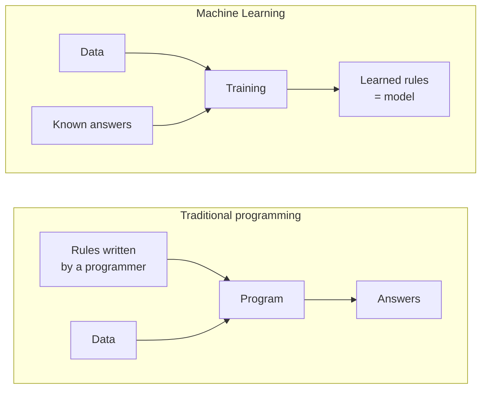
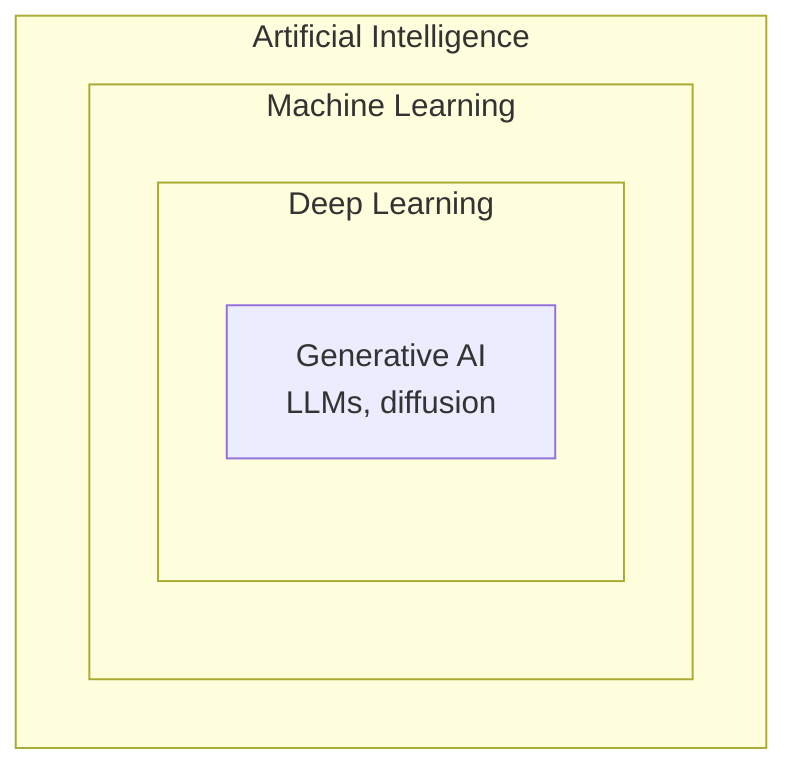
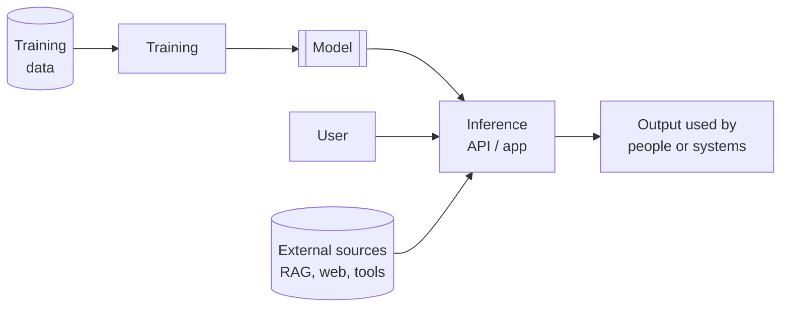

# 01 · What is Artificial Intelligence

> 🇺🇸 English · 🇧🇷 [Português](01-what-is-ai.pt-BR.md)

| | |
|-|-|
| **Track** | [AI Fundamentals](README.md) · Lesson 1 of 13 |
| **Level** | Foundation |
| **Prerequisites** | None: start here |
| **Reading time** | ~15 min |
| **You will learn** | What AI is, how it differs from traditional programming, the AI → ML → DL → generative AI hierarchy, and the parts of an AI system |

## The question that sounds simple

You use AI dozens of times a day: your email spam filter, the next show recommendation, face unlock on your phone, keyboard autocorrect and, of course, the chatbot. What do they all have in common?

A practical definition:

> **Artificial Intelligence** is the field of computing that builds systems able to perform tasks that, if done by a person, we would say require intelligence: recognizing patterns, making decisions, understanding language, planning.

The definition is broad on purpose. "AI" is an **umbrella**, not a single technology. When people talk about AI today, they almost always mean one specific part of it: **Machine Learning**.

## Hand-written rules vs learned rules

The best way to understand modern AI is to compare it with traditional programming.

**Example: a spam filter.**

- **The traditional way**, you write rules: *"if the subject contains 'MAKE MONEY', it is spam"*. The spammer switches to "M4KE M0NEY" and the rule breaks. You write another rule, and they change again. It never ends.
- **With Machine Learning**, you show the algorithm 100,000 emails already labeled "spam" or "not spam". It figures out on its own which combinations of words, senders and formats point to spam, including patterns you would never think of writing.

The result of training is a **model**: a file with millions (sometimes billions) of numbers, the **parameters**, that encode the learned rules. Nobody wrote those rules, and often nobody can read them directly.

> [!IMPORTANT]
> **The core idea**
> In traditional programming, behavior comes from **code**. In Machine Learning, behavior comes from **data**. That changes everything, including security: whoever influences the data influences the behavior.

## The hierarchy: AI, ML, Deep Learning and Generative AI

These terms are often used as synonyms, but they are layers, one inside the other:

| Layer | What it is | Examples |
|-------|------------|----------|
| **Artificial Intelligence** | Any technique that makes a machine act "intelligently", including fixed rules | Expert systems, classic chess engines, pathfinding robots |
| **Machine Learning (ML)** | AI that **learns patterns from data** instead of explicit rules | Spam filters, fraud detection, recommendations |
| **Deep Learning (DL)** | ML with **many-layered neural networks** that learn complex representations by themselves | Face recognition, speech transcription, self-driving cars |
| **Generative AI** | DL that **creates new content** (text, images, audio, code) instead of only classifying | ChatGPT, Claude, Llama, Stable Diffusion |

**LLMs** (*Large Language Models*), like the models behind chatbots, are the best-known case of generative AI. They get their own lesson later.

## "Narrow" and "general" AI

- **Narrow AI (ANI):** excellent at **one** task or family of tasks. Every AI that exists today is here, including the most advanced LLMs, however versatile they seem.
- **General AI (AGI):** would be able to learn and perform any human intellectual task. It is still a research goal and a heavily debated topic, not a product.

## What AI is *not*

For a security professional, this part matters as much as the definition:

- **AI does not "understand" like a human.** A model learns statistical correlations. An LLM predicts which text is most likely to come next. That produces impressive results, but it is not human reasoning.
- **AI is confidently wrong.** A classifier can be 99% sure of a wrong answer, and an LLM can invent a non-existent reference with total conviction (so-called *hallucination*).
- **AI only knows the world through data.** If the data is biased, incomplete or manipulated, so is the model.
- **AI does not separate instructions from data.** For an LLM, everything is text. That is the root of prompt injection.

## The parts of an AI system

An "AI system" in production is much more than the model. Knowing its parts is the first step to mapping the attack surface:

| Part | Role | Example attack | Section |
|------|------|----------------|---------|
| **Training data** | Teaches the behavior | Data poisoning, backdoors | [04](../04-data-attacks/README.md) |
| **Model** | Stores the learned knowledge | Model theft/extraction, malicious model files | [04](../04-data-attacks/README.md), [07](../07-privacy/README.md) |
| **Inference (input)** | Receives the queries | Prompt injection, adversarial examples | [02](../02-prompt-injection/README.md), [06](../06-evasion/README.md) |
| **Output** | Becomes text, actions or HTML | XSS/SQLi via LLM output | [03](../03-output-attacks/README.md) |
| **External sources & tools** | Extend what the model knows and does | Indirect injection, tool abuse | [05](../05-app-and-system/README.md) |

> [!TIP]
> **Red teamer's view**
> Whenever someone says "we have AI in the product", ask: **where does the data come from, where does the model run, what goes into it, where does the output go and what can it access?** Each answer is part of the attack surface. That is exactly what the rest of this repository explores.

## Summary

- AI is an umbrella. What drives modern AI is **Machine Learning**: systems that learn patterns from data.
- AI ⊃ ML ⊃ Deep Learning ⊃ Generative AI.
- A model's behavior comes from **data**, not code, and that opens new attack classes.
- All current AI is "narrow", learns correlations, is confidently wrong and does not separate instructions from data.

## Check your understanding

1. What is the fundamental difference between traditional programming and Machine Learning?

In traditional programming, the programmer writes the rules and the program applies them to data. In ML, the algorithm receives data and the expected answers and **discovers the rules by itself**, producing a model.

2. Is a system that flags malware using a fixed list of known hashes Machine Learning?

No. It is AI in the broad sense (if that), but not ML: the rules (the hash list) were written by hand. It would be ML if the system learned, from examples, which file characteristics indicate malware.

3. Why is "behavior comes from data" a security issue?

Because anyone who can influence the data (training data or the model's context) can influence the behavior without touching a single line of code. That is the basis of data poisoning, backdoors and indirect prompt injection.

---

**Next lesson:** [02 · The history of AI](02-history-of-ai.md) →
