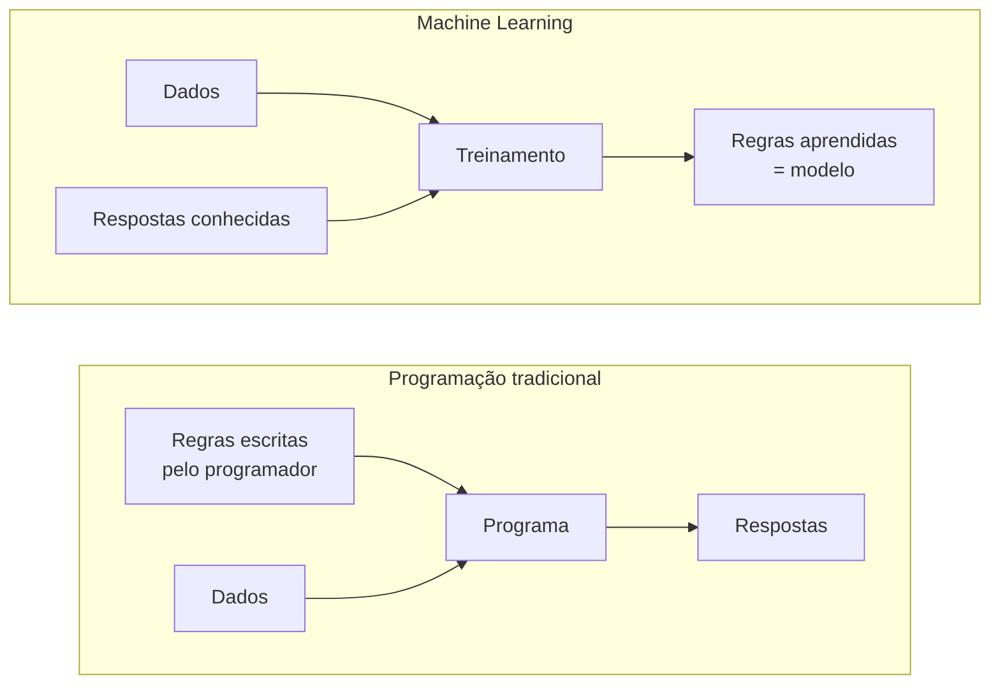
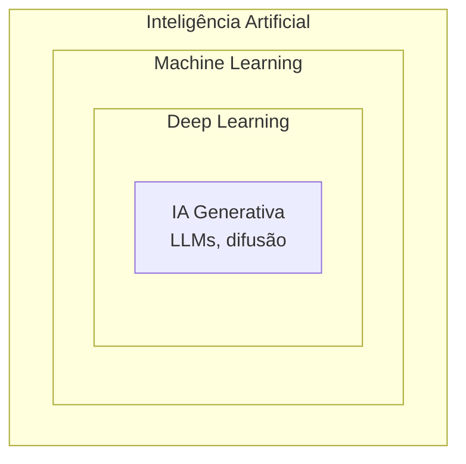
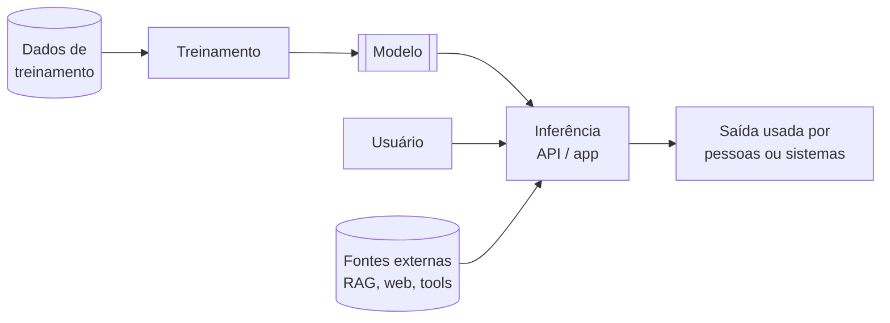

# 01 · O que é Inteligência Artificial

> 🇧🇷 Português · 🇺🇸 [English](01-what-is-ai.md)

| | |
|-|-|
| **Trilha** | [Fundamentos de IA](README.pt-BR.md) · Aula 1 de 13 |
| **Nível** | Base |
| **Pré-requisitos** | Nenhum: comece por aqui |
| **Tempo de leitura** | ~15 min |
| **Você vai aprender** | O que é IA, como ela difere da programação tradicional, a hierarquia IA → ML → DL → IA generativa e quais peças formam um sistema de IA |

## A pergunta que parece simples

Você usa IA dezenas de vezes por dia: o filtro de spam do e-mail, a recomendação da próxima série, o desbloqueio do celular pelo rosto, o corretor do teclado e, claro, o chatbot. Mas o que todos eles têm em comum?

Uma definição prática:

> **Inteligência Artificial** é o campo da computação que cria sistemas capazes de executar tarefas que, se feitas por uma pessoa, diríamos que exigem inteligência: reconhecer padrões, tomar decisões, entender linguagem, planejar.

A definição é ampla de propósito. "IA" é um **guarda-chuva**, não uma tecnologia única. Quando alguém fala de IA hoje, quase sempre está falando de uma parte específica dela: o **Machine Learning**.

## Regras escritas à mão × regras aprendidas

A melhor forma de entender a IA moderna é compará-la com a programação tradicional.

**Exemplo: filtro de spam.**

- **Do jeito tradicional**, você escreve regras: *"se o assunto tem 'GANHE DINHEIRO', é spam"*. O spammer troca para "G4NHE D1NHEIRO" e a regra quebra. Você escreve outra regra, e ele muda de novo. É uma corrida sem fim.
- **Com Machine Learning**, você mostra ao algoritmo 100 mil e-mails já marcados como "spam" ou "não spam". Ele descobre sozinho quais combinações de palavras, remetentes e formatos indicam spam, incluindo padrões que você nunca pensaria em escrever.

O resultado do treinamento é um **modelo**: um arquivo com milhões (às vezes bilhões) de números, os **parâmetros**, que codificam as regras aprendidas. Ninguém escreveu essas regras, e muitas vezes ninguém consegue lê-las diretamente.

> [!IMPORTANT]
> **A ideia central**
> Na programação tradicional, o comportamento vem do **código**. Em Machine Learning, o comportamento vem dos **dados**. Isso muda tudo, inclusive a segurança: quem influencia os dados influencia o comportamento.

## A hierarquia: IA, ML, Deep Learning e IA Generativa

Esses termos são usados como sinônimos, mas são camadas, uma dentro da outra:

| Camada | O que é | Exemplos |
|--------|---------|----------|
| **Inteligência Artificial** | Qualquer técnica que faz a máquina agir de forma "inteligente", inclusive regras fixas | Sistemas especialistas, motores de xadrez clássicos, robôs de busca de caminho |
| **Machine Learning (ML)** | IA que **aprende padrões a partir de dados**, sem regras explícitas | Filtro de spam, detecção de fraude, recomendação |
| **Deep Learning (DL)** | ML com **redes neurais de muitas camadas**, que aprendem representações complexas sozinhas | Reconhecimento facial, transcrição de voz, carros autônomos |
| **IA Generativa** | DL que **cria conteúdo novo** (texto, imagem, áudio, código) em vez de só classificar | ChatGPT, Claude, Llama, Stable Diffusion |

Os **LLMs** (*Large Language Models*), como os modelos por trás dos chatbots, são o caso mais conhecido de IA generativa. Eles têm uma aula própria mais adiante.

## IA "fraca" e IA "forte"

- **IA estreita (ANI):** é excelente em **uma** tarefa ou família de tarefas. Toda IA que existe hoje está aqui, inclusive os LLMs mais avançados, por mais versáteis que pareçam.
- **IA geral (AGI):** seria capaz de aprender e executar qualquer tarefa intelectual humana. Ainda é um objetivo de pesquisa e assunto de muito debate, não um produto.

## O que IA *não* é

Para um profissional de segurança, essa parte é tão importante quanto a definição:

- **IA não "entende" como um humano.** Um modelo aprende correlações estatísticas. Um LLM prevê qual texto é mais provável de vir em seguida. Isso produz resultados impressionantes, mas não é raciocínio humano.
- **IA erra com confiança.** Um classificador pode dar 99% de certeza para uma resposta errada, e um LLM pode inventar uma referência inexistente com toda a convicção (a chamada *alucinação*).
- **IA só conhece o mundo pelos dados.** Se os dados forem enviesados, incompletos ou manipulados, o modelo também será.
- **IA não separa instrução de dado.** Para um LLM, tudo é texto. Essa característica é a raiz da prompt injection.

## As peças de um sistema de IA

Um "sistema de IA" em produção é muito mais que o modelo. Conhecer as peças é o primeiro passo para mapear a superfície de ataque:

| Peça | Função | Exemplo de ataque | Seção |
|------|--------|-------------------|-------|
| **Dados de treinamento** | Ensinam o comportamento | Data poisoning, backdoors | [04](../04-data-attacks/README.md) |
| **Modelo** | Guarda o conhecimento aprendido | Roubo/extração do modelo, arquivos de modelo maliciosos | [04](../04-data-attacks/README.md), [07](../07-privacy/README.md) |
| **Inferência (entrada)** | Recebe as consultas | Prompt injection, adversarial examples | [02](../02-prompt-injection/README.pt-BR.md), [06](../06-evasion/README.md) |
| **Saída** | Vira texto, ação ou HTML | XSS/SQLi via saída do LLM | [03](../03-output-attacks/README.md) |
| **Fontes externas e tools** | Ampliam o que o modelo sabe e faz | Injection indireta, abuso de tools | [05](../05-app-and-system/README.md) |

> [!TIP]
> **Visão do red teamer**
> Toda vez que alguém disser "temos IA no produto", pergunte: **de onde vêm os dados, onde o modelo roda, o que entra nele, para onde vai a saída e o que ele pode acessar?** Cada resposta é uma parte da superfície de ataque. É exatamente isso que o restante deste repositório explora.

## Resumo

- IA é um guarda-chuva. O que move a IA moderna é o **Machine Learning**: sistemas que aprendem padrões a partir de dados.
- IA ⊃ ML ⊃ Deep Learning ⊃ IA Generativa.
- O comportamento de um modelo vem dos **dados**, não do código, e isso abre classes de ataque novas.
- Toda IA atual é "estreita", aprende correlações, erra com confiança e não separa instrução de dado.

## Teste seu entendimento

1. Qual a diferença fundamental entre programação tradicional e Machine Learning?

Na programação tradicional, o programador escreve as regras e o programa as aplica aos dados. Em ML, o algoritmo recebe dados e as respostas esperadas e **descobre as regras sozinho**, gerando um modelo.

2. Um sistema que classifica malware usando uma lista fixa de hashes conhecidos é Machine Learning?

Não. É IA no sentido amplo (ou nem isso), mas não é ML: as regras (a lista de hashes) foram escritas à mão. Seria ML se o sistema aprendesse, a partir de exemplos, quais características de um arquivo indicam malware.

3. Por que "o comportamento vem dos dados" é uma questão de segurança?

Porque quem consegue influenciar os dados (de treinamento ou do contexto do modelo) consegue influenciar o comportamento, sem tocar em uma linha de código. É a base de data poisoning, backdoors e prompt injection indireta.

---

**Próxima aula:** [02 · A história da IA](02-history-of-ai.pt-BR.md) →
