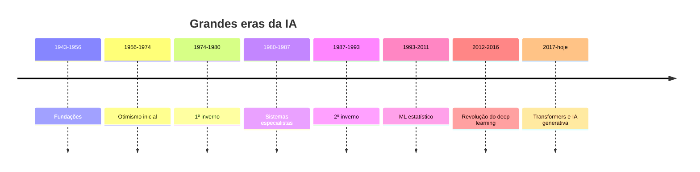

# 02 · A história da IA

> 🇧🇷 Português · 🇺🇸 [English](02-history-of-ai.md)

| | |
|-|-|
| **Trilha** | [Fundamentos de IA](README.pt-BR.md) · Aula 2 de 13 |
| **Tempo de leitura** | ~15 min |
| **Você vai aprender** | Como a IA saiu de uma ideia filosófica até os LLMs, por que ela passou por "invernos" e como a história da **segurança** de IA andou junto |

## Por que estudar a história?

Porque a IA atual é a soma de ideias com décadas de idade que só funcionaram quando três ingredientes se juntaram: **algoritmos**, **dados** e **poder computacional**. Entender essa trajetória ajuda a separar o que é avanço real do que é hype, e mostra que vários "ataques novos" a IA têm raízes antigas.

## 1. Fundações (1943–1956)

- **1943:** Warren McCulloch e Walter Pitts propõem um modelo matemático do **neurônio**: ele recebe sinais, soma e "dispara" se passar de um limite. É o ancestral de todas as redes neurais.
- **1950:** Alan Turing publica *Computing Machinery and Intelligence* e troca a pergunta "máquinas podem pensar?" por um teste prático, o **Jogo da Imitação** (hoje chamado de Teste de Turing): se um avaliador não consegue distinguir a máquina de um humano numa conversa, a máquina "passou".
- **1956:** a conferência de **Dartmouth**, organizada por John McCarthy, Marvin Minsky, Claude Shannon e Nathaniel Rochester, batiza o campo de **"Inteligência Artificial"**. A proposta era otimista: resolver boa parte do problema em um verão.

## 2. Otimismo inicial (1956–1974)

- **1958:** Frank Rosenblatt cria o **Perceptron**, uma máquina que *aprendia* a classificar padrões ajustando seus pesos. A imprensa da época prometeu máquinas que logo andariam, falariam e teriam consciência.
- **1966:** Joseph Weizenbaum cria o **ELIZA**, um chatbot que imitava um terapeuta só com regras de troca de palavras. Muitos usuários criaram vínculo emocional com ele e acreditavam que ele os entendia. É o primeiro registro de humanos **confiando demais** em uma IA conversacional, um problema que continua atual.
- **1969:** Minsky e Papert publicam *Perceptrons* e mostram que um perceptron simples não resolve problemas como o **XOR**. O interesse por redes neurais despenca.

## 3. Os invernos da IA

Um **inverno da IA** é um período em que as promessas não se cumprem, o financiamento seca e o campo perde credibilidade.

| Inverno | Causa principal |
|---------|-----------------|
| **1º (≈1974–1980)** | Promessas exageradas, computadores fracos, críticas como o relatório Lighthill (Reino Unido, 1973) |
| **2º (≈1987–1993)** | Os sistemas especialistas eram caros, frágeis e difíceis de manter, e o mercado de hardware dedicado quebrou |

Entre os dois invernos, nos anos 1980, os **sistemas especialistas** fizeram sucesso: milhares de regras "SE… ENTÃO…" escritas por especialistas humanos (o XCON, por exemplo, configurava computadores da DEC). Funcionavam bem em domínios estreitos, mas não aprendiam e quebravam diante de qualquer situação imprevista.

> [!NOTE]
> **Uma peça escondida no 2º inverno**
> Em 1986, Rumelhart, Hinton e Williams popularizam o **backpropagation**, o algoritmo que permite treinar redes neurais de várias camadas. Ele resolvia o problema do XOR, mas ainda faltavam dados e computação para mostrar todo o seu potencial.

## 4. A virada estatística (1993–2011)

O campo troca as regras escritas à mão pelo **aprendizado a partir de dados**:

- **1997:** o Deep Blue, da IBM, vence o campeão mundial de xadrez Garry Kasparov (ainda com busca e regras, não com aprendizado).
- **1998:** Yann LeCun apresenta a **LeNet-5**, uma rede convolucional que lia dígitos manuscritos em cheques.
- **Anos 2000:** algoritmos como SVM, árvores de decisão e *random forests* dominam a indústria. A internet passa a gerar **dados em escala**.
- **2006:** Geoffrey Hinton e colegas mostram formas de treinar redes profundas, e o termo **deep learning** ganha força.

## 5. A revolução do deep learning (2012–2016)

- **2012:** a rede **AlexNet** vence a competição ImageNet de reconhecimento de imagens com uma margem enorme, treinada em **GPUs**. Esse é considerado o "big bang" do deep learning moderno.
- **2014:** Ian Goodfellow propõe as **GANs**, redes que geram imagens realistas.
- **2016:** o **AlphaGo**, da DeepMind, vence Lee Sedol no Go, um jogo considerado difícil demais para máquinas.

## 6. Transformers e IA generativa (2017–hoje)

- **2017:** o artigo ***Attention Is All You Need*** (Google) apresenta o **Transformer**, a arquitetura por trás de praticamente todos os LLMs atuais.
- **2018–2020:** BERT, GPT-2 e **GPT-3** mostram que modelos maiores, treinados em mais texto, ganham habilidades novas.
- **2020–2022:** **modelos de difusão** revolucionam a geração de imagens (DALL·E 2, Stable Diffusion, Midjourney).
- **Nov/2022:** o **ChatGPT** é lançado e chega a 100 milhões de usuários em cerca de dois meses. A IA generativa vira assunto de todo mundo.
- **2023 em diante:** modelos de pesos abertos (Llama, Mistral, Qwen), modelos multimodais, **agents** que usam ferramentas e protocolos como o **MCP** para conectar LLMs a sistemas externos.

## A história paralela: segurança de IA

Enquanto a IA evoluía, a pesquisa sobre **como atacá-la** evoluía junto. Estes marcos são a base do que você vai praticar neste repositório:

| Ano | Marco | Por que importa |
|-----|-------|-----------------|
| **2004** | *Adversarial Classification* (Dalvi et al.): spammers adaptando mensagens para enganar filtros | Primeiros estudos formais de **evasão** de modelos de ML |
| **2013–14** | Szegedy et al. descobrem os **adversarial examples**: ruídos invisíveis que fazem uma rede errar com alta confiança. Goodfellow cria o FGSM | Nasce o campo de **adversarial ML** moderno |
| **2016** | O chatbot **Tay**, da Microsoft, é manipulado por usuários e passa a publicar conteúdo ofensivo em menos de 24 horas | Caso público de **envenenamento** pelo aprendizado com usuários |
| **2017** | **BadNets** (Gu et al.) mostra backdoors escondidos em redes neurais | Base dos ataques de **backdoor** e supply chain |
| **2022** | O termo **prompt injection** é cunhado pouco antes do lançamento do ChatGPT | A classe de vulnerabilidade nº 1 dos LLMs |
| **2023** | Lançamento do **OWASP Top 10 for LLM Applications**. MITRE ATLAS ganha técnicas de LLM | A indústria passa a tratar segurança de IA como disciplina própria |

> [!TIP]
> **Visão do red teamer**
> Repare no padrão: **cada salto de capacidade trouxe uma nova superfície de ataque.** Classificadores trouxeram a evasão, aprender com usuários trouxe o envenenamento, LLMs trouxeram a prompt injection e agents trouxeram o abuso de tools. Quando surgir a próxima tecnologia, a primeira pergunta é: *o que ela passou a aceitar como entrada e o que passou a poder fazer?*

## Lições da história

1. **Ideias antigas, sucesso recente.** O neurônio artificial é de 1943 e o backpropagation, de 1986. O que mudou foi a escala de **dados** e de **computação** (GPUs).
2. **Hype e inverno andam juntos.** Promessas exageradas já derrubaram o campo duas vezes. Ceticismo saudável faz parte do trabalho.
3. **Confiança excessiva é um risco antigo.** De ELIZA aos LLMs, pessoas tendem a atribuir entendimento e autoridade a máquinas que conversam bem.

## Teste seu entendimento

1. Quais três ingredientes explicam o sucesso recente da IA?

Algoritmos (como backpropagation e Transformers), grandes volumes de dados (internet) e poder computacional (principalmente GPUs).

2. O que foi o caso Tay e que classe de ataque ele ilustra?

Em 2016, a Microsoft lançou o chatbot Tay, que aprendia com as interações. Usuários coordenados o alimentaram com conteúdo ofensivo e em menos de um dia ele passou a reproduzi-lo. É um exemplo de **envenenamento de dados** em um sistema que aprende com entradas não confiáveis.

3. Por que os adversarial examples (2013–14) foram uma descoberta tão importante?

Mostraram que redes neurais com desempenho excelente podem ser enganadas por perturbações mínimas, às vezes invisíveis para humanos. Ou seja, alta acurácia não significa robustez, e isso deu origem ao campo de segurança de ML moderno.

---

← [01 · O que é IA](01-what-is-ai.pt-BR.md) · **Próxima aula:** [03 · Como as máquinas aprendem](03-how-machines-learn.pt-BR.md) →
