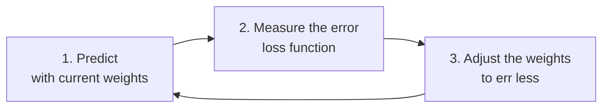
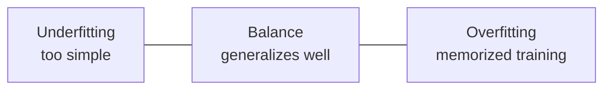
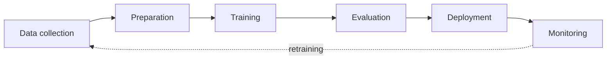

# 03 · How machines learn

> 🇺🇸 English · 🇧🇷 [Português](03-how-machines-learn.pt-BR.md)

| | |
|-|-|
| **Track** | [AI Fundamentals](README.md) · Lesson 3 of 13 |
| **Reading time** | ~20 min |
| **You will learn** | Basic ML vocabulary, the training loop (predict → err → adjust), generalization and overfitting, the three types of learning and the ML pipeline |

## Essential vocabulary

We will use one example from start to finish: **predicting the price of an apartment**.

| Term | Meaning | In the example |
|------|---------|----------------|
| **Dataset** | The data used to learn | A spreadsheet with 10,000 sold apartments |
| **Sample** | One row of the dataset | One apartment |
| **Features** | The input information | Area, neighborhood, number of bedrooms, floor |
| **Label** | The right answer, when known | Sale price |
| **Model** | The function that turns features into a prediction | "price ≈ f(area, neighborhood, …)" |
| **Parameters** (weights) | The model's internal numbers, adjusted during training | How much each m² or each neighborhood weighs on the price |
| **Training** | The process of adjusting the parameters | Reading the 10,000 examples and correcting the weights |
| **Inference** | Using the trained model on new data | Estimating the price of an apartment that was just listed |

## The learning loop

At its core, almost every ML training process follows the same loop:



### An example with numbers

Imagine the simplest possible model:

```text
price = w × area + b
```

`w` (weight) and `b` (bias) are the parameters. At first, they are random:

| Step | w | b | Prediction for 50 m² | Real price | Error |
|------|---|---|----------------------|------------|-------|
| Start | 1,000 | 0 | $50,000 | $400,000 | far too low |
| Adjustment 1 | 5,000 | 10,000 | $260,000 | $400,000 | still low |
| Adjustment 2 | 7,500 | 20,000 | $395,000 | $400,000 | almost there |

At each step, the algorithm looks at the error and moves the weights **in the direction that reduces it**. Repeated thousands of times over thousands of examples, the model converges to weights that work well for most cases.

- The **loss function** is the ruler that measures how wrong the model was. A common example is the mean of the squared errors.
- Training is literally an **optimization problem**: finding the parameters that minimize the loss.

### Gradient descent: walking down a mountain in the fog

The most common method to adjust the weights is **gradient descent**. The classic analogy:

> You are on top of a mountain, in thick fog, and want to reach the valley. You cannot see the path, but you can feel the slope under your feet. So you take a step in the steepest downhill direction. And repeat.

- The **slope** is the *gradient*, computed with derivatives (we will see the intuition in the math lesson).
- The **step size** is the *learning rate*. Too large and you jump over the valley. Too small and it takes forever.

> [!NOTE]
> **Keep this idea in mind**
> Gradients are not only for training. An attacker can use the **same computation in reverse**: instead of changing the weights to *decrease* the error, they change the **input** to *increase* it. That is how adversarial examples are born ([section 06](../06-evasion/README.md)).

## Generalization: learning vs memorizing

The goal is not to get the training data right, but to **get right data the model has never seen**. That is called **generalization**.

To measure it, the dataset is split:

| Set | Use | Typical share |
|-----|-----|---------------|
| **Training** | The model learns from it | ~70% |
| **Validation** | Tune settings and compare versions | ~15% |
| **Test** | Final evaluation, used only once | ~15% |

Two classic problems:

- **Underfitting:** the model is too simple and does not capture the pattern. Like a student who did not study: bad at the exercises and bad at the exam.
- **Overfitting:** the model **memorizes** the training examples, noise included, and fails on new data. Like a student who memorized the answers to the exercise list: perfect score on the list, bad on the exam.



> [!WARNING]
> **Overfitting is also a security risk**
> A model that "memorizes" its training data can **leak** it. *Membership inference* attacks find out whether a specific record was in the training set, and extraction attacks recover pieces of the original data, such as emails and documents memorized by LLMs. See [section 07](../07-privacy/README.md).

## The three types of learning

| Type | How it learns | General examples | Security examples |
|------|---------------|------------------|-------------------|
| **Supervised** | From **labeled** examples (input + right answer) | House prices, medical imaging, spam | Malware classification, phishing detection |
| **Unsupervised** | **Without labels**: finds structure by itself | Customer segmentation, data compression | Log anomaly detection, clustering malware families |
| **Reinforcement** | By **trial and error**, receiving rewards or penalties | Games, robotics, control | Automated pentest agents, adaptive defense |

Each type has its own lesson in this track, with the main algorithms.

> [!NOTE]
> **What about LLMs?**
> LLMs are trained in a **self-supervised** way: the "label" is the next word of the text itself, so nothing needs to be labeled by hand. Then they go through supervised fine-tuning and reinforcement learning from human feedback (RLHF) to follow instructions. This comes up in the LLM lesson.

## The ML pipeline

In practice, a model goes through a full lifecycle, and **every stage is an attack point**:



| Stage | What happens | What can go wrong |
|-------|--------------|-------------------|
| **Collection** | Gather data (web, logs, users, vendors) | Poisoned data, untrusted sources |
| **Preparation** | Clean, label, transform | Manipulated labels (*label flipping*) |
| **Training** | Adjust the parameters | Backdoors, compromised dependencies and base models |
| **Evaluation** | Measure performance | Good metrics hiding a lack of robustness |
| **Deployment** | Serve the model via API or app | Malicious model files, exposed API, model extraction |
| **Monitoring** | Track behavior in production | Undetected drift, unnoticed abuse |

> [!TIP]
> **Red teamer's view**
> Three takeaways from this lesson drive most attacks on ML:
>
> 1. **The model only knows what the data taught it**, so controlling the data means controlling the model (*poisoning*).
> 2. **The model learns decision boundaries**, and inputs placed carefully near those boundaries fool it (*evasion*).
> 3. **The model can memorize its training data**, so well-crafted queries can extract what it saw (*privacy attacks*).

## Summary

- A model is a function with **parameters** fitted from **data**.
- Training repeats the **predict → measure the error → adjust** loop, usually with **gradient descent**.
- The goal is to **generalize**. Overfitting is memorizing, and memorizing can leak data.
- There are three main types of learning: **supervised**, **unsupervised** and **reinforcement**.
- The ML pipeline has several stages, and each one is an attack surface.

## Check your understanding

<details><summary>1. In a phishing detector, what are the features and what is the label?</summary>

Features are the email's input information: sender, link domains, words in the text, attachments and so on. The label is the right answer used in training: "phishing" or "legitimate".
</details>

<details><summary>2. A model scores 99% on training data and 60% on test data. What probably happened?</summary>

**Overfitting**: the model memorized the training data instead of learning general patterns. Besides being a quality problem, it increases the risk of leaking training data.
</details>

<details><summary>3. Which type of learning would you use to detect anomalous behavior in logs, with no prior attack examples?</summary>

**Unsupervised**: the model learns what "normal" looks like without labels and flags what deviates from it.
</details>

<details><summary>4. How does gradient descent relate to adversarial examples?</summary>

In training, the gradient shows how to change the **weights** to decrease the error. In an attack, the gradient shows how to change the **input** to increase the error, producing small perturbations that fool the model.
</details>

---

← [02 · The history of AI](02-history-of-ai.md) · **Next lesson:** 04 · Essential math for AI (coming soon)
