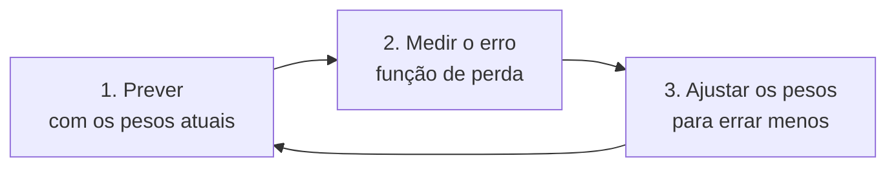
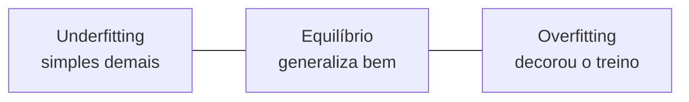
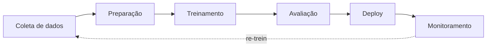

# 03 · Como as máquinas aprendem

> 🇧🇷 Português · 🇺🇸 [English](03-how-machines-learn.md)

| | |
|-|-|
| **Trilha** | [Fundamentos de IA](README.pt-BR.md) · Aula 3 de 13 |
| **Nível** | Base |
| **Pré-requisitos** | [01 · O que é IA](01-what-is-ai.pt-BR.md) |
| **Tempo de leitura** | ~20 min |
| **Você vai aprender** | O vocabulário básico de ML, o ciclo de treinamento (prever → errar → ajustar), generalização e overfitting, os três tipos de aprendizado e o pipeline de ML |

## O vocabulário essencial

Vamos usar um exemplo do começo ao fim: **prever o preço de um apartamento**.

| Termo | Significado | No exemplo |
|-------|-------------|------------|
| **Dataset** | O conjunto de dados usado para aprender | Planilha com 10 mil apartamentos vendidos |
| **Amostra** | Uma linha do dataset | Um apartamento |
| **Features** (atributos) | As informações de entrada | Área, bairro, nº de quartos, andar |
| **Rótulo** (*label*) | A resposta certa, quando conhecida | Preço de venda |
| **Modelo** | A função que transforma features em previsão | "preço ≈ f(área, bairro, …)" |
| **Parâmetros** (pesos) | Os números internos do modelo, ajustados no treino | Quanto cada m² ou cada bairro pesa no preço |
| **Treinamento** | O processo de ajustar os parâmetros | Ler os 10 mil exemplos e corrigir os pesos |
| **Inferência** | Usar o modelo treinado em dados novos | Estimar o preço de um apartamento que acabou de ser anunciado |

## O ciclo de aprendizado

No fundo, quase todo treinamento de ML segue o mesmo ciclo:



### Um exemplo com números

Imagine o modelo mais simples possível:

```text
preço = w × área + b
```

`w` (peso) e `b` (viés) são os parâmetros. No início, eles são aleatórios:

| Passo | w | b | Previsão para 50 m² | Preço real | Erro |
|-------|---|---|---------------------|------------|------|
| Início | 1.000 | 0 | R$ 50.000 | R$ 400.000 | muito baixo |
| Ajuste 1 | 5.000 | 10.000 | R$ 260.000 | R$ 400.000 | ainda baixo |
| Ajuste 2 | 7.500 | 20.000 | R$ 395.000 | R$ 400.000 | quase lá |

Em cada passo, o algoritmo olha o erro e mexe nos pesos **na direção que reduz o erro**. Repetido milhares de vezes, sobre milhares de exemplos, o modelo converge para pesos que funcionam bem para a maioria dos casos.

- A **função de perda** (*loss*) é a régua que mede o quanto o modelo errou. Um exemplo comum é a média dos erros ao quadrado.
- O treinamento é, literalmente, um **problema de otimização**: encontrar os parâmetros que minimizam a perda.

### Gradient descent: descendo a montanha no nevoeiro

O método mais usado para ajustar os pesos é o **gradiente descendente**. A analogia clássica:

> Você está no alto de uma montanha, no meio de um nevoeiro, e quer chegar ao vale. Você não enxerga o caminho, mas sente a inclinação do chão sob os pés. Então dá um passo na direção que mais desce. E repete.

- A **inclinação** é o *gradiente*, calculado com derivadas (veremos a intuição na aula de matemática).
- O **tamanho do passo** é a *learning rate* (taxa de aprendizado). Se for grande demais, você pula o vale. Se for pequena demais, demora uma eternidade.

> [!NOTE]
> **Guarde essa ideia**
> Os gradientes não servem só para treinar. Um atacante pode usar o **mesmo cálculo ao contrário**: em vez de mudar os pesos para *diminuir* o erro, muda a **entrada** para *aumentar* o erro. É assim que nascem os adversarial examples ([seção 06](../06-evasion/README.md)).

## Generalização: aprender × decorar

O objetivo não é acertar os dados de treino, mas **acertar dados que o modelo nunca viu**. Isso se chama **generalização**.

Para medir isso, o dataset é dividido:

| Conjunto | Uso | Proporção típica |
|----------|-----|------------------|
| **Treino** | O modelo aprende com ele | ~70% |
| **Validação** | Ajustar configurações e comparar versões | ~15% |
| **Teste** | Avaliação final, usado uma única vez | ~15% |

Dois problemas clássicos:

- **Underfitting** (subajuste): o modelo é simples demais e não captura o padrão. É como o aluno que não estudou: vai mal no exercício e na prova.
- **Overfitting** (sobreajuste): o modelo **decora** os exemplos de treino, inclusive o ruído, e falha em dados novos. É como o aluno que decorou as respostas da lista de exercícios: tira 10 na lista e vai mal na prova.



> [!WARNING]
> **Overfitting também é um risco de segurança**
> Um modelo que "decora" seus dados de treino pode **vazá-los**. Ataques de *membership inference* descobrem se um registro específico estava no treino, e ataques de extração recuperam trechos dos dados originais, como e-mails e documentos memorizados por LLMs. Veja a [seção 07](../07-privacy/README.md).

## Os três tipos de aprendizado

| Tipo | Como aprende | Exemplos gerais | Exemplos em segurança |
|------|--------------|-----------------|-----------------------|
| **Supervisionado** | Com exemplos **rotulados** (entrada + resposta certa) | Preço de imóvel, diagnóstico por imagem, spam | Classificar malware, detectar phishing |
| **Não supervisionado** | **Sem rótulos**: encontra estrutura sozinho | Segmentar clientes, comprimir dados | Detectar anomalias em logs, agrupar famílias de malware |
| **Por reforço** | Por **tentativa e erro**, recebendo recompensas ou punições | Jogos, robótica, controle | Agentes de pentest automatizado, defesa adaptativa |

Cada tipo tem uma aula própria nesta trilha, com os algoritmos principais.

> [!NOTE]
> **E os LLMs?**
> LLMs são treinados de forma **autossupervisionada**: o "rótulo" é a própria próxima palavra do texto, então não é preciso rotular nada à mão. Depois, passam por ajustes supervisionados e por reforço com feedback humano (RLHF) para seguir instruções. Isso aparece na aula de LLMs.

## O pipeline de ML

Na prática, um modelo passa por um ciclo de vida completo, e **cada etapa é um ponto de ataque**:



| Etapa | O que acontece | O que pode dar errado |
|-------|----------------|-----------------------|
| **Coleta** | Juntar dados (web, logs, usuários, fornecedores) | Dados envenenados, fontes não confiáveis |
| **Preparação** | Limpar, rotular, transformar | Rótulos manipulados (*label flipping*) |
| **Treinamento** | Ajustar os parâmetros | Backdoors, dependências e modelos-base comprometidos |
| **Avaliação** | Medir desempenho | Métricas boas que escondem falta de robustez |
| **Deploy** | Servir o modelo via API ou app | Arquivos de modelo maliciosos, API exposta, extração do modelo |
| **Monitoramento** | Acompanhar o comportamento em produção | Drift não detectado, abuso não percebido |

> [!TIP]
> **Visão do red teamer**
> Três conclusões desta aula guiam boa parte dos ataques a ML:
>
> 1. **O modelo só sabe o que os dados ensinaram**, então controlar os dados é controlar o modelo (*poisoning*).
> 2. **O modelo aprende fronteiras de decisão**, e entradas cuidadosamente posicionadas perto dessas fronteiras o enganam (*evasion*).
> 3. **O modelo pode memorizar o treino**, então perguntas bem feitas podem extrair o que ele viu (*privacy attacks*).

## Resumo

- Um modelo é uma função com **parâmetros** ajustados a partir de **dados**.
- O treinamento repete o ciclo **prever → medir o erro → ajustar**, normalmente com **gradiente descendente**.
- O objetivo é **generalizar**. Overfitting é decorar, e decorar pode vazar dados.
- Existem três tipos principais de aprendizado: **supervisionado**, **não supervisionado** e **por reforço**.
- O pipeline de ML tem várias etapas, e cada uma é uma superfície de ataque.

## Teste seu entendimento

<details><summary>1. Num detector de phishing, o que são as features e o que é o rótulo?</summary>

Features são as informações de entrada do e-mail: remetente, domínio dos links, palavras do texto, anexos etc. O rótulo é a resposta certa usada no treino: "phishing" ou "legítimo".
</details>

<details><summary>2. Um modelo tem 99% de acerto no treino e 60% no teste. O que provavelmente aconteceu?</summary>

**Overfitting**: o modelo decorou os dados de treino em vez de aprender padrões gerais. Além de ser um problema de qualidade, aumenta o risco de vazamento dos dados de treino.
</details>

<details><summary>3. Qual tipo de aprendizado você usaria para detectar comportamento anômalo em logs, sem exemplos prévios de ataque?</summary>

**Não supervisionado**: o modelo aprende o que é "normal" sem precisar de rótulos e sinaliza o que foge do padrão.
</details>

<details><summary>4. Como o gradiente descendente se relaciona com adversarial examples?</summary>

No treino, o gradiente indica como mudar os **pesos** para diminuir o erro. Num ataque, o gradiente indica como mudar a **entrada** para aumentar o erro, gerando pequenas perturbações que enganam o modelo.
</details>

## Aprofunde e pratique

Técnicas do IA-Lab que se apoiam nesta aula:

- **Na prática:** [Data poisoning](../04-data-attacks/data-poisoning.pt-BR.md)

---

← [02 · A história da IA](02-history-of-ai.pt-BR.md) · **Próxima aula:** [04 · Matemática essencial para IA](04-essential-math.pt-BR.md) →
