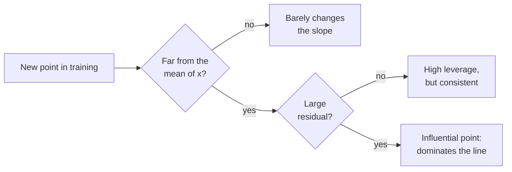

# 05.1 · Least squares and regression assumptions

> 🇺🇸 English · 🇧🇷 [Português](05-1-least-squares.pt-BR.md)

| | |
|-|-|
| **Track** | [AI Fundamentals](README.md) · Deep dive into lesson [05 · Linear and logistic regression](05-linear-logistic-regression.md) |
| **Level** | Deep dive |
| **Prerequisites** | [05 · Linear and logistic regression](05-linear-logistic-regression.md), [04.2 · Linear algebra for ML](04-2-linear-algebra.md) |
| **Reading time** | ~25 min |
| **You will learn** | Where the least squares formula comes from, what residuals and R² are, which assumptions linear regression makes and what breaks when they fail, what leverage is, and why where an attacker places a poisoned point matters as much as its value |

## Where we left off

In [lesson 05](05-linear-logistic-regression.md), the best line for the four apartments was `4.2 × area + 46`, with an MSE of 80, and a single poisoned point flipped the slope. In [04.2](04-2-linear-algebra.md), the normal equation `w = (XᵀX)⁻¹Xᵀy` reproduced that line. Now we will see **why** the computation gives that result, how to measure the quality of the fit, when to trust it and why some points have much more power over the line than others.

## The formula, step by step

**Ordinary least squares** (*OLS*) picks the `w` and `b` that minimize the sum of squared errors. At the minimum, the derivative with respect to each parameter is zero ([lesson 04](04-essential-math.md)). Solving the two equations, with a single feature, gives:

```text
w = Σ (x − x̄)(y − ȳ) / Σ (x − x̄)²        b = ȳ − w × x̄
```

In words: the slope is how much x and y **vary together**, divided by how much x varies on its own. And the line always goes through the mean point (x̄, ȳ).

With the apartments from lesson 05:

| Area x | Price y | x − x̄ | y − ȳ | (x − x̄)(y − ȳ) | (x − x̄)² |
|--------|---------|-------|-------|-----------------|----------|
| 40 | 210 | −30 | −130 | 3900 | 900 |
| 60 | 310 | −10 | −30 | 300 | 100 |
| 80 | 370 | 10 | 30 | 300 | 100 |
| 100 | 470 | 30 | 130 | 3900 | 900 |
| **mean 70** | **mean 340** | | | **sum 8400** | **sum 2000** |

```text
w = 8400 / 2000 = 4.2          b = 340 − 4.2 × 70 = 46
```

The same line as lesson 05 and the 04.2 normal equation: three paths to the same result.

## Residuals and R²

Each point's **residual** is the error that is left: `actual − predicted`.

| Area | Actual | Predicted | Residual |
|------|--------|-----------|----------|
| 40 | 210 | 214 | −4 |
| 60 | 310 | 298 | +12 |
| 80 | 370 | 382 | −12 |
| 100 | 470 | 466 | +4 |

With an intercept, OLS residuals **always add up to zero**: the line sits "in the middle" of the points.

**R²** (coefficient of determination) tells what fraction of y's variation the model explains:

```text
R² = 1 − (sum of residuals²) / (sum of (y − ȳ)²) = 1 − 320 / 35600 = 0.991
```

The line explains 99.1% of the price variation. An R² close to 1 means a good fit **on the training data**, and nothing more: it does not guarantee the model generalizes ([03.1](03-1-evaluation-regularization.md)) or that the assumptions hold.

## The assumptions

Linear regression works well when a few conditions are reasonably true. When they are not, the weights can still be computed, but predictions, confidence intervals and interpretation become misleading.

| Assumption | What it says | What breaks if it fails | How to check |
|------------|--------------|-------------------------|--------------|
| **Linearity** | The relationship between x and y is roughly a straight line | Systematic errors: the model always misses on the same side in certain ranges | Residuals vs x plot: there must be no curve |
| **Independent errors** | One example's error does not depend on another's | Overconfident results; common in time series, such as logs | Residuals over time: there must be no pattern |
| **Constant variance** (homoscedasticity) | The typical error size is the same across the range of x | The model becomes imprecise exactly for large values | Residuals "fanning out" signal a problem |
| **Normal residuals** | Errors follow a normal distribution | Affects confidence intervals and statistical tests, not the prediction itself | Histogram of residuals |
| **No multicollinearity** | Features are not combinations of each other | Unstable weights, huge and of opposite signs ([04.2](04-2-linear-algebra.md)) | Correlation between features |
| **No overly influential points** | No single example dominates the fit | The whole line starts obeying one point | Leverage and large residuals, below |

Common fixes: transform variables (the logarithm from [04.1](04-1-logs-and-entropy.md) linearizes exponential relationships and stabilizes variance), remove redundant features, use regularization, or switch to a more flexible model.

### Extrapolation: outside the range, no guarantees

The model was fitted with areas between 40 and 100 m². For 300 m², it predicts `4.2 × 300 + 46 = 1306`, but there is no data supporting that the relationship stays straight that far out. **Outside the range of the training data, a prediction is a guess.**

## Leverage: not every point weighs the same

In lesson 05, a fake point (50 m², 900 thousand) flipped the slope. But the effect depends a lot on **where** the point is. Look at the same fake price, 900 thousand, placed at different areas:

| Area of the fake point | Slope w | Intercept b | R² |
|------------------------|---------|-------------|-----|
| (no poisoning) | 4.20 | 46 | 0.991 |
| 40 m² | −1.85 | 571 | 0.03 |
| 50 m² | −0.24 | 468 | 0.00 |
| 70 m² (the mean) | **4.20** | 158 | 0.12 |
| 100 m² | 8.03 | −158 | 0.61 |
| 130 m² | 7.23 | −141 | **0.89** |

Three lessons:

- **At the mean of x, the point does not move the slope**, it only lifts the whole line. The farther from the mean, the more power the point has over the slope. That power is called **leverage**: the point at 130 m² has a leverage of 0.67, versus 0.20 for the point at the mean.
- **Stealthy poisoning exists.** At 130 m², the fake point almost doubles the slope, and R² stays at 0.89, a value that looks healthy. A crude attack crashes R²; a well-placed one does not.
- **Influential point = high leverage + large residual.** That combination is what measures such as *Cook's distance* look for.



### Robust regression

Since MSE squares the errors, a few extreme points dominate OLS. More resistant alternatives:

| Method | Idea |
|--------|------|
| **Huber loss** | Quadratic for small errors, linear for large ones: the outlier weighs less |
| **RANSAC** | Fits several lines on random subsets and keeps the one most points agree with |
| **Theil-Sen** | Uses the median of the slopes between pairs of points, which ignores extremes |

> [!TIP]
> **Red teamer's view**
> 1. **Poison where the leverage is.** An attacker who wants to change the slope places fake points at the **extremes** of the x range, with values consistent enough not to crash R². Points at the mean only change the level.
> 2. **Operate outside the training range.** Risk or fraud scoring models fitted on typical values extrapolate unpredictably for extreme values. Testing inputs outside the range seen in training is a path to odd behavior.
> 3. **Fit metrics do not catch clever poisoning.** A high R² after retraining does not prove the data is clean. Compare coefficients with previous versions and monitor high-leverage points.
> 4. **On the defense side,** large residuals, high leverage and Cook's distance are cheap signals to review examples before training, and robust regression limits the damage of a few points ([data poisoning](../04-data-attacks/data-poisoning.md)).

## Hands-on with Python

```python
import numpy as np

def ols(x, y):
    x, y = np.asarray(x, float), np.asarray(y, float)
    w = ((x - x.mean()) * (y - y.mean())).sum() / ((x - x.mean()) ** 2).sum()
    b = y.mean() - w * x.mean()
    residuals = y - (w * x + b)
    r2 = 1 - (residuals ** 2).sum() / ((y - y.mean()) ** 2).sum()
    return round(w, 2), round(b, 2), round(r2, 3), residuals

area, price = [40, 60, 80, 100], [210, 310, 370, 470]
w, b, r2, res = ols(area, price)
print(w, b, r2, res)          # 4.2 46.0 0.991 [ -4.  12. -12.   4.]

# The same fake price (900) at different areas
for x_fake in (40, 70, 100, 130):
    w, b, r2, _ = ols(area + [x_fake], price + [900])
    print(x_fake, w, b, r2)
# 40 -1.85 570.59 0.033
# 70 4.2 158.0 0.123
# 100 8.03 -158.24 0.612
# 130 7.23 -140.82 0.89

# Leverage of a new point: 1/n + (x - mean)² / Σ(x - mean)²
def leverage(xs, i):
    xs = np.asarray(xs, float)
    return round(1 / len(xs) + (xs[i] - xs.mean()) ** 2 / ((xs - xs.mean()) ** 2).sum(), 3)

print(leverage(area + [70], 4), leverage(area + [130], 4))   # 0.2 0.672
```

In real life, `sklearn.linear_model` has `LinearRegression`, `HuberRegressor`, `RANSACRegressor` and `TheilSenRegressor`, and `statsmodels` shows residuals, leverage and Cook's distance.

## Summary

- **OLS** picks the line that minimizes the sum of squared errors: `w = Σ(x−x̄)(y−ȳ) / Σ(x−x̄)²` and `b = ȳ − w·x̄`; the line goes through the mean point.
- **Residuals** add up to zero; **R²** measures how much of the variation the model explains on training, and nothing more.
- The assumptions (linearity, independence, constant variance, normal residuals, no multicollinearity, no dominant points) define when to trust the model; **extrapolating** outside the range is a guess.
- **Leverage**: points far from the mean of x control the slope; points at the mean only change the level.
- For the red teamer: efficient poisoning uses high leverage and keeps R² high; extrapolation is an attack surface; robust regression and influence diagnostics are defenses.

## Check your understanding

<details><summary>1. With the four apartments, why does the line go exactly through the point (70, 340)?</summary>

Because `b = ȳ − w × x̄`, that is, `ȳ = w × x̄ + b`: the mean point always satisfies the equation of the least squares line with an intercept.
</details>

<details><summary>2. A model has R² = 0.95 on training. Does that guarantee it works well in production?</summary>

No. R² measures the fit on training data. The model may be overfitting, have violated assumptions, have been trained on stealthily poisoned data or be used outside the range of its training data.
</details>

<details><summary>3. Why does a fake point placed exactly at the mean of x not change the slope?</summary>

Because the slope depends on `(x − x̄)`. For a point at x = x̄ that term is zero, so it contributes to neither the numerator nor the denominator of w's formula. It only shifts ȳ, and with it the intercept.
</details>

<details><summary>4. A model's residuals grow as the predicted value grows, forming a funnel. Which assumption is violated and what would you try?</summary>

Constant variance (homoscedasticity). A logarithmic transform of the target variable usually stabilizes the variance; weighted regression is another option.
</details>

<details><summary>5. You want to poison a regression model retrained on customer data, without being noticed. Where would you place the points and why?</summary>

At the extremes of the x range, where leverage is high, with y values that pull the slope in the desired direction but are consistent enough to keep R² high. That way the coefficient changes a lot and the overall metrics still look healthy.
</details>

---

← [05 · Linear and logistic regression](05-linear-logistic-regression.md) · **Next lesson in the track:** [06 · Trees, Naive Bayes and SVM](06-trees-naive-bayes-svm.md) →
