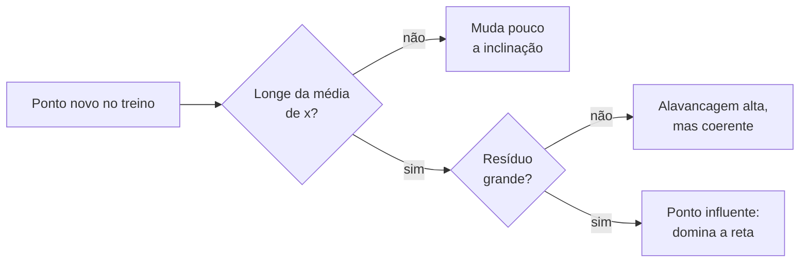

# 05.1 · Mínimos quadrados e pressupostos da regressão

> 🇧🇷 Português · 🇺🇸 [English](05-1-least-squares.md)

| | |
|-|-|
| **Trilha** | [Fundamentos de IA](README.pt-BR.md) · Aprofundamento da aula [05 · Regressão linear e logística](05-linear-logistic-regression.pt-BR.md) |
| **Nível** | Aprofundamento |
| **Pré-requisitos** | [05 · Regressão linear e logística](05-linear-logistic-regression.pt-BR.md), [04.2 · Álgebra linear para ML](04-2-linear-algebra.pt-BR.md) |
| **Tempo de leitura** | ~25 min |
| **Você vai aprender** | De onde vem a fórmula dos mínimos quadrados, o que são resíduos e R², quais pressupostos a regressão linear faz e o que quebra quando eles falham, o que é alavancagem, e por que o lugar onde o atacante coloca um ponto envenenado importa tanto quanto o valor dele |

## Onde paramos

Na [aula 05](05-linear-logistic-regression.pt-BR.md), a melhor reta para os quatro apartamentos foi `4,2 × área + 46`, com MSE 80, e um único ponto envenenado inverteu a inclinação. No [04.2](04-2-linear-algebra.pt-BR.md), a equação normal `w = (XᵀX)⁻¹Xᵀy` reproduziu essa reta. Agora vamos ver **por que** a conta dá esse resultado, como medir a qualidade do ajuste, quando confiar nele e por que alguns pontos têm muito mais poder sobre a reta do que outros.

## A fórmula, passo a passo

Os **mínimos quadrados ordinários** (*OLS*) escolhem `w` e `b` que minimizam a soma dos erros ao quadrado. No ponto mínimo, a derivada em relação a cada parâmetro é zero ([aula 04](04-essential-math.pt-BR.md)). Resolvendo as duas equações, com uma única feature, chega-se a:

```text
w = Σ (x − x̄)(y − ȳ) / Σ (x − x̄)²        b = ȳ − w × x̄
```

Em palavras: a inclinação é o quanto x e y **variam juntos**, dividido pelo quanto x varia sozinho. E a reta sempre passa pelo ponto médio (x̄, ȳ).

Com os apartamentos da aula 05:

| Área x | Preço y | x − x̄ | y − ȳ | (x − x̄)(y − ȳ) | (x − x̄)² |
|--------|---------|-------|-------|-----------------|----------|
| 40 | 210 | −30 | −130 | 3900 | 900 |
| 60 | 310 | −10 | −30 | 300 | 100 |
| 80 | 370 | 10 | 30 | 300 | 100 |
| 100 | 470 | 30 | 130 | 3900 | 900 |
| **média 70** | **média 340** | | | **soma 8400** | **soma 2000** |

```text
w = 8400 / 2000 = 4,2          b = 340 − 4,2 × 70 = 46
```

A mesma reta da aula 05 e da equação normal do 04.2: são três caminhos para o mesmo resultado.

## Resíduos e R²

O **resíduo** de cada ponto é o erro que sobrou: `real − previsto`.

| Área | Real | Previsto | Resíduo |
|------|------|----------|---------|
| 40 | 210 | 214 | −4 |
| 60 | 310 | 298 | +12 |
| 80 | 370 | 382 | −12 |
| 100 | 470 | 466 | +4 |

Com intercepto, os resíduos do OLS **sempre somam zero**: a reta fica "no meio" dos pontos.

O **R²** (coeficiente de determinação) diz que fração da variação de y o modelo explica:

```text
R² = 1 − (soma dos resíduos²) / (soma de (y − ȳ)²) = 1 − 320 / 35600 = 0,991
```

A reta explica 99,1% da variação dos preços. R² perto de 1 significa ajuste bom **nos dados de treino**, e só isso: não garante que o modelo generalize ([03.1](03-1-evaluation-regularization.pt-BR.md)) nem que os pressupostos valham.

## Os pressupostos

A regressão linear funciona bem quando algumas condições são razoavelmente verdadeiras. Quando não são, os pesos podem até ser calculados, mas as previsões, os intervalos de confiança e a interpretação ficam enganosos.

| Pressuposto | O que diz | O que quebra se falhar | Como verificar |
|-------------|-----------|------------------------|----------------|
| **Linearidade** | A relação entre x e y é aproximadamente uma reta | Erros sistemáticos: o modelo erra sempre para o mesmo lado em certas faixas | Gráfico de resíduos contra x: não pode ter curva |
| **Independência dos erros** | O erro de um exemplo não depende do erro de outro | Confiança exagerada nos resultados; comum em séries temporais, como logs | Resíduos ao longo do tempo: não podem ter padrão |
| **Variância constante** (homocedasticidade) | O tamanho típico do erro é o mesmo em toda a faixa de x | O modelo fica impreciso justamente nos valores grandes | Resíduos "abrindo em funil" indicam problema |
| **Normalidade dos resíduos** | Os erros seguem uma distribuição normal | Afeta intervalos de confiança e testes estatísticos, não a previsão em si | Histograma dos resíduos |
| **Sem multicolinearidade** | As features não são combinações umas das outras | Pesos instáveis, enormes e de sinais opostos ([04.2](04-2-linear-algebra.pt-BR.md)) | Correlação entre features |
| **Sem pontos influentes demais** | Nenhum exemplo isolado domina o ajuste | A reta inteira passa a obedecer a um ponto | Alavancagem e resíduos grandes, logo abaixo |

Correções comuns: transformar variáveis (o logaritmo do [04.1](04-1-logs-and-entropy.pt-BR.md) lineariza relações exponenciais e estabiliza a variância), remover features redundantes, usar regularização, ou trocar para um modelo mais flexível.

### Extrapolação: fora da faixa, nenhuma garantia

O modelo foi ajustado com áreas entre 40 e 100 m². Para 300 m², ele prevê `4,2 × 300 + 46 = 1306`, mas não há nenhum dado que sustente que a relação continua reta tão longe. **Fora da faixa dos dados de treino, a previsão é um palpite.**

## Alavancagem: nem todo ponto pesa igual

Na aula 05, um ponto falso (50 m², 900 mil) inverteu a inclinação. Mas o efeito depende muito de **onde** o ponto está. Veja o mesmo preço falso, 900 mil, colocado em áreas diferentes:

| Área do ponto falso | Inclinação w | Intercepto b | R² |
|---------------------|--------------|--------------|-----|
| (sem envenenamento) | 4,20 | 46 | 0,991 |
| 40 m² | −1,85 | 571 | 0,03 |
| 50 m² | −0,24 | 468 | 0,00 |
| 70 m² (a média) | **4,20** | 158 | 0,12 |
| 100 m² | 8,03 | −158 | 0,61 |
| 130 m² | 7,23 | −141 | **0,89** |

Três lições:

- **Na média de x, o ponto não mexe na inclinação**, só sobe a reta inteira. Quanto mais longe da média, mais poder o ponto tem sobre a inclinação. Esse poder se chama **alavancagem**: o ponto em 130 m² tem alavancagem de 0,67, contra 0,20 do ponto na média.
- **Envenenamento discreto existe.** Em 130 m², o ponto falso quase dobra a inclinação, e o R² continua 0,89, um valor que parece saudável. Um ataque grosseiro derruba o R²; um ataque bem posicionado não.
- **Ponto influente = alavancagem alta + resíduo grande.** É essa combinação que medidas como a *distância de Cook* procuram.



### Regressão robusta

Como o MSE eleva os erros ao quadrado, poucos pontos extremos dominam o OLS. Alternativas mais resistentes:

| Método | Ideia |
|--------|-------|
| **Perda de Huber** | Quadrática para erros pequenos, linear para erros grandes: o outlier pesa menos |
| **RANSAC** | Ajusta várias retas com subconjuntos aleatórios e fica com a que concorda com a maioria dos pontos |
| **Theil-Sen** | Usa a mediana das inclinações entre pares de pontos, que ignora extremos |

> [!TIP]
> **Visão do red teamer**
> 1. **Envenene onde há alavancagem.** Um atacante que quer mudar a inclinação coloca os pontos falsos nos **extremos** da faixa de x, com valores coerentes o bastante para não derrubar o R². Pontos na média só mudam o nível.
> 2. **Opere fora da faixa de treino.** Modelos de pontuação de risco ou de fraude ajustados com valores típicos extrapolam de forma imprevisível para valores extremos. Testar entradas fora da faixa vista no treino é um caminho para comportamentos estranhos.
> 3. **Métricas de ajuste não detectam envenenamento esperto.** R² alto depois de um re-treino não prova que os dados estão limpos. Compare os coeficientes com os de versões anteriores e monitore pontos com alavancagem alta.
> 4. **Do lado da defesa,** resíduos grandes, alavancagem alta e distância de Cook são sinais baratos para revisar exemplos antes do treino, e a regressão robusta reduz o estrago de poucos pontos ([data poisoning](../04-data-attacks/data-poisoning.pt-BR.md)).

## Na prática com Python

```python
import numpy as np

def ols(x, y):
    x, y = np.asarray(x, float), np.asarray(y, float)
    w = ((x - x.mean()) * (y - y.mean())).sum() / ((x - x.mean()) ** 2).sum()
    b = y.mean() - w * x.mean()
    residuos = y - (w * x + b)
    r2 = 1 - (residuos ** 2).sum() / ((y - y.mean()) ** 2).sum()
    return round(w, 2), round(b, 2), round(r2, 3), residuos

area, preco = [40, 60, 80, 100], [210, 310, 370, 470]
w, b, r2, res = ols(area, preco)
print(w, b, r2, res)          # 4.2 46.0 0.991 [ -4.  12. -12.   4.]

# O mesmo preço falso (900) em áreas diferentes
for x_falso in (40, 70, 100, 130):
    w, b, r2, _ = ols(area + [x_falso], preco + [900])
    print(x_falso, w, b, r2)
# 40 -1.85 570.59 0.033
# 70 4.2 158.0 0.123
# 100 8.03 -158.24 0.612
# 130 7.23 -140.82 0.89

# Alavancagem de um novo ponto: 1/n + (x - média)² / Σ(x - média)²
def alavancagem(xs, i):
    xs = np.asarray(xs, float)
    return round(1 / len(xs) + (xs[i] - xs.mean()) ** 2 / ((xs - xs.mean()) ** 2).sum(), 3)

print(alavancagem(area + [70], 4), alavancagem(area + [130], 4))   # 0.2 0.672
```

Na vida real, `sklearn.linear_model` tem `LinearRegression`, `HuberRegressor`, `RANSACRegressor` e `TheilSenRegressor`, e o `statsmodels` mostra resíduos, alavancagem e distância de Cook.

## Resumo

- O **OLS** escolhe a reta que minimiza a soma dos erros ao quadrado: `w = Σ(x−x̄)(y−ȳ) / Σ(x−x̄)²` e `b = ȳ − w·x̄`; a reta passa pelo ponto médio.
- **Resíduos** somam zero; o **R²** mede quanto da variação o modelo explica no treino, e só isso.
- Os pressupostos (linearidade, independência, variância constante, normalidade dos resíduos, sem multicolinearidade, sem pontos dominantes) definem quando confiar no modelo; **extrapolar** fora da faixa é palpite.
- **Alavancagem**: pontos longe da média de x mandam na inclinação; pontos na média só mudam o nível.
- Para o red teamer: envenenamento eficiente usa alta alavancagem e mantém o R² alto; extrapolação é superfície de ataque; regressão robusta e diagnóstico de influência são defesas.

## Teste seu entendimento

<details><summary>1. Com os quatro apartamentos, por que a reta passa exatamente pelo ponto (70, 340)?</summary>

Porque `b = ȳ − w × x̄`, ou seja, `ȳ = w × x̄ + b`: o ponto médio sempre satisfaz a equação da reta de mínimos quadrados com intercepto.
</details>

<details><summary>2. Um modelo tem R² = 0,95 no treino. Isso garante que ele funciona bem em produção?</summary>

Não. O R² mede o ajuste nos dados de treino. O modelo pode estar com overfitting, ter pressupostos violados, ter sido treinado com dados envenenados de forma discreta ou ser usado fora da faixa dos dados de treino.
</details>

<details><summary>3. Por que um ponto falso colocado exatamente na média de x não muda a inclinação?</summary>

Porque a inclinação depende de `(x − x̄)`. Para um ponto em x = x̄ esse termo é zero, então ele não contribui para o numerador nem para o denominador da fórmula de w. Ele só desloca ȳ, e com isso o intercepto.
</details>

<details><summary>4. Os resíduos de um modelo aumentam conforme o valor previsto cresce, formando um funil. Que pressuposto foi violado e o que você tentaria?</summary>

A variância constante (homocedasticidade). Uma transformação logarítmica da variável alvo costuma estabilizar a variância; regressão ponderada é outra opção.
</details>

<details><summary>5. Você quer envenenar um modelo de regressão re-treinado com dados de clientes, sem ser notado. Onde colocaria os pontos e por quê?</summary>

Nos extremos da faixa de x, onde a alavancagem é alta, com valores de y que puxem a inclinação na direção desejada, mas coerentes o suficiente para manter o R² alto. Assim, o coeficiente muda bastante e as métricas gerais continuam parecendo saudáveis.
</details>

---

← [05 · Regressão linear e logística](05-linear-logistic-regression.pt-BR.md) · **Próxima aula da trilha:** [06 · Árvores, Naive Bayes e SVM](06-trees-naive-bayes-svm.pt-BR.md) →
