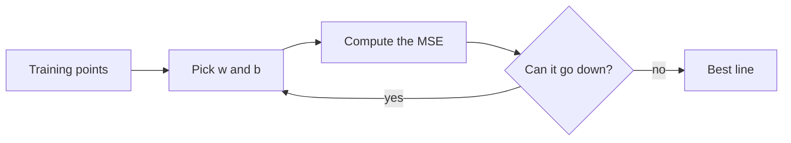
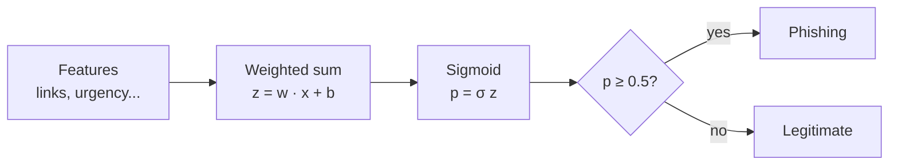

# 05 · Supervised learning I: linear and logistic regression

> 🇺🇸 English · 🇧🇷 [Português](05-linear-logistic-regression.pt-BR.md)

| | |
|-|-|
| **Track** | [AI Fundamentals](README.md) · Lesson 5 of 13 |
| **Reading time** | ~25 min |
| **You will learn** | Regression vs classification, how linear regression finds "the best line", how logistic regression becomes a classifier, how to evaluate a classifier and why linear models are so easy to attack |

## Regression or classification?

Supervised learning ([lesson 03](03-how-machines-learn.md)) learns from labeled examples. It answers two kinds of question:

| Type | The answer is… | Examples |
|------|----------------|----------|
| **Regression** | A continuous **number** | Price of a property, time until a failure, tomorrow's traffic volume |
| **Classification** | A **category** | Phishing or legitimate, malware or benign, which malware family |

This lesson covers the simplest model of each type. They are simple, but they are not toys: they still run in production, they are the baseline for bigger models and, as you will see, the last layer of many neural networks is exactly a logistic regression.

## Linear regression: the best line

### The model

Back to the apartment from lesson 03, with a single feature:

```text
price = w × area + b
```

Geometrically, it is a **line**: `w` is the slope (how much the price goes up per m²) and `b` is where the line crosses the axis. Training the model means choosing the line that passes "as close as possible" to the points.

### Measuring "close": the mean squared error

Take four sold apartments (price in thousands of dollars):

| Area (m²) | Real price |
|-----------|-----------|
| 40 | 210 |
| 60 | 310 |
| 80 | 370 |
| 100 | 470 |

To compare lines we use the most common **loss function** for regression, the **mean squared error** (*MSE*): for each point, compute the error (real − predicted), square it and take the mean.

```text
MSE = mean of (real − predicted)²
```

Let us test three candidate lines:

| Line | Predictions (40, 60, 80, 100 m²) | Errors | MSE |
|------|----------------------------------|--------|-----|
| `5 × area + 0` | 200, 300, 400, 500 | +10, +10, −30, −30 | **500** |
| `4 × area + 60` | 220, 300, 380, 460 | −10, +10, −10, +10 | **100** |
| `4.2 × area + 46` | 214, 298, 382, 466 | −4, +12, −12, +4 | **80** |

The last one is the **best possible line** for this data: no other combination of `w` and `b` has a lower MSE. For linear regression there is even a closed formula that finds this line in one go (the *least squares* method), but you can also reach it with the gradient descent from [lesson 04](04-essential-math.md).



### Why square the errors?

Squaring has two effects:

- Errors above and below the line do not cancel out (−10 and +10 become 100 and 100).
- **Large errors weigh disproportionately**: an error of 30 costs 900, nine times more than an error of 10.

The second effect is useful (the model works hard not to be badly wrong), but it creates a serious weakness, which we will see in the red teamer's view.

### Several features

With more information, the formula just gets more terms:

```text
price = w₁ × area + w₂ × bedrooms + w₃ × floor + b
```

That is the **dot product** between the weight vector and the feature vector, plus the bias: `w · x + b`. Each weight says **how much that feature pushes the prediction** and in which direction. This transparency is great for whoever needs to explain the model, and just as great for whoever wants to attack it.

## Logistic regression: from line to classifier

### The problem

We want a phishing detector. The output should be a **probability** between 0 and 1, but `w · x + b` can be any number: −7, 2.5, 340. We need something that "squashes" any number into the range between 0 and 1.

### The sigmoid function

The **sigmoid** does exactly that:

```text
σ(z) = 1 / (1 + e^(−z))
```

| z | σ(z) | Reading |
|---|------|---------|
| −4 | 0.018 | almost certainly "no" |
| −0.4 | 0.401 | leaning "no" |
| 0 | 0.500 | undecided |
| 2 | 0.881 | probably "yes" |
| 4 | 0.982 | almost certainly "yes" |

It is S-shaped: very negative values become almost 0, very positive values become almost 1, and zero lands exactly on 0.5. It is the two-class sibling of the softmax from lesson 04.

### The full model

Logistic regression is just: **weighted sum → sigmoid → threshold**.



Despite the name, it is a **classification** model. The "regression" comes from the fact that it computes a number (the probability) before deciding.

### An example with numbers

A phishing detector with two features and already trained weights:

| Feature | Weight |
|---------|--------|
| `links`: number of links in the email | 0.8 |
| `urgency`: has words like "urgent", "suspended" (0 or 1) | 2.0 |
| bias `b` | −4.0 |

| Email | links | urgency | z = 0.8·links + 2·urgency − 4 | p = σ(z) | Decision |
|-------|-------|---------|-------------------------------|----------|----------|
| A | 2 | 1 | −0.4 | 0.401 | legitimate |
| B | 5 | 1 | 2.0 | 0.881 | **phishing** |
| C | 1 | 0 | −3.2 | 0.039 | legitimate |

### The decision boundary

The model says "phishing" when `p ≥ 0.5`, that is, when `z ≥ 0`. The boundary is:

```text
0.8 × links + 2 × urgency − 4 = 0
```

That is a **line** (with more features, a plane or a hyperplane). On one side everything is phishing, on the other everything is legitimate. That is why logistic regression is called a **linear classifier**: it can only separate the classes with a straight cut.

### The loss: punishing confident mistakes

MSE does not work well for training logistic regression. The loss used is **log loss** (or *binary cross-entropy*). For an email that **is** phishing:

```text
loss = −ln(p)
```

| Phishing probability given by the model | Loss |
|-----------------------------------------|------|
| 0.9 (right and confident) | 0.105 |
| 0.5 (on the fence) | 0.693 |
| 0.1 (wrong and confident) | 2.303 |
| 0.01 (wrong and very confident) | 4.605 |

The lesson: **being confidently wrong is very expensive**. The model learns to be confident only when it has a reason to.

## Evaluating a classifier

### The accuracy trap

Picture 1,000 emails, 50 of them phishing. A "detector" that **always** answers "legitimate" gets 950 out of 1,000 right: **95% accuracy**, without catching a single attack. With imbalanced classes, which is the norm in security, accuracy alone is misleading.

### The confusion matrix

Now a real detector, on the same 1,000 emails:

| | Predicted phishing | Predicted legitimate |
|-|--------------------|----------------------|
| **Is phishing** (50) | 40 · true positive (TP) | 10 · false negative (FN) |
| **Is legitimate** (950) | 30 · false positive (FP) | 920 · true negative (TN) |

| Metric | Question it answers | Computation | Value |
|--------|---------------------|-------------|-------|
| **Accuracy** | How much did I get right overall? | (40 + 920) / 1000 | 96% |
| **Precision** | Of the alerts, how many were attacks? | 40 / (40 + 30) | 57% |
| **Recall** (sensitivity) | Of the attacks, how many did I catch? | 40 / (40 + 10) | 80% |
| **F1** | Balance between precision and recall | 2·P·R / (P + R) | 0.67 |

### The threshold is a choice

0.5 is not sacred. Lowering the threshold to 0.3 catches more phishing (**recall goes up**) but raises more false alarms (**precision goes down**). In a SOC this choice is negotiated: every false positive costs analyst time, and every false negative may cost an incident.

> [!NOTE]
> **Link to lesson 04**
> The base rate trap shows up again here: with few attacks in a lot of legitimate traffic, even a good detector has low precision. Always ask "how many alerts are we talking about?" before celebrating a high accuracy.

## Red teamer's view

Linear models are the easiest to understand, and that is why they are the easiest to attack. Four classic attacks already show up here, in their purest form.

### 1. Evasion: the weights show the way

An attacker who knows (or estimates) the weights knows exactly **what to change**. Email B had z = 2.0 (phishing). To slip through, it only needs to bring z below 0:

- cut down to 2 links (a URL shortener, a single button): z = −0.4 → **legitimate**;
- or drop the urgency word and rewrite the lure in a calm tone.

If the model also has features with **negative weight** (words typical of corporate email, such as "meeting" or "please find attached"), the attacker can **add** those words without touching the lure. With a "trusted words" feature of weight −0.5, five of those words take email B from z = 2.0 to z = −0.5 (p = 0.378). This is the *good word attack*, documented against spam filters since the 2000s.

Remember lesson 04: the gradient tells which direction to move the input. In a linear model, **the gradient of z with respect to the input is the weight vector itself**. There is nothing to compute: the weights are the attack map. The adversarial examples in [section 06](../06-evasion/README.md) generalize this idea to neural networks.

### 2. Poisoning: one point that bends the line

Because MSE squares the errors, **a single absurd point weighs a lot**. Add a fake record to the four apartments, 50 m² sold for 900 thousand, and retrain:

| | Slope `w` | Reading |
|---|-----------|---------|
| Clean data | +4.2 | each m² adds $4,200 |
| With 1 poisoned point | **−0.24** | the price **drops** as the area grows |

One record out of five reversed the relationship the model learned. In classification, the equivalent is **label flipping**: changing the label of a few examples (marking phishing as "legitimate") to shift the decision boundary in the attacker's favor. See [section 04](../04-data-attacks/README.md).

### 3. Extraction: stealing the model by solving equations

If an API returns the **probability** from a logistic regression, you can undo the sigmoid and recover `z`:

```text
z = ln( p / (1 − p) )
```

Since `z = w · x + b` is linear, with `d` features only **d + 1 well-chosen queries** are needed to build a system of equations and recover every weight exactly. In our detector:

| Query (links, urgency) | p returned | z recovered | Conclusion |
|------------------------|------------|-------------|------------|
| (0, 0) | 0.018 | −4.0 | b = −4.0 |
| (1, 0) | 0.039 | −3.2 | w₁ = −3.2 − (−4.0) = 0.8 |
| (0, 1) | 0.119 | −2.0 | w₂ = −2.0 − (−4.0) = 2.0 |

Three queries, model copied. That is why returning only the class ("phishing"), and not a probability with many decimal places, is already a defense. See [section 07](../07-privacy/README.md).

### 4. Confidence is not a guarantee

A probability of 0.98 means "far from the boundary", not "certainly correct". An input crafted by the attacker can sit far from the boundary **on the wrong side**, and the model will classify it with full confidence.

> [!TIP]
> **Red teamer's view**
> When facing a linear classifier, ask: (1) can I see or estimate the weights? Then I know which features to change to evade. (2) Can I influence the training data? A few extreme points shift the line. (3) Does the API return probabilities? Then `d + 1` queries may be enough to copy the model.

## Hands-on with Python

A numpy-only example that reproduces the numbers in this lesson:

```python
import numpy as np

# Linear regression: the best line
area  = np.array([40, 60, 80, 100])
price = np.array([210, 310, 370, 470])
w, b = np.polyfit(area, price, 1)
print(round(w, 2), round(b, 2))                      # 4.2 46.0
print(np.mean((price - (w * area + b)) ** 2))        # 80.0  (MSE)

# Poisoning: one fake point
w_p, b_p = np.polyfit(np.append(area, 50), np.append(price, 900), 1)
print(round(w_p, 2))                                 # -0.24

# Logistic regression: phishing detector
sigmoid = lambda z: 1 / (1 + np.exp(-z))
W, B = np.array([0.8, 2.0]), -4.0
emails = np.array([[2, 1], [5, 1], [1, 0]])          # A, B, C
print(sigmoid(emails @ W + B).round(3))              # [0.401 0.881 0.039]

# Extraction: d + 1 queries recover the weights
api = lambda x: sigmoid(np.dot(W, x) + B)            # the "black box"
logit = lambda p: np.log(p / (1 - p))
b_rec = logit(api([0, 0]))
w_rec = [logit(api([1, 0])) - b_rec, logit(api([0, 1])) - b_rec]
print(round(b_rec, 2), np.round(w_rec, 2))           # -4.0 [0.8 2. ]
```

## Summary

- **Regression** predicts numbers; **classification** predicts categories.
- **Linear regression** finds the line that minimizes the **mean squared error**.
- **Logistic regression** passes the weighted sum through a **sigmoid** and decides with a **threshold**. Its decision boundary is linear.
- **Log loss** punishes confident mistakes. Accuracy is misleading with imbalanced classes: use **precision, recall and F1**.
- In linear models, **the weights are the attack map**: evasion, outlier poisoning and extraction with `d + 1` queries.

## Check your understanding

<details><summary>1. Is predicting how many alerts the SIEM will raise tomorrow regression or classification? What about deciding whether an alert is a false positive?</summary>

The number of alerts is a continuous value: **regression**. Deciding "false positive or not" means choosing a category: **classification**.
</details>

<details><summary>2. Why can a single outlier ruin a linear regression trained with MSE?</summary>

Because MSE squares the errors: a point far from the line produces a huge error, and the model shifts the whole line to reduce that single error. An attacker who inserts a few extreme points can change the model a lot.
</details>

<details><summary>3. A malware detector has 99% accuracy on a dataset with 1% malware. Is that good?</summary>

There is no way to tell. A model that always says "benign" would also have 99% accuracy and zero recall. You need to look at **recall** (how much malware it catches) and **precision** (how many alerts are real).
</details>

<details><summary>4. In a linear classifier, what is the most efficient direction to change the input and flip the decision?</summary>

The direction of the **weight vector**: it is the gradient of `z` with respect to the input. To push towards "legitimate", the attacker moves features against the positive weights (or along the negative ones).
</details>

<details><summary>5. A classification API returns "phishing: 0.8734". What risk does that create and how do you reduce it?</summary>

A probability with many decimal places lets an attacker recover `z` and, in a linear model, **extract the weights** with few queries, and it also makes trial-and-error evasion easier. To reduce it: return only the class (or rounded probabilities), rate-limit queries and monitor for anomalous query patterns.
</details>

---

← [04 · Essential math for AI](04-essential-math.md) · **Next lesson:** [06 · Supervised learning II: decision trees, Naive Bayes and SVM](06-trees-naive-bayes-svm.md) →
