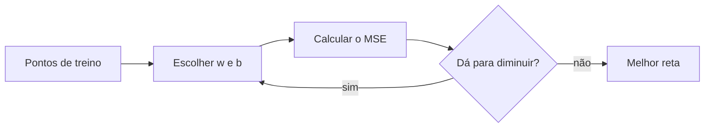
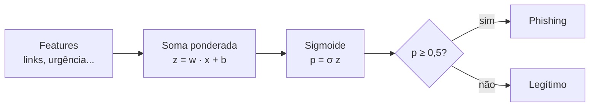

# 05 · Aprendizado supervisionado I: regressão linear e logística

> 🇧🇷 Português · 🇺🇸 [English](05-linear-logistic-regression.md)

| | |
|-|-|
| **Trilha** | [Fundamentos de IA](README.pt-BR.md) · Aula 5 de 13 |
| **Tempo de leitura** | ~25 min |
| **Você vai aprender** | Regressão × classificação, como a regressão linear acha "a melhor reta", como a regressão logística vira um classificador, como avaliar um classificador e por que modelos lineares são tão fáceis de atacar |

## Regressão ou classificação?

O aprendizado supervisionado ([aula 03](03-how-machines-learn.pt-BR.md)) aprende com exemplos rotulados. Ele resolve dois tipos de pergunta:

| Tipo | A resposta é… | Exemplos |
|------|---------------|----------|
| **Regressão** | Um **número** contínuo | Preço de um imóvel, tempo até uma falha, volume de tráfego amanhã |
| **Classificação** | Uma **categoria** | Phishing ou legítimo, malware ou benigno, qual família de malware |

Esta aula apresenta o modelo mais simples de cada tipo. Eles são simples, mas não são de brinquedo: ainda aparecem em produção, servem de baseline para modelos maiores e, como você vai ver, a última camada de muitas redes neurais é exatamente uma regressão logística.

## Regressão linear: a melhor reta

### O modelo

Voltando ao apartamento da aula 03, com uma única feature:

```text
preço = w × área + b
```

Geometricamente, é uma **reta**: `w` é a inclinação (quanto o preço sobe a cada m²) e `b` é onde a reta corta o eixo. Treinar o modelo é escolher a reta que passa "o mais perto possível" dos pontos.

### Medindo o "mais perto": o erro quadrático médio

Considere quatro apartamentos vendidos (preço em milhares de reais):

| Área (m²) | Preço real |
|-----------|-----------|
| 40 | 210 |
| 60 | 310 |
| 80 | 370 |
| 100 | 470 |

Para comparar retas, usamos a **função de perda** mais comum em regressão, o **erro quadrático médio** (*MSE*): para cada ponto, calcule o erro (real − previsto), eleve ao quadrado e tire a média.

```text
MSE = média de (real − previsto)²
```

Vamos testar três retas candidatas:

| Reta | Previsões (40, 60, 80, 100 m²) | Erros | MSE |
|------|-------------------------------|-------|-----|
| `5 × área + 0` | 200, 300, 400, 500 | +10, +10, −30, −30 | **500** |
| `4 × área + 60` | 220, 300, 380, 460 | −10, +10, −10, +10 | **100** |
| `4,2 × área + 46` | 214, 298, 382, 466 | −4, +12, −12, +4 | **80** |

A última é a **melhor reta possível** para esses dados: nenhuma outra combinação de `w` e `b` tem MSE menor. Para a regressão linear existe até uma fórmula fechada que encontra essa reta de uma vez (o método dos *mínimos quadrados*), mas também dá para chegar nela com o gradiente descendente da [aula 04](04-essential-math.pt-BR.md).



### Por que elevar ao quadrado?

O quadrado tem dois efeitos:

- Erros para cima e para baixo não se cancelam (−10 e +10 viram 100 e 100).
- **Erros grandes pesam desproporcionalmente**: um erro de 30 custa 900, nove vezes mais que um erro de 10.

O segundo efeito é útil (o modelo se esforça para não errar feio), mas cria uma fraqueza séria, que veremos na visão do red teamer.

### Várias features

Com mais informações, a fórmula só ganha mais termos:

```text
preço = w₁ × área + w₂ × quartos + w₃ × andar + b
```

Isso é o **produto escalar** entre o vetor de pesos e o vetor de features, mais o viés: `w · x + b`. Cada peso diz **quanto aquela feature empurra a previsão** e em que direção. Essa transparência é ótima para quem precisa explicar o modelo, e igualmente ótima para quem quer atacá-lo.

## Regressão logística: de reta a classificador

### O problema

Queremos um detector de phishing. A saída deveria ser uma **probabilidade** entre 0 e 1, mas `w · x + b` pode dar qualquer número: −7, 2,5, 340. Precisamos de algo que "esmague" qualquer número para o intervalo entre 0 e 1.

### A função sigmoide

A **sigmoide** faz exatamente isso:

```text
σ(z) = 1 / (1 + e^(−z))
```

| z | σ(z) | Leitura |
|---|------|---------|
| −4 | 0,018 | quase certeza de "não" |
| −0,4 | 0,401 | levemente para "não" |
| 0 | 0,500 | indeciso |
| 2 | 0,881 | provavelmente "sim" |
| 4 | 0,982 | quase certeza de "sim" |

Ela tem formato de "S": valores muito negativos viram quase 0, valores muito positivos viram quase 1, e o zero fica exatamente em 0,5. É a irmã de duas classes do softmax da aula 04.

### O modelo completo

A regressão logística é só: **soma ponderada → sigmoide → limiar**.



Apesar do nome, ela é um modelo de **classificação**. O "regressão" vem do fato de ela calcular um número (a probabilidade) antes de decidir.

### Um exemplo com números

Um detector de phishing com duas features e pesos já treinados:

| Feature | Peso |
|---------|------|
| `links`: número de links no e-mail | 0,8 |
| `urgência`: tem palavras como "urgente", "bloqueada" (0 ou 1) | 2,0 |
| viés `b` | −4,0 |

| E-mail | links | urgência | z = 0,8·links + 2·urgência − 4 | p = σ(z) | Decisão |
|--------|-------|----------|-------------------------------|----------|---------|
| A | 2 | 1 | −0,4 | 0,401 | legítimo |
| B | 5 | 1 | 2,0 | 0,881 | **phishing** |
| C | 1 | 0 | −3,2 | 0,039 | legítimo |

### A fronteira de decisão

O modelo diz "phishing" quando `p ≥ 0,5`, ou seja, quando `z ≥ 0`. A fronteira é:

```text
0,8 × links + 2 × urgência − 4 = 0
```

Isso é uma **reta** (com mais features, um plano, ou um hiperplano). De um lado dela tudo é phishing, do outro tudo é legítimo. Por isso a regressão logística é chamada de **classificador linear**: ela só consegue separar as classes com um corte reto.

### A perda: punir a confiança errada

Para treinar a regressão logística, o MSE não funciona bem. A perda usada é a **log loss** (ou *entropia cruzada binária*). Para um e-mail que **é** phishing:

```text
perda = −ln(p)
```

| Probabilidade de phishing que o modelo deu | Perda |
|-------------------------------------------|-------|
| 0,9 (acertou com confiança) | 0,105 |
| 0,5 (em cima do muro) | 0,693 |
| 0,1 (errou com confiança) | 2,303 |
| 0,01 (errou com muita confiança) | 4,605 |

A lição: **errar com confiança custa muito caro**. O modelo aprende a ser confiante só quando tem motivo.

## Avaliando um classificador

### A armadilha da acurácia

Imagine 1.000 e-mails, dos quais 50 são phishing. Um "detector" que responde **sempre "legítimo"** acerta 950 de 1.000: **95% de acurácia**, sem detectar nenhum ataque. Com classes desbalanceadas, que é o normal em segurança, a acurácia sozinha engana.

### A matriz de confusão

Agora um detector de verdade, nos mesmos 1.000 e-mails:

| | Previu phishing | Previu legítimo |
|-|-----------------|-----------------|
| **É phishing** (50) | 40 · verdadeiro positivo (TP) | 10 · falso negativo (FN) |
| **É legítimo** (950) | 30 · falso positivo (FP) | 920 · verdadeiro negativo (TN) |

| Métrica | Pergunta que responde | Conta | Valor |
|---------|----------------------|-------|-------|
| **Acurácia** | Quanto acertei no total? | (40 + 920) / 1000 | 96% |
| **Precisão** | Dos alertas, quantos eram ataques? | 40 / (40 + 30) | 57% |
| **Recall** (sensibilidade) | Dos ataques, quantos peguei? | 40 / (40 + 10) | 80% |
| **F1** | Equilíbrio entre precisão e recall | 2·P·R / (P + R) | 0,67 |

### O limiar é uma escolha

O 0,5 não é sagrado. Baixar o limiar para 0,3 pega mais phishing (**recall sobe**) mas gera mais alarmes falsos (**precisão cai**). Num SOC, essa escolha é negociada: cada falso positivo custa tempo de analista, e cada falso negativo pode custar um incidente.

> [!NOTE]
> **Conexão com a aula 04**
> A armadilha da taxa base aparece aqui de novo: com poucos ataques no meio de muito tráfego legítimo, até um detector bom tem precisão baixa. Sempre pergunte "de quantos alertas eu estou falando?" antes de comemorar uma acurácia alta.

## Visão do red teamer

Modelos lineares são os mais fáceis de entender, e por isso são os mais fáceis de atacar. Quatro ataques clássicos aparecem já aqui, na forma mais pura.

### 1. Evasão: os pesos mostram o caminho

O atacante que conhece (ou estima) os pesos sabe exatamente **o que mudar**. O e-mail B tinha z = 2,0 (phishing). Para passar despercebido, basta levar z abaixo de 0:

- reduzir para 2 links (encurtador de URL, um único botão): z = −0,4 → **legítimo**;
- ou tirar a palavra de urgência e reescrever a isca com calma.

Se o modelo também tiver features com **peso negativo** (palavras típicas de e-mail corporativo, como "reunião" ou "segue em anexo"), o atacante pode **adicionar** essas palavras sem mexer na isca. Com uma feature de "palavras confiáveis" de peso −0,5, cinco dessas palavras levam o e-mail B de z = 2,0 para z = −0,5 (p = 0,378). Esse é o *good word attack*, documentado contra filtros de spam desde os anos 2000.

Lembre da aula 04: o gradiente diz em que direção mexer na entrada. Num modelo linear, **o gradiente de z em relação à entrada é o próprio vetor de pesos**. Não há nada para calcular: os pesos são o mapa do ataque. Os adversarial examples da [seção 06](../06-evasion/README.md) generalizam essa ideia para redes neurais.

### 2. Envenenamento: um ponto que entorta a reta

Como o MSE eleva os erros ao quadrado, **um único ponto absurdo tem um peso enorme**. Some aos quatro apartamentos um registro falso, 50 m² vendido por 900 mil, e treine de novo:

| | Inclinação `w` | Leitura |
|---|---------------|---------|
| Dados limpos | +4,2 | cada m² soma R$ 4.200 |
| Com 1 ponto envenenado | **−0,24** | o preço **cai** quando a área aumenta |

Um registro em cinco inverteu a relação que o modelo aprendeu. Em classificação, o equivalente é o **label flipping**: trocar o rótulo de alguns exemplos (marcar phishings como "legítimo") para deslocar a fronteira de decisão a favor do atacante. Veja a [seção 04](../04-data-attacks/README.md).

### 3. Extração: roubar o modelo resolvendo equações

Se uma API devolve a **probabilidade** de uma regressão logística, dá para desfazer a sigmoide e recuperar `z`:

```text
z = ln( p / (1 − p) )
```

Como `z = w · x + b` é linear, com `d` features bastam **d + 1 consultas** bem escolhidas para montar um sistema de equações e recuperar todos os pesos exatamente. No nosso detector:

| Consulta (links, urgência) | p devolvido | z recuperado | Conclusão |
|----------------------------|-------------|--------------|-----------|
| (0, 0) | 0,018 | −4,0 | b = −4,0 |
| (1, 0) | 0,039 | −3,2 | w₁ = −3,2 − (−4,0) = 0,8 |
| (0, 1) | 0,119 | −2,0 | w₂ = −2,0 − (−4,0) = 2,0 |

Três consultas, modelo copiado. É por isso que devolver só a classe ("phishing"), e não a probabilidade com várias casas decimais, já é uma defesa. Veja a [seção 07](../07-privacy/README.md).

### 4. A confiança não é garantia

Uma probabilidade de 0,98 quer dizer "longe da fronteira", e não "certamente correto". Uma entrada fabricada pelo atacante pode ficar longe da fronteira **do lado errado**, e o modelo vai classificá-la com toda a confiança.

> [!TIP]
> **Visão do red teamer**
> Diante de um classificador linear, pergunte: (1) consigo ver ou estimar os pesos? Então sei quais features mexer para evadir. (2) Consigo influenciar os dados de treino? Poucos pontos extremos deslocam a reta. (3) A API devolve probabilidades? Então `d + 1` consultas podem bastar para copiar o modelo.

## Na prática com Python

Um exemplo só com numpy, que reproduz os números desta aula:

```python
import numpy as np

# Regressão linear: a melhor reta
area  = np.array([40, 60, 80, 100])
preco = np.array([210, 310, 370, 470])
w, b = np.polyfit(area, preco, 1)
print(round(w, 2), round(b, 2))                      # 4.2 46.0
print(np.mean((preco - (w * area + b)) ** 2))        # 80.0  (MSE)

# Envenenamento: um ponto falso
w_p, b_p = np.polyfit(np.append(area, 50), np.append(preco, 900), 1)
print(round(w_p, 2))                                 # -0.24

# Regressão logística: detector de phishing
sigmoid = lambda z: 1 / (1 + np.exp(-z))
W, B = np.array([0.8, 2.0]), -4.0
emails = np.array([[2, 1], [5, 1], [1, 0]])          # A, B, C
print(sigmoid(emails @ W + B).round(3))              # [0.401 0.881 0.039]

# Extração: d + 1 consultas recuperam os pesos
api = lambda x: sigmoid(np.dot(W, x) + B)            # a "caixa-preta"
logit = lambda p: np.log(p / (1 - p))
b_rec = logit(api([0, 0]))
w_rec = [logit(api([1, 0])) - b_rec, logit(api([0, 1])) - b_rec]
print(round(b_rec, 2), np.round(w_rec, 2))           # -4.0 [0.8 2. ]
```

## Resumo

- **Regressão** prevê números; **classificação** prevê categorias.
- A **regressão linear** acha a reta que minimiza o **erro quadrático médio**.
- A **regressão logística** passa a soma ponderada por uma **sigmoide** e decide com um **limiar**. A fronteira de decisão é linear.
- A **log loss** pune erros confiantes. Acurácia engana com classes desbalanceadas: use **precisão, recall e F1**.
- Em modelos lineares, **os pesos são o mapa do ataque**: evasão, envenenamento por outliers e extração com `d + 1` consultas.

## Teste seu entendimento

<details><summary>1. Prever quantos alertas o SIEM vai gerar amanhã é regressão ou classificação? E decidir se um alerta é falso positivo?</summary>

O número de alertas é um valor contínuo: **regressão**. Decidir "falso positivo ou não" é escolher uma categoria: **classificação**.
</details>

<details><summary>2. Por que um único outlier pode estragar uma regressão linear treinada com MSE?</summary>

Porque o MSE eleva os erros ao quadrado: um ponto muito longe da reta gera um erro enorme, e o modelo desloca a reta inteira para reduzir esse único erro. Um atacante que insere poucos pontos extremos consegue mudar muito o modelo.
</details>

<details><summary>3. Um detector de malware tem 99% de acurácia num conjunto com 1% de malware. Isso é bom?</summary>

Não dá para saber. Um modelo que diz sempre "benigno" também teria 99% de acurácia e recall zero. É preciso olhar **recall** (quantos malwares ele pega) e **precisão** (quantos alertas são reais).
</details>

<details><summary>4. Num classificador linear, qual é a direção mais eficiente para mudar a entrada e trocar a decisão?</summary>

A direção do **vetor de pesos**: ele é o gradiente de `z` em relação à entrada. Para empurrar para "legítimo", o atacante mexe nas features no sentido contrário aos pesos positivos (ou a favor dos negativos).
</details>

<details><summary>5. Uma API de classificação devolve "phishing: 0.8734". Que risco isso cria e como reduzir?</summary>

A probabilidade com muitas casas decimais permite recuperar `z` e, num modelo linear, **extrair os pesos** com poucas consultas, além de facilitar ataques de evasão por tentativa e erro. Reduzir: devolver só a classe (ou probabilidades arredondadas), limitar a taxa de consultas e monitorar padrões de consulta anômalos.
</details>

---

← [04 · Matemática essencial para IA](04-essential-math.pt-BR.md) · **Próxima aula:** 06 · Aprendizado supervisionado II: árvores de decisão, Naive Bayes e SVM (em breve)
