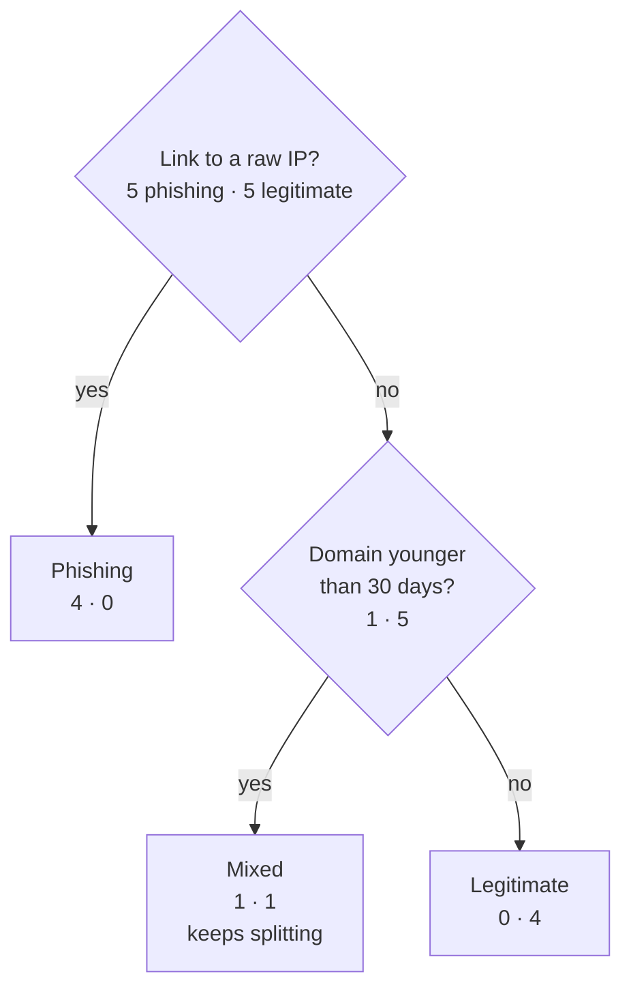

# 06.1 · Decision trees in depth

> 🇺🇸 English · 🇧🇷 [Português](06-1-decision-trees-deep-dive.pt-BR.md)

| | |
|-|-|
| **Track** | [AI Fundamentals](README.md) · Deep dive into lesson [06 · Trees, Naive Bayes and SVM](06-trees-naive-bayes-svm.md) |
| **Level** | Deep dive |
| **Prerequisites** | [06 · Trees, Naive Bayes and SVM](06-trees-naive-bayes-svm.md), [04.1 · Logarithms, exponentials and entropy](04-1-logs-and-entropy.md) |
| **Reading time** | ~30 min |
| **You will learn** | How to build a tree with entropy and information gain, how it handles continuous numbers, why "unique" features fool the algorithm, how to prune the tree, how forests and boosting work inside, and how to find a tree's thresholds through queries |

## Where we left off

In [lesson 06](06-trees-naive-bayes-svm.md), the tree picked the question that most reduced **Gini impurity**, and "link to a raw IP" beat "has an attachment". In [04.1](04-1-logs-and-entropy.md) we saw **entropy**, the measure of a distribution's uncertainty. Now we will rebuild the tree with entropy, move on to the second level, handle numeric features and understand the traps that make trees easy to fool.

## Information gain

The idea is the same as in lesson 06: pick the question that leaves the groups most "pure". The difference is the ruler:

```text
information gain = entropy before − weighted average entropy after
```

### The first level, with the 10 emails from lesson 06

The same 10 emails: 5 phishing and 5 legitimate. The starting entropy is **1 bit** (half and half).

| Question | "Yes" group | "No" group | Entropy after | Gain |
|----------|-------------|------------|---------------|------|
| "Has an attachment?" | 3 phishing, 2 legitimate (0.971) | 2 phishing, 3 legitimate (0.971) | 0.971 | **0.029** |
| "Link to a raw IP?" | 4 phishing, 0 legitimate (0) | 1 phishing, 5 legitimate (0.650) | 0.390 | **0.610** |

```text
entropy after = (4/10) × 0 + (6/10) × 0.650 = 0.390
gain = 1 − 0.390 = 0.610
```

The result agrees with Gini from lesson 06: "link to a raw IP" is by far the best question. In practice, entropy and Gini pick the same split in the vast majority of cases; Gini is slightly cheaper to compute (no logarithm), which is why many libraries use it by default.

### The second level

The left group (4 phishing) is already pure and becomes a **leaf**. The right one (1 phishing, 5 legitimate, entropy 0.650) is still mixed, so the algorithm repeats the search **with those 6 emails only**:

| Question | "Yes" group | "No" group | Entropy after | Gain |
|----------|-------------|------------|---------------|------|
| "Has urgency words?" | 1 phishing, 2 legitimate | 0 phishing, 3 legitimate | 0.459 | 0.191 |
| "Domain younger than 30 days?" | 1 phishing, 1 legitimate | 0 phishing, 4 legitimate | 0.333 | **0.317** |



The process is **greedy**: at each node it picks the best question **at that moment**, without going back. It is fast, but it does not guarantee the best possible tree.

## Numeric features: choosing the threshold

Yes/no questions are easy. What about a numeric feature, such as the **number of links** in the email? The tree turns the number into a "**links < threshold?**" question and tests the candidate thresholds: the midpoints between neighboring values.

Six emails, sorted by number of links:

| Links | 1 | 2 | 5 | 6 | 7 | 8 |
|-------|---|---|---|---|---|---|
| Class | legitimate | legitimate | phishing | legitimate | phishing | phishing |

| Threshold | Left (phishing · legitimate) | Right | Gain |
|-----------|------------------------------|-------|------|
| 1.5 | 0 · 1 | 3 · 2 | 0.191 |
| **3.5** | 0 · 2 | 3 · 1 | **0.459** |
| 5.5 | 1 · 2 | 2 · 1 | 0.082 |
| **6.5** | 1 · 3 | 2 · 0 | **0.459** |
| 7.5 | 2 · 3 | 1 · 0 | 0.191 |

Two thresholds **tie** at the top. The library picks one by an arbitrary rule (usually the first one found), and **a single extra email in training** is enough to break the tie. Keep that in mind for the red teamer's view.

## The "unique" feature trap

Picture an **"email ID"** feature, different for each of the 10 examples. A question that splits by ID puts each email alone in a pure leaf:

```text
entropy after = 0      gain = 1 − 0 = 1.000 (perfect!)
```

Information gain loves features with many distinct values, but the ID does nothing to classify a new email. The classic fix is the **gain ratio**, which divides the gain by the "split information" (the entropy of how the examples spread across the branches):

| Feature | Gain | Split information | Gain ratio |
|---------|------|-------------------|------------|
| Link to a raw IP (splits 4 / 6) | 0.610 | 0.971 | **0.628** |
| Email ID (splits 1 / 1 / … / 1) | 1.000 | 3.322 | 0.301 |

With the correction, "link to a raw IP" wins again. In security, this trap shows up as **data leakage**: timestamps, batch IDs, file names or the source folder path that happen to separate the classes in training. The model learns the shortcut, not the pattern.

## Controlling the size of the tree

Without a brake, the tree splits until it isolates every example: pure overfitting. The most common controls:

| Control | What it does |
|---------|--------------|
| **Maximum depth** | Limits how many questions in a row the tree can ask |
| **Minimum samples per leaf** | Prevents leaves based on one or two examples (like the "1 · 1" leaf above) |
| **Minimum gain** | Only splits if the question reduces impurity enough |
| **Cost-complexity pruning** | Grows the full tree and then cuts branches that barely help, penalizing the number of leaves |

## Forests and boosting inside

| Technique | How it works | Why it helps |
|-----------|--------------|--------------|
| **Bagging** | Each tree trains on a sample drawn **with replacement** from the dataset | The trees make different mistakes; voting cancels part of them |
| **Random Forest** | Bagging + at each node, only a random subset of features can be used (around the square root of the total) | Keeps every tree from always using the same dominant feature, making them more independent |
| **Out-of-bag** | Each tree did not see about a third of the examples; they work as a "free" validation set | Estimates error without setting aside a validation set |
| **Gradient boosting** | Shallow trees in sequence; each new tree learns to fix the **residual error** of the previous ones | Combines many weak models into a strong one; dominates tabular data |

### Feature importance

Libraries compute each feature's importance by adding up how much it reduced impurity across all nodes where it was used. That has a known bias: it favors features with many distinct values (the same ID trap). The more reliable alternative is **permutation importance**: shuffle a feature and measure how much performance drops.

> [!TIP]
> **Red teamer's view**
> 1. **Thresholds can be found by binary search.** Each node is a "feature < value" cut. With query access, the attacker varies one feature while keeping the others fixed and watches when the decision flips. In a 0 to 20 range, **6 queries** locate the threshold to within 0.31; each query halves the uncertainty (1 bit, as in [04.1](04-1-logs-and-entropy.md)).
> 2. **Trees can be extracted.** If the API returns the confidence or a leaf identifier, well-chosen queries rebuild the paths of the whole tree. Research on stealing models through APIs showed this as early as 2016.
> 3. **Ties are weak spots.** In the links example, thresholds 3.5 and 6.5 tied. A single poisoned example decides which one becomes the rule, and with it changes the classification of every email with 4 to 6 links ([data poisoning](../04-data-attacks/data-poisoning.md)).
> 4. **Shortcuts become loopholes.** If the tree learned a leakage shortcut (a file name, a metadata field), the attacker only needs to imitate the shortcut.
> 5. **Feature importance is a map**, and its bias may point to features the attacker easily controls.

## Hands-on with Python

```python
import numpy as np

def entropy(*counts):
    c = np.array(counts, dtype=float)
    p = c[c > 0] / c.sum()
    return -(p * np.log2(p)).sum()

def gain(parent, *children):
    n = sum(parent)
    after = sum(sum(ch) / n * entropy(*ch) for ch in children)
    return entropy(*parent) - after

print(round(gain((5, 5), (4, 0), (1, 5)), 3))    # 0.61   link to a raw IP
print(round(gain((5, 5), (3, 2), (2, 3)), 3))    # 0.029  has an attachment
print(round(gain((1, 5), (1, 1), (0, 4)), 3))    # 0.317  young domain

# Thresholds for a numeric feature (1 = phishing)
links = np.array([1, 2, 5, 6, 7, 8])
label = np.array([0, 0, 1, 0, 1, 1])
for t in (1.5, 3.5, 5.5, 6.5, 7.5):
    left, right = label[links < t], label[links >= t]
    g = gain((3, 3), (left.sum(), len(left) - left.sum()), (right.sum(), len(right) - right.sum()))
    print(t, round(g, 3))       # 3.5 and 6.5 tie at 0.459

# Binary search for a "black box" tree's threshold
secret = 6.5
query = lambda x: x >= secret   # the attacker only sees the decision
lo, hi = 0.0, 20.0
for _ in range(6):
    mid = (lo + hi) / 2
    lo, hi = (lo, mid) if query(mid) else (mid, hi)
print(lo, hi)                   # 6.25 6.5625  -> a 0.3125-wide interval
```

In real life, use scikit-learn's `DecisionTreeClassifier(criterion="entropy")` or `RandomForestClassifier`, with `max_depth`, `min_samples_leaf` and `ccp_alpha` to control size, and `permutation_importance` to measure importance.

## Summary

- **Information gain** = entropy before − weighted entropy after; the tree greedily picks the highest-gain question at each node.
- Numeric features become "value < threshold" questions, testing the midpoints between neighboring values.
- Features with many distinct values fool information gain; the **gain ratio** fixes it, and in security this shows up as **data leakage**.
- Maximum depth, minimum per leaf and **pruning** control overfitting; **bagging**, **random forests** and **boosting** combine trees.
- For the attacker: thresholds can be found by **binary search**, trees can be **extracted** through queries and **ties** are weak spots for poisoning.

## Check your understanding

<details><summary>1. A group has 6 phishing and 2 legitimate. A question splits it into (4 · 0) and (2 · 2). Is the gain high or low? Why?</summary>

It is reasonable: one group became pure (entropy 0), but the other ended up half and half (1 bit). Entropy before ≈ 0.811; after = (4/8) × 0 + (4/8) × 1 = 0.5; gain ≈ 0.311.
</details>

<details><summary>2. Why can an "event timestamp" feature look excellent in training and be useless in production?</summary>

Because it has many distinct values and may, by chance, separate the classes in training (for example, all attacks were collected on the same day). Information gain favors it, but it says nothing about new events. It is a case of data leakage.
</details>

<details><summary>3. What is the difference between bagging and a random forest?</summary>

Bagging trains each tree on a sample drawn with replacement from the data. A random forest does that **and** limits, at each node, the usable features to a random subset, which makes the trees more different from each other.
</details>

<details><summary>4. You can only see the final decision of a tree-based classifier. How would you estimate the threshold of a numeric feature?</summary>

With binary search: keep the other features fixed, test the midpoint of the range, observe the decision and discard the half that does not contain the flip. Each query halves the interval.
</details>

<details><summary>5. Why is a tie between two thresholds interesting for someone who wants to poison training?</summary>

Because a single well-placed example is enough to break the tie in favor of the threshold the attacker prefers. That changes the rule applied to every case between the two thresholds.
</details>

---

← [06 · Trees, Naive Bayes and SVM](06-trees-naive-bayes-svm.md) · **Next:** [06.2 · SVM and Naive Bayes in depth](06-2-svm-naive-bayes-deep-dive.md) →
