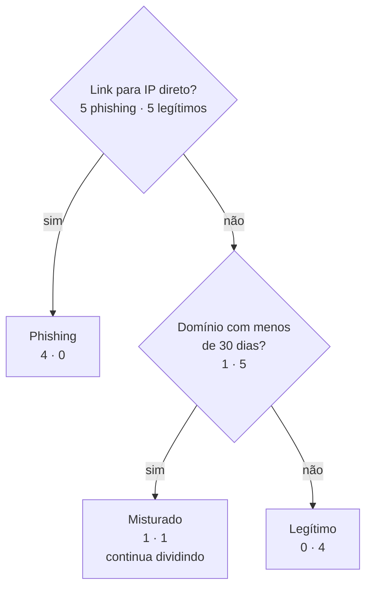

# 06.1 · Árvores de decisão a fundo

> 🇧🇷 Português · 🇺🇸 [English](06-1-decision-trees-deep-dive.md)

| | |
|-|-|
| **Trilha** | [Fundamentos de IA](README.pt-BR.md) · Aprofundamento da aula [06 · Árvores, Naive Bayes e SVM](06-trees-naive-bayes-svm.pt-BR.md) |
| **Nível** | Aprofundamento |
| **Pré-requisitos** | [06 · Árvores, Naive Bayes e SVM](06-trees-naive-bayes-svm.pt-BR.md), [04.1 · Logaritmos, exponenciais e entropia](04-1-logs-and-entropy.pt-BR.md) |
| **Tempo de leitura** | ~30 min |
| **Você vai aprender** | Como construir uma árvore com entropia e ganho de informação, como ela lida com números contínuos, por que features "únicas" enganam o algoritmo, como podar a árvore, como florestas e boosting funcionam por dentro, e como descobrir os limiares de uma árvore por consultas |

## Onde paramos

Na [aula 06](06-trees-naive-bayes-svm.pt-BR.md), a árvore escolhia a pergunta que mais reduzia a **impureza de Gini**, e "link para IP direto" venceu "tem anexo". No [04.1](04-1-logs-and-entropy.pt-BR.md) vimos a **entropia**, a medida de incerteza de uma distribuição. Agora vamos refazer a construção da árvore com entropia, seguir para o segundo nível, lidar com features numéricas e entender as armadilhas que tornam árvores fáceis de enganar.

## Ganho de informação

A ideia é a mesma da aula 06: escolher a pergunta que deixa os grupos mais "puros". A diferença é a régua:

```text
ganho de informação = entropia antes − entropia média ponderada depois
```

### O primeiro nível, com os 10 e-mails da aula 06

Os mesmos 10 e-mails: 5 phishing e 5 legítimos. A entropia inicial é **1 bit** (meio a meio).

| Pergunta | Grupo "sim" | Grupo "não" | Entropia depois | Ganho |
|----------|-------------|-------------|-----------------|-------|
| "Tem anexo?" | 3 phishing, 2 legítimos (0,971) | 2 phishing, 3 legítimos (0,971) | 0,971 | **0,029** |
| "Link para IP direto?" | 4 phishing, 0 legítimos (0) | 1 phishing, 5 legítimos (0,650) | 0,390 | **0,610** |

```text
entropia depois = (4/10) × 0 + (6/10) × 0,650 = 0,390
ganho = 1 − 0,390 = 0,610
```

O resultado concorda com o Gini da aula 06: "link para IP" é de longe a melhor pergunta. Na prática, entropia e Gini escolhem a mesma divisão na grande maioria dos casos; o Gini é um pouco mais barato de calcular (não tem logaritmo), por isso muitas bibliotecas o usam como padrão.

### O segundo nível

O grupo da esquerda (4 phishing) já é puro e vira uma **folha**. O da direita (1 phishing, 5 legítimos, entropia 0,650) ainda está misturado, então o algoritmo repete a busca **só com esses 6 e-mails**:

| Pergunta | Grupo "sim" | Grupo "não" | Entropia depois | Ganho |
|----------|-------------|-------------|-----------------|-------|
| "Tem palavras de urgência?" | 1 phishing, 2 legítimos | 0 phishing, 3 legítimos | 0,459 | 0,191 |
| "Domínio com menos de 30 dias?" | 1 phishing, 1 legítimo | 0 phishing, 4 legítimos | 0,333 | **0,317** |



O processo é **guloso**: em cada nó, escolhe a melhor pergunta **naquele momento**, sem voltar atrás. É rápido, mas não garante a melhor árvore possível.

## Features numéricas: escolhendo o limiar

Perguntas de sim/não são fáceis. E uma feature numérica, como o **número de links** no e-mail? A árvore transforma o número numa pergunta "**links < limiar?**" e testa os limiares candidatos: os pontos médios entre valores vizinhos.

Seis e-mails, ordenados pelo número de links:

| Links | 1 | 2 | 5 | 6 | 7 | 8 |
|-------|---|---|---|---|---|---|
| Classe | legítimo | legítimo | phishing | legítimo | phishing | phishing |

| Limiar | Esquerda (phishing · legítimo) | Direita | Ganho |
|--------|-------------------------------|---------|-------|
| 1,5 | 0 · 1 | 3 · 2 | 0,191 |
| **3,5** | 0 · 2 | 3 · 1 | **0,459** |
| 5,5 | 1 · 2 | 2 · 1 | 0,082 |
| **6,5** | 1 · 3 | 2 · 0 | **0,459** |
| 7,5 | 2 · 3 | 1 · 0 | 0,191 |

Dois limiares **empatam** no topo. A biblioteca escolhe um deles por um critério arbitrário (geralmente o primeiro encontrado), e **um único e-mail a mais no treino** basta para desempatar. Guarde isso para a visão do red teamer.

## A armadilha das features "únicas"

Imagine uma feature **"ID do e-mail"**, diferente para cada um dos 10 exemplos. Uma pergunta que separa por ID coloca cada e-mail sozinho numa folha pura:

```text
entropia depois = 0      ganho = 1 − 0 = 1,000 (perfeito!)
```

O ganho de informação adora features com muitos valores distintos, mas o ID não ajuda em nada para classificar um e-mail novo. A correção clássica é o **gain ratio**, que divide o ganho pela "informação da própria divisão" (a entropia de como os exemplos se espalham entre os ramos):

| Feature | Ganho | Informação da divisão | Gain ratio |
|---------|-------|-----------------------|------------|
| Link para IP (divide 4 / 6) | 0,610 | 0,971 | **0,628** |
| ID do e-mail (divide 1 / 1 / … / 1) | 1,000 | 3,322 | 0,301 |

Com a correção, "link para IP" volta a vencer. Em segurança, essa armadilha aparece como **vazamento de dados** (*data leakage*): timestamps, IDs de lote, nomes de arquivo ou o caminho da pasta de origem que, por acaso, separam as classes no treino. O modelo aprende o atalho, não o padrão.

## Controlando o tamanho da árvore

Sem freio, a árvore divide até isolar cada exemplo: overfitting puro. Os controles mais usados:

| Controle | O que faz |
|----------|-----------|
| **Profundidade máxima** | Limita quantas perguntas seguidas a árvore pode fazer |
| **Mínimo de exemplos por folha** | Impede folhas baseadas em um ou dois exemplos (como a folha "1 · 1" acima) |
| **Ganho mínimo** | Só divide se a pergunta reduzir a impureza o suficiente |
| **Poda por custo-complexidade** | Cresce a árvore inteira e depois corta os ramos que pouco ajudam, penalizando o número de folhas |

## Florestas e boosting por dentro

| Técnica | Como funciona | Por que ajuda |
|---------|---------------|---------------|
| **Bagging** | Cada árvore treina com uma amostra sorteada **com reposição** do dataset | As árvores erram de jeitos diferentes; a votação cancela parte dos erros |
| **Random Forest** | Bagging + em cada nó, só um subconjunto aleatório das features pode ser usado (algo como a raiz quadrada do total) | Impede que todas as árvores usem sempre a mesma feature dominante, deixando-as mais independentes |
| **Out-of-bag** | Cada árvore não viu cerca de um terço dos exemplos; eles servem de validação "de graça" | Estima o erro sem separar um conjunto de validação |
| **Gradient boosting** | Árvores rasas em sequência; cada nova árvore aprende a corrigir o **erro residual** das anteriores | Junta muitos modelos fracos num modelo forte; domina dados tabulares |

### Importância das features

Bibliotecas calculam a importância de cada feature somando quanto ela reduziu a impureza em todos os nós onde foi usada. Isso tem um viés conhecido: favorece features com muitos valores distintos (a mesma armadilha do ID). A alternativa mais confiável é a **importância por permutação**: embaralhar uma feature e medir quanto o desempenho cai.

> [!TIP]
> **Visão do red teamer**
> 1. **Limiares se descobrem por busca binária.** Cada nó é um corte "feature < valor". Com acesso de consulta, o atacante varia uma feature mantendo as outras fixas e observa quando a decisão muda. Num intervalo de 0 a 20, **6 consultas** localizam o limiar com precisão de 0,31; cada consulta corta a incerteza pela metade (1 bit, como no [04.1](04-1-logs-and-entropy.pt-BR.md)).
> 2. **Árvores podem ser extraídas.** Se a API devolve a confiança ou um identificador da folha, consultas bem escolhidas reconstroem os caminhos da árvore inteira. Pesquisas sobre roubo de modelos por API mostraram isso já em 2016.
> 3. **Empates são pontos frágeis.** No exemplo dos links, os limiares 3,5 e 6,5 empataram. Um único exemplo envenenado decide qual vira a regra, e com isso muda a classificação de todo e-mail com 4 a 6 links ([data poisoning](../04-data-attacks/data-poisoning.pt-BR.md)).
> 4. **Atalhos viram brechas.** Se a árvore aprendeu um atalho de vazamento (um nome de arquivo, um campo de metadado), o atacante só precisa imitar o atalho.
> 5. **Importância de features é um mapa**, e o viés dela pode apontar para features que o atacante controla facilmente.

## Na prática com Python

```python
import numpy as np

def entropia(*contagens):
    c = np.array(contagens, dtype=float)
    p = c[c > 0] / c.sum()
    return -(p * np.log2(p)).sum()

def ganho(pai, *filhos):
    n = sum(pai)
    depois = sum(sum(f) / n * entropia(*f) for f in filhos)
    return entropia(*pai) - depois

print(round(ganho((5, 5), (4, 0), (1, 5)), 3))   # 0.61   link para IP
print(round(ganho((5, 5), (3, 2), (2, 3)), 3))   # 0.029  tem anexo
print(round(ganho((1, 5), (1, 1), (0, 4)), 3))   # 0.317  domínio novo

# Limiares de uma feature numérica (1 = phishing)
links  = np.array([1, 2, 5, 6, 7, 8])
classe = np.array([0, 0, 1, 0, 1, 1])
for t in (1.5, 3.5, 5.5, 6.5, 7.5):
    esq, dir_ = classe[links < t], classe[links >= t]
    g = ganho((3, 3), (esq.sum(), len(esq) - esq.sum()), (dir_.sum(), len(dir_) - dir_.sum()))
    print(t, round(g, 3))       # 3.5 e 6.5 empatam em 0.459

# Busca binária pelo limiar de uma árvore "caixa-preta"
segredo = 6.5
consulta = lambda x: x >= segredo     # o atacante só vê a decisão
lo, hi = 0.0, 20.0
for _ in range(6):
    meio = (lo + hi) / 2
    lo, hi = (lo, meio) if consulta(meio) else (meio, hi)
print(lo, hi)                   # 6.25 6.5625  -> intervalo de 0.3125
```

Na vida real, use `DecisionTreeClassifier(criterion="entropy")` ou `RandomForestClassifier` do scikit-learn, com `max_depth`, `min_samples_leaf` e `ccp_alpha` para controlar o tamanho, e `permutation_importance` para medir importância.

## Resumo

- **Ganho de informação** = entropia antes − entropia ponderada depois; a árvore escolhe, de forma gulosa, a pergunta de maior ganho em cada nó.
- Features numéricas viram perguntas "valor < limiar", testando os pontos médios entre valores vizinhos.
- Features com muitos valores distintos enganam o ganho de informação; o **gain ratio** corrige, e em segurança isso aparece como **vazamento de dados**.
- Profundidade máxima, mínimo por folha e **poda** controlam o overfitting; **bagging**, **random forest** e **boosting** combinam árvores.
- Para o atacante: limiares se descobrem por **busca binária**, árvores podem ser **extraídas** por consulta e **empates** são pontos frágeis para envenenamento.

## Teste seu entendimento

<details><summary>1. Um grupo tem 6 phishing e 2 legítimos. Uma pergunta o divide em (4 · 0) e (2 · 2). O ganho é alto ou baixo? Por quê?</summary>

É razoável: um dos grupos ficou puro (entropia 0), mas o outro ficou meio a meio (1 bit). Entropia antes ≈ 0,811; depois = (4/8) × 0 + (4/8) × 1 = 0,5; ganho ≈ 0,311.
</details>

<details><summary>2. Por que uma feature "timestamp do evento" pode parecer excelente no treino e ser inútil em produção?</summary>

Porque tem muitos valores distintos e pode, por acaso, separar as classes no treino (por exemplo, todos os ataques foram coletados num mesmo dia). O ganho de informação a favorece, mas ela não diz nada sobre eventos novos. É um caso de vazamento de dados.
</details>

<details><summary>3. Qual a diferença entre bagging e random forest?</summary>

O bagging treina cada árvore numa amostra com reposição dos dados. A random forest faz isso **e** limita, em cada nó, as features que podem ser usadas a um subconjunto aleatório, o que deixa as árvores mais diferentes entre si.
</details>

<details><summary>4. Você só consegue ver a decisão final de um classificador baseado em árvore. Como estimaria o limiar de uma feature numérica?</summary>

Com busca binária: fixa as outras features, testa o ponto do meio do intervalo, observa a decisão e descarta a metade que não contém a mudança. Cada consulta reduz o intervalo pela metade.
</details>

<details><summary>5. Por que um empate entre dois limiares é interessante para quem quer envenenar o treino?</summary>

Porque basta um único exemplo bem posicionado para desempatar a favor do limiar que o atacante prefere. Com isso, muda a regra aplicada a todos os casos entre os dois limiares.
</details>

---

← [06 · Árvores, Naive Bayes e SVM](06-trees-naive-bayes-svm.pt-BR.md) · **Próximo:** [06.2 · SVM e Naive Bayes a fundo](06-2-svm-naive-bayes-deep-dive.pt-BR.md) →
