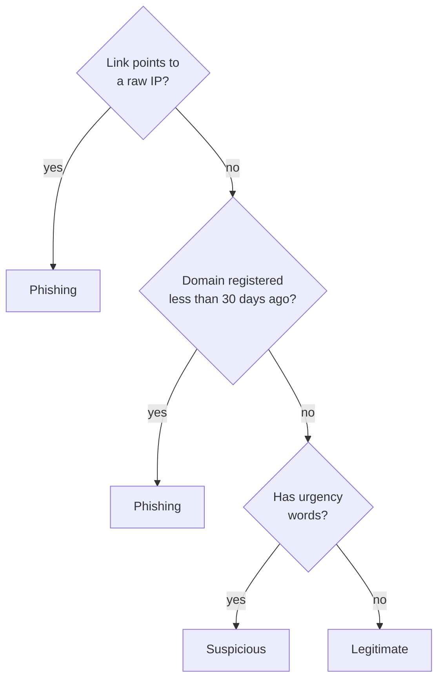
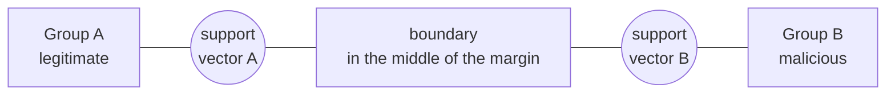

# 06 · Supervised learning II: decision trees, Naive Bayes and SVM

> 🇺🇸 English · 🇧🇷 [Português](06-trees-naive-bayes-svm.pt-BR.md)

| | |
|-|-|
| **Track** | [AI Fundamentals](README.md) · Lesson 6 of 13 |
| **Reading time** | ~25 min |
| **You will learn** | How a decision tree picks its questions, why forests and boosting dominate tabular data, how Naive Bayes uses Bayes' theorem to filter spam, what an SVM margin is and the kernel trick, and how to attack each of them |

## Three ways to draw a boundary

In [lesson 05](05-linear-logistic-regression.md), logistic regression separated the classes with **one straight cut**. Many real problems do not fit a straight line. This lesson covers three families of classic classifiers, each built on a different idea:

| Model | Core idea | The question it asks |
|-------|-----------|----------------------|
| **Decision tree** | A sequence of yes/no questions | "Which question splits the data best right now?" |
| **Naive Bayes** | Probabilities and Bayes' theorem | "Given this evidence, which class is most likely?" |
| **SVM** | The boundary with the widest possible gap | "Which line stays farthest from both groups?" |

## Decision trees: the 20 questions game

### How it works

A decision tree is a flowchart learned from data. Each node asks a question about a feature, each branch is an answer, and each leaf is a decision. A SOC analyst triaging emails would do something similar:



The big advantage: you can **read the model**. Every decision has a justification a human understands.

### How the tree picks a question: Gini impurity

During training, the algorithm tests many candidate questions and picks the one that leaves the resulting groups most "pure", that is, most dominated by a single class. A common measure is **Gini impurity**:

```text
Gini = 1 − (sum of each class proportion squared)
```

- A group with only phishing has Gini **0** (pure).
- A half-and-half group has Gini **0.5** (as mixed as it gets with two classes).

Example with 10 emails, 5 phishing and 5 legitimate (starting Gini = 0.5). Two candidate questions:

| Question | "Yes" group | "No" group | Weighted Gini |
|----------|-------------|------------|---------------|
| "Has an attachment?" | 3 phishing, 2 legitimate (Gini 0.48) | 2 phishing, 3 legitimate (Gini 0.48) | **0.48** |
| "Link to a raw IP?" | 4 phishing, 0 legitimate (Gini 0) | 1 phishing, 5 legitimate (Gini 0.278) | **0.167** |

```text
Weighted Gini = (4/10) × 0 + (6/10) × 0.278 = 0.167
```

"Link to a raw IP" brings the impurity down from 0.5 to 0.167, while "has an attachment" barely helps. The tree picks the first one, and repeats the process inside each group until the groups are pure or a depth limit is reached.

### The problem: trees memorize

With no limit, a tree keeps asking questions until it isolates **every single example** in its own leaf. That is pure overfitting ([lesson 03](03-how-machines-learn.md)): it memorized the training set. The most common fixes combine many trees:

| Technique | How it works | Analogy |
|-----------|--------------|---------|
| **Random Forest** | Trains hundreds of trees, each on a different sample of the data and features, and takes a vote | Asking many independent experts for their opinion |
| **Gradient Boosting** (XGBoost, LightGBM) | Trains trees in sequence, each one fixing the errors of the previous ones | A team where each member reviews what the last one got wrong |

On **tabular data** (logs, file features, network metadata), these tree ensembles often beat neural networks, and they are widely used in security: classifying executables by static features, fraud detection, login risk scoring.

## Naive Bayes: the classic spam filter

### The idea

Naive Bayes applies **Bayes' theorem**, which you already saw in the base rate trap of [lesson 04](04-essential-math.md): start with an initial belief (the *prior*) and update it with each piece of evidence.

```text
P(spam | words) ∝ P(spam) × P(word₁ | spam) × P(word₂ | spam) × …
```

The "naive" part comes from a strong assumption: the model treats **each word as independent** of the others. That is false in real language ("credit" and "card" go together), but it works surprisingly well and makes training trivial: just count how often each word shows up in each class.

### An example with numbers

A trained filter learned these frequencies:

| | Spam | Legitimate |
|-|------|------------|
| Prior (share of emails) | 0.3 | 0.7 |
| P("free" appears) | 0.6 | 0.05 |
| P("password" appears) | 0.4 | 0.1 |
| P("meeting" appears) | 0.05 | 0.3 |

An email with **"free"** and **"password"**:

```text
Spam score       = 0.3 × 0.6 × 0.4  = 0.072
Legitimate score = 0.7 × 0.05 × 0.1 = 0.0035

P(spam) = 0.072 / (0.072 + 0.0035) ≈ 0.954
```

A 95.4% chance of spam. The filter blocks it.

> [!NOTE]
> **Never-seen words**
> If a word never appeared in spam during training, P(word | spam) would be 0 and zero out the whole product. In practice a small value is added to every count (*Laplace smoothing*) to avoid that.

## SVM: the boundary with the widest gap

### Margin and support vectors

When two groups can be separated by a line, there are usually **infinitely many** possible lines. The **SVM** (*Support Vector Machine*) picks the one that stays **as far as possible** from the closest points on each side. That distance is the **margin**.

Think of a road between two neighborhoods: the SVM builds the widest possible road without running over any house. The houses touching the edge of the road are the **support vectors**.



One important detail: the boundary depends **only on the support vectors**. Points far from the margin can move freely and nothing changes. Keep that in mind for the red teamer's view.

### The kernel trick

What if no line separates the groups? Example with a single feature, the position `x`:

| Class | Values of x |
|-------|-------------|
| Legitimate | −1, 0, 1 |
| Malicious | −3, 3 |

The malicious points sit **on both sides** of the legitimate ones: no single cut on `x` separates the groups. But if we create a new feature, `x²`:

| Class | Values of x² |
|-------|--------------|
| Legitimate | 1, 0, 1 |
| Malicious | 9, 9 |

Now a simple cut, `x² > 5`, separates everything. A **kernel** does this automatically: it takes the data into a space with more dimensions, where a straight boundary works, and that straight boundary, seen in the original space, becomes a curve. The "trick" is that the SVM does this computation without actually building the new features.

## Comparing the three

| | Tree / forest | Naive Bayes | SVM |
|-|---------------|-------------|-----|
| **Boundary** | Axis-aligned boxes ("feature > value" cuts) | Driven by probabilities, often linear | Max-margin line, or a curve with a kernel |
| **Interpretable?** | Tree yes; forest partially | Yes: you can see each word's weight | Barely, especially with a kernel |
| **Strengths** | Tabular data, mixed features | Text, very fast training, little data | Many features and few examples |
| **Security use** | Malware by static features, fraud, login risk | Classic spam filters | Malware and intrusion classification (very common before deep learning) |

## Red teamer's view

### Trees: find the threshold and stay on the right side

Each node in a tree is a "feature > value" cut. An attacker who finds those thresholds knows **exactly how much to change**. In the tree from the start of the lesson:

- swap the raw-IP link for a hostname;
- use a domain registered 31 days ago instead of a fresh one (*domain aging*, a real tactic of phishing campaigns);
- drop the urgency words.

Three cheap changes and the email lands on the "legitimate" leaf. Two more observations:

- Trees **have no useful gradient** (the output changes in steps), so the gradient attacks from lesson 04 do not work directly. The attacker uses **queries** (try, observe, adjust) or trains a differentiable **surrogate model** and transfers the attack.
- **Feature importance**, which many systems show to "explain" the model, is a map for the attacker: it says which features are worth manipulating.

### Naive Bayes: the good word attack again

The independence between words is the weakness. Since each word multiplies the score **separately**, the attacker can dilute the message with words typical of legitimate email. Back to the example, add "meeting" to the spam email:

| Email | P(spam) |
|-------|---------|
| "free" + "password" | 0.954 |
| + 1× "meeting" | 0.774 |
| + 3× "meeting" | **0.087** |

Three harmless words and the spam gets through. Spammers did exactly that for years, pasting random chunks of books and news at the end of their messages. There is also a **poisoning** path: if the filter learns from emails users mark, an attacker who sends legitimate messages full of the next campaign's keywords teaches the filter to trust them.

### SVM: a few points control the boundary

Since the boundary depends only on the support vectors, the attacker does not need to poison the whole dataset: inserting **a few well-placed points near the margin** is enough to shift it. Some of the first academic studies on attacks against ML, around 2012 and 2013, showed exactly this kind of poisoning and evasion against SVMs used to detect malicious PDFs.

> [!TIP]
> **Red teamer's view**
> Before attacking, identify the model family. **Trees and forests**: find the thresholds through queries and change the minimum needed in each feature. **Naive Bayes**: dilute the malicious signal with "good" evidence. **SVM**: focus the poisoning near the margin. And for any of them: if the system publishes feature importance or explanations, it is handing out the map.

## Hands-on with Python

A plain-Python example that reproduces the numbers in this lesson:

```python
def gini(*counts):
    total = sum(counts)
    return 1 - sum((c / total) ** 2 for c in counts)

# Which question does the tree pick?
print(gini(5, 5))                                      # 0.5   (before the split)
print(round(0.5 * gini(3, 2) + 0.5 * gini(2, 3), 3))   # 0.48  ("has an attachment?")
print(round(0.4 * gini(4, 0) + 0.6 * gini(1, 5), 3))   # 0.167 ("link to a raw IP?")

# Naive Bayes
prior = {"spam": 0.3, "legit": 0.7}
p = {"spam":  {"free": 0.6,  "password": 0.4, "meeting": 0.05},
     "legit": {"free": 0.05, "password": 0.1, "meeting": 0.3}}

def p_spam(words):
    score = {}
    for cls in prior:
        score[cls] = prior[cls]
        for w in words:
            score[cls] *= p[cls][w]
    return score["spam"] / (score["spam"] + score["legit"])

print(round(p_spam(["free", "password"]), 3))                  # 0.954
print(round(p_spam(["free", "password"] + ["meeting"] * 3), 3))  # 0.087

# Kernel trick: x² separates what x could not
legit, malicious = [-1, 0, 1], [-3, 3]
print([x**2 > 5 for x in legit], [x**2 > 5 for x in malicious])
# [False, False, False] [True, True]
```

In real life you would use scikit-learn (`DecisionTreeClassifier`, `RandomForestClassifier`, `MultinomialNB`, `SVC`), but these are the computations underneath.

## Summary

- **Decision trees** ask yes/no questions and pick the question that reduces impurity (Gini) the most. They are readable but memorize; **forests** and **boosting** fix that and dominate tabular data.
- **Naive Bayes** applies Bayes' theorem assuming independent words. It is fast and good with text.
- **SVM** looks for the boundary with the **maximum margin**, defined by the **support vectors**; the **kernel** allows curved boundaries.
- Each family has its typical attack: thresholds in trees, evidence dilution in Naive Bayes and poisoning near the margin in SVMs.

## Check your understanding

<details><summary>1. A question splits 10 examples into one group of 5 phishing and another of 5 legitimate. What is the weighted Gini? Is it a good question?</summary>

Both groups are pure (Gini 0), so the weighted Gini is **0**. It is the best possible question: it separates the classes perfectly.
</details>

<details><summary>2. Why does a decision tree with no depth limit tend to do badly on new data?</summary>

Because it keeps splitting until it isolates every training example, noise included: **overfitting**. Limiting the depth, pruning the tree or using forests and boosting reduces the problem.
</details>

<details><summary>3. What is "naive" about Naive Bayes, and how does an attacker exploit it?</summary>

It assumes words are **independent** of each other. Since each word contributes separately, the attacker can add words typical of legitimate messages to dilute the malicious signal (*good word attack*).
</details>

<details><summary>4. In an SVM, does moving a training point far from the margin change the boundary? What about moving a support vector?</summary>

Moving a point far from the margin **changes nothing**. Moving a support vector (or inserting a new point near the margin) **changes the boundary**. That is why SVM poisoning focuses near the margin.
</details>

<details><summary>5. Why don't gradient-based attacks work directly against a random forest? What does the attacker do instead?</summary>

A tree's output changes in steps, so the gradient is zero almost everywhere and gives no direction. The attacker uses **query-based** attacks (guided trial and error) or trains a differentiable **surrogate model**, crafts the attack on it and transfers it to the target model.
</details>

---

← [05 · Supervised learning I: linear and logistic regression](05-linear-logistic-regression.md) · **Next lesson:** [07 · Unsupervised learning: K-Means, PCA and anomaly detection](07-unsupervised-learning.md) →
