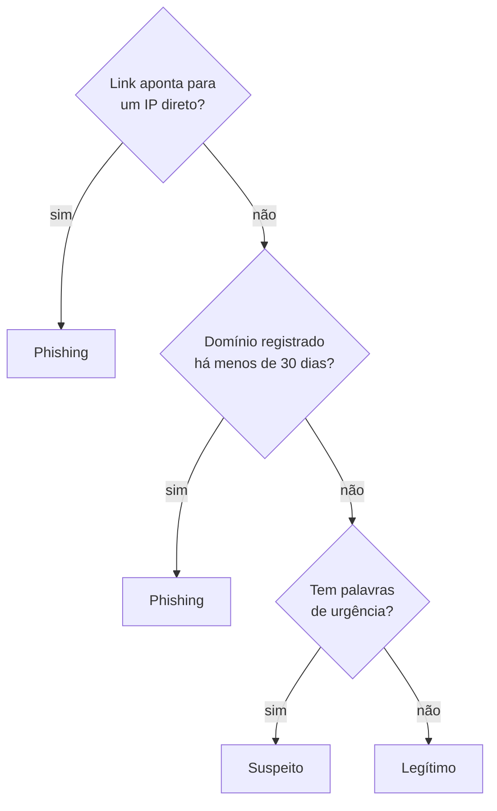
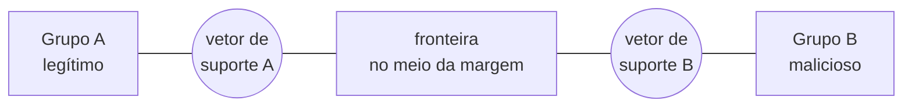

# 06 · Aprendizado supervisionado II: árvores de decisão, Naive Bayes e SVM

> 🇧🇷 Português · 🇺🇸 [English](06-trees-naive-bayes-svm.md)

| | |
|-|-|
| **Trilha** | [Fundamentos de IA](README.pt-BR.md) · Aula 6 de 13 |
| **Nível** | Base |
| **Pré-requisitos** | [05 · Regressão linear e logística](05-linear-logistic-regression.pt-BR.md) |
| **Tempo de leitura** | ~25 min |
| **Você vai aprender** | Como uma árvore de decisão escolhe suas perguntas, por que florestas e boosting dominam dados tabulares, como o Naive Bayes usa o teorema de Bayes para filtrar spam, o que é a margem de uma SVM e o truque do kernel, e como atacar cada um deles |

## Três jeitos de traçar uma fronteira

Na [aula 05](05-linear-logistic-regression.pt-BR.md), a regressão logística separava as classes com **um corte reto**. Muitos problemas reais não cabem numa reta. Esta aula apresenta três famílias de classificadores clássicos, cada uma com uma ideia diferente:

| Modelo | Ideia central | Pergunta que ele faz |
|--------|---------------|----------------------|
| **Árvore de decisão** | Uma sequência de perguntas sim/não | "Qual pergunta separa melhor os dados agora?" |
| **Naive Bayes** | Probabilidades e o teorema de Bayes | "Dadas estas evidências, qual classe é mais provável?" |
| **SVM** | A fronteira com a maior folga possível | "Qual linha fica mais longe dos dois grupos?" |

## Árvores de decisão: o jogo das 20 perguntas

### Como funciona

Uma árvore de decisão é um fluxograma aprendido a partir dos dados. Cada nó faz uma pergunta sobre uma feature, cada ramo é uma resposta, e cada folha é uma decisão. Um analista de SOC triando e-mails faria algo parecido:



A grande vantagem: dá para **ler o modelo**. Cada decisão tem uma justificativa que um humano entende.

### Como a árvore escolhe a pergunta: impureza de Gini

Durante o treino, o algoritmo testa várias perguntas possíveis e escolhe a que deixa os grupos resultantes mais "puros", isto é, mais dominados por uma só classe. Uma medida comum é a **impureza de Gini**:

```text
Gini = 1 − (soma das proporções de cada classe ao quadrado)
```

- Um grupo só de phishing tem Gini **0** (puro).
- Um grupo meio a meio tem Gini **0,5** (o mais misturado possível com duas classes).

Exemplo com 10 e-mails, 5 phishing e 5 legítimos (Gini inicial = 0,5). Duas perguntas candidatas:

| Pergunta | Grupo "sim" | Grupo "não" | Gini ponderado |
|----------|-------------|-------------|----------------|
| "Tem anexo?" | 3 phishing, 2 legítimos (Gini 0,48) | 2 phishing, 3 legítimos (Gini 0,48) | **0,48** |
| "Link para IP direto?" | 4 phishing, 0 legítimos (Gini 0) | 1 phishing, 5 legítimos (Gini 0,278) | **0,167** |

```text
Gini ponderado = (4/10) × 0 + (6/10) × 0,278 = 0,167
```

"Link para IP" reduz a impureza de 0,5 para 0,167, enquanto "tem anexo" quase não ajuda. A árvore escolhe a primeira, e repete o processo dentro de cada grupo até os grupos ficarem puros ou até atingir um limite de profundidade.

### O problema: árvores decoram

Sem limite, uma árvore continua fazendo perguntas até isolar **cada exemplo** numa folha própria. Isso é overfitting puro ([aula 03](03-how-machines-learn.pt-BR.md)): ela decorou o treino. As soluções mais usadas combinam várias árvores:

| Técnica | Como funciona | Analogia |
|---------|---------------|----------|
| **Random Forest** | Treina centenas de árvores, cada uma com uma amostra diferente dos dados e das features, e faz uma votação | Perguntar a opinião de muitos especialistas independentes |
| **Gradient Boosting** (XGBoost, LightGBM) | Treina árvores em sequência, cada uma corrigindo os erros das anteriores | Uma equipe em que cada membro revisa o que o anterior errou |

Em **dados tabulares** (logs, features de arquivos, metadados de rede), esses conjuntos de árvores costumam bater redes neurais, e são muito usados em segurança: classificação de executáveis por features estáticas, detecção de fraude, pontuação de risco de login.

## Naive Bayes: o filtro de spam clássico

### A ideia

O Naive Bayes aplica o **teorema de Bayes**, que você já viu na armadilha da taxa base da [aula 04](04-essential-math.pt-BR.md): começar com uma crença inicial (a *prior*) e atualizá-la com cada evidência.

```text
P(spam | palavras) ∝ P(spam) × P(palavra₁ | spam) × P(palavra₂ | spam) × …
```

O "naive" (ingênuo) vem de uma suposição forte: o modelo trata **cada palavra como independente** das outras. Isso é falso na linguagem real ("cartão" e "crédito" andam juntas), mas funciona surpreendentemente bem, e torna o treino trivial: basta contar com que frequência cada palavra aparece em cada classe.

### Um exemplo com números

Um filtro treinado aprendeu estas frequências:

| | Spam | Legítimo |
|-|------|----------|
| Prior (proporção de e-mails) | 0,3 | 0,7 |
| P("grátis" aparece) | 0,6 | 0,05 |
| P("senha" aparece) | 0,4 | 0,1 |
| P("reunião" aparece) | 0,05 | 0,3 |

Um e-mail com **"grátis"** e **"senha"**:

```text
Pontuação spam     = 0,3 × 0,6 × 0,4  = 0,072
Pontuação legítimo = 0,7 × 0,05 × 0,1 = 0,0035

P(spam) = 0,072 / (0,072 + 0,0035) ≈ 0,954
```

95,4% de chance de spam. O filtro bloqueia.

> [!NOTE]
> **Palavra nunca vista**
> Se uma palavra nunca apareceu em spam no treino, P(palavra | spam) seria 0 e zeraria a conta inteira. Na prática, soma-se um pequeno valor a todas as contagens (*suavização de Laplace*) para evitar isso.

## SVM: a fronteira com a maior folga

### Margem e vetores de suporte

Quando dois grupos podem ser separados por uma reta, normalmente existem **infinitas** retas possíveis. A **SVM** (*Support Vector Machine*) escolhe a que fica **o mais longe possível** dos pontos mais próximos de cada lado. Essa distância é a **margem**.

Pense numa estrada entre dois bairros: a SVM traça a estrada mais larga possível sem invadir nenhuma casa. As casas que encostam na beira da estrada são os **vetores de suporte**.



Um detalhe importante: a fronteira depende **só dos vetores de suporte**. Os pontos longe da margem podem mudar à vontade que nada acontece. Guarde isso para a visão do red teamer.

### O truque do kernel

E quando nenhuma reta separa os grupos? Exemplo com uma única feature, a posição `x`:

| Classe | Valores de x |
|--------|--------------|
| Legítimo | −1, 0, 1 |
| Malicioso | −3, 3 |

Os maliciosos estão **dos dois lados** dos legítimos: nenhum corte único em `x` separa os grupos. Mas se criarmos uma nova feature, `x²`:

| Classe | Valores de x² |
|--------|---------------|
| Legítimo | 1, 0, 1 |
| Malicioso | 9, 9 |

Agora um corte simples, `x² > 5`, separa tudo. O **kernel** faz isso automaticamente: leva os dados para um espaço com mais dimensões, onde uma fronteira reta resolve, e essa reta, vista no espaço original, vira uma curva. O "truque" é que a SVM faz esse cálculo sem precisar construir as novas features de verdade.

## Comparando os três

| | Árvore / floresta | Naive Bayes | SVM |
|-|------------------|-------------|-----|
| **Fronteira** | Caixas alinhadas aos eixos (cortes do tipo "feature > valor") | Depende das probabilidades, muitas vezes linear | Reta com margem máxima, ou curva com kernel |
| **Interpretável?** | Árvore sim; floresta, parcialmente | Sim: dá para ver o peso de cada palavra | Pouco, especialmente com kernel |
| **Pontos fortes** | Dados tabulares, features mistas | Texto, treino muito rápido, poucos dados | Bom com muitas features e poucos exemplos |
| **Uso em segurança** | Malware por features estáticas, fraude, risco de login | Filtros de spam clássicos | Classificação de malware e intrusão (muito usado antes do deep learning) |

## Visão do red teamer

### Árvores: encontrar o limiar e ficar do lado certo

Cada nó de uma árvore é um corte do tipo "feature > valor". O atacante que descobre esses limiares sabe **exatamente o quanto precisa mudar**. Na árvore do começo da aula:

- trocar o link para IP por um hostname;
- usar um domínio registrado há 31 dias em vez de um recém-criado (*domain aging*, uma tática real de campanhas de phishing);
- remover as palavras de urgência.

Três mudanças baratas e o e-mail cai na folha "legítimo". Duas observações a mais:

- Árvores **não têm gradiente** útil (a saída muda em degraus), então os ataques de gradiente da aula 04 não funcionam diretamente. O atacante usa **consultas** (tenta, observa, ajusta) ou treina um **modelo substituto** com gradiente e transfere o ataque.
- A **importância das features**, que muitos sistemas mostram para "explicar" o modelo, é um mapa para o atacante: diz quais features vale a pena manipular.

### Naive Bayes: o good word attack de novo

A independência entre as palavras é a fraqueza. Como cada palavra multiplica a pontuação **separadamente**, o atacante pode diluir a mensagem com palavras típicas de e-mail legítimo. Voltando ao exemplo, adicione "reunião" ao e-mail de spam:

| E-mail | P(spam) |
|--------|---------|
| "grátis" + "senha" | 0,954 |
| + 1× "reunião" | 0,774 |
| + 3× "reunião" | **0,087** |

Com três palavras inofensivas, o spam passa. Spammers fizeram exatamente isso por anos, colando trechos aleatórios de livros e notícias no fim das mensagens. Também existe o caminho do **envenenamento**: se o filtro aprende com os e-mails que os usuários marcam, um atacante que envia mensagens legítimas cheias de palavras-chave da próxima campanha ensina o filtro a confiar nelas.

### SVM: poucos pontos mandam na fronteira

Como a fronteira depende só dos vetores de suporte, o atacante não precisa envenenar o dataset inteiro: basta inserir **alguns pontos bem posicionados perto da margem** para deslocar a fronteira. Algumas das primeiras pesquisas acadêmicas sobre ataques a ML, por volta de 2012 e 2013, mostraram justamente envenenamento e evasão contra SVMs usadas para detectar malware em PDF.

> [!TIP]
> **Visão do red teamer**
> Antes de atacar, identifique a família do modelo. **Árvores e florestas**: descubra os limiares por consultas e mude o mínimo necessário em cada feature. **Naive Bayes**: dilua o sinal malicioso com evidências "boas". **SVM**: concentre o envenenamento perto da margem. E em qualquer um deles: se o sistema publica importância de features ou explicações, ele está entregando o mapa.

## Na prática com Python

Um exemplo só com Python puro, que reproduz os números desta aula:

```python
def gini(*contagens):
    total = sum(contagens)
    return 1 - sum((c / total) ** 2 for c in contagens)

# Qual pergunta a árvore escolhe?
print(gini(5, 5))                                      # 0.5   (antes de dividir)
print(round(0.5 * gini(3, 2) + 0.5 * gini(2, 3), 3))   # 0.48  ("tem anexo?")
print(round(0.4 * gini(4, 0) + 0.6 * gini(1, 5), 3))   # 0.167 ("link para IP?")

# Naive Bayes
prior = {"spam": 0.3, "legit": 0.7}
p = {"spam":  {"grátis": 0.6,  "senha": 0.4, "reunião": 0.05},
     "legit": {"grátis": 0.05, "senha": 0.1, "reunião": 0.3}}

def p_spam(palavras):
    pont = {}
    for classe in prior:
        pont[classe] = prior[classe]
        for w in palavras:
            pont[classe] *= p[classe][w]
    return pont["spam"] / (pont["spam"] + pont["legit"])

print(round(p_spam(["grátis", "senha"]), 3))                  # 0.954
print(round(p_spam(["grátis", "senha"] + ["reunião"] * 3), 3))  # 0.087

# Truque do kernel: x² separa o que x não separava
legit, malicioso = [-1, 0, 1], [-3, 3]
print([x**2 > 5 for x in legit], [x**2 > 5 for x in malicioso])
# [False, False, False] [True, True]
```

Na vida real você usaria o scikit-learn (`DecisionTreeClassifier`, `RandomForestClassifier`, `MultinomialNB`, `SVC`), mas as contas por baixo são estas.

## Resumo

- **Árvores de decisão** fazem perguntas sim/não e escolhem a pergunta que mais reduz a impureza (Gini). São legíveis, mas decoram; **florestas** e **boosting** corrigem isso e dominam dados tabulares.
- **Naive Bayes** aplica o teorema de Bayes supondo palavras independentes. É rápido e bom com texto.
- **SVM** busca a fronteira com **margem máxima**, definida pelos **vetores de suporte**; o **kernel** permite fronteiras curvas.
- Cada família tem seu ataque típico: limiares nas árvores, diluição de evidências no Naive Bayes e envenenamento perto da margem na SVM.

## Teste seu entendimento

<details><summary>1. Uma pergunta divide 10 exemplos em um grupo com 5 phishing e outro com 5 legítimos. Qual o Gini ponderado? É uma boa pergunta?</summary>

Os dois grupos são puros (Gini 0), então o Gini ponderado é **0**. É a melhor pergunta possível: separa as classes perfeitamente.
</details>

<details><summary>2. Por que uma árvore de decisão sem limite de profundidade tende a ir mal em dados novos?</summary>

Porque ela continua dividindo até isolar cada exemplo de treino, inclusive o ruído: **overfitting**. Limitar a profundidade, podar a árvore ou usar florestas e boosting reduz o problema.
</details>

<details><summary>3. O que é "ingênuo" no Naive Bayes, e como um atacante explora isso?</summary>

Ele supõe que as palavras são **independentes** entre si. Como cada palavra contribui separadamente, o atacante pode adicionar palavras típicas de mensagens legítimas para diluir o sinal malicioso (*good word attack*).
</details>

<details><summary>4. Numa SVM, mover um ponto de treino que está longe da margem muda a fronteira? E mover um vetor de suporte?</summary>

Mover um ponto longe da margem **não muda nada**. Mover um vetor de suporte (ou inserir um ponto novo perto da margem) **muda a fronteira**. Por isso o envenenamento de SVMs se concentra perto da margem.
</details>

<details><summary>5. Por que ataques baseados em gradiente não funcionam diretamente contra uma random forest? O que o atacante faz no lugar?</summary>

A saída de uma árvore muda em degraus, então o gradiente é zero em quase todo lugar e não indica direção. O atacante usa ataques por **consulta** (tentativa e erro guiada) ou treina um **modelo substituto** diferenciável, gera o ataque nele e o transfere para o modelo alvo.
</details>

## Aprofunde e pratique

Técnicas do IA-Lab que se apoiam nesta aula:

- **Na prática:** [Backdoors em modelos](../04-data-attacks/model-backdoors.pt-BR.md)

---

← [05 · Aprendizado supervisionado I: regressão linear e logística](05-linear-logistic-regression.pt-BR.md) · **Próxima aula:** [07 · Aprendizado não supervisionado: K-Means, PCA e detecção de anomalias](07-unsupervised-learning.pt-BR.md) →
