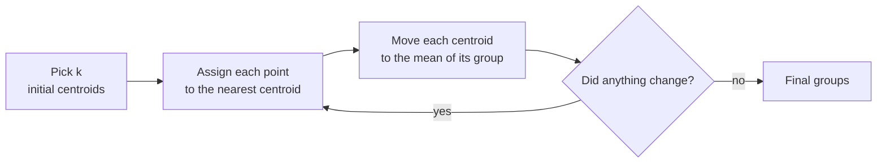

# 07 · Unsupervised learning: K-Means, PCA and anomaly detection

> 🇺🇸 English · 🇧🇷 [Português](07-unsupervised-learning.pt-BR.md)

| | |
|-|-|
| **Track** | [AI Fundamentals](README.md) · Lesson 7 of 13 |
| **Level** | Foundation |
| **Prerequisites** | [04 · Essential math](04-essential-math.md), [05 · Linear and logistic regression](05-linear-logistic-regression.md) |
| **Reading time** | ~25 min |
| **You will learn** | How K-Means finds groups without labels, how PCA compresses many features into a few, how both become anomaly detectors, and how attackers hide inside "normal" or shift it slowly |

## Learning without an answer key

In lessons 05 and 06, every training example came with the right answer. In practice, labels are expensive: someone has to analyze each event and decide whether it is an attack. Security has an even worse problem: **tomorrow's attack is not in today's dataset**.

**Unsupervised learning** ([lesson 03](03-how-machines-learn.md)) works with the features alone and looks for **structure** in the data. This lesson covers the three most common tasks:

| Task | Question | Algorithm in this lesson | Security use |
|------|----------|--------------------------|--------------|
| **Clustering** | Which natural groups exist? | K-Means | Grouping malware families, host profiles, phishing campaigns |
| **Dimensionality reduction** | Can 100 features be summarized in 3? | PCA | Visualizing data, removing noise, speeding up other models |
| **Anomaly detection** | What breaks the pattern? | Distance to cluster, reconstruction error, Isolation Forest | UEBA, intrusion detection, fraud, beaconing |

## K-Means: finding groups

### The algorithm

K-Means splits the data into **k** groups. Each group is represented by its **centroid**, the mean point of the group. The algorithm alternates two steps until nothing changes:



### An example with numbers

Six hosts on the network, described by two features: **connections per hour** (in tens) and **distinct destination ports**.

| Host | Connections | Ports |
|------|-------------|-------|
| A | 2 | 1 |
| B | 3 | 2 |
| C | 2 | 3 |
| D | 9 | 8 |
| E | 10 | 9 |
| F | 8 | 10 |

With k = 2, and starting (badly, on purpose) with the centroids at A (2, 1) and B (3, 2):

| Iteration | Group 1 | Group 2 | New centroid 1 | New centroid 2 |
|-----------|---------|---------|----------------|----------------|
| 1 | A | B, C, D, E, F | (2, 1) | (6.4, 6.4) |
| 2 | A, B, C | D, E, F | (2.33, 2) | (9, 9) |
| 3 | A, B, C | D, E, F | unchanged | unchanged |

In iteration 1, almost everything fell into group 2, because both centroids started right next to each other. In iteration 2, centroid 2 moved to the middle of the data and "pulled" D, E and F, freeing B and C to join group 1. In iteration 3 nothing changes: the algorithm has **converged**. The groups make sense: workstations (few connections, few ports) and servers (lots of both).

The algorithm does not know what the groups **mean**. Naming them is the analyst's job.

### Choosing k

K-Means does not figure out by itself how many groups exist. A common heuristic is the **elbow method**: run the algorithm with k = 1, 2, 3… and measure the average distance from the points to their centroids. That distance always goes down as k grows, but past a certain point it barely drops. That "elbow" in the curve is a good candidate for k.

> [!NOTE]
> **K-Means limitations**
> It assumes groups that are roughly round and similar in size, it depends on the initial centroids (which is why libraries run it several times with different starts) and it is sensitive to scale: if one feature goes from 0 to 1 and another from 0 to 1,000,000, the second one dominates the distance. Normalizing the features first is mandatory.

## PCA: summarizing many features in a few

### The intuition

Real data has dozens or hundreds of features, and many of them move together. The number of packets and the volume transferred in a connection, for example, almost always rise and fall together. Keeping both is nearly redundant.

**PCA** (*Principal Component Analysis*) finds the **directions** in which the data varies the most, called **principal components**:

- the 1st component is the direction of greatest variation;
- the 2nd is the direction of greatest remaining variation, perpendicular to the first;
- and so on.

If the first components hold almost all the variation, the rest can be dropped with little loss. It is like photographing a 3D object from the angle that shows the most detail: the photo is 2D, but it keeps what matters.

### An example with numbers

Four normal connections, with **packets** (in hundreds) and **volume** (in MB):

| Connection | Packets | Volume |
|------------|---------|--------|
| 1 | 1 | 2.1 |
| 2 | 2 | 3.9 |
| 3 | 3 | 6.2 |
| 4 | 4 | 7.8 |

Volume is roughly twice the packet count. PCA finds the 1st component in the direction **(0.457, 0.890)**, along that relationship, and it explains **99.9%** of the variation. In practice, these two features are really one: "connection size".

### PCA as an anomaly detector

Here is the trick that matters for security: compress a point onto the 1st component and then **reconstruct** it. If the point follows the normal pattern, the reconstruction is almost identical to the original. If it does not, a large **reconstruction error** is left over.

| Point | Packets | Volume | Reconstructed | Error |
|-------|---------|--------|---------------|-------|
| Normal | 3 | 6.0 | (3.01, 5.99) | 0.012 |
| Normal (from training) | 1 | 2.1 | (1.01, 2.10) | 0.009 |
| **Odd** | 2 | 8.0 | (3.61, 7.17) | **1.816** |

The odd point carries a lot of volume for few packets, which breaks the learned relationship. Neither feature on its own is absurd (2 and 8 are within normal ranges), but the **combination** is. Spotting it by looking at one feature at a time would be impossible.

## Anomaly detection

### The general idea

Instead of learning "what an attack looks like", the model learns **what normal looks like** and flags what departs from it. The big advantage: it can catch attacks nobody has seen before. Three common approaches:

| Approach | How it measures "odd" | Link to other lessons |
|----------|-----------------------|-----------------------|
| **Distance to cluster** | A point far from every K-Means centroid | This lesson |
| **Reconstruction error** | A point that PCA (or an autoencoder) cannot reconstruct well | This lesson; autoencoders in lesson 09 |
| **Isolation Forest** | Random trees isolate anomalies with **few** questions, because they stand alone | Trees from [lesson 06](06-trees-naive-bayes-svm.md) |

Back to K-Means: a new host G with (9 connections, 2 ports) sits **6.67** from the workstation centroid and **7.00** from the server centroid. Compared with the typical distance of normal hosts to their centroids (around 1), it belongs to neither group: many connections to very few destinations, a pattern that may be malware **beaconing** or exfiltration.

### An anomaly is not an attack

> [!WARNING]
> **The detector finds the unusual, not the malicious**
> A nightly backup, a deploy, an employee traveling or a sale on the online store are legitimate anomalies. And an attacker who behaves like a normal user is no anomaly at all. Add the base rate trap from [lesson 04](04-essential-math.md) and you get the classic SOC problem: many alerts, few attacks. Anomaly detection works best as **one signal among several**, not as a verdict.

## Red teamer's view

### 1. Mimicry: look normal

If the detector learns what normal is, the attacker tries to **stay inside normal**. In the example, host G (9 connections, 2 ports) was far from everything. If the malware slows down to 3 connections per hour and varies its ports a little, say (3, 3), the distance to the workstation centroid drops to **1.20**: just like any workstation. That is the **"low and slow"** logic: less volume, more time, business hours, common destinations and protocols (HTTPS to well-known services).

PCA has the same weakness: an attack that **respects the learned correlations** (volume proportional to packets, for example) has a low reconstruction error, even though it is malicious.

### 2. Boiling frog: shift normal slowly

Anomaly detectors are usually **retrained** on recent data to keep up with legitimate change. The attacker exploits that by increasing activity **gradually**:

| Week | Attacker activity | The detector… |
|------|-------------------|---------------|
| 1 | Slightly above normal | Finds it odd, but below the threshold |
| 2 | A bit more | Already retrained on week 1: "this is the new normal" |
| … | … | … |
| 8 | High-volume exfiltration | Considers it normal |

This is **poisoning** of an unsupervised model: there are no labels to flip, so the attacker changes **what the model considers normal**. Research since the late 2000s showed that slowly injecting extra traffic (*chaff*) can blind PCA-based network anomaly detectors.

### 3. Feature choice is the attack surface

The detector only sees the features someone picked. If it looks at connections and ports, but not time of day or destination, the attacker varies what is **not observed**. For the red teamer, finding out (or inferring) which features feed the model is half the job.

> [!TIP]
> **Red teamer's view**
> Against anomaly detection, the question is "what is normal here?". Observe the environment before acting and **imitate the profile of an existing group** (mimicry). If the model is retrained on recent data, **ramp up activity slowly** to shift normal. And remember that every unmonitored feature is a free channel. For the blue team the lesson is the reverse: cap how much retraining can change the model, monitor centroid drift and combine several signals.

## Hands-on with Python

A numpy-only example that reproduces the numbers in this lesson:

```python
import numpy as np

# K-Means with k = 2
X = np.array([[2, 1], [3, 2], [2, 3], [9, 8], [10, 9], [8, 10]], dtype=float)
c = X[[0, 1]].copy()                          # bad start: A and B
for _ in range(10):
    dist = np.linalg.norm(X[:, None] - c[None], axis=2)
    group = dist.argmin(axis=1)
    c = np.array([X[group == k].mean(axis=0) for k in range(2)])
print(group)                                  # [0 0 0 1 1 1]
print(c.round(2))                             # centroids ≈ (2.33, 2.0) and (9.0, 9.0)

# Distance-based anomaly and mimicry
for host in ([9, 2], [3, 3]):
    print(host, np.linalg.norm(c - host, axis=1).round(2))
# [9, 2] [6.67 7.  ]  -> far from everything
# [3, 3] [1.2  8.49]  -> looks like a workstation

# PCA and reconstruction error
P = np.array([[1, 2.1], [2, 3.9], [3, 6.2], [4, 7.8]])
mean = P.mean(axis=0)
eigenvalues, eigenvectors = np.linalg.eigh(np.cov(P.T))
pc1 = eigenvectors[:, -1]                     # direction of greatest variation
print((eigenvalues[-1] / eigenvalues.sum()).round(3))   # 0.999

def error(point):
    centered = np.array(point) - mean
    reconstructed = mean + (centered @ pc1) * pc1
    return np.linalg.norm(np.array(point) - reconstructed).round(3)

print(error([3, 6]), error([2, 8]))           # 0.012 1.816
```

In real life you would use scikit-learn (`KMeans`, `PCA`, `IsolationForest`), but these are the computations underneath.

## Summary

- **Unsupervised** learning finds structure without labels, which is valuable when labels are expensive or attacks are new.
- **K-Means** alternates "assign to the nearest centroid" and "move the centroid to the mean" until it converges. You pick k.
- **PCA** finds the directions of greatest variation and lets you summarize many features in a few.
- **Anomaly detection** learns normal and flags what departs from it: distance to cluster, reconstruction error, Isolation Forest. An anomaly is not the same as an attack.
- The attacker responds with **mimicry** (looking normal) and **gradual poisoning** (shifting normal).

## Check your understanding

<details><summary>1. Why would a SOC use unsupervised instead of supervised learning to detect intrusions?</summary>

Because attack labels are rare and expensive, and new attacks do not show up in training. An unsupervised model learns normal behavior and can flag deviations nobody labeled before.
</details>

<details><summary>2. Two features: one in bytes (0 to 10,000,000) and one in number of ports (0 to 100). What happens if you run K-Means without normalizing?</summary>

The distance is dominated by the byte feature, and the number of ports barely affects the groups. The features need to be put on the same scale first.
</details>

<details><summary>3. A point has every feature within its normal range, but PCA gives it a high reconstruction error. How is that possible?</summary>

Reconstruction error measures whether the point respects the **correlations** between features. Values that are individually normal can form a combination that never appears in normal data, such as a lot of volume for few packets.
</details>

<details><summary>4. What is the "boiling frog" attack against an anomaly detector?</summary>

It is gradual poisoning: the attacker raises activity slowly, always below the threshold, and periodic retraining absorbs each step as "normal". In the end, high-volume malicious activity is no longer seen as an anomaly.
</details>

<details><summary>5. How can C2 malware try to evade a detector based on distance to host clusters?</summary>

With **mimicry**: lowering connection frequency, using common ports and protocols (such as HTTPS), talking during business hours and to destinations similar to those of legitimate hosts, until it sits close to the centroid of a normal group.
</details>

## Go deeper and practice

Deep dives that build on this lesson:

- **Deep dive:** [07.1 · Evaluating clusters](07-1-evaluating-clusters.md)
- **Deep dive:** [07.2 · Anomaly detection in depth](07-2-anomaly-detection-deep-dive.md)

---

← [06 · Supervised learning II: decision trees, Naive Bayes and SVM](06-trees-naive-bayes-svm.md) · **Next lesson:** [08 · Reinforcement learning: agents, rewards, Q-Learning and SARSA](08-reinforcement-learning.md) →
