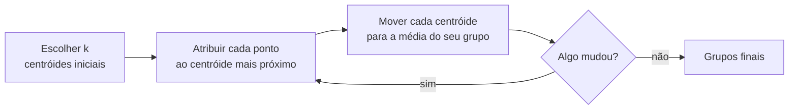

# 07 · Aprendizado não supervisionado: K-Means, PCA e detecção de anomalias

> 🇧🇷 Português · 🇺🇸 [English](07-unsupervised-learning.md)

| | |
|-|-|
| **Trilha** | [Fundamentos de IA](README.pt-BR.md) · Aula 7 de 13 |
| **Nível** | Base |
| **Pré-requisitos** | [04 · Matemática essencial](04-essential-math.pt-BR.md), [05 · Regressão linear e logística](05-linear-logistic-regression.pt-BR.md) |
| **Tempo de leitura** | ~25 min |
| **Você vai aprender** | Como o K-Means encontra grupos sem rótulos, como o PCA comprime muitas features em poucas, como os dois viram detectores de anomalia, e como atacantes se escondem do "normal" ou o mudam aos poucos |

## Aprender sem gabarito

Nas aulas 05 e 06, todo exemplo de treino vinha com a resposta certa. Na prática, rótulos são caros: alguém precisa analisar cada evento e decidir se é ataque. Em segurança, há ainda um problema pior: **o ataque de amanhã não está no dataset de hoje**.

O **aprendizado não supervisionado** ([aula 03](03-how-machines-learn.pt-BR.md)) trabalha só com as features e procura **estrutura** nos dados. Esta aula cobre as três tarefas mais comuns:

| Tarefa | Pergunta | Algoritmo da aula | Uso em segurança |
|--------|----------|-------------------|------------------|
| **Agrupamento** (*clustering*) | Que grupos naturais existem? | K-Means | Agrupar famílias de malware, perfis de hosts, campanhas de phishing |
| **Redução de dimensionalidade** | Dá para resumir 100 features em 3? | PCA | Visualizar dados, remover ruído, acelerar outros modelos |
| **Detecção de anomalias** | O que foge do padrão? | Distância ao cluster, erro de reconstrução, Isolation Forest | UEBA, detecção de intrusão, fraude, beaconing |

## K-Means: encontrando grupos

### O algoritmo

O K-Means divide os dados em **k** grupos. Cada grupo é representado pelo seu **centróide**, o ponto médio do grupo. O algoritmo alterna dois passos até parar de mudar:



### Um exemplo com números

Seis hosts da rede, descritos por duas features: **conexões por hora** (em dezenas) e **portas de destino distintas**.

| Host | Conexões | Portas |
|------|----------|--------|
| A | 2 | 1 |
| B | 3 | 2 |
| C | 2 | 3 |
| D | 9 | 8 |
| E | 10 | 9 |
| F | 8 | 10 |

Com k = 2, e começando (de propósito, mal) com os centróides em A (2, 1) e B (3, 2):

| Iteração | Grupo 1 | Grupo 2 | Novo centróide 1 | Novo centróide 2 |
|----------|---------|---------|------------------|------------------|
| 1 | A | B, C, D, E, F | (2, 1) | (6,4; 6,4) |
| 2 | A, B, C | D, E, F | (2,33; 2) | (9, 9) |
| 3 | A, B, C | D, E, F | não mudou | não mudou |

Na iteração 1, quase tudo caiu no grupo 2, porque os dois centróides começaram colados. Na iteração 2, o centróide 2 se moveu para o meio dos dados e "puxou" D, E e F, liberando B e C para o grupo 1. Na iteração 3 nada muda: o algoritmo **convergiu**. Os grupos fazem sentido: estações de trabalho (poucas conexões, poucas portas) e servidores (muitas das duas coisas).

O algoritmo não sabe o que os grupos **significam**. Quem dá nome a eles é o analista.

### Escolhendo o k

O K-Means não descobre sozinho quantos grupos existem. Uma heurística comum é o **método do cotovelo**: rodar o algoritmo com k = 1, 2, 3… e medir a distância média dos pontos aos seus centróides. Essa distância sempre cai quando k aumenta, mas a partir de certo ponto cai pouco. Esse "cotovelo" da curva é um bom candidato para k.

> [!NOTE]
> **Limitações do K-Means**
> Ele supõe grupos mais ou menos redondos e de tamanho parecido, depende dos centróides iniciais (por isso as bibliotecas rodam várias vezes com inícios diferentes) e é sensível à escala: se uma feature vai de 0 a 1 e outra de 0 a 1.000.000, a segunda domina a distância. Normalizar as features antes é obrigatório.

## PCA: resumindo muitas features em poucas

### A intuição

Dados reais têm dezenas ou centenas de features, e muitas delas andam juntas. O número de pacotes e o volume transferido numa conexão, por exemplo, quase sempre sobem e descem juntos. Guardar os dois é quase redundante.

O **PCA** (*Principal Component Analysis*) encontra as **direções** em que os dados mais variam, chamadas **componentes principais**:

- o 1º componente é a direção de maior variação;
- o 2º é a de maior variação entre as que sobram, perpendicular ao primeiro;
- e assim por diante.

Se os primeiros componentes concentram quase toda a variação, dá para descartar o resto com pouca perda. É como fotografar um objeto 3D pelo ângulo que mostra mais detalhes: a foto é 2D, mas preserva o essencial.

### Um exemplo com números

Quatro conexões normais, com **pacotes** (em centenas) e **volume** (em MB):

| Conexão | Pacotes | Volume |
|---------|---------|--------|
| 1 | 1 | 2,1 |
| 2 | 2 | 3,9 |
| 3 | 3 | 6,2 |
| 4 | 4 | 7,8 |

O volume é quase o dobro dos pacotes. O PCA encontra o 1º componente na direção **(0,457; 0,890)**, ao longo dessa relação, e ele explica **99,9%** da variação. Na prática, essas duas features são uma só: "tamanho da conexão".

### PCA como detector de anomalias

Aqui está o truque útil para segurança: comprimir um ponto no 1º componente e depois **reconstruí-lo**. Se o ponto segue o padrão normal, a reconstrução fica quase igual ao original. Se não segue, sobra um **erro de reconstrução** grande.

| Ponto | Pacotes | Volume | Reconstruído | Erro |
|-------|---------|--------|--------------|------|
| Normal | 3 | 6,0 | (3,01; 5,99) | 0,012 |
| Normal (do treino) | 1 | 2,1 | (1,01; 2,10) | 0,009 |
| **Estranho** | 2 | 8,0 | (3,61; 7,17) | **1,816** |

O ponto estranho carrega muito volume para poucos pacotes, o que não segue a relação aprendida. Nenhuma das features sozinha é absurda (2 e 8 estão dentro das faixas normais), mas a **combinação** é. Detectar isso olhando uma feature de cada vez seria impossível.

## Detecção de anomalias

### A ideia geral

Em vez de aprender "o que é ataque", o modelo aprende **o que é normal** e sinaliza o que se afasta disso. A grande vantagem: pode detectar ataques que ninguém viu antes. Três formas comuns:

| Abordagem | Como mede o "estranho" | Ligação com outras aulas |
|-----------|------------------------|--------------------------|
| **Distância ao cluster** | Ponto longe de todos os centróides do K-Means | Esta aula |
| **Erro de reconstrução** | Ponto que o PCA (ou um autoencoder) não consegue reconstruir bem | Esta aula; autoencoders na aula 09 |
| **Isolation Forest** | Árvores aleatórias isolam anomalias com **poucas** perguntas, porque elas estão sozinhas | Árvores da [aula 06](06-trees-naive-bayes-svm.pt-BR.md) |

Voltando ao K-Means: um host novo G com (9 conexões, 2 portas) fica a **6,67** do centróide das estações e a **7,00** do centróide dos servidores. Comparado com a distância típica dos hosts normais aos seus centróides (em torno de 1), ele não pertence a nenhum grupo: muitas conexões para pouquíssimos destinos, um padrão que pode ser **beaconing** de malware ou exfiltração.

### Anomalia não é ataque

> [!WARNING]
> **O detector encontra o incomum, não o malicioso**
> Um backup noturno, um deploy, um funcionário viajando ou uma promoção na loja online são anomalias legítimas. E um atacante que se comporta como um usuário normal não é anomalia nenhuma. Some a isso a armadilha da taxa base da [aula 04](04-essential-math.pt-BR.md) e o resultado é o problema clássico do SOC: muitos alertas, poucos ataques. Detecção de anomalias funciona melhor como **um sinal entre vários**, não como veredito.

## Visão do red teamer

### 1. Mimetismo: pareça normal

Se o detector aprende o que é normal, o atacante tenta **ficar dentro do normal**. No exemplo, o host G (9 conexões, 2 portas) estava longe de tudo. Se o malware reduzir o ritmo para 3 conexões por hora e variar um pouco as portas, digamos (3, 3), a distância ao centróide das estações cai para **1,20**: igual a uma estação de trabalho qualquer. É a lógica do **"low and slow"**: menos volume, mais tempo, horários comerciais, destinos e protocolos comuns (HTTPS para serviços conhecidos).

O PCA tem a mesma fraqueza: um ataque que **respeita as correlações** aprendidas (volume proporcional aos pacotes, por exemplo) tem erro de reconstrução baixo, mesmo sendo malicioso.

### 2. Sapo na panela: mudar o normal aos poucos

Detectores de anomalia costumam ser **retreinados** com dados recentes, para acompanhar mudanças legítimas. O atacante explora isso aumentando a atividade **gradualmente**:

| Semana | Atividade do atacante | O detector… |
|--------|----------------------|-------------|
| 1 | Um pouco acima do normal | Acha estranho, mas abaixo do limiar |
| 2 | Um pouco mais | Já retreinou com a semana 1: "isso é o novo normal" |
| … | … | … |
| 8 | Exfiltração em volume alto | Considera normal |

Isso é **envenenamento** de um modelo não supervisionado: não há rótulos para trocar, então o atacante muda **o que o modelo considera normal**. Pesquisas desde o fim dos anos 2000 mostraram que injetar tráfego extra aos poucos (*chaff*) consegue cegar detectores de anomalia de rede baseados em PCA.

### 3. Escolha das features é a superfície de ataque

O detector só enxerga as features que alguém escolheu. Se ele olha conexões e portas, mas não horário nem destino, o atacante varia o que **não é observado**. Para o red teamer, descobrir (ou deduzir) quais features alimentam o modelo é metade do trabalho.

> [!TIP]
> **Visão do red teamer**
> Contra detecção de anomalias, a pergunta é "o que é normal aqui?". Observe o ambiente antes de agir e **imite o perfil de um grupo existente** (mimetismo). Se o modelo é retreinado com dados recentes, **aumente a atividade aos poucos** para deslocar o normal. E lembre que cada feature não monitorada é um canal livre. Para o blue team, a lição é a inversa: limite o quanto o retreino pode mudar o modelo, monitore a deriva dos centróides e combine vários sinais.

## Na prática com Python

Um exemplo só com numpy, que reproduz os números desta aula:

```python
import numpy as np

# K-Means com k = 2
X = np.array([[2, 1], [3, 2], [2, 3], [9, 8], [10, 9], [8, 10]], dtype=float)
c = X[[0, 1]].copy()                          # início ruim: A e B
for _ in range(10):
    dist = np.linalg.norm(X[:, None] - c[None], axis=2)
    grupo = dist.argmin(axis=1)
    c = np.array([X[grupo == k].mean(axis=0) for k in range(2)])
print(grupo)                                  # [0 0 0 1 1 1]
print(c.round(2))                             # centróides ≈ (2.33, 2.0) e (9.0, 9.0)

# Anomalia por distância e mimetismo
for host in ([9, 2], [3, 3]):
    print(host, np.linalg.norm(c - host, axis=1).round(2))
# [9, 2] [6.67 7.  ]  -> longe de tudo
# [3, 3] [1.2  8.49]  -> parece uma estação de trabalho

# PCA e erro de reconstrução
P = np.array([[1, 2.1], [2, 3.9], [3, 6.2], [4, 7.8]])
media = P.mean(axis=0)
autovalores, autovetores = np.linalg.eigh(np.cov(P.T))
pc1 = autovetores[:, -1]                      # direção de maior variação
print((autovalores[-1] / autovalores.sum()).round(3))   # 0.999

def erro(ponto):
    centro = np.array(ponto) - media
    reconstruido = media + (centro @ pc1) * pc1
    return np.linalg.norm(np.array(ponto) - reconstruido).round(3)

print(erro([3, 6]), erro([2, 8]))             # 0.012 1.816
```

Na vida real você usaria o scikit-learn (`KMeans`, `PCA`, `IsolationForest`), mas as contas por baixo são estas.

## Resumo

- O aprendizado **não supervisionado** encontra estrutura sem rótulos, o que é valioso quando rótulos são caros ou os ataques são novos.
- O **K-Means** alterna "atribuir ao centróide mais próximo" e "mover o centróide para a média" até convergir. O k é escolhido por você.
- O **PCA** encontra as direções de maior variação e permite resumir muitas features em poucas.
- **Detecção de anomalias** aprende o normal e sinaliza o que foge dele: distância ao cluster, erro de reconstrução, Isolation Forest. Anomalia não é sinônimo de ataque.
- O atacante responde com **mimetismo** (parecer normal) e **envenenamento gradual** (mudar o normal).

## Teste seu entendimento

<details><summary>1. Por que um SOC usaria aprendizado não supervisionado em vez de supervisionado para detectar intrusões?</summary>

Porque rótulos de ataque são raros e caros, e ataques novos não aparecem no treino. Um modelo não supervisionado aprende o comportamento normal e pode sinalizar desvios que ninguém rotulou antes.
</details>

<details><summary>2. Duas features: uma em bytes (0 a 10.000.000) e outra em número de portas (0 a 100). O que acontece se você rodar K-Means sem normalizar?</summary>

A distância fica dominada pela feature em bytes, e o número de portas praticamente não influencia os grupos. É preciso colocar as features na mesma escala antes.
</details>

<details><summary>3. Um ponto tem cada feature dentro da faixa normal, mas o PCA dá um erro de reconstrução alto. Como isso é possível?</summary>

O erro de reconstrução mede se o ponto respeita as **correlações** entre as features. Valores individualmente normais podem formar uma combinação que nunca aparece nos dados normais, como muito volume para poucos pacotes.
</details>

<details><summary>4. O que é o ataque "sapo na panela" contra um detector de anomalias?</summary>

É um envenenamento gradual: o atacante aumenta a atividade aos poucos, sempre abaixo do limiar, e o retreino periódico incorpora cada passo como "normal". No fim, a atividade maliciosa em volume alto não é mais vista como anomalia.
</details>

<details><summary>5. Como um malware de C2 pode tentar evitar um detector baseado em distância aos clusters de hosts?</summary>

Com **mimetismo**: reduzir a frequência das conexões, usar portas e protocolos comuns (como HTTPS), conversar em horário comercial e com destinos parecidos com os de hosts legítimos, até ficar perto do centróide de um grupo normal.
</details>

## Aprofunde e pratique

Aprofundamentos que partem desta aula:

- **Aprofundamento:** [07.1 · Avaliando agrupamentos](07-1-evaluating-clusters.pt-BR.md)
- **Aprofundamento:** [07.2 · Detecção de anomalias a fundo](07-2-anomaly-detection-deep-dive.pt-BR.md)

---

← [06 · Aprendizado supervisionado II: árvores de decisão, Naive Bayes e SVM](06-trees-naive-bayes-svm.pt-BR.md) · **Próxima aula:** [08 · Aprendizado por reforço: agentes, recompensas, Q-Learning e SARSA](08-reinforcement-learning.pt-BR.md) →
