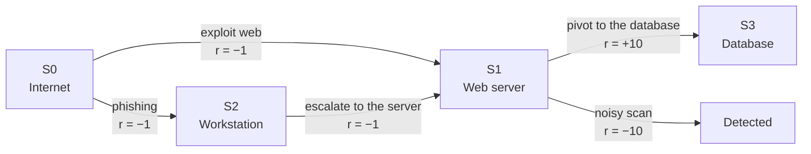

# 08.1 · Reinforcement learning in depth

> 🇺🇸 English · 🇧🇷 [Português](08-1-reinforcement-learning-deep-dive.pt-BR.md)

| | |
|-|-|
| **Track** | [AI Fundamentals](README.md) · Deep dive into lesson [08 · Reinforcement learning](08-reinforcement-learning.md) |
| **Level** | Deep dive |
| **Prerequisites** | [08 · Reinforcement learning](08-reinforcement-learning.md), [04.1 · Logs and entropy](04-1-logs-and-entropy.md) |
| **Reading time** | ~30 min |
| **You will learn** | What the V and Q value functions are, the Bellman equation and value iteration, how uncertainty and risk change the best policy, episodic and continuing tasks, exploration with decaying ε and softmax, why badly designed rewards create infinite loops, and how defenders use the same math |

## Where we left off

In [lesson 08](08-reinforcement-learning.md), an agent used Q-Learning to learn the S0 → S1 → S3 route through a mini attack graph, and we watched the goal's value "flow backwards" with each episode. Still unexplained: **why** that value converges to 8, what happens when actions can fail, how to dose exploration and why badly defined rewards lead to absurd behavior.

## Value functions: V and Q

| Function | Question it answers |
|----------|---------------------|
| **V(s)** | How much total reward do I expect from **state** s, acting in the best way? |
| **Q(s, a)** | How much total reward do I expect if I take **action** a in state s and then act in the best way? |

The relationship between them is simple: a state's value is that of the best action available in it, `V(s) = max Q(s, a)`.

## The Bellman equation

An action's value is the immediate reward plus the (discounted) value of where it leads:

```text
Q(s, a) = r + γ × V(s')
V(s)    = max over a of Q(s, a)
```

It is a **recursive** definition: a state's value depends on the value of the following states. Lesson 08's Q-Learning update is precisely a way to solve this equation little by little, through trial and error.

### The attack graph, solved

The mini graph from lesson 08, with γ = 0.9:



Solving from the end backwards:

| State | Actions | Value of each action | V(state) |
|-------|---------|----------------------|----------|
| S1 | pivot / scan | 10 / −10 | **10** |
| S2 | escalate to S1 | −1 + 0.9 × 10 = 8 | **8** |
| S0 | exploit web / phishing | −1 + 0.9 × 10 = **8** / −1 + 0.9 × 8 = 6.2 | **8** |

The best policy from the Internet is to exploit the web server and pivot: a value of 8, the same number lesson 08's Q-Learning converged to.

### Value iteration

When the environment is known (every transition and reward), Bellman can be solved without trial and error: start with V = 0 everywhere and apply the equation repeatedly.

| Iteration | V(S0) | V(S1) | V(S2) |
|-----------|-------|-------|-------|
| 0 | 0 | 0 | 0 |
| 1 | −1 | 10 | −1 |
| 2 | 8 | 10 | 8 |
| 3 | 8 | 10 | 8 |

After two iterations, the values stop changing: it has converged. The difference from Q-Learning:

| Approach | Needs to know the environment? | How it learns |
|----------|-------------------------------|---------------|
| **Value iteration** (model-based) | Yes: every transition and reward | By computing |
| **Q-Learning, SARSA** (model-free) | No | By experimenting |

## When actions can fail

In the real world, not every action works. Suppose exploiting the web server has a **20% chance of being detected** (end of the episode, reward −10). The action's value becomes an **average weighted** by the possible outcomes:

```text
Q(S0, exploit web) = 0.8 × (−1 + 0.9 × 10) + 0.2 × (−10) = 6.4 − 2 = 4.4
Q(S0, phishing)    = −1 + 0.9 × 8 = 6.2
```

| Detection chance on the web route | Web route value | Phishing route value | Best policy |
|-----------------------------------|-----------------|----------------------|-------------|
| 0% | 8.0 | 6.2 | Exploit web |
| 20% | 4.4 | 6.2 | **Phishing** |

The web route only pays off if the success chance is above 90%:

```text
p × 8 + (1 − p) × (−10) > 6.2   →   p > 0.9
```

**Raising detection on a path changes the attacker's optimal route.** That is the bridge between RL and defense: the same computations an automated pentest agent uses to choose its path help the defender decide **where to place monitoring**.

## Episodic and continuing tasks

| Type | How it ends | Example |
|------|-------------|---------|
| **Episodic** | In a final state (goal reached, detection, step limit) | An automated pentest, a game match |
| **Continuing** | It never ends | A defense agent tuning firewall rules all the time |

In continuing tasks, the discount **γ < 1** is mandatory: without it, the sum of future rewards would be infinite.

## Dosing exploration

### Decaying ε

In lesson 08, ε-greedy drew a random action with probability ε. In practice, ε **decreases** over time: lots of exploration at the start, almost none at the end. With `ε = max(0.01, 0.995^t)`:

| Episode t | 0 | 100 | 500 | 1000 |
|-----------|---|-----|-----|------|
| ε | 1.00 | 0.61 | 0.08 | 0.01 |

### Softmax exploration

ε-greedy explores blindly: when it explores, every action has the same chance, including terrible ones. **Softmax** (or Boltzmann) **exploration** draws actions with probability proportional to their value, with a **temperature** T, the same idea as LLM temperature ([lesson 11](11-llms.md)):

```text
P(a) = e^(Q(a) / T) / Σ e^(Q(b) / T)
```

With the graph's values at S0 (8 for exploit web, 6.2 for phishing):

| Temperature T | P(exploit web) | Behavior |
|---------------|----------------|----------|
| 0.2 | ≈ 1.000 | Almost always the best action |
| 1 | 0.858 | Sometimes explores the second option |
| 5 | 0.589 | Explores a lot |

Actions almost as good as the best one get explored often; much worse ones, almost never.

## Convergence and parameters

Q-Learning converges to the correct values if **every action is tried infinitely often** and the learning rate α decreases appropriately. In practice:

| Parameter | Too high | Too low |
|-----------|----------|---------|
| **α** (learning rate) | Values oscillate, dominated by the latest experience | Learns too slowly |
| **γ** (discount) | Plans very far ahead; learning becomes slow and unstable | Short-sighted: only sees the immediate reward |
| **ε or T** (exploration) | Never exploits what it learned | Gets stuck in a bad strategy |

With many states, the Q table becomes a neural network (DQN, [lesson 08](08-reinforcement-learning.md)). LLM RLHF uses another family, **policy gradient** methods (such as PPO), which directly adjust the actions' probabilities, with a **KL divergence** penalty ([04.1](04-1-logs-and-entropy.md)) so the model does not drift too far from the original.

> [!TIP]
> **Red teamer's view**
> 1. **Infinite reward loops.** By the Bellman equation, a loop that gives reward r at each step is worth `r / (1 − γ)`. If the agent earns +1 for "gathering information" with a scan that returns to the same state, the loop is worth 1 / 0.1 = **10**, the same as reaching the goal. At +1.5, it is worth **15** and becomes **better** than the goal: the agent keeps scanning forever. It is lesson 08's *reward hacking*, now explained by the math.
> 2. **Defense as changing values.** Raising the detection chance on a path changes the optimal policy of rational attackers (humans or agents). In the example, 20% detection was enough to knock the web route out of first place. Well-placed monitoring does not have to catch everything: it has to make the path expensive.
> 3. **Exploration is an attack surface.** An agent that is still exploring takes random actions. In an environment the attacker influences, those actions can be induced, and the resulting experiences **poison** learning.
> 4. **Greedy policies are predictable.** A defense agent that always picks the same "best action" can be studied and worked around. Stochastic policies, such as softmax, are harder to anticipate.
> 5. **Alignment is a policy, not a rule.** In LLMs, RLHF adjusts probabilities within a KL limit relative to the original model. Refusal is a high-probability action, not an impossibility, and that is what [jailbreaks](../02-prompt-injection/jailbreaks.md) exploit.

## Hands-on with Python

```python
import numpy as np

gamma = 0.9

def value_iteration(p_web, iterations=4):
    V = {"S0": 0.0, "S1": 0.0, "S2": 0.0}
    for _ in range(iterations):
        q_web = p_web * (-1 + gamma * V["S1"]) + (1 - p_web) * (-10)
        q_phish = -1 + gamma * V["S2"]
        V = {"S1": max(10, -10),
             "S2": -1 + gamma * V["S1"],
             "S0": max(q_web, q_phish)}
    return round(V["S0"], 2), round(q_web, 2), round(q_phish, 2)

print(value_iteration(1.0))   # (8.0, 8.0, 6.2)  -> exploit web
print(value_iteration(0.8))   # (6.2, 4.4, 6.2)  -> phishing

# Softmax exploration with temperature
def softmax(q, T):
    e = np.exp(np.array(q) / T)
    return e / e.sum()

for T in (0.2, 1, 5):
    print(T, softmax([8, 6.2], T).round(3))   # 0.2 [1. 0.] · 1 [0.858 0.142] · 5 [0.589 0.411]

# Decaying ε
print([round(max(0.01, 0.995 ** t), 3) for t in (0, 100, 500, 1000)])   # [1.0, 0.606, 0.082, 0.01]

# Reward loop: r / (1 - γ)
print(1 / (1 - gamma), 1.5 / (1 - gamma))    # 10.0 15.0 (approx.)
```

## Summary

- **V(s)** is a state's value and **Q(s, a)** an action's; `V(s) = max Q(s, a)`.
- The **Bellman equation** defines value recursively; **value iteration** solves it when the environment is known, and Q-Learning solves it through experience.
- With actions that can fail, the value is a **weighted average**; in the example, 20% detection changed the optimal route.
- **Continuing** tasks require γ < 1; exploration can be dosed with **decaying ε** or **softmax** with a temperature.
- For the red teamer: reward loops are worth `r / (1 − γ)` and cause reward hacking; detection changes the attacker's policy; exploration can be poisoned; greedy policies are predictable; alignment is probability, not rule.

## Check your understanding

<details><summary>1. What is the difference between V(s) and Q(s, a)?</summary>

V(s) is the expected value from a state, acting in the best way; Q(s, a) is the expected value of taking a specific action in that state and then acting in the best way. V is the maximum of Q over the actions.
</details>

<details><summary>2. On the web route, the detection chance dropped to 5%. Which route does a rational attacker choose?</summary>

The web route: with p = 0.95, its value is `0.95 × 8 + 0.05 × (−10) = 7.6 − 0.5 = 7.1`, higher than phishing's 6.2. It only stops paying off when the success chance falls below 90%.
</details>

<details><summary>3. Why do continuing tasks need γ below 1?</summary>

Because they never end: without a discount, the sum of future rewards would be infinite (or undefined), and the agent could not compare actions.
</details>

<details><summary>4. An agent earns +2 per step on an action that keeps it in the same state, with γ = 0.9. How much is that loop worth, and why is it a problem?</summary>

`2 / (1 − 0.9) = 20`. If the real goal is worth less than that, the agent prefers staying in the loop forever instead of completing the task: reward hacking caused by the reward design.
</details>

<details><summary>5. What is the advantage of softmax exploration over ε-greedy?</summary>

ε-greedy, when exploring, picks any action with the same chance, including very bad ones. Softmax explores in proportion to value: actions almost as good as the best get tried often, and terrible ones almost never.
</details>

---

← [08 · Reinforcement learning](08-reinforcement-learning.md) · **Next lesson in the track:** [09 · From the perceptron to neural networks](09-neural-networks.md) →
