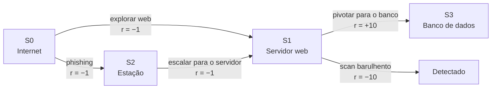

# 08.1 · Aprendizado por reforço a fundo

> 🇧🇷 Português · 🇺🇸 [English](08-1-reinforcement-learning-deep-dive.md)

| | |
|-|-|
| **Trilha** | [Fundamentos de IA](README.pt-BR.md) · Aprofundamento da aula [08 · Aprendizado por reforço](08-reinforcement-learning.pt-BR.md) |
| **Nível** | Aprofundamento |
| **Pré-requisitos** | [08 · Aprendizado por reforço](08-reinforcement-learning.pt-BR.md), [04.1 · Logaritmos e entropia](04-1-logs-and-entropy.pt-BR.md) |
| **Tempo de leitura** | ~30 min |
| **Você vai aprender** | O que são as funções de valor V e Q, a equação de Bellman e a value iteration, como incerteza e risco mudam a melhor política, tarefas episódicas e contínuas, exploração com ε decrescente e softmax, por que recompensas mal desenhadas criam laços infinitos, e como defensores usam a mesma matemática |

## Onde paramos

Na [aula 08](08-reinforcement-learning.pt-BR.md), um agente aprendeu com Q-Learning a rota S0 → S1 → S3 de um mini grafo de ataque, e vimos o valor do objetivo "escorrer para trás" a cada episódio. Ficaram por explicar: **por que** esse valor converge para 8, o que acontece quando as ações podem falhar, como dosar a exploração e por que recompensas mal definidas levam a comportamentos absurdos.

## Funções de valor: V e Q

| Função | Pergunta que responde |
|--------|----------------------|
| **V(s)** | Quanta recompensa total espero a partir do **estado** s, agindo da melhor forma? |
| **Q(s, a)** | Quanta recompensa total espero se fizer a **ação** a no estado s e depois agir da melhor forma? |

A relação entre elas é simples: o valor de um estado é o da melhor ação disponível nele, `V(s) = máx Q(s, a)`.

## A equação de Bellman

O valor de uma ação é a recompensa imediata mais o valor (descontado) de onde ela leva:

```text
Q(s, a) = r + γ × V(s')
V(s)    = máx sobre a de Q(s, a)
```

É uma definição **recursiva**: o valor de um estado depende do valor dos estados seguintes. A atualização do Q-Learning da aula 08 é justamente uma forma de resolver essa equação aos poucos, por tentativa e erro.

### O grafo de ataque, resolvido

O mini grafo da aula 08, com γ = 0,9:



Resolvendo de trás para frente:

| Estado | Ações | Valor de cada ação | V(estado) |
|--------|-------|--------------------|-----------|
| S1 | pivotar / scan | 10 / −10 | **10** |
| S2 | escalar para S1 | −1 + 0,9 × 10 = 8 | **8** |
| S0 | explorar web / phishing | −1 + 0,9 × 10 = **8** / −1 + 0,9 × 8 = 6,2 | **8** |

A melhor política a partir da Internet é explorar o servidor web e pivotar: valor 8, o mesmo número para o qual o Q-Learning da aula 08 convergia.

### Value iteration

Quando o ambiente é conhecido (todas as transições e recompensas), dá para resolver Bellman sem tentativa e erro: começa-se com V = 0 em tudo e aplica-se a equação repetidamente.

| Iteração | V(S0) | V(S1) | V(S2) |
|----------|-------|-------|-------|
| 0 | 0 | 0 | 0 |
| 1 | −1 | 10 | −1 |
| 2 | 8 | 10 | 8 |
| 3 | 8 | 10 | 8 |

Em duas iterações, os valores param de mudar: convergiu. A diferença em relação ao Q-Learning:

| Abordagem | Precisa conhecer o ambiente? | Como aprende |
|-----------|------------------------------|--------------|
| **Value iteration** (baseada em modelo) | Sim: todas as transições e recompensas | Calculando |
| **Q-Learning, SARSA** (sem modelo) | Não | Experimentando |

## Quando as ações podem falhar

No mundo real, nem toda ação dá certo. Suponha que explorar o servidor web tem **20% de chance de ser detectado** (fim do episódio, recompensa −10). O valor da ação passa a ser uma **média ponderada** pelos resultados possíveis:

```text
Q(S0, explorar web) = 0,8 × (−1 + 0,9 × 10) + 0,2 × (−10) = 6,4 − 2 = 4,4
Q(S0, phishing)     = −1 + 0,9 × 8 = 6,2
```

| Chance de detecção na rota web | Valor da rota web | Valor da rota phishing | Melhor política |
|--------------------------------|-------------------|------------------------|-----------------|
| 0% | 8,0 | 6,2 | Explorar web |
| 20% | 4,4 | 6,2 | **Phishing** |

A rota web só compensa se a chance de sucesso for maior que 90%:

```text
p × 8 + (1 − p) × (−10) > 6,2   →   p > 0,9
```

**Aumentar a detecção num caminho muda a rota ótima do atacante.** Essa é a ponte entre RL e defesa: os mesmos cálculos que um agente de pentest automatizado usa para escolher o caminho servem para o defensor decidir **onde colocar monitoramento**.

## Tarefas episódicas e contínuas

| Tipo | Como termina | Exemplo |
|------|--------------|---------|
| **Episódica** | Num estado final (objetivo alcançado, detecção, limite de passos) | Um pentest automatizado, uma partida de jogo |
| **Contínua** | Nunca termina | Um agente de defesa ajustando regras de firewall o tempo todo |

Em tarefas contínuas, o desconto **γ < 1** é obrigatório: sem ele, a soma das recompensas futuras seria infinita.

## Dosando a exploração

### ε decrescente

Na aula 08, o ε-greedy sorteava uma ação aleatória com probabilidade ε. Na prática, ε **diminui** com o tempo: muita exploração no começo, quase nenhuma no fim. Com `ε = máx(0,01; 0,995^t)`:

| Episódio t | 0 | 100 | 500 | 1000 |
|------------|---|-----|-----|------|
| ε | 1,00 | 0,61 | 0,08 | 0,01 |

### Exploração softmax

O ε-greedy explora às cegas: quando explora, todas as ações têm a mesma chance, inclusive as péssimas. A **exploração softmax** (ou de Boltzmann) sorteia as ações com probabilidade proporcional ao valor, com uma **temperatura** T, a mesma ideia da temperatura dos LLMs ([aula 11](11-llms.pt-BR.md)):

```text
P(a) = e^(Q(a) / T) / Σ e^(Q(b) / T)
```

Com os valores do grafo em S0 (8 para explorar web, 6,2 para phishing):

| Temperatura T | P(explorar web) | Comportamento |
|---------------|-----------------|---------------|
| 0,2 | ≈ 1,000 | Quase sempre a melhor ação |
| 1 | 0,858 | Explora a segunda opção às vezes |
| 5 | 0,589 | Explora muito |

Ações quase tão boas quanto a melhor são exploradas com frequência; ações muito piores, quase nunca.

## Convergência e parâmetros

O Q-Learning converge para os valores corretos se **todas as ações forem experimentadas infinitas vezes** e a taxa de aprendizado α diminuir de forma adequada. Na prática:

| Parâmetro | Alto demais | Baixo demais |
|-----------|-------------|--------------|
| **α** (taxa de aprendizado) | Valores oscilam, dominados pela última experiência | Aprende devagar demais |
| **γ** (desconto) | Planeja muito longe; aprendizado lento e instável | Míope: só vê a recompensa imediata |
| **ε ou T** (exploração) | Nunca aproveita o que aprendeu | Fica preso numa estratégia ruim |

Com muitos estados, a tabela Q vira uma rede neural (DQN, [aula 08](08-reinforcement-learning.pt-BR.md)). Já o RLHF dos LLMs usa outra família, os métodos de **gradiente de política** (como o PPO), que ajustam diretamente as probabilidades das ações, com uma penalidade de **divergência KL** ([04.1](04-1-logs-and-entropy.pt-BR.md)) para o modelo não se afastar demais do original.

> [!TIP]
> **Visão do red teamer**
> 1. **Laços infinitos de recompensa.** Pela equação de Bellman, um laço que dá recompensa r a cada passo vale `r / (1 − γ)`. Se o agente ganha +1 por "coletar informação" num scan que volta ao mesmo estado, o laço vale 1 / 0,1 = **10**, o mesmo que chegar ao objetivo. Com +1,5, vale **15** e passa a ser **melhor** que o objetivo: o agente fica escaneando para sempre. É o *reward hacking* da aula 08, agora explicado pela conta.
> 2. **Defesa como mudança de valores.** Aumentar a chance de detecção num caminho muda a política ótima de atacantes racionais (humanos ou agentes). No exemplo, 20% de detecção bastou para tirar a rota web do primeiro lugar. Monitoramento bem colocado não precisa pegar tudo: precisa tornar o caminho caro.
> 3. **A exploração é uma superfície de ataque.** Um agente que ainda explora toma ações aleatórias. Num ambiente que o atacante influencia, essas ações podem ser induzidas, e as experiências resultantes **envenenam** o aprendizado.
> 4. **Políticas gulosas são previsíveis.** Um agente de defesa que sempre escolhe a mesma "melhor ação" pode ser estudado e contornado. Políticas estocásticas, como a softmax, são mais difíceis de antecipar.
> 5. **Alinhamento é uma política, não uma regra.** Nos LLMs, o RLHF ajusta probabilidades dentro de um limite de KL em relação ao modelo original. A recusa é uma ação de alta probabilidade, não uma impossibilidade, e é isso que os [jailbreaks](../02-prompt-injection/jailbreaks.pt-BR.md) exploram.

## Na prática com Python

```python
import numpy as np

gama = 0.9

def value_iteration(p_web, iteracoes=4):
    V = {"S0": 0.0, "S1": 0.0, "S2": 0.0}
    for _ in range(iteracoes):
        q_web = p_web * (-1 + gama * V["S1"]) + (1 - p_web) * (-10)
        q_phish = -1 + gama * V["S2"]
        V = {"S1": max(10, -10),
             "S2": -1 + gama * V["S1"],
             "S0": max(q_web, q_phish)}
    return round(V["S0"], 2), round(q_web, 2), round(q_phish, 2)

print(value_iteration(1.0))   # (8.0, 8.0, 6.2)  -> explorar web
print(value_iteration(0.8))   # (6.2, 4.4, 6.2)  -> phishing

# Exploração softmax com temperatura
def softmax(q, T):
    e = np.exp(np.array(q) / T)
    return e / e.sum()

for T in (0.2, 1, 5):
    print(T, softmax([8, 6.2], T).round(3))   # 0.2 [1. 0.] · 1 [0.858 0.142] · 5 [0.589 0.411]

# ε decrescente
print([round(max(0.01, 0.995 ** t), 3) for t in (0, 100, 500, 1000)])   # [1.0, 0.606, 0.082, 0.01]

# Laço de recompensa: r / (1 - γ)
print(1 / (1 - gama), 1.5 / (1 - gama))      # 10.0 15.0 (aprox.)
```

## Resumo

- **V(s)** é o valor de um estado e **Q(s, a)** o de uma ação; `V(s) = máx Q(s, a)`.
- A **equação de Bellman** define o valor recursivamente; **value iteration** a resolve quando o ambiente é conhecido, e o Q-Learning a resolve por experiência.
- Com ações que podem falhar, o valor é uma **média ponderada**; no exemplo, 20% de detecção mudou a rota ótima.
- Tarefas **contínuas** exigem γ < 1; a exploração pode ser dosada com **ε decrescente** ou **softmax** com temperatura.
- Para o red teamer: laços de recompensa valem `r / (1 − γ)` e geram reward hacking; detecção muda a política do atacante; exploração pode ser envenenada; políticas gulosas são previsíveis; alinhamento é probabilidade, não regra.

## Teste seu entendimento

<details><summary>1. Qual a diferença entre V(s) e Q(s, a)?</summary>

V(s) é o valor esperado a partir de um estado, agindo da melhor forma; Q(s, a) é o valor esperado de fazer uma ação específica naquele estado e depois agir da melhor forma. V é o máximo de Q sobre as ações.
</details>

<details><summary>2. Na rota web, a chance de detecção caiu para 5%. Qual rota um atacante racional escolhe?</summary>

A rota web: com p = 0,95, o valor é `0,95 × 8 + 0,05 × (−10) = 7,6 − 0,5 = 7,1`, maior que os 6,2 do phishing. Ela só deixa de compensar quando a chance de sucesso cai abaixo de 90%.
</details>

<details><summary>3. Por que tarefas contínuas precisam de γ menor que 1?</summary>

Porque não têm fim: sem desconto, a soma das recompensas futuras seria infinita (ou indefinida), e o agente não conseguiria comparar ações.
</details>

<details><summary>4. Um agente recebe +2 por passo numa ação que o mantém no mesmo estado, com γ = 0,9. Quanto vale esse laço, e por que isso é um problema?</summary>

`2 / (1 − 0,9) = 20`. Se o objetivo real vale menos que isso, o agente prefere ficar no laço para sempre em vez de cumprir a tarefa: é reward hacking causado pelo desenho da recompensa.
</details>

<details><summary>5. Qual a vantagem da exploração softmax sobre o ε-greedy?</summary>

O ε-greedy, quando explora, escolhe qualquer ação com a mesma chance, inclusive as muito ruins. A softmax explora proporcionalmente ao valor: ações quase tão boas quanto a melhor são testadas com frequência, e as péssimas quase nunca.
</details>

---

← [08 · Aprendizado por reforço](08-reinforcement-learning.pt-BR.md) · **Próxima aula da trilha:** [09 · Do perceptron às redes neurais](09-neural-networks.pt-BR.md) →
