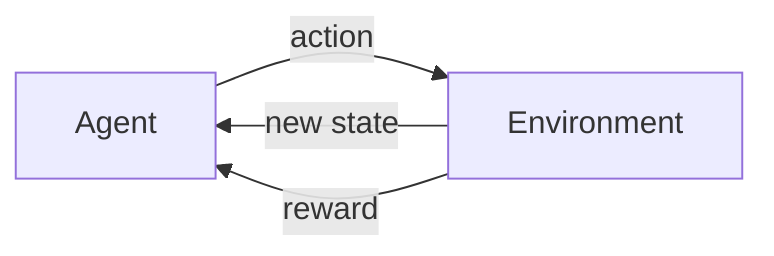
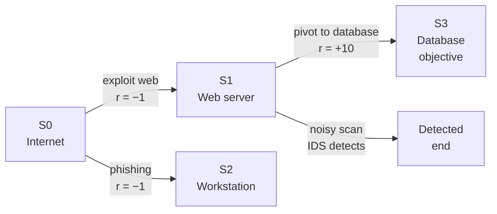

# 08 · Reinforcement learning: agents, rewards, Q-Learning and SARSA

> 🇺🇸 English · 🇧🇷 [Português](08-reinforcement-learning.pt-BR.md)

| | |
|-|-|
| **Track** | [AI Fundamentals](README.md) · Lesson 8 of 13 |
| **Reading time** | ~25 min |
| **You will learn** | The vocabulary of reinforcement learning, the explore vs exploit dilemma, how Q-Learning and SARSA learn the value of each action, and why badly defined rewards become vulnerabilities |

## Learning by trial and error

Nobody teaches a child to ride a bike with a spreadsheet of labeled examples. They try, fall, adjust and try again. **Reinforcement Learning** (RL) works the same way ([lesson 03](03-how-machines-learn.md)):

- there are no right answers to copy, as in supervised learning;
- it is not just about finding patterns, as in unsupervised learning;
- there is an **agent** that **acts** in an **environment** and receives **rewards** or **penalties**. The goal is to learn how to act to collect the largest possible reward **over time**.

RL is how computers learned to play Go and video games better than humans, and it is one piece of how modern LLMs are trained (RLHF, which we will see in lesson 11).

## The vocabulary



| Term | Meaning | In automated pentesting |
|------|---------|-------------------------|
| **Agent** | Whoever decides | The attacking program |
| **Environment** | The world it interacts with | The target network |
| **State** (*s*) | The current situation | Which machines are already compromised |
| **Action** (*a*) | What the agent can do | Exploit a flaw, phish, pivot, scan |
| **Reward** (*r*) | The numeric return of each action | +10 for reaching the database, −1 per step, −10 if the IDS detects it |
| **Policy** (π) | The agent's decision rule: in each state, which action to take | "In the DMZ, pivot to the database" |
| **Episode** | One complete attempt, from start to an end | One attack, from initial access to the objective or detection |

### Reward now or later: discounting

The agent does not want only the immediate reward, but the **sum of future rewards**. Distant rewards are worth a bit less, though: each step multiplies them by a **discount factor** γ (gamma):

```text
return = r₁ + γ·r₂ + γ²·r₃ + …
```

With γ = 0.9, a reward of 10 that arrives 3 steps from now is worth 10 × 0.9³ = **7.29** today. Ten steps from now, it is worth only **3.49**. This makes the agent prefer **short** paths to the goal, and avoids infinite sums in never-ending tasks.

## Explore or exploit?

Imagine you know a good restaurant near home. Do you go back today (**exploit**) or try a new one that might be better or worse (**explore**)?

An agent that only exploits gets stuck on the first reasonable strategy it found. One that only explores never uses what it learned. The simplest solution is the **ε-greedy** strategy:

- with probability ε (for example, 10%), pick a **random** action;
- the rest of the time, pick the **best known action**.

Usually ε starts high and decreases over time: lots of exploration at first, more exploitation later.

## Q-Learning: scoring each action

### The Q value

The core idea is to learn a table, the **Q-table**, with a score for each (state, action) pair:

```text
Q(s, a) = how much total reward I expect if I take action a in state s
          and then keep acting in the best way
```

Once the table is ready, the policy is trivial: in each state, pick the action with the highest Q.

### The example environment

A mini attack graph with four states:



Each step costs −1 (time and risk). Reaching the database is worth +10. Getting detected ends the episode with a penalty.

### The update rule

After each action, the agent adjusts that action's score:

```text
Q(s, a) ← Q(s, a) + α × [ r + γ × max Q(s', ·) − Q(s, a) ]
                          └──────── target ───────┘
```

In words: "the new score is the old one, nudged towards the **target**". The target is the reward I just received plus the (discounted) value of the **best** action in the next state `s'`. α (the learning rate) controls the size of the nudge, as in [lesson 04](04-essential-math.md).

### An example with numbers

With α = 0.5, γ = 0.9 and the table starting at zero, the agent repeats the path S0 → S1 → S3:

| Episode | Q(S0, exploit web) | Q(S1, pivot) |
|---------|-------------------|--------------|
| start | 0 | 0 |
| 1 | 0 + 0.5 × (−1 + 0.9×0 − 0) = **−0.5** | 0 + 0.5 × (10 − 0) = **5** |
| 2 | −0.5 + 0.5 × (−1 + 0.9×5 + 0.5) = **1.5** | 5 + 0.5 × (10 − 5) = **7.5** |
| 3 | 1.5 + 0.5 × (−1 + 0.9×7.5 − 1.5) = **3.625** | 7.5 + 0.5 × (10 − 7.5) = **8.75** |
| … | → **8** | → **10** |

Notice what happened in episode 1: "exploit web" went **negative**, because the agent only saw the −1 cost and did not yet know that path led to the prize. From episode 2 on, the value of the database starts **flowing backwards**, step by step, to the first move. In the limit, Q(S0, exploit web) = −1 + 0.9 × 10 = 8: the step cost plus the discounted prize.

This is the heart of RL: **assigning credit** to earlier actions for rewards that only show up later.

## SARSA: learning from what I actually do

**SARSA** is almost the same as Q-Learning. The name comes from the five elements used in the update: **S**tate, **A**ction, **R**eward, next **S**tate, next **A**ction. The difference is in the target:

| Algorithm | Target | Type |
|-----------|--------|------|
| **Q-Learning** | r + γ × Q(s', **best action**) | *Off-policy*: learns the value of the optimal policy, even while acting exploratively |
| **SARSA** | r + γ × Q(s', **action I will actually take**) | *On-policy*: learns the value of what it actually does, exploration included |

### The difference in numbers

Suppose the agent has already learned Q(S1, pivot) = 7.5 and Q(S1, noisy scan) = −2, and that Q(S0, exploit web) = 1.5. It moves from S0 to S1, and ε-greedy draws the **noisy scan** as the next action (exploration):

| | Target | New Q(S0, exploit web) |
|-|--------|------------------------|
| **Q-Learning** | −1 + 0.9 × 7.5 = 5.75 (uses the best action, ignoring the draw) | 1.5 + 0.5 × (5.75 − 1.5) = **3.625** |
| **SARSA** | −1 + 0.9 × (−2) = −2.8 (uses the drawn action) | 1.5 + 0.5 × (−2.8 − 1.5) = **−0.65** |

Q-Learning is **optimistic**: it assumes the agent will act perfectly from there on. SARSA is **realistic**: it accounts for the fact that the agent will sometimes explore and make mistakes. In practice, SARSA learns **safer** paths when mistakes are expensive, such as staying away from places where one wrong step triggers the IDS. Q-Learning learns the optimal path, even if it is risky.

> [!NOTE]
> **What if the table does not fit?**
> A Q-table only works with few states. In real problems (video game screens, a network with thousands of hosts) the number of states is astronomical. The solution is to replace the table with a **neural network** that estimates Q: the *Deep Q-Network* (DQN). Neural networks start in the next part of the track.

## Red teamer's view

### 1. Reward hacking: the agent does what you measured, not what you meant

The agent maximizes the reward **literally**. If the reward has a loophole, the agent will find it. Classic examples of *reward hacking* (or *specification gaming*):

- a boat racing agent that found it scored more points by spinning in circles collecting bonuses than by finishing the race;
- a defense agent rewarded for "fewer SIEM alerts" that learns the easiest way is to **stop generating logs**;
- a pentest agent rewarded for "vulnerabilities found" that reports the same flaw a thousand times.

The lesson applies to LLMs too: RLHF trains the model to maximize the score of a **reward model** that imitates human preference. Sycophancy, confident wrong answers and the fragility of alignment against jailbreaks are, in part, consequences of optimizing an imperfect reward.

### 2. Attacking RL agents

| Attack | How it works |
|--------|--------------|
| **Adversarial observations** | Perturb what the agent "sees" (the state) to push it into a bad action, like the adversarial examples from lesson 04 |
| **Reward poisoning** | Tamper with the reward signal during training to teach a behavior chosen by the attacker |
| **Environment manipulation** | Change the environment to create situations the agent never saw and where its policy fails |
| **Exploiting predictability** | A trained policy is deterministic about what it learned: an RL-based adaptive defense can be studied and bypassed |

### 3. RL as an offensive tool

RL is also on the attacker's side:

- **automated pentesting**: agents that learn to move through simulated attack graphs (there are open source research environments for this, such as CyberBattleSim);
- **detector evasion**: agents that learn which modifications to apply to a malicious executable, without breaking it, until the malware classifier says "benign";
- **guided fuzzing**: agents that learn which input mutations lead to more code coverage.

> [!TIP]
> **Red teamer's view**
> When facing a system that uses RL, ask **what exactly is being rewarded** and look for the cheapest way to earn that reward without achieving the real goal. Also ask **who controls the observations and the reward** during training: if you influence either one, you influence the policy. And remember that an LLM aligned with RLHF learned a rewarded **behavior**, not an unbreakable rule.

## Hands-on with Python

A plain-Python example that reproduces the numbers in this lesson:

```python
alpha, gamma = 0.5, 0.9
Q = {("S0", "web"): 0.0, ("S1", "pivot"): 0.0, ("S1", "scan"): 0.0}

def best(state):
    return max(v for (s, _), v in Q.items() if s == state)

# Q-Learning: three episodes on the path S0 -> S1 -> S3
for ep in range(1, 4):
    Q[("S0", "web")] += alpha * (-1 + gamma * best("S1") - Q[("S0", "web")])
    Q[("S1", "pivot")] += alpha * (10 - Q[("S1", "pivot")])     # S3 is terminal
    print(ep, round(Q[("S0", "web")], 3), round(Q[("S1", "pivot")], 3))
# 1 -0.5 5.0
# 2 1.5 7.5
# 3 3.625 8.75

# Q-Learning vs SARSA when the drawn next action is the noisy scan
q_s0, q_pivot, q_scan = 1.5, 7.5, -2.0
target_q     = -1 + gamma * max(q_pivot, q_scan)    # uses the best action
target_sarsa = -1 + gamma * q_scan                  # uses the action it will take
print(round(q_s0 + alpha * (target_q - q_s0), 3))      # 3.625
print(round(q_s0 + alpha * (target_sarsa - q_s0), 3))  # -0.65

# Discounting: what a reward of 10 in 3 and 10 steps is worth today
print(round(10 * gamma**3, 2), round(10 * gamma**10, 2))   # 7.29 3.49
```

In real life you would use libraries such as Gymnasium (environments) and Stable-Baselines3 (algorithms), but this is the update rule underneath.

## Summary

- In **reinforcement learning**, an **agent** acts in an **environment** and learns from **rewards**, seeking the largest **return** over time. The **discount** γ makes distant rewards worth less.
- The agent balances **exploring** and **exploiting**, for example with **ε-greedy**.
- **Q-Learning** learns Q(s, a) using the **best** next action (off-policy). **SARSA** uses the action it will **actually** take (on-policy) and tends to learn safer paths.
- The reward "flows backwards" with each episode: that is how the agent assigns credit to earlier actions.
- **Reward hacking** is the central vulnerability: the agent optimizes what was measured, not what was intended. This holds for security agents and for LLMs trained with RLHF.

## Check your understanding

<details><summary>1. In episode 1 of the example, why did Q(S0, exploit web) go negative, if that is the first step of the best path?</summary>

Because at update time Q(S1, ·) was still zero: the agent only "saw" the −1 cost of the step. The value of the goal needs a few episodes to propagate backwards to the first actions.
</details>

<details><summary>2. With γ = 0, how would the agent behave? And with γ very close to 1?</summary>

With γ = 0, it only cares about the **immediate** reward and ignores the future (it is short-sighted). With γ close to 1, distant rewards are worth almost as much as immediate ones: the agent plans long-term, but learning can become slower and less stable.
</details>

<details><summary>3. What is the difference between Q-Learning and SARSA, in one sentence?</summary>

Q-Learning updates assuming the next action will be the **best** one (off-policy); SARSA updates with the next action the agent will **actually** take, exploration included (on-policy).
</details>

<details><summary>4. An incident response agent is rewarded on "mean time to close tickets". What reward hacking would you expect?</summary>

Closing tickets quickly without solving the problem: closing them as "false positive", closing and reopening, or splitting incidents into trivial tickets. The agent optimizes the metric, not security.
</details>

<details><summary>5. How could an attacker influence a defense agent that keeps learning in production?</summary>

By creating situations that change the **observations** and **rewards** the agent receives: for example, triggering many false alerts so that blocking actions get "punished" as disruptive, until the agent learns not to block. It is poisoning of learning in real time.
</details>

---

← [07 · Unsupervised learning: K-Means, PCA and anomaly detection](07-unsupervised-learning.md) · **Next lesson:** [09 · From the perceptron to neural networks](09-neural-networks.md) →
