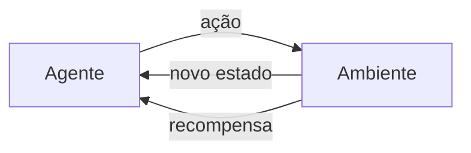
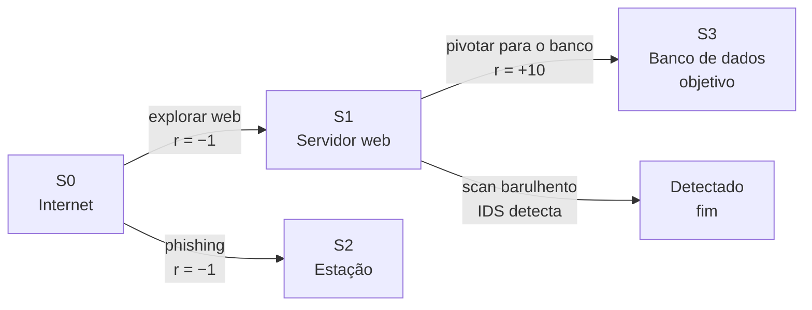

# 08 · Aprendizado por reforço: agentes, recompensas, Q-Learning e SARSA

> 🇧🇷 Português · 🇺🇸 [English](08-reinforcement-learning.md)

| | |
|-|-|
| **Trilha** | [Fundamentos de IA](README.pt-BR.md) · Aula 8 de 13 |
| **Nível** | Base |
| **Pré-requisitos** | [03 · Como as máquinas aprendem](03-how-machines-learn.pt-BR.md), [04 · Matemática essencial](04-essential-math.pt-BR.md) |
| **Tempo de leitura** | ~25 min |
| **Você vai aprender** | O vocabulário do aprendizado por reforço, o dilema entre explorar e aproveitar, como o Q-Learning e o SARSA aprendem o valor de cada ação, e por que recompensas mal definidas viram vulnerabilidades |

## Aprender por tentativa e erro

Ninguém ensina uma criança a andar de bicicleta com uma planilha de exemplos rotulados. Ela tenta, cai, ajusta e tenta de novo. O **aprendizado por reforço** (*Reinforcement Learning*, RL) funciona assim ([aula 03](03-how-machines-learn.pt-BR.md)):

- não há respostas certas para copiar, como no supervisionado;
- não se trata só de achar padrões, como no não supervisionado;
- há um **agente** que **age** num **ambiente** e recebe **recompensas** ou **punições**. O objetivo é aprender a agir para ganhar a maior recompensa possível **ao longo do tempo**.

Foi com RL que computadores aprenderam a jogar Go e videogames melhor que humanos, e é uma peça do treinamento dos LLMs modernos (o RLHF, que veremos na aula 11).

## O vocabulário



| Termo | Significado | Num pentest automatizado |
|-------|-------------|--------------------------|
| **Agente** | Quem decide | O programa atacante |
| **Ambiente** | O mundo com que ele interage | A rede alvo |
| **Estado** (*s*) | A situação atual | Quais máquinas já foram comprometidas |
| **Ação** (*a*) | O que o agente pode fazer | Explorar uma falha, fazer phishing, pivotar, escanear |
| **Recompensa** (*r*) | O retorno numérico de cada ação | +10 ao chegar no banco de dados, −1 por passo, −10 se o IDS detectar |
| **Política** (π) | A regra de decisão do agente: em cada estado, qual ação tomar | "Na DMZ, pivote para o banco" |
| **Episódio** | Uma tentativa completa, do início até um fim | Um ataque, do acesso inicial até o objetivo ou a detecção |

### Recompensa agora ou depois: o desconto

O agente não quer só a recompensa imediata, mas a **soma das recompensas futuras**. Só que recompensas distantes valem um pouco menos, multiplicadas por um **fator de desconto** γ (gama) a cada passo:

```text
retorno = r₁ + γ·r₂ + γ²·r₃ + …
```

Com γ = 0,9, uma recompensa de 10 que chega daqui a 3 passos vale 10 × 0,9³ = **7,29** hoje. Daqui a 10 passos, vale só **3,49**. Isso faz o agente preferir caminhos **curtos** até o objetivo, e evita somas infinitas em tarefas sem fim.

## Explorar ou aproveitar?

Imagine que você conhece um bom restaurante perto de casa. Hoje você volta nele (**aproveitar**, *exploitation*) ou tenta um novo que pode ser melhor ou pior (**explorar**, *exploration*)?

Um agente que só aproveita fica preso na primeira estratégia razoável que encontrou. Um que só explora nunca usa o que aprendeu. A solução mais simples é a estratégia **ε-greedy**:

- com probabilidade ε (por exemplo, 10%), escolha uma ação **aleatória**;
- no resto do tempo, escolha a **melhor ação conhecida**.

Normalmente ε começa alto e diminui com o tempo: muita exploração no começo, mais aproveitamento depois.

## Q-Learning: dando nota para cada ação

### O valor Q

A ideia central é aprender uma tabela, a **Q-table**, com uma nota para cada par (estado, ação):

```text
Q(s, a) = quanta recompensa total eu espero se fizer a ação a no estado s
          e depois continuar agindo da melhor forma
```

Com a tabela pronta, a política é trivial: em cada estado, escolha a ação com o maior Q.

### O ambiente de exemplo

Um mini grafo de ataque com quatro estados:



Cada passo custa −1 (tempo e risco). Chegar ao banco de dados vale +10. Ser detectado termina o episódio com punição.

### A regra de atualização

Depois de cada ação, o agente ajusta a nota daquela ação:

```text
Q(s, a) ← Q(s, a) + α × [ r + γ × max Q(s', ·) − Q(s, a) ]
                          └──────── alvo ────────┘
```

Em palavras: "a nota nova é a antiga, empurrada na direção do **alvo**". O alvo é a recompensa que acabei de receber mais o valor (descontado) da **melhor** ação no próximo estado `s'`. O α (taxa de aprendizado) controla o tamanho do empurrão, como na [aula 04](04-essential-math.pt-BR.md).

### Um exemplo com números

Com α = 0,5, γ = 0,9 e a tabela começando toda em zero, o agente repete o caminho S0 → S1 → S3:

| Episódio | Q(S0, explorar web) | Q(S1, pivotar) |
|----------|--------------------|----------------|
| início | 0 | 0 |
| 1 | 0 + 0,5 × (−1 + 0,9×0 − 0) = **−0,5** | 0 + 0,5 × (10 − 0) = **5** |
| 2 | −0,5 + 0,5 × (−1 + 0,9×5 + 0,5) = **1,5** | 5 + 0,5 × (10 − 5) = **7,5** |
| 3 | 1,5 + 0,5 × (−1 + 0,9×7,5 − 1,5) = **3,625** | 7,5 + 0,5 × (10 − 7,5) = **8,75** |
| … | → **8** | → **10** |

Repare no que aconteceu no episódio 1: "explorar web" ficou **negativo**, porque o agente só viu o custo de −1 e ainda não sabia que aquele caminho levava ao prêmio. A partir do episódio 2, o valor do banco de dados começa a **escorrer para trás**, passo a passo, até o primeiro movimento. No limite, Q(S0, explorar web) = −1 + 0,9 × 10 = 8: o custo do passo mais o prêmio descontado.

Isso é o coração do RL: **atribuir crédito** a ações antigas pelas recompensas que só aparecem depois.

## SARSA: aprendendo com o que eu realmente faço

O **SARSA** é quase igual ao Q-Learning. O nome vem dos cinco elementos usados na atualização: **S**tate, **A**ction, **R**eward, next **S**tate, next **A**ction. A diferença está no alvo:

| Algoritmo | Alvo | Tipo |
|-----------|------|------|
| **Q-Learning** | r + γ × Q(s', **melhor ação**) | *Off-policy*: aprende o valor da política ótima, mesmo quando age explorando |
| **SARSA** | r + γ × Q(s', **ação que eu vou realmente tomar**) | *On-policy*: aprende o valor do que de fato faz, exploração incluída |

### A diferença em números

Suponha que o agente já aprendeu Q(S1, pivotar) = 7,5 e Q(S1, scan barulhento) = −2, e que Q(S0, explorar web) = 1,5. Ele vai de S0 para S1, e a estratégia ε-greedy sorteia, como próxima ação, o **scan barulhento** (exploração):

| | Alvo | Novo Q(S0, explorar web) |
|-|------|--------------------------|
| **Q-Learning** | −1 + 0,9 × 7,5 = 5,75 (usa a melhor ação, ignorando o sorteio) | 1,5 + 0,5 × (5,75 − 1,5) = **3,625** |
| **SARSA** | −1 + 0,9 × (−2) = −2,8 (usa a ação sorteada) | 1,5 + 0,5 × (−2,8 − 1,5) = **−0,65** |

O Q-Learning é **otimista**: supõe que dali para frente o agente vai agir perfeitamente. O SARSA é **realista**: leva em conta que o agente às vezes vai explorar e errar. Na prática, o SARSA aprende caminhos mais **seguros** quando erros são caros, como evitar passar perto de onde um passo em falso dispara o IDS. O Q-Learning aprende o caminho ótimo, mesmo que arriscado.

> [!NOTE]
> **E quando a tabela não cabe?**
> Uma Q-table só funciona com poucos estados. Em problemas reais (as telas de um videogame, uma rede com milhares de hosts) o número de estados é astronômico. A solução é trocar a tabela por uma **rede neural** que estima o Q: é o *Deep Q-Network* (DQN). Redes neurais começam na próxima parte da trilha.

## Visão do red teamer

### 1. Reward hacking: o agente faz o que você mediu, não o que você quis

O agente maximiza a recompensa **ao pé da letra**. Se a recompensa tem uma brecha, ele encontra. Exemplos clássicos de *reward hacking* (ou *specification gaming*):

- um agente de corrida de barcos que descobriu que ganhava mais pontos girando em círculos para pegar bônus do que terminando a corrida;
- um agente de defesa recompensado por "menos alertas no SIEM" que aprende que o jeito mais fácil é **parar de gerar logs**;
- um agente de pentest recompensado por "vulnerabilidades encontradas" que reporta a mesma falha mil vezes.

A lição vale também para LLMs: o RLHF treina o modelo para maximizar a nota de um **modelo de recompensa** que imita a preferência humana. Bajulação (*sycophancy*), respostas confiantes e erradas, e a própria fragilidade do alinhamento diante de jailbreaks são, em parte, consequências de otimizar uma recompensa imperfeita.

### 2. Atacando agentes de RL

| Ataque | Como funciona |
|--------|---------------|
| **Observações adversariais** | Perturbar o que o agente "vê" (o estado) para levá-lo a uma ação ruim, como os adversarial examples da aula 04 |
| **Envenenamento da recompensa** | Adulterar o sinal de recompensa durante o treino para ensinar um comportamento escolhido pelo atacante |
| **Manipulação do ambiente** | Mudar o ambiente para criar situações que o agente nunca viu e em que sua política falha |
| **Explorar a previsibilidade** | Uma política treinada é determinística no que aprendeu: uma defesa adaptativa baseada em RL pode ser estudada e contornada |

### 3. RL como ferramenta ofensiva

O RL também está do lado do atacante:

- **pentest automatizado**: agentes que aprendem a se mover em grafos de ataque simulados (existem ambientes de pesquisa open source para isso, como o CyberBattleSim);
- **evasão de detectores**: agentes que aprendem quais modificações aplicar a um executável malicioso, sem quebrar seu funcionamento, até o classificador de malware dizer "benigno";
- **fuzzing guiado**: agentes que aprendem quais mutações de entrada levam a mais cobertura de código.

> [!TIP]
> **Visão do red teamer**
> Diante de um sistema que usa RL, pergunte **o que exatamente está sendo recompensado** e procure a forma mais barata de ganhar essa recompensa sem cumprir o objetivo real. Pergunte também **quem controla as observações e a recompensa** durante o treino: se você influencia qualquer um dos dois, influencia a política. E lembre que um LLM alinhado com RLHF aprendeu um **comportamento** recompensado, não uma regra inviolável.

## Na prática com Python

Um exemplo só com Python puro, que reproduz os números desta aula:

```python
alpha, gamma = 0.5, 0.9
Q = {("S0", "web"): 0.0, ("S1", "pivotar"): 0.0, ("S1", "scan"): 0.0}

def melhor(estado):
    return max(v for (s, _), v in Q.items() if s == estado)

# Q-Learning: três episódios no caminho S0 -> S1 -> S3
for ep in range(1, 4):
    Q[("S0", "web")] += alpha * (-1 + gamma * melhor("S1") - Q[("S0", "web")])
    Q[("S1", "pivotar")] += alpha * (10 - Q[("S1", "pivotar")])   # S3 é terminal
    print(ep, round(Q[("S0", "web")], 3), round(Q[("S1", "pivotar")], 3))
# 1 -0.5 5.0
# 2 1.5 7.5
# 3 3.625 8.75

# Q-Learning x SARSA quando a próxima ação sorteada é o scan barulhento
q_s0, q_pivotar, q_scan = 1.5, 7.5, -2.0
alvo_q     = -1 + gamma * max(q_pivotar, q_scan)    # usa a melhor ação
alvo_sarsa = -1 + gamma * q_scan                    # usa a ação que vai tomar
print(round(q_s0 + alpha * (alvo_q - q_s0), 3))      # 3.625
print(round(q_s0 + alpha * (alvo_sarsa - q_s0), 3))  # -0.65

# Desconto: quanto vale hoje uma recompensa de 10 daqui a 3 e 10 passos
print(round(10 * gamma**3, 2), round(10 * gamma**10, 2))   # 7.29 3.49
```

Na vida real você usaria bibliotecas como o Gymnasium (ambientes) e o Stable-Baselines3 (algoritmos), mas a regra de atualização por baixo é esta.

## Resumo

- No **aprendizado por reforço**, um **agente** age num **ambiente** e aprende com **recompensas**, buscando o maior **retorno** ao longo do tempo. O **desconto** γ faz recompensas distantes valerem menos.
- O agente equilibra **explorar** e **aproveitar**, por exemplo com **ε-greedy**.
- O **Q-Learning** aprende Q(s, a) usando a **melhor** ação seguinte (off-policy). O **SARSA** usa a ação que **realmente** vai tomar (on-policy) e tende a aprender caminhos mais seguros.
- A recompensa "escorre para trás" a cada episódio: é assim que o agente atribui crédito a ações antigas.
- **Reward hacking** é a vulnerabilidade central: o agente otimiza o que foi medido, não o que foi pretendido. Isso vale para agentes de segurança e para LLMs treinados com RLHF.

## Teste seu entendimento

<details><summary>1. No episódio 1 do exemplo, por que Q(S0, explorar web) ficou negativo, se esse é o primeiro passo do melhor caminho?</summary>

Porque, no momento da atualização, Q(S1, ·) ainda era zero: o agente só "viu" o custo de −1 do passo. O valor do objetivo precisa de alguns episódios para se propagar para trás até as primeiras ações.
</details>

<details><summary>2. Com γ = 0, como o agente se comportaria? E com γ muito perto de 1?</summary>

Com γ = 0, ele só se importa com a recompensa **imediata** e ignora o futuro (é míope). Com γ perto de 1, recompensas distantes valem quase tanto quanto as imediatas: o agente planeja a longo prazo, mas o aprendizado pode ficar mais lento e instável.
</details>

<details><summary>3. Qual a diferença entre Q-Learning e SARSA, numa frase?</summary>

O Q-Learning atualiza supondo que a próxima ação será a **melhor** (off-policy); o SARSA atualiza com a próxima ação que o agente **realmente** vai tomar, exploração incluída (on-policy).
</details>

<details><summary>4. Um agente de resposta a incidentes é recompensado por "tempo médio para fechar tickets". Que reward hacking você esperaria?</summary>

Fechar tickets rapidamente sem resolver o problema: fechar como "falso positivo", fechar e reabrir, ou dividir incidentes em tickets triviais. O agente otimiza a métrica, não a segurança.
</details>

<details><summary>5. Como um atacante poderia influenciar um agente de defesa que continua aprendendo em produção?</summary>

Gerando situações que mudam as **observações** e as **recompensas** que o agente recebe: por exemplo, provocando muitos alertas falsos para que ações de bloqueio sejam "punidas" como disruptivas, até o agente aprender a não bloquear. É envenenamento do aprendizado em tempo real.
</details>

## Aprofunde e pratique

Aprofundamentos e técnicas que partem desta aula:

- **Aprofundamento:** [08.1 · Aprendizado por reforço a fundo](08-1-reinforcement-learning-deep-dive.pt-BR.md)
- **Na prática:** [Jailbreaks](../02-prompt-injection/jailbreaks.pt-BR.md)

---

← [07 · Aprendizado não supervisionado: K-Means, PCA e detecção de anomalias](07-unsupervised-learning.pt-BR.md) · **Próxima aula:** [09 · Do perceptron às redes neurais](09-neural-networks.pt-BR.md) →
