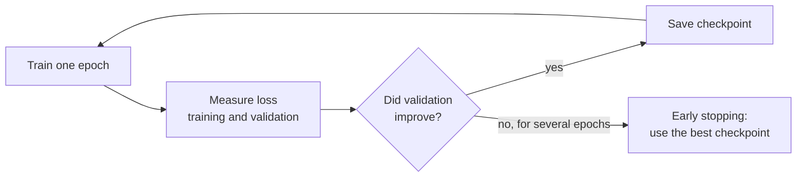

# 09.1 · Training neural networks: losses, optimizers and hyperparameters

> 🇺🇸 English · 🇧🇷 [Português](09-1-training-neural-networks.pt-BR.md)

| | |
|-|-|
| **Track** | [AI Fundamentals](README.md) · Deep dive into lesson [09 · From the perceptron to neural networks](09-neural-networks.md) |
| **Level** | Deep dive |
| **Prerequisites** | [09 · Neural networks](09-neural-networks.md), [04.1 · Logarithms, exponentials and entropy](04-1-logs-and-entropy.md) |
| **Reading time** | ~30 min |
| **You will learn** | How to choose the loss function, why some activations stall training, how SGD, momentum and Adam work, which hyperparameters matter most, how to read training curves, and how all of it affects poisoning, privacy and robustness |

## Where we left off

In [lesson 09](09-neural-networks.md), we took **one** training step on a neuron, with a learning rate of 1, and the loss dropped from 0.474 to 0.251. In [04.1](04-1-logs-and-entropy.md) we saw that this loss was cross-entropy. But training a real network raises questions a single step does not answer: which loss to use, how big the step should be, how not to get stuck halfway and how to tell whether training is going well.

## Loss functions: what exactly are we minimizing

| Task | Network output | Usual loss |
|------|----------------|------------|
| Regression (predict a number) | Any value | **Mean squared error** (MSE) |
| Binary classification | Sigmoid (0 to 1) | **Binary cross-entropy** |
| Multi-class classification | Softmax | **Categorical cross-entropy** |
| An LLM's next token | Softmax over the vocabulary | Cross-entropy (the same thing, with tens of thousands of classes) |

### Why not use MSE for classification?

Measuring the error of a probability with MSE sounds reasonable. The problem shows up in the **gradient**, which is what moves the weights. For a sigmoid neuron with true label 1:

| Prediction p | Gradient with MSE | Gradient with cross-entropy |
|--------------|-------------------|-----------------------------|
| 0.01 (badly wrong) | −0.0196 | **−0.990** |
| 0.50 (undecided) | −0.250 | −0.500 |
| 0.90 (almost right) | −0.018 | −0.100 |

With MSE, exactly when the model is badly wrong, the gradient almost vanishes: the sigmoid is "saturated" and its derivative is tiny. Cross-entropy cancels that effect, and the gradient becomes simply `p − y`: large when the error is large. That is why classifiers use cross-entropy.

## Activations and the vanishing gradient

The activation's derivative enters every step of backpropagation ([lesson 09](09-neural-networks.md)). If it is small, the gradient shrinks at each layer:

| Activation | Derivative | Typical problem |
|------------|------------|-----------------|
| **Sigmoid** | At most 0.25 | Across 10 layers, the gradient can be multiplied by 0.25¹⁰ ≈ **0.000001**: the first layers barely learn (*vanishing gradient*, the same as the RNN in [lesson 10](10-cnn-rnn.md)) |
| **Tanh** | At most 1, but small at the extremes | Also saturates |
| **ReLU** | 1 if z > 0, 0 if z < 0 | Does not shrink the gradient, but a neuron that only receives negative z stops learning forever (*dead ReLU*) |
| **Leaky ReLU** | 1 if z > 0, 0.01 if z < 0 | Lets a small gradient through on the negative side and avoids dead ReLUs |
| **GELU** | Smooth, similar to ReLU | Default in Transformers ([lesson 11](11-llms.md)) |

Hence the rule of thumb: **ReLU or variants in hidden layers**, and sigmoid or softmax **only at the output**.

> [!NOTE]
> **Initialization matters too**
> If every weight started out equal (for example, zero), every neuron in a layer would get the same gradient and stay identical forever. That is why weights start out **random and small**, with scales computed so the signal neither grows nor vanishes as it crosses the layers.

## Optimizers: how big the step is and in which direction

### Learning rate: the most important hyperparameter

Back to the `f(w) = w²` function from [lesson 04](04-essential-math.md), whose minimum is at w = 0, starting from w = 3. The rule is `w ← w − lr × 2w`:

| Rate (lr) | Values of w in the first steps | Behavior |
|-----------|--------------------------------|----------|
| 0.1 | 3 → 2.4 → 1.92 → 1.54 → 1.23 | Converges slowly and safely |
| 0.9 | 3 → −2.4 → 1.92 → −1.54 → 1.23 | Converges, but **oscillates** from one side of the valley to the other |
| 1.1 | 3 → −3.6 → 4.32 → −5.18 → 6.22 | **Diverges**: each step jumps further away |

In practice, a loss that turns into `NaN` or blows up in the first steps is almost always a learning rate that is too high.

### SGD and mini-batches

Computing the gradient over the whole dataset at every step is expensive. The variants:

| Variant | Gradient computed with | Characteristic |
|---------|------------------------|----------------|
| "Batch" gradient descent | All examples | Stable, but slow per step |
| **SGD** (stochastic) | One example at a time | Fast and noisy |
| **Mini-batch** | A batch of, say, 32 to 256 examples | The default: a balance between stability and speed, and it makes good use of the GPU |

An **epoch** is one full pass over every example.

### Momentum: building up speed to cross the valley

Momentum accumulates the direction of recent gradients, like a ball rolling down a slope:

```text
v ← β × v + gradient         (β is usually 0.9)
w ← w − lr × v
```

On the same `f(w) = w²`, with lr = 0.1:

| Step | 0 | 1 | 2 | 3 | 4 | 5 |
|------|---|---|---|---|---|---|
| Without momentum | 3 | 2.40 | 1.92 | 1.54 | 1.23 | 0.98 |
| With momentum (β = 0.9) | 3 | 2.40 | 1.38 | **0.19** | −0.93 | −1.74 |

With momentum, w gets close to zero in 3 steps, but **overshoots** and has to come back. On real loss surfaces, full of long, narrow valleys, that momentum speeds training up a lot.

### Adam: a tailored step for each weight

**Adam** keeps, for each weight, an average of the gradients (like momentum) and an average of the **squared** gradients, and divides one by the square root of the other. The practical effect: the step size no longer depends on the gradient's scale.

| Weight gradient | Adam's first step (lr = 0.001) |
|-----------------|--------------------------------|
| 1000 | 0.001 |
| 0.001 | 0.001 |

Weights with huge gradients and weights with tiny gradients move at the same initial pace. It is the default optimizer for most networks, including LLMs (usually in the AdamW variant, with *weight decay*).

## Hyperparameters

Parameters are the weights training learns. **Hyperparameters** are the choices made before training:

| Hyperparameter | Effect |
|----------------|--------|
| **Learning rate** (and its schedule: warmup at the start, decay along training) | The most important: decides whether training converges, oscillates or diverges |
| **Batch size** | Bigger batches give more stable gradients and use more memory |
| **Number of epochs** | Too few: underfitting; too many: overfitting |
| **Architecture** (layers, neurons, activations) | Model capacity |
| **Regularization** (weight decay, dropout rate) | Puts the brakes on overfitting ([lesson 09](09-neural-networks.md)) |
| **Early stopping** (patience) | Stops training when validation stops improving |

They are tuned by looking at performance on the **validation set** ([lesson 03](03-how-machines-learn.md)), with grid search, random search or smarter methods, never on the test set.

## Reading training curves

During training, track the loss on training and validation at every epoch:

| What you see | Likely diagnosis | What to try |
|--------------|------------------|-------------|
| Both losses high and flat | Underfitting or a learning rate that is too low | Bigger model, more epochs, higher rate |
| Training going down, validation going up | **Overfitting** | Regularization, dropout, more data, early stopping |
| Loss oscillating wildly or turning into `NaN` | Rate too high | Lower the rate, use warmup |
| Loss stuck from the start | Dead ReLUs, bad initialization, wrong data or labels | Leaky ReLU, review the data pipeline |
| Both going down together | Healthy | Keep going until validation levels off |



> [!TIP]
> **Red teamer's view**
> 1. **The optimizer follows any gradient, including that of poisoned data.** Each example contributes to the batch gradient; repeated or extreme examples pull the weights hard. That is why a few samples are enough to implant behaviors ([data poisoning](../04-data-attacks/data-poisoning.md), [backdoors](../04-data-attacks/model-backdoors.md)).
> 2. **Overfitting is leakage.** When the training loss sits far below the validation loss, the model has memorized examples, and *membership inference* attacks exploit exactly that gap. Regularization and early stopping are privacy defenses too. The strongest defense is **training with differential privacy** (DP-SGD): it caps each example's gradient contribution and adds noise, with a mathematical guarantee that no individual example influences the model too much.
> 3. **Attacks use the same tools.** FGSM climbs the gradient of cross-entropy; GCG minimizes the cross-entropy of a target answer such as "Sure, here it is"; stronger evasion attacks use Adam itself to optimize the perturbation. Understanding training is understanding the attack.
> 4. **Adversarial training is the price of robustness.** Adding adversarial examples to each batch makes the model more resistant, but it costs more compute and usually lowers accuracy on clean data.

## Hands-on with Python

```python
import numpy as np

sig = lambda z: 1 / (1 + np.exp(-z))

# Gradient with respect to z, label y = 1: MSE vs cross-entropy
for p in (0.01, 0.5, 0.9):
    mse = 2 * (p - 1) * p * (1 - p)
    ce = p - 1
    print(p, round(mse, 4), round(ce, 3))
# 0.01 -0.0196 -0.99
# 0.5 -0.25 -0.5
# 0.9 -0.018 -0.1

print(0.25 ** 10)                 # 9.5e-07: the gradient that vanishes with sigmoid

# Learning rate on f(w) = w², starting at w = 3
for lr in (0.1, 0.9, 1.1):
    w, steps = 3.0, []
    for _ in range(4):
        w -= lr * 2 * w
        steps.append(round(w, 2))
    print(lr, steps)
# 0.1 [2.4, 1.92, 1.54, 1.23]
# 0.9 [-2.4, 1.92, -1.54, 1.23]
# 1.1 [-3.6, 4.32, -5.18, 6.22]

# Momentum
w, v = 3.0, 0.0
for _ in range(5):
    v = 0.9 * v + 2 * w
    w -= 0.1 * v
    print(round(w, 2), end=" ")   # 2.4 1.38 0.19 -0.93 -1.74
print()

# Adam's first step does not depend on the gradient's scale
for g in (1000.0, 0.001):
    m, s = 0.1 * g, 0.001 * g ** 2            # averages after 1 step (β1=0.9, β2=0.999)
    m_hat, s_hat = m / 0.1, s / 0.001         # bias correction
    print(g, round(0.001 * m_hat / (np.sqrt(s_hat) + 1e-8), 6))   # 0.001 in both cases
```

In real life, PyTorch does all of this with `torch.nn.CrossEntropyLoss`, `torch.optim.SGD(momentum=0.9)` or `torch.optim.AdamW`, plus a learning rate scheduler.

## Summary

- **Cross-entropy** for classification: with sigmoid or softmax, the gradient becomes `p − y`, strong exactly when the error is large; MSE stalls in that case.
- **Sigmoid in hidden layers** makes the gradient vanish; **ReLU** and variants fix it, with the risk of dead neurons.
- The **learning rate** decides between converging, oscillating and diverging; **momentum** speeds things up and **Adam** adapts the step to each weight.
- Hyperparameters are tuned on **validation**; **training curves** reveal underfitting, overfitting and a wrong rate.
- For attacker and defender: the optimizer amplifies poisoned data, overfitting leaks training data, and attacks use the same losses and optimizers.

## Check your understanding

<details><summary>1. A classification network with a sigmoid output was trained with MSE and learns very slowly on the examples it gets most wrong. Why?</summary>

Because with MSE the gradient with respect to z includes the sigmoid's derivative, which is tiny when the sigmoid is saturated (near 0 or 1). Exactly on the gross mistakes the gradient almost vanishes. With cross-entropy, the gradient becomes `p − y` and is large in those cases.
</details>

<details><summary>2. Your training loss turned into NaN after a few iterations. What is the first suspect and what do you do?</summary>

A learning rate that is too high, making the weights diverge (like lr = 1.1 in the example). Lower the rate, use warmup at the start and, if needed, cap the gradient size (*gradient clipping*).
</details>

<details><summary>3. What is Adam's practical advantage over plain SGD?</summary>

It adapts the step size for each weight, dividing by the typical scale of that weight's gradients. Weights with very large or very small gradients move at a similar pace, and training depends less on getting the exact learning rate right.
</details>

<details><summary>4. The curves show training loss dropping steadily and validation loss rising since epoch 10. What security risk does that point to, besides worse quality?</summary>

Overfitting: the model is memorizing training examples. That raises the risk of *membership inference* and training data extraction. Early stopping at the best validation epoch, regularization or training with differential privacy reduce the risk.
</details>

<details><summary>5. What does DP-SGD do differently from regular SGD?</summary>

It caps (*clips*) the gradient of each example individually and adds random noise to the batch gradient. That way no single example can influence the model much, which gives a formal privacy guarantee in exchange for some accuracy.
</details>

---

← [09 · From the perceptron to neural networks](09-neural-networks.md) · **Next lesson in the track:** [10 · Convolutional (CNN) and recurrent (RNN) networks](10-cnn-rnn.md) →
