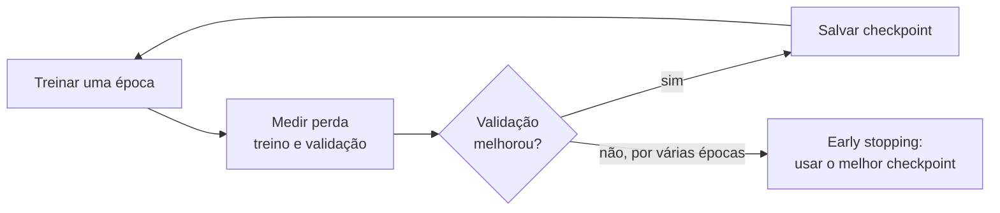

# 09.1 · Treinando redes neurais: perdas, otimizadores e hiperparâmetros

> 🇧🇷 Português · 🇺🇸 [English](09-1-training-neural-networks.md)

| | |
|-|-|
| **Trilha** | [Fundamentos de IA](README.pt-BR.md) · Aprofundamento da aula [09 · Do perceptron às redes neurais](09-neural-networks.pt-BR.md) |
| **Nível** | Aprofundamento |
| **Pré-requisitos** | [09 · Redes neurais](09-neural-networks.pt-BR.md), [04.1 · Logaritmos, exponenciais e entropia](04-1-logs-and-entropy.pt-BR.md) |
| **Tempo de leitura** | ~30 min |
| **Você vai aprender** | Como escolher a função de perda, por que algumas ativações travam o treino, como funcionam SGD, momentum e Adam, quais hiperparâmetros mais importam, como ler as curvas de treino, e como tudo isso afeta envenenamento, privacidade e robustez |

## Onde paramos

Na [aula 09](09-neural-networks.pt-BR.md), demos **um** passo de treino num neurônio, com taxa de aprendizado 1, e a perda caiu de 0,474 para 0,251. No [04.1](04-1-logs-and-entropy.pt-BR.md) vimos que aquela perda era a entropia cruzada. Mas treinar uma rede de verdade levanta perguntas que um passo só não responde: qual perda usar, de que tamanho deve ser o passo, como não travar no meio do caminho e como saber se o treino está indo bem.

## Funções de perda: o que exatamente estamos minimizando

| Tarefa | Saída da rede | Perda usual |
|--------|---------------|-------------|
| Regressão (prever um número) | Um valor qualquer | **Erro quadrático médio** (MSE) |
| Classificação binária | Sigmoide (0 a 1) | **Entropia cruzada binária** |
| Classificação com várias classes | Softmax | **Entropia cruzada categórica** |
| Próximo token de um LLM | Softmax sobre o vocabulário | Entropia cruzada (é a mesma coisa, com dezenas de milhares de classes) |

### Por que não usar MSE em classificação?

Parece razoável medir o erro de uma probabilidade com MSE. O problema aparece no **gradiente**, que é o que move os pesos. Para um neurônio com sigmoide e rótulo verdadeiro 1:

| Previsão p | Gradiente com MSE | Gradiente com entropia cruzada |
|------------|-------------------|--------------------------------|
| 0,01 (errou feio) | −0,0196 | **−0,990** |
| 0,50 (indeciso) | −0,250 | −0,500 |
| 0,90 (quase certo) | −0,018 | −0,100 |

Com MSE, justamente quando o modelo erra feio, o gradiente quase some: a sigmoide está "saturada" e a derivada dela é minúscula. A entropia cruzada cancela esse efeito, e o gradiente fica simplesmente `p − y`: grande quando o erro é grande. É por isso que classificadores usam entropia cruzada.

## Ativações e o gradiente que some

A derivada da ativação entra em cada passo do backpropagation ([aula 09](09-neural-networks.pt-BR.md)). Se ela for pequena, o gradiente encolhe a cada camada:

| Ativação | Derivada | Problema típico |
|----------|----------|-----------------|
| **Sigmoide** | No máximo 0,25 | Em 10 camadas, o gradiente pode ser multiplicado por 0,25¹⁰ ≈ **0,000001**: as primeiras camadas quase não aprendem (*vanishing gradient*, o mesmo da RNN na [aula 10](10-cnn-rnn.pt-BR.md)) |
| **Tanh** | No máximo 1, mas pequena nos extremos | Também satura |
| **ReLU** | 1 se z > 0, 0 se z < 0 | Não encolhe o gradiente, mas um neurônio que só recebe z negativo para de aprender para sempre (*ReLU morta*) |
| **Leaky ReLU** | 1 se z > 0, 0,01 se z < 0 | Deixa passar um gradiente pequeno do lado negativo e evita a ReLU morta |
| **GELU** | Suave, parecida com a ReLU | Padrão nos Transformers ([aula 11](11-llms.pt-BR.md)) |

Por isso a regra prática é: **ReLU ou variantes nas camadas ocultas**, e sigmoide ou softmax **só na saída**.

> [!NOTE]
> **A inicialização também importa**
> Se todos os pesos começassem iguais (por exemplo, zero), todos os neurônios de uma camada receberiam o mesmo gradiente e continuariam idênticos para sempre. Por isso os pesos começam **aleatórios e pequenos**, com escalas calculadas para que o sinal não cresça nem suma ao atravessar as camadas.

## Otimizadores: de que tamanho e em que direção é o passo

### Taxa de aprendizado: o hiperparâmetro mais importante

Voltando à função `f(w) = w²` da [aula 04](04-essential-math.pt-BR.md), que tem o mínimo em w = 0, partindo de w = 3. A regra é `w ← w − lr × 2w`:

| Taxa (lr) | Valores de w nos primeiros passos | Comportamento |
|-----------|-----------------------------------|---------------|
| 0,1 | 3 → 2,4 → 1,92 → 1,54 → 1,23 | Converge devagar e com segurança |
| 0,9 | 3 → −2,4 → 1,92 → −1,54 → 1,23 | Converge, mas **oscilando** de um lado para o outro do vale |
| 1,1 | 3 → −3,6 → 4,32 → −5,18 → 6,22 | **Diverge**: cada passo pula mais longe |

Na prática, uma perda que vira `NaN` ou explode nos primeiros passos quase sempre é taxa de aprendizado alta demais.

### SGD e mini-batches

Calcular o gradiente com o dataset inteiro a cada passo é caro. As variantes:

| Variante | Gradiente calculado com | Característica |
|----------|-------------------------|----------------|
| Gradiente descendente "em lote" | Todos os exemplos | Estável, mas lento por passo |
| **SGD** (estocástico) | Um exemplo por vez | Rápido e barulhento |
| **Mini-batch** | Um lote de, por exemplo, 32 a 256 exemplos | O padrão: equilíbrio entre estabilidade e velocidade, e aproveita bem a GPU |

Uma **época** é uma passada completa por todos os exemplos.

### Momentum: embalo para atravessar o vale

O momentum acumula a direção dos gradientes recentes, como uma bola descendo uma ladeira:

```text
v ← β × v + gradiente        (β costuma ser 0,9)
w ← w − lr × v
```

Na mesma `f(w) = w²`, com lr = 0,1:

| Passo | 0 | 1 | 2 | 3 | 4 | 5 |
|-------|---|---|---|---|---|---|
| Sem momentum | 3 | 2,40 | 1,92 | 1,54 | 1,23 | 0,98 |
| Com momentum (β = 0,9) | 3 | 2,40 | 1,38 | **0,19** | −0,93 | −1,74 |

Com embalo, w chega perto de zero em 3 passos, mas **passa do ponto** e precisa voltar. Em superfícies de perda reais, cheias de vales longos e estreitos, esse embalo acelera muito o treino.

### Adam: um passo sob medida para cada peso

O **Adam** mantém, para cada peso, uma média dos gradientes (como o momentum) e uma média dos gradientes **ao quadrado**, e divide uma pela raiz da outra. O efeito prático: o tamanho do passo deixa de depender da escala do gradiente.

| Gradiente do peso | Primeiro passo do Adam (lr = 0,001) |
|-------------------|-------------------------------------|
| 1000 | 0,001 |
| 0,001 | 0,001 |

Pesos com gradientes enormes e pesos com gradientes minúsculos andam no mesmo ritmo inicial. É o otimizador padrão para a maioria das redes, inclusive LLMs (geralmente na variante AdamW, com *weight decay*).

## Hiperparâmetros

Parâmetros são os pesos que o treino aprende. **Hiperparâmetros** são as escolhas feitas antes do treino:

| Hiperparâmetro | Efeito |
|----------------|--------|
| **Taxa de aprendizado** (e seu cronograma: aquecimento no começo, redução ao longo do treino) | O mais importante: define se o treino converge, oscila ou diverge |
| **Tamanho do lote** | Lotes maiores dão gradientes mais estáveis e usam mais memória |
| **Número de épocas** | Poucas: underfitting; muitas: overfitting |
| **Arquitetura** (camadas, neurônios, ativações) | Capacidade do modelo |
| **Regularização** (weight decay, taxa de dropout) | Freia o overfitting ([aula 09](09-neural-networks.pt-BR.md)) |
| **Early stopping** (paciência) | Para o treino quando a validação para de melhorar |

Eles são ajustados olhando o desempenho no **conjunto de validação** ([aula 03](03-how-machines-learn.pt-BR.md)), com busca em grade, busca aleatória ou métodos mais espertos, nunca no conjunto de teste.

## Lendo as curvas de treino

Durante o treino, acompanhe a perda no treino e na validação a cada época:

| O que você vê | Diagnóstico provável | O que tentar |
|---------------|---------------------|--------------|
| As duas perdas altas e paradas | Underfitting ou taxa baixa demais | Modelo maior, mais épocas, taxa maior |
| Treino caindo, validação subindo | **Overfitting** | Regularização, dropout, mais dados, early stopping |
| Perda oscilando muito ou virando `NaN` | Taxa alta demais | Reduzir a taxa, usar aquecimento |
| Perda travada desde o início | ReLUs mortas, inicialização ruim, dados ou rótulos errados | Leaky ReLU, revisar o pipeline de dados |
| As duas caindo juntas | Saudável | Continuar até a validação estabilizar |



> [!TIP]
> **Visão do red teamer**
> 1. **O otimizador segue qualquer gradiente, inclusive o de dados envenenados.** Cada exemplo contribui para o gradiente do lote; exemplos repetidos ou extremos puxam os pesos com força. É por isso que poucas amostras bastam para implantar comportamentos ([data poisoning](../04-data-attacks/data-poisoning.pt-BR.md), [backdoors](../04-data-attacks/model-backdoors.pt-BR.md)).
> 2. **Overfitting é vazamento.** Quando a perda de treino fica muito abaixo da de validação, o modelo memorizou exemplos, e ataques de *membership inference* exploram justamente essa diferença. Regularização e early stopping também são defesas de privacidade. A defesa mais forte é o **treino com privacidade diferencial** (DP-SGD): limita a contribuição do gradiente de cada exemplo e soma ruído, com garantia matemática de que nenhum exemplo individual influencia demais o modelo.
> 3. **Os ataques usam as mesmas ferramentas.** O FGSM sobe o gradiente da entropia cruzada; o GCG minimiza a entropia cruzada de uma resposta-alvo como "Claro, aqui está"; ataques de evasão mais fortes usam o próprio Adam para otimizar a perturbação. Entender o treino é entender o ataque.
> 4. **Treino adversarial é o preço da robustez.** Incluir exemplos adversariais em cada lote deixa o modelo mais resistente, mas custa mais computação e costuma baixar a acurácia em dados limpos.

## Na prática com Python

```python
import numpy as np

sig = lambda z: 1 / (1 + np.exp(-z))

# Gradiente em relação a z, rótulo y = 1: MSE x entropia cruzada
for p in (0.01, 0.5, 0.9):
    mse = 2 * (p - 1) * p * (1 - p)
    ce = p - 1
    print(p, round(mse, 4), round(ce, 3))
# 0.01 -0.0196 -0.99
# 0.5 -0.25 -0.5
# 0.9 -0.018 -0.1

print(0.25 ** 10)                 # 9.5e-07: o gradiente que some com sigmoide

# Taxa de aprendizado em f(w) = w², partindo de w = 3
for lr in (0.1, 0.9, 1.1):
    w, passos = 3.0, []
    for _ in range(4):
        w -= lr * 2 * w
        passos.append(round(w, 2))
    print(lr, passos)
# 0.1 [2.4, 1.92, 1.54, 1.23]
# 0.9 [-2.4, 1.92, -1.54, 1.23]
# 1.1 [-3.6, 4.32, -5.18, 6.22]

# Momentum
w, v = 3.0, 0.0
for _ in range(5):
    v = 0.9 * v + 2 * w
    w -= 0.1 * v
    print(round(w, 2), end=" ")   # 2.4 1.38 0.19 -0.93 -1.74
print()

# Primeiro passo do Adam não depende da escala do gradiente
for g in (1000.0, 0.001):
    m, s = 0.1 * g, 0.001 * g ** 2            # médias após 1 passo (β1=0.9, β2=0.999)
    m_hat, s_hat = m / 0.1, s / 0.001         # correção de viés
    print(g, round(0.001 * m_hat / (np.sqrt(s_hat) + 1e-8), 6))   # 0.001 nos dois casos
```

Na vida real, o PyTorch faz tudo isso com `torch.nn.CrossEntropyLoss`, `torch.optim.SGD(momentum=0.9)` ou `torch.optim.AdamW`, e um agendador de taxa de aprendizado.

## Resumo

- **Entropia cruzada** para classificação: com sigmoide ou softmax, o gradiente fica `p − y`, forte justamente quando o erro é grande; MSE nesse caso trava.
- **Sigmoide nas camadas ocultas** faz o gradiente sumir; **ReLU** e variantes resolvem, com o risco de neurônios mortos.
- A **taxa de aprendizado** decide entre convergir, oscilar e divergir; **momentum** acelera e **Adam** adapta o passo a cada peso.
- Hiperparâmetros se ajustam na **validação**; as **curvas de treino** mostram underfitting, overfitting e taxa errada.
- Para o atacante e o defensor: o otimizador amplifica dados envenenados, overfitting vaza dados de treino, e os ataques usam as mesmas perdas e otimizadores.

## Teste seu entendimento

<details><summary>1. Uma rede de classificação com saída sigmoide foi treinada com MSE e aprende muito devagar nos exemplos em que mais erra. Por quê?</summary>

Porque com MSE o gradiente em relação a z inclui a derivada da sigmoide, que é minúscula quando a sigmoide está saturada (perto de 0 ou de 1). Justamente nos erros grosseiros o gradiente quase some. Com entropia cruzada, o gradiente vira `p − y` e fica grande nesses casos.
</details>

<details><summary>2. A perda do seu treino virou NaN depois de poucas iterações. Qual é o primeiro suspeito e o que você faz?</summary>

A taxa de aprendizado alta demais, que faz os pesos divergirem (como lr = 1,1 no exemplo). Reduza a taxa, use aquecimento no início e, se necessário, limite o tamanho dos gradientes (*gradient clipping*).
</details>

<details><summary>3. Qual é a vantagem prática do Adam em relação ao SGD simples?</summary>

Ele adapta o tamanho do passo para cada peso, dividindo pela escala típica dos gradientes daquele peso. Pesos com gradientes muito grandes ou muito pequenos andam num ritmo parecido, e o treino depende menos de acertar a taxa de aprendizado exata.
</details>

<details><summary>4. As curvas mostram perda de treino caindo sem parar e perda de validação subindo desde a época 10. Que risco de segurança isso indica, além da piora de qualidade?</summary>

Overfitting: o modelo está memorizando os exemplos de treino. Isso aumenta o risco de *membership inference* e de extração de dados de treino. Early stopping na época de melhor validação, regularização ou treino com privacidade diferencial reduzem o risco.
</details>

<details><summary>5. O que o DP-SGD faz de diferente do SGD comum?</summary>

Limita (*clipa*) o gradiente de cada exemplo individualmente e soma ruído aleatório ao gradiente do lote. Assim, nenhum exemplo isolado consegue influenciar muito o modelo, o que dá uma garantia formal de privacidade, em troca de alguma perda de acurácia.
</details>

---

← [09 · Do perceptron às redes neurais](09-neural-networks.pt-BR.md) · **Próxima aula da trilha:** [10 · Redes convolucionais (CNN) e recorrentes (RNN)](10-cnn-rnn.pt-BR.md) →
