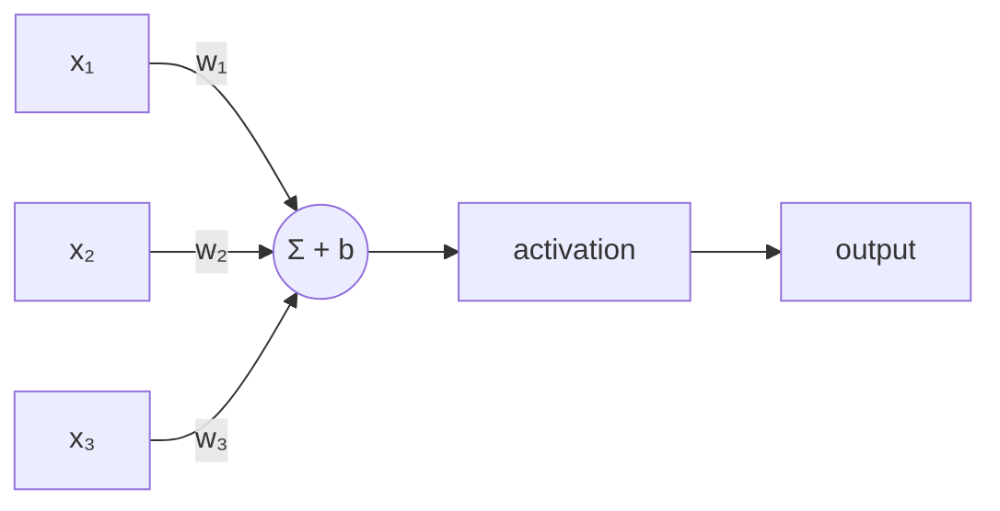
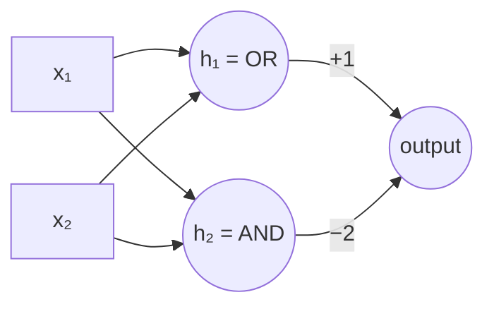
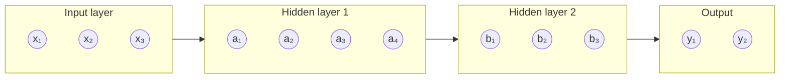
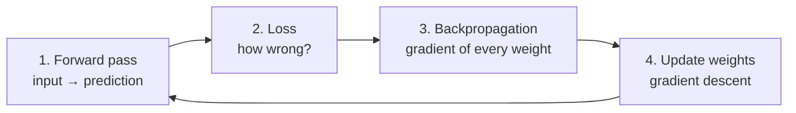
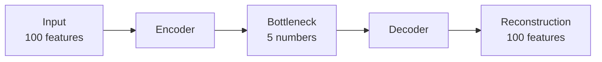

# 09 · From the perceptron to neural networks

> 🇺🇸 English · 🇧🇷 [Português](09-neural-networks.pt-BR.md)

| | |
|-|-|
| **Track** | [AI Fundamentals](README.md) · Lesson 9 of 13 |
| **Reading time** | ~30 min |
| **You will learn** | What an artificial neuron is, why a single one cannot solve XOR, how hidden layers and activation functions fix that, how a network is trained with backpropagation, what an autoencoder is, and why the gradient that trains the network also attacks it |

## From classic to deep

Part 2 of the track showed models where someone picks the features by hand (links, urgency words, connections per hour) and the model learns weights for them. **Deep learning** changes that: neural networks with many layers learn **their own features** from raw data (pixels, bytes, text). It is the foundation of everything that comes next in the track: computer vision, LLMs and diffusion models.

And the starting point is something you already know.

## The perceptron: an artificial neuron

Loosely inspired by the biological neuron, the **perceptron**, from 1958 ([lesson 02](02-history-of-ai.md)), does three things:

1. takes inputs `x₁, x₂, …`;
2. computes the weighted sum `z = w · x + b`;
3. applies an **activation function**. In the original perceptron, a step: 1 if `z > 0`, otherwise 0.



Looks familiar? It is the **logistic regression from [lesson 05](05-linear-logistic-regression.md)**, just with a step instead of the sigmoid. With the sigmoid, it is exactly the same thing. A single neuron is a **linear classifier**.

### An example: the AND gate

With weights `w = (1, 1)` and bias `b = −1.5`, the perceptron implements AND:

| x₁ | x₂ | z = x₁ + x₂ − 1.5 | Output |
|----|----|-------------------|--------|
| 0 | 0 | −1.5 | 0 |
| 0 | 1 | −0.5 | 0 |
| 1 | 0 | −0.5 | 0 |
| 1 | 1 | 0.5 | **1** |

With `b = −0.5`, the same structure becomes OR (a single active input is enough to make `z` positive).

## The XOR problem

**XOR** (exclusive or) outputs 1 when **exactly one** of the inputs is 1:

| x₁ | x₂ | XOR |
|----|----|-----|
| 0 | 0 | 0 |
| 0 | 1 | 1 |
| 1 | 0 | 1 |
| 1 | 1 | 0 |

Draw the four points on a plane: the "1"s sit on opposite corners, and the "0"s on the other two. **No line** separates the groups. Since a perceptron only draws lines, it cannot learn XOR. That limitation, pointed out in 1969, helped cool down neural network research for over a decade (the first "AI winter" from lesson 02).

### The fix: a hidden layer

XOR is "OR, but not AND". So use two intermediate neurons, in a **hidden layer**, and a third one to combine them:



| x₁ | x₂ | h₁ (OR) | h₂ (AND) | output = step(h₁ − 2·h₂ − 0.5) |
|----|----|---------|----------|--------------------------------|
| 0 | 0 | 0 | 0 | step(−0.5) = 0 |
| 0 | 1 | 1 | 0 | step(0.5) = **1** |
| 1 | 0 | 1 | 0 | step(0.5) = **1** |
| 1 | 1 | 1 | 1 | step(−1.5) = 0 |

The hidden layer **transformed the space**: in the (h₁, h₂) coordinates, the points become separable by a line. It is the same idea as the kernel trick from [lesson 06](06-trees-naive-bayes-svm.md), except that now **the network learns** the transformation by itself, instead of someone choosing the kernel.

## Activation functions: the non-linear ingredient

Why not use only weighted sums, with no activation? Because stacking linear layers gains nothing:

```text
layer 2 (layer 1 (x)) = W₂ (W₁ x) = (W₂ W₁) x = a single linear layer
```

A hundred linear layers are equivalent to one. It is the **non-linearity** between layers that gives the network its power. The most common activations:

| Activation | Formula | Output | Typical use |
|------------|---------|--------|-------------|
| **Step** | 1 if z > 0, else 0 | 0 or 1 | Original perceptron (useless for gradients: the derivative is zero) |
| **Sigmoid** | 1 / (1 + e^(−z)) | between 0 and 1 | Binary classification output |
| **Tanh** | (e^z − e^(−z)) / (e^z + e^(−z)) | between −1 and 1 | Recurrent networks (lesson 10) |
| **ReLU** | max(0, z) | 0 or positive | Hidden layers: simple, fast and today's default |
| **Softmax** | e^(zᵢ) / Σ e^(zⱼ) | probabilities that add up to 1 | Multi-class output ([lesson 04](04-essential-math.md)) |

## The full neural network

A **feedforward neural network** (or *MLP*, *Multi-Layer Perceptron*) organizes neurons in layers: each neuron in a layer receives every output of the previous one.



Each layer is the **matrix × vector** multiplication from lesson 04, followed by an activation. "Deep", in *deep learning*, just means **many layers**.

### Counting parameters

A network to recognize handwritten digits in 28 × 28 pixel images (784 inputs), with one hidden layer of 128 neurons and 10 outputs:

```text
hidden layer: 784 × 128 weights + 128 biases = 100,480
output:       128 × 10  weights + 10  biases =   1,290
total:                                         101,770 parameters
```

Over 100 thousand numbers for a tiny network. Modern vision models have millions, and LLMs have **billions**. All those numbers live in a file: the model **is** the weights file.

### What the layers learn

In networks trained on images, the early layers usually detect simple patterns, such as edges and colors; the middle layers combine them into textures and shapes; and the final layers recognize object parts and whole objects. Nobody programmed that hierarchy: it **emerges from training**. On the flip side, nobody can easily point at what each of the thousands of neurons does either. Neural networks are, to a large extent, **black boxes**.

## How the network learns: backpropagation

Training follows the loop from [lesson 03](03-how-machines-learn.md), now with proper names:



Step 3 is **backpropagation**: the chain rule from lesson 04 applied backwards, layer by layer, to find out how much each weight contributed to the error. With millions of weights, this is only feasible because each gradient reuses the computations from the next layer.

### One training step with numbers

A single neuron with a sigmoid, one input `x = 1`, weight `w = 0.5`, bias `b = 0`. The example belongs to class 1 (say, "malicious"):

| Step | Computation | Result |
|------|-------------|--------|
| Forward | z = 0.5 × 1 + 0 → p = σ(0.5) | p = 0.622 |
| Loss (log loss, lesson 05) | −ln(0.622) | 0.474 |
| Gradient of the loss w.r.t. z | p − y = 0.622 − 1 | −0.378 |
| Gradient w.r.t. w and b | (p − y) × x and (p − y) | −0.378 and −0.378 |
| Update (learning rate 1) | w = 0.5 + 0.378; b = 0 + 0.378 | w = 0.878; b = 0.378 |
| New forward | z = 1.255 → p = σ(1.255) | p = 0.778 |
| New loss | −ln(0.778) | **0.251** |

One step and the loss almost halved. A real network repeats this for millions of weights, in **batches** of examples, over several full passes through the dataset (**epochs**).

> [!NOTE]
> **Avoiding overfitting**
> Large networks memorize easily. The most common defenses: **dropout** (switching off random neurons during training so none of them becomes indispensable), **regularization** (penalizing large weights) and **early stopping** (stopping training when validation performance stops improving).

## Autoencoders: the network that learns to copy itself

As promised in [lesson 07](07-unsupervised-learning.md): an **autoencoder** is a network trained to reproduce its own input, passing through a narrow **bottleneck** in the middle.



To reconstruct well through just 5 numbers, the network has to learn the essential structure of the data. It is a non-linear PCA. And the security use is the same: trained only on normal traffic, the autoencoder reconstructs normal well and anomalies badly. **High reconstruction error = anomaly.**

## Red teamer's view

### 1. The gradient that trains is the gradient that attacks

During training, backpropagation computes the gradient of the loss with respect to the **weights**. With one more line of code, it computes the gradient with respect to the **input**. That is how **FGSM** (*Fast Gradient Sign Method*), one of the first practical adversarial attacks, works:

```text
x_adversarial = x + ε × sign(gradient of the loss with respect to x)
```

Example with a detector neuron, weights `w = (2, −1, 0.5)`, bias 0, and a sample `x = (0.5, 0.2, 0.4)`:

| | Input | z | p (malicious) | Decision |
|-|-------|---|---------------|----------|
| Original | (0.5, 0.2, 0.4) | 1.0 | 0.731 | malicious |
| FGSM with ε = 0.3 | (0.2, 0.5, 0.1) | −0.05 | 0.488 | **benign** |

Each feature moved by only 0.3, in the direction that lowers `z` the most (against the sign of each weight). Now picture an image with thousands of pixels: an **invisible** change to each pixel, summed over all of them, shifts `z` enough to flip the class. That is why vision networks mistake a panda for a gibbon after imperceptible noise. See [section 06](../06-evasion/README.md).

### 2. The model is a file

The trained weights are the asset. Whoever steals the file takes months of training and expensive data, and gains **white-box** access to craft attacks like FGSM precisely. On top of that, model file formats based on serialization (such as Python's pickle) can **execute code** when loaded: downloading a model from an untrusted source is like running an unknown executable. See [section 04](../04-data-attacks/README.md).

### 3. Behaviors hidden in the neurons

Since nobody can easily audit what each neuron does, a network can carry a **backdoor**: it works normally, but when the input contains a **trigger** (a sticker on a road sign, a rare word in a text) it produces the output the attacker chose. The backdoor is planted by poisoning the training data or tampering with the weights of a published model, and it goes unnoticed in normal metrics.

### 4. Confidence without grounds

Softmax always returns probabilities that add up to 1, even for meaningless inputs. A network can classify random noise as "cat" with 99% confidence. High confidence, once again, does not mean correct.

> [!TIP]
> **Red teamer's view**
> A neural network is a differentiable function with millions of parameters stored in a file. **Differentiable** means that, with access to the model, the gradient points the way to the attack. **Millions of parameters** means hidden behaviors fit in there without anyone noticing. **Stored in a file** means the model can be stolen, swapped or loaded with malicious code.

## Hands-on with Python

A numpy-only example that reproduces the numbers in this lesson:

```python
import numpy as np

step = lambda z: (z > 0).astype(int)
sigmoid = lambda z: 1 / (1 + np.exp(-z))

# XOR with a hidden layer (OR and AND) and one output neuron
X = np.array([[0, 0], [0, 1], [1, 0], [1, 1]])
W1 = np.array([[1, 1], [1, 1]])            # columns: OR neuron, AND neuron
b1 = np.array([-0.5, -1.5])
h = step(X @ W1 + b1)
output = step(h @ np.array([1, -2]) - 0.5)
print(output)                               # [0 1 1 0]

# One backpropagation step on a sigmoid neuron
x, y, w, b, lr = 1.0, 1, 0.5, 0.0, 1.0
p = sigmoid(w * x + b)
print(round(p, 3), round(-np.log(p), 3))    # 0.622 0.474
grad = p - y                                 # derivative of log loss w.r.t. z
w, b = w - lr * grad * x, b - lr * grad
p = sigmoid(w * x + b)
print(round(-np.log(p), 3))                  # 0.251

# FGSM: push the input against the gradient
w_det = np.array([2, -1, 0.5])
x = np.array([0.5, 0.2, 0.4])
print(round(sigmoid(x @ w_det), 3))          # 0.731 -> malicious
x_adv = x - 0.3 * np.sign(w_det)             # the gradient of z w.r.t. x is w
print(x_adv, round(sigmoid(x_adv @ w_det), 3))   # [0.2 0.5 0.1] 0.488 -> benign
```

In real life you would use PyTorch, which computes every gradient automatically (*autograd*), but these are the computations underneath.

## Summary

- An **artificial neuron** is a weighted sum followed by an **activation**. On its own it is a linear classifier, like logistic regression.
- One neuron cannot solve **XOR**; a **hidden layer** can, because it transforms the space until the classes become separable.
- The **non-linearity** of the activations (ReLU, sigmoid, tanh) is what gives stacked layers their power.
- Networks are trained with **forward pass → loss → backpropagation → gradient descent**, in batches and epochs.
- **Autoencoders** compress and reconstruct; reconstruction error detects anomalies.
- The same gradient that trains the network creates **adversarial examples** (FGSM). The model is a **file** that can be stolen or tampered with, and millions of parameters can hide **backdoors**.

## Check your understanding

<details><summary>1. How does a perceptron with a sigmoid relate to logistic regression?</summary>

They are the same thing: a weighted sum of the inputs plus a bias, passed through a sigmoid. Both are linear classifiers.
</details>

<details><summary>2. Why can't a single perceptron learn XOR, and what fixes it?</summary>

Because the XOR points are not separable by a line, and a perceptron only draws lines. A **hidden layer** with a non-linear activation transforms the inputs into a new space where a line separates the classes.
</details>

<details><summary>3. What happens if you remove every activation function from a 50-layer network?</summary>

The whole network becomes equivalent to **a single linear layer**, because a composition of linear functions is linear. It loses the ability to learn non-linear patterns.
</details>

<details><summary>4. What is the difference between the gradient used in training and the one used in FGSM?</summary>

In training, you compute the gradient of the loss with respect to the **weights** and change the weights to **decrease** the loss. In FGSM, you compute the gradient with respect to the **input** and change the input to **increase** the loss, with the weights frozen.
</details>

<details><summary>5. Why is downloading a pre-trained model from a public repository a security concern?</summary>

For three reasons: the file can **execute code** when loaded (pickle-based formats); the weights may contain a **backdoor** that only shows up with a trigger; and a popular public model gives an attacker **white-box** access to craft adversarial examples that also work on fine-tuned versions of it.
</details>

---

← [08 · Reinforcement learning: agents, rewards, Q-Learning and SARSA](08-reinforcement-learning.md) · **Next lesson:** 10 · Convolutional (CNN) and recurrent (RNN) networks (coming soon)
