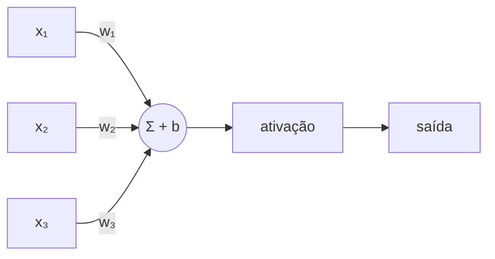
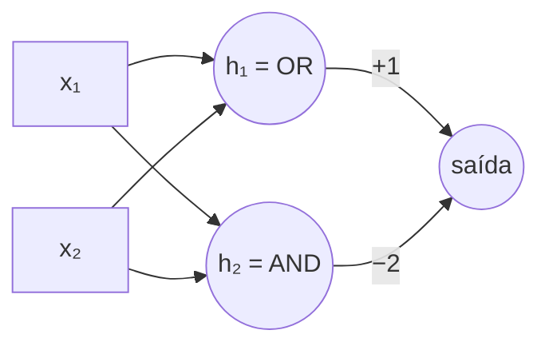
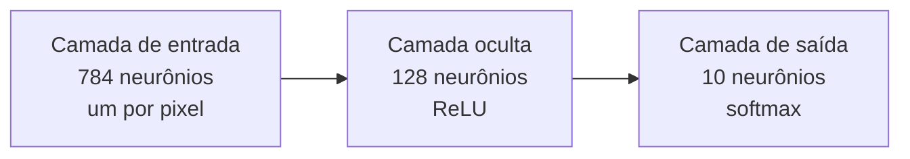
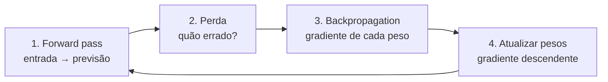
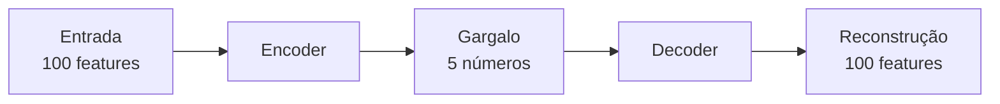

# 09 · Do perceptron às redes neurais

> 🇧🇷 Português · 🇺🇸 [English](09-neural-networks.md)

| | |
|-|-|
| **Trilha** | [Fundamentos de IA](README.pt-BR.md) · Aula 9 de 13 |
| **Tempo de leitura** | ~30 min |
| **Você vai aprender** | O que é um neurônio artificial, por que um só não resolve o XOR, como camadas ocultas e funções de ativação resolvem, como uma rede é treinada com backpropagation, o que é um autoencoder, e por que o gradiente que treina a rede também a ataca |

## Do clássico ao profundo

A Parte 2 da trilha mostrou modelos em que alguém escolhe as features à mão (links, palavras de urgência, conexões por hora) e o modelo aprende pesos para elas. O **deep learning** muda isso: redes neurais com várias camadas aprendem **as próprias features** a partir dos dados brutos (pixels, bytes, texto). É a base de tudo o que vem a seguir na trilha: visão computacional, LLMs e modelos de difusão.

E o ponto de partida é algo que você já conhece.

## O perceptron: um neurônio artificial

Inspirado (de longe) no neurônio biológico, o **perceptron**, de 1958 ([aula 02](02-history-of-ai.pt-BR.md)), faz três coisas:

1. recebe entradas `x₁, x₂, …`;
2. calcula a soma ponderada `z = w · x + b`;
3. aplica uma **função de ativação**. No perceptron original, um degrau: 1 se `z > 0`, senão 0.



Parece familiar? É a **regressão logística da [aula 05](05-linear-logistic-regression.pt-BR.md)**, só que com um degrau no lugar da sigmoide. Com a sigmoide, é exatamente a mesma coisa. Um neurônio sozinho é um **classificador linear**.

### Um exemplo: a porta lógica AND

Com pesos `w = (1, 1)` e viés `b = −1,5`, o perceptron implementa o AND:

| x₁ | x₂ | z = x₁ + x₂ − 1,5 | Saída |
|----|----|-------------------|-------|
| 0 | 0 | −1,5 | 0 |
| 0 | 1 | −0,5 | 0 |
| 1 | 0 | −0,5 | 0 |
| 1 | 1 | 0,5 | **1** |

Com `b = −0,5`, a mesma estrutura vira um OR (basta uma entrada ligada para `z` ficar positivo).

## O problema do XOR

O **XOR** (ou exclusivo) dá 1 quando **exatamente uma** das entradas é 1:

| x₁ | x₂ | XOR |
|----|----|-----|
| 0 | 0 | 0 |
| 0 | 1 | 1 |
| 1 | 0 | 1 |
| 1 | 1 | 0 |

Desenhe os quatro pontos num plano: os "1" estão em cantos opostos, e os "0" nos outros dois. **Nenhuma reta** separa os grupos. Como um perceptron só traça retas, ele não consegue aprender o XOR. Essa limitação, apontada em 1969, ajudou a esfriar a pesquisa em redes neurais por mais de uma década (o primeiro "inverno da IA" da aula 02).

### A solução: uma camada oculta

O XOR é "OR, mas não AND". Então use dois neurônios intermediários, numa **camada oculta**, e um terceiro para combiná-los:



| x₁ | x₂ | h₁ (OR) | h₂ (AND) | saída = degrau(h₁ − 2·h₂ − 0,5) |
|----|----|---------|----------|----------------------------------|
| 0 | 0 | 0 | 0 | degrau(−0,5) = 0 |
| 0 | 1 | 1 | 0 | degrau(0,5) = **1** |
| 1 | 0 | 1 | 0 | degrau(0,5) = **1** |
| 1 | 1 | 1 | 1 | degrau(−1,5) = 0 |

A camada oculta **transformou o espaço**: nas coordenadas (h₁, h₂), os pontos ficam separáveis por uma reta. É a mesma ideia do truque do kernel da [aula 06](06-trees-naive-bayes-svm.pt-BR.md), só que agora **a rede aprende** a transformação sozinha, em vez de alguém escolher o kernel.

## Funções de ativação: o ingrediente não linear

Por que não usar só somas ponderadas, sem ativação? Porque empilhar camadas lineares não ganha nada:

```text
camada 2 (camada 1 (x)) = W₂ (W₁ x) = (W₂ W₁) x = uma única camada linear
```

Cem camadas lineares equivalem a uma. É a **não linearidade** entre as camadas que dá poder à rede. As ativações mais comuns:

| Ativação | Fórmula | Saída | Uso típico |
|----------|---------|-------|------------|
| **Degrau** | 1 se z > 0, senão 0 | 0 ou 1 | Perceptron original (não serve para gradiente: a derivada é zero) |
| **Sigmoide** | 1 / (1 + e^(−z)) | entre 0 e 1 | Saída de classificação binária |
| **Tanh** | (e^z − e^(−z)) / (e^z + e^(−z)) | entre −1 e 1 | Redes recorrentes (aula 10) |
| **ReLU** | max(0, z) | 0 ou positivo | Camadas ocultas: simples, rápida e o padrão atual |
| **Softmax** | e^(zᵢ) / Σ e^(zⱼ) | probabilidades que somam 1 | Saída com várias classes ([aula 04](04-essential-math.pt-BR.md)) |

## A rede neural completa

Uma **rede neural feedforward** (ou *MLP*, *Multi-Layer Perceptron*) organiza neurônios em camadas: cada neurônio de uma camada recebe todas as saídas da anterior.



Cada camada é a multiplicação **matriz × vetor** da aula 04, seguida de uma ativação. "Profundo", em *deep learning*, quer dizer apenas **muitas camadas**.

### Contando parâmetros

Uma rede para reconhecer dígitos escritos à mão em imagens de 28 × 28 pixels (784 entradas), com uma camada oculta de 128 neurônios e 10 saídas:

```text
camada oculta: 784 × 128 pesos + 128 vieses = 100.480
saída:         128 × 10  pesos + 10  vieses =   1.290
total:                                        101.770 parâmetros
```

Mais de 100 mil números para uma rede minúscula. Modelos de visão modernos têm milhões, e LLMs têm **bilhões**. Todos esses números ficam num arquivo: o modelo **é** o arquivo de pesos.

### O que as camadas aprendem

Em redes treinadas com imagens, as camadas iniciais costumam detectar padrões simples, como bordas e cores; as intermediárias combinam isso em texturas e formas; e as finais reconhecem partes de objetos e objetos inteiros. Ninguém programou essa hierarquia: ela **emerge do treino**. Por outro lado, também ninguém consegue apontar com facilidade o que cada um dos milhares de neurônios faz. Redes neurais são, em boa parte, **caixas-pretas**.

## Como a rede aprende: backpropagation

O treino segue o ciclo da [aula 03](03-how-machines-learn.pt-BR.md), agora com nomes próprios:



O passo 3 é o **backpropagation**: a regra da cadeia da aula 04 aplicada de trás para frente, camada por camada, para descobrir quanto cada peso contribuiu para o erro. Com milhões de pesos, isso só é viável porque cada gradiente reaproveita os cálculos da camada seguinte.

### Um passo de treino com números

Um único neurônio com sigmoide, uma entrada `x = 1`, peso `w = 0,5`, viés `b = 0`. O exemplo é da classe 1 (por exemplo, "malicioso"):

| Etapa | Conta | Resultado |
|-------|-------|-----------|
| Forward | z = 0,5 × 1 + 0 → p = σ(0,5) | p = 0,622 |
| Perda (log loss, aula 05) | −ln(0,622) | 0,474 |
| Gradiente da perda em relação a z | p − y = 0,622 − 1 | −0,378 |
| Gradiente em relação a w e b | (p − y) × x e (p − y) | −0,378 e −0,378 |
| Atualização (taxa de aprendizado 1) | w = 0,5 + 0,378; b = 0 + 0,378 | w = 0,878; b = 0,378 |
| Novo forward | z = 1,255 → p = σ(1,255) | p = 0,778 |
| Nova perda | −ln(0,778) | **0,251** |

Um passo e a perda caiu quase pela metade. Uma rede real repete isso para milhões de pesos, em **lotes** (*batches*) de exemplos, por várias passadas completas pelo dataset (**épocas**).

> [!NOTE]
> **Evitando o overfitting**
> Redes grandes decoram com facilidade. As defesas mais comuns: **dropout** (desligar neurônios aleatórios durante o treino, para nenhum deles virar indispensável), **regularização** (penalizar pesos grandes) e **early stopping** (parar o treino quando o desempenho na validação para de melhorar).

## Autoencoders: a rede que aprende a se copiar

Prometido na [aula 07](07-unsupervised-learning.pt-BR.md): um **autoencoder** é uma rede treinada para reproduzir a própria entrada, passando por um **gargalo** estreito no meio.



Para reconstruir bem passando por só 5 números, a rede precisa aprender a estrutura essencial dos dados. É um PCA não linear. E o uso em segurança é o mesmo: treinado só com tráfego normal, o autoencoder reconstrói bem o normal e mal o anômalo. **Erro de reconstrução alto = anomalia.**

## Visão do red teamer

### 1. O gradiente que treina é o gradiente que ataca

No treino, o backpropagation calcula o gradiente da perda em relação aos **pesos**. Com uma linha a mais de código, calcula o gradiente em relação à **entrada**. É assim que funciona o **FGSM** (*Fast Gradient Sign Method*), um dos primeiros ataques adversariais práticos:

```text
x_adversarial = x + ε × sinal(gradiente da perda em relação a x)
```

Exemplo com um neurônio detector, pesos `w = (2; −1; 0,5)`, viés 0, e uma amostra `x = (0,5; 0,2; 0,4)`:

| | Entrada | z | p (malicioso) | Decisão |
|-|---------|---|----------------|---------|
| Original | (0,5; 0,2; 0,4) | 1,0 | 0,731 | malicioso |
| FGSM com ε = 0,3 | (0,2; 0,5; 0,1) | −0,05 | 0,488 | **benigno** |

Cada feature mudou só 0,3, na direção que mais reduz `z` (contra o sinal de cada peso). Agora imagine uma imagem com milhares de pixels: uma mudança **invisível** em cada pixel, somada sobre todos eles, desloca `z` o suficiente para trocar a classe. É por isso que redes de visão confundem um panda com um gibão depois de um ruído imperceptível. Veja a [seção 06](../06-evasion/README.md).

### 2. O modelo é um arquivo

Os pesos treinados são o ativo. Quem rouba o arquivo leva meses de treino e dados caros, e ganha acesso **white-box** para gerar ataques como o FGSM com precisão. Além disso, formatos de arquivo de modelo baseados em serialização (como o pickle do Python) podem **executar código** ao serem carregados: baixar um modelo de fonte não confiável é como rodar um executável desconhecido. Veja a [seção 04](../04-data-attacks/README.md).

### 3. Comportamentos escondidos nos neurônios

Como ninguém audita facilmente o que cada neurônio faz, uma rede pode carregar um **backdoor**: funciona normalmente, mas, quando a entrada contém um **gatilho** (um adesivo numa placa de trânsito, uma palavra rara num texto), produz a saída que o atacante escolheu. O backdoor é inserido envenenando os dados de treino ou adulterando os pesos de um modelo publicado, e passa despercebido nas métricas normais.

### 4. Confiança sem fundamento

A softmax sempre devolve probabilidades que somam 1, mesmo para entradas sem sentido. Uma rede pode classificar ruído aleatório como "gato" com 99% de confiança. Alta confiança, de novo, não é sinônimo de acerto.

> [!TIP]
> **Visão do red teamer**
> Uma rede neural é uma função diferenciável com milhões de parâmetros guardados num arquivo. **Diferenciável** significa que, com acesso ao modelo, o gradiente aponta o caminho do ataque. **Milhões de parâmetros** significa que comportamentos escondidos cabem ali sem ninguém perceber. **Guardada num arquivo** significa que o modelo pode ser roubado, trocado ou carregado com código malicioso.

## Na prática com Python

Um exemplo só com numpy, que reproduz os números desta aula:

```python
import numpy as np

degrau = lambda z: (z > 0).astype(int)
sigmoide = lambda z: 1 / (1 + np.exp(-z))

# XOR com uma camada oculta (OR e AND) e um neurônio de saída
X = np.array([[0, 0], [0, 1], [1, 0], [1, 1]])
W1 = np.array([[1, 1], [1, 1]])            # colunas: neurônio OR, neurônio AND
b1 = np.array([-0.5, -1.5])
h = degrau(X @ W1 + b1)
saida = degrau(h @ np.array([1, -2]) - 0.5)
print(saida)                                # [0 1 1 0]

# Um passo de backpropagation num neurônio com sigmoide
x, y, w, b, lr = 1.0, 1, 0.5, 0.0, 1.0
p = sigmoide(w * x + b)
print(round(p, 3), round(-np.log(p), 3))    # 0.622 0.474
grad = p - y                                 # derivada da log loss em relação a z
w, b = w - lr * grad * x, b - lr * grad
p = sigmoide(w * x + b)
print(round(-np.log(p), 3))                  # 0.251

# FGSM: empurrar a entrada contra o gradiente
w_det = np.array([2, -1, 0.5])
x = np.array([0.5, 0.2, 0.4])
print(round(sigmoide(x @ w_det), 3))         # 0.731 -> malicioso
x_adv = x - 0.3 * np.sign(w_det)             # o gradiente de z em relação a x é w
print(x_adv, round(sigmoide(x_adv @ w_det), 3))   # [0.2 0.5 0.1] 0.488 -> benigno
```

Na vida real você usaria o PyTorch, que calcula todos os gradientes automaticamente (*autograd*), mas as contas por baixo são estas.

## Resumo

- Um **neurônio artificial** é uma soma ponderada seguida de uma **ativação**. Sozinho, é um classificador linear, como a regressão logística.
- Um neurônio não resolve o **XOR**; uma **camada oculta** resolve, porque transforma o espaço até as classes ficarem separáveis.
- A **não linearidade** das ativações (ReLU, sigmoide, tanh) é o que dá poder às camadas empilhadas.
- Redes são treinadas com **forward pass → perda → backpropagation → gradiente descendente**, em lotes e épocas.
- **Autoencoders** comprimem e reconstroem; o erro de reconstrução detecta anomalias.
- O mesmo gradiente que treina a rede gera **adversarial examples** (FGSM). O modelo é um **arquivo** que pode ser roubado ou adulterado, e milhões de parâmetros podem esconder **backdoors**.

## Teste seu entendimento

<details><summary>1. Qual a relação entre um perceptron com sigmoide e a regressão logística?</summary>

São a mesma coisa: soma ponderada das entradas mais um viés, passada por uma sigmoide. Ambos são classificadores lineares.
</details>

<details><summary>2. Por que um único perceptron não aprende o XOR, e o que resolve isso?</summary>

Porque os pontos do XOR não são separáveis por uma reta, e um perceptron só traça retas. Uma **camada oculta** com ativação não linear transforma as entradas num novo espaço em que uma reta separa as classes.
</details>

<details><summary>3. O que acontece se você remover todas as funções de ativação de uma rede com 50 camadas?</summary>

A rede inteira vira equivalente a **uma única camada linear**, porque a composição de funções lineares é linear. Ela perde a capacidade de aprender padrões não lineares.
</details>

<details><summary>4. Qual a diferença entre o gradiente usado no treino e o usado no FGSM?</summary>

No treino, calcula-se o gradiente da perda em relação aos **pesos** e muda-se os pesos para **diminuir** a perda. No FGSM, calcula-se o gradiente em relação à **entrada** e muda-se a entrada para **aumentar** a perda, com os pesos congelados.
</details>

<details><summary>5. Por que baixar um modelo pré-treinado de um repositório público é uma questão de segurança?</summary>

Por três motivos: o arquivo pode **executar código** ao ser carregado (formatos baseados em pickle); os pesos podem conter um **backdoor** que só aparece com um gatilho; e um modelo popular e público dá ao atacante acesso **white-box** para preparar adversarial examples que também funcionam em versões ajustadas dele.
</details>

---

← [08 · Aprendizado por reforço: agentes, recompensas, Q-Learning e SARSA](08-reinforcement-learning.pt-BR.md) · **Próxima aula:** 10 · Redes convolucionais (CNN) e recorrentes (RNN) (em breve)
