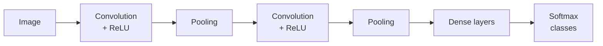
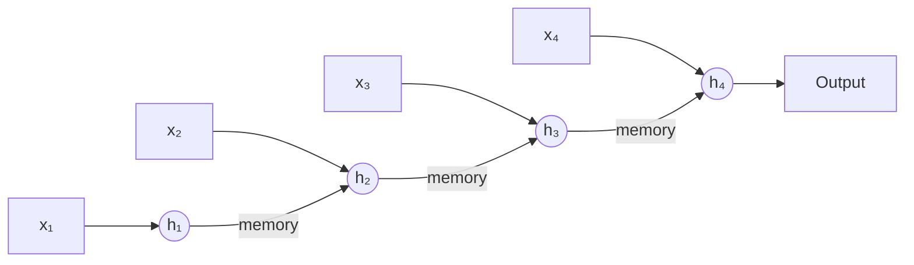

# 10 · Convolutional (CNN) and recurrent (RNN) networks

> 🇺🇸 English · 🇧🇷 [Português](10-cnn-rnn.pt-BR.md)

| | |
|-|-|
| **Track** | [AI Fundamentals](README.md) · Lesson 10 of 13 |
| **Reading time** | ~30 min |
| **You will learn** | How a convolution detects patterns in images, why CNNs need so few weights, how an RNN carries memory along a sequence, why that memory fades, and the typical attacks against each architecture |

## Architectures with built-in assumptions

The network from [lesson 09](09-neural-networks.md) connects each neuron to **every** input. That works, but it ignores something obvious about the data:

- in an **image**, neighboring pixels are related, and a cat is a cat in any corner of the photo;
- in a **text** or a **log**, order matters: "user deleted the log" is not the same as "the log deleted the user".

The two architectures in this lesson build those assumptions into the structure of the network itself:

| Architecture | Built for | Built-in assumption |
|--------------|-----------|---------------------|
| **CNN** (*Convolutional Neural Network*) | Images, signals, grid data | Patterns are **local** and can show up **in any position** |
| **RNN** (*Recurrent Neural Network*) | Text, time series, event sequences | What comes now depends **on what came before** |

## CNN: looking at the image piece by piece

### The convolution

The core idea is a **filter** (or *kernel*): a small grid of weights, for example 3 × 3, that **slides** across the image. At each position, it multiplies its weights by the pixels underneath and adds everything up. The result is an **activation map** that shows **where** that pattern appears.

It is like sliding a magnifying glass with a stencil across the image: wherever the drawing under the glass matches the stencil, the result is high.

### An example with numbers

A 5 × 5 image whose left half is dark (0) and right half is bright (1), and a filter that detects **vertical edges**:

```text
5×5 image           3×3 filter
0 0 1 1 1           −1  0  1
0 0 1 1 1           −1  0  1
0 0 1 1 1           −1  0  1
0 0 1 1 1
0 0 1 1 1
```

The filter computes "right side minus left side". Sliding it across the 3 × 3 possible positions:

| Filter position | Columns covered | Per-row computation | Sum of 3 rows |
|-----------------|-----------------|---------------------|---------------|
| Left | 0, 0, 1 | −0 + 0 + 1 = 1 | **3** |
| Middle | 0, 1, 1 | −0 + 0 + 1 = 1 | **3** |
| Right | 1, 1, 1 | −1 + 0 + 1 = 0 | **0** |

```text
3×3 activation map
3 3 0
3 3 0
3 3 0
```

The map "lights up" where there is a dark-to-bright transition and stays at zero in the uniform area. Nobody writes this filter by hand: during training, the CNN **learns** the filter values, and a layer usually has dozens or hundreds of them, each specialized in one pattern.

### Why so few weights

The same **9-weight** filter is reused at every position of the image (*weight sharing*). Compare that with a dense layer from lesson 09 connecting a 28 × 28 image to another layer of the same size:

| Layer | Weights |
|-------|---------|
| Dense: 784 inputs × 784 neurons | 614,656 |
| Convolutional: one 3 × 3 filter | 9 |

Fewer weights means less data needed for training, less overfitting, and a "cat ear" detector that works anywhere in the photo.

### Pooling: summarize and gain tolerance

After a convolution, it is common to apply **pooling**: split the map into blocks (for example, 2 × 2) and keep only the largest value of each one (*max pooling*). The block `[1 3; 2 0]` becomes **3**. This halves the size of the map in each direction and makes the network tolerant to small shifts: if the edge moved by one pixel, the block maximum stays about the same.

### The full CNN



The first layers detect edges and colors; the next ones combine those into textures and shapes; the final ones recognize objects. It is the hierarchy described in lesson 09, now with the mechanism that produces it. It was a CNN, AlexNet, that won the ImageNet competition in 2012 and kicked off the deep learning era ([lesson 02](02-history-of-ai.md)).

**In security**, CNNs show up in face recognition, CAPTCHA solving, visual phishing detection (sites that mimic the look of banks) and even malware classification: the bytes of an executable can be treated as a grayscale image or as a sequence processed by one-dimensional convolutions.

## RNN: networks with memory

### The hidden state

An RNN processes the sequence **one element at a time** and carries a **hidden state** `h`, a kind of compressed memory of everything it has seen so far:

```text
h_t = tanh( W_x · x_t + W_h · h_(t−1) + b )
```

At each step, the new state combines the current input `x_t` with the previous state `h_(t−1)`. The **same weights** are used at every step, just as the CNN filter is reused at every position.



### An example with numbers: memory fades

A minimal RNN with simple numbers: `W_x = 1`, `W_h = 0.5`, `b = 0`. It analyzes a sequence of events from a host, where **1** is a suspicious command and **0** is a common event:

| Step | Event | Computation | State h |
|------|-------|-------------|---------|
| 1 | 1 (suspicious) | tanh(1 + 0.5 × 0) | **0.762** |
| 2 | 0 | tanh(0 + 0.5 × 0.762) | 0.363 |
| 3 | 0 | tanh(0.5 × 0.363) | 0.180 |
| 4 | 0 | tanh(0.5 × 0.180) | 0.090 |
| 5 | 0 | tanh(0.5 × 0.090) | 0.045 |
| 6 | 0 | tanh(0.5 × 0.045) | **0.022** |

With each common event, the memory of the suspicious command is cut in half. After 10 steps, only 0.0014 is left. The network has **forgotten**.

### The vanishing gradient

The same effect hurts training. Through backpropagation (lesson 09), the gradient of an old event must travel through every later step, getting multiplied at each one by a factor that is usually smaller than 1. With a factor of 0.5, after 20 steps it becomes 0.5²⁰ ≈ **0.000001**. That is the **vanishing gradient**: the network cannot learn relationships between distant events, because the error signal never gets there.

### LSTM and GRU: memory with gates

The most widely used fix was the **LSTM** (*Long Short-Term Memory*) and its simplified version, the **GRU**. They add learned **gates** that decide what to keep, what to forget and what to show:

| Gate | Question it answers |
|------|---------------------|
| **Forget** | What from the old memory can I drop? |
| **Input** | What from the current input is worth keeping? |
| **Output** | What from the memory do I show now? |

With that, an important piece of information can travel hundreds of steps almost intact. LSTMs dominated machine translation, speech recognition and text analysis until around 2017.

**In security**, recurrent networks were used to model sequences of system calls, shell commands, log events and network flows, detecting anomalous sequences, and to generate candidate passwords from leaks.

> [!NOTE]
> **The limit of RNNs**
> Even with LSTM, the RNN processes one element at a time, so training cannot be parallelized, and long-term memory is still a bottleneck. In 2017, the **Transformer** architecture replaced recurrence with **attention**: each element looks directly at every other one. It is the foundation of LLMs, and the subject of lesson 11.

## Red teamer's view

### 1. Adversarial patches: attacks in the physical world

Since each filter looks at a small region, a well-designed area of the image can dominate the activations. Hence **adversarial patches**: a colorful sticker that, placed next to any object, makes the CNN see something else. Research has shown stickers on stop signs that led classifiers to read "speed limit" and printed eyeglass frames that made face recognition systems mistake one person for another. Unlike the FGSM from lesson 09, which touches every pixel, a patch works **in the real world**, printed and photographed.

### 2. Transferability: attacking without access to the model

Adversarial examples crafted against one CNN often fool **other CNNs** trained for the same task, even with different architectures. Since many companies start from the same public pre-trained models, the attacker crafts the attack on a model they control (the **surrogate**) and applies it to the target, without ever seeing its weights. See [section 06](../06-evasion/README.md).

### 3. Malware treated as an image or byte sequence

Classifiers that read the raw bytes of an executable (with convolutions over the sequence) can be fooled by **appending** bytes that do not affect execution: at the end of the file (*overlay*), in new sections or in padding areas. The malware still works, and the extra bytes are chosen to push the decision towards "benign". It is the binary version of the good word attack from [lesson 05](05-linear-logistic-regression.md).

### 4. Sequences: dilute and imitate

The fading memory is an advantage for the attacker. In the example, the suspicious command dropped to almost zero after a few common events. Sequence-based detectors can be evaded by:

- **diluting** the malicious steps among many legitimate events (the sequential equivalent of the "low and slow" from [lesson 07](07-unsupervised-learning.md));
- **imitating** normal sequences, inserting harmless calls between the malicious ones until the whole sequence looks ordinary. *Mimicry attacks* against system-call-based intrusion detectors have been known since the early 2000s.

> [!TIP]
> **Red teamer's view**
> Every architecture has a built-in assumption, and every assumption becomes an attack. The CNN assumes local patterns matter: a local **patch** can dominate the decision. The RNN assumes recent context matters more: **diluting** the malicious signal in benign events makes it vanish. And since networks of the same family learn similar things, an attack crafted on a **surrogate** model often **transfers** to the target.

## Hands-on with Python

A numpy-only example that reproduces the numbers in this lesson:

```python
import numpy as np

# Convolution: vertical edge detector
img = np.array([[0, 0, 1, 1, 1]] * 5)
kernel = np.array([[-1, 0, 1]] * 3)
fmap = np.array([[np.sum(img[i:i+3, j:j+3] * kernel) for j in range(3)]
                 for i in range(3)])
print(fmap)            # [[3 3 0]
                       #  [3 3 0]
                       #  [3 3 0]]

# 2×2 max pooling
block = np.array([[1, 3], [2, 0]])
print(block.max())     # 3

# Weights: dense layer vs convolutional filter
print(784 * 784, kernel.size)    # 614656 9

# Minimal RNN: the memory of a suspicious event fades
h = 0.0
for x in [1, 0, 0, 0, 0, 0]:
    h = np.tanh(1.0 * x + 0.5 * h)
    print(round(h, 3), end=" ")  # 0.762 0.363 0.18 0.09 0.045 0.022
print()

# Vanishing gradient: 20 multiplications by 0.5
print(0.5 ** 20)                 # 9.5367431640625e-07
```

In real life you would use PyTorch's ready-made layers (`nn.Conv2d`, `nn.MaxPool2d`, `nn.LSTM`), but these are the computations underneath.

## Summary

- **CNNs** slide small filters across the image; each filter detects a pattern in any position, with few weights thanks to **weight sharing**. **Pooling** summarizes and adds tolerance to shifts.
- **RNNs** process sequences step by step, carrying a **hidden state** as memory.
- A simple RNN's memory **fades**, and the gradient **vanishes** over long sequences. **LSTM** and **GRU** use gates to preserve what matters.
- The limits of RNNs led to **Transformers** and attention, the foundation of LLMs.
- Typical attacks: physical **adversarial patches** and **transferability** against CNNs; **appended bytes** against malware classifiers; **dilution** and **mimicry** against sequence detectors.

## Check your understanding

<details><summary>1. Why does a CNN need far fewer weights than a dense network to process the same image?</summary>

Because each filter is small (for example, 3 × 3) and the **same filter** is reused at every position of the image. A dense layer would have a separate weight for every input-neuron pair.
</details>

<details><summary>2. In the example, the vertical edge filter produced 0 at the rightmost position. Why?</summary>

Because every pixel in that region was 1: the filter computes "right minus left", and in a uniform area that difference is zero. There is no edge there.
</details>

<details><summary>3. What is the vanishing gradient in an RNN and which architecture reduces it?</summary>

It is the gradient getting smaller and smaller as it goes back in time, because it is multiplied at each step by factors below 1. The network cannot learn relationships between distant events. **LSTM** and **GRU** reduce the problem with gates that control what the memory keeps and forgets.
</details>

<details><summary>4. Why is an adversarial patch more dangerous, in practice, than an FGSM perturbation spread over the whole image?</summary>

Because the patch works in the **physical world**: it can be printed, stuck on an object and photographed from different angles. A pixel-level perturbation usually requires direct access to the digital image fed into the model.
</details>

<details><summary>5. An intrusion detector uses an RNN over system call sequences. Name two ways to evade it.</summary>

**Dilution**: spreading the malicious calls among many legitimate ones so the network's memory "forgets" the signal. **Mimicry**: inserting harmless calls until the whole sequence imitates that of a normal program, without changing what the attack does.
</details>

---

← [09 · From the perceptron to neural networks](09-neural-networks.md) · **Next lesson:** 11 · Generative AI and LLMs: tokens, embeddings, Transformers and attention (coming soon)
