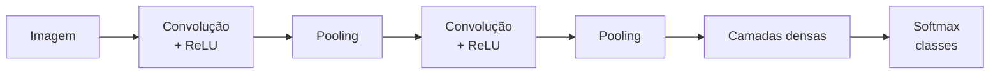
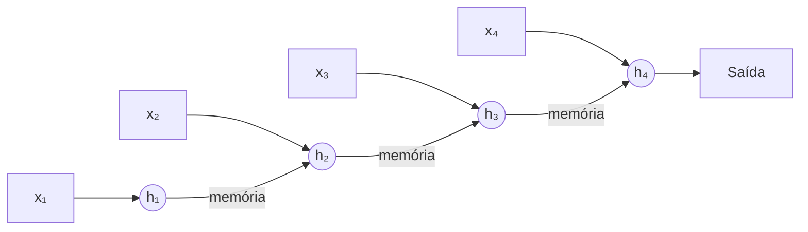

# 10 · Redes convolucionais (CNN) e recorrentes (RNN)

> 🇧🇷 Português · 🇺🇸 [English](10-cnn-rnn.md)

| | |
|-|-|
| **Trilha** | [Fundamentos de IA](README.pt-BR.md) · Aula 10 de 13 |
| **Tempo de leitura** | ~30 min |
| **Você vai aprender** | Como uma convolução detecta padrões em imagens, por que CNNs precisam de tão poucos pesos, como uma RNN carrega memória ao longo de uma sequência, por que essa memória se apaga, e os ataques típicos contra cada arquitetura |

## Arquiteturas com suposições embutidas

A rede da [aula 09](09-neural-networks.pt-BR.md) liga cada neurônio a **todas** as entradas. Isso funciona, mas ignora algo óbvio sobre os dados:

- numa **imagem**, pixels vizinhos têm relação, e um gato é um gato em qualquer canto da foto;
- num **texto** ou num **log**, a ordem importa: "usuário apagou o log" não é o mesmo que "o log apagou o usuário".

As duas arquiteturas desta aula embutem essas suposições na própria estrutura da rede:

| Arquitetura | Feita para | Suposição embutida |
|-------------|-----------|--------------------|
| **CNN** (*Convolutional Neural Network*) | Imagens, sinais, dados em grade | Padrões são **locais** e podem aparecer **em qualquer posição** |
| **RNN** (*Recurrent Neural Network*) | Texto, séries temporais, sequências de eventos | O que vem agora depende **do que veio antes** |

## CNN: olhando a imagem por partes

### A convolução

A ideia central é um **filtro** (ou *kernel*): uma pequena grade de pesos, por exemplo 3 × 3, que **desliza** pela imagem. Em cada posição, multiplica seus pesos pelos pixels embaixo dele e soma tudo. O resultado é um **mapa de ativação** que mostra **onde** aquele padrão aparece.

É como passar uma lupa com um molde pela imagem: onde o desenho embaixo da lupa combina com o molde, o resultado é alto.

### Um exemplo com números

Uma imagem 5 × 5 em que a metade esquerda é escura (0) e a direita é clara (1), e um filtro que detecta **bordas verticais**:

```text
Imagem 5×5          Filtro 3×3
0 0 1 1 1           −1  0  1
0 0 1 1 1           −1  0  1
0 0 1 1 1           −1  0  1
0 0 1 1 1
0 0 1 1 1
```

O filtro calcula "lado direito menos lado esquerdo". Deslizando pelas 3 × 3 posições possíveis:

| Posição do filtro | Colunas cobertas | Conta por linha | Soma das 3 linhas |
|-------------------|------------------|-----------------|-------------------|
| Esquerda | 0, 0, 1 | −0 + 0 + 1 = 1 | **3** |
| Meio | 0, 1, 1 | −0 + 0 + 1 = 1 | **3** |
| Direita | 1, 1, 1 | −1 + 0 + 1 = 0 | **0** |

```text
Mapa de ativação 3×3
3 3 0
3 3 0
3 3 0
```

O mapa "acende" onde há transição de escuro para claro e fica em zero na região uniforme. Ninguém programa esse filtro à mão: durante o treino, a CNN **aprende** os valores dos filtros, e uma camada costuma ter dezenas ou centenas deles, cada um especializado num padrão.

### Por que tão poucos pesos

O mesmo filtro de **9 pesos** é reaproveitado em todas as posições da imagem (*compartilhamento de pesos*). Compare com uma camada densa da aula 09 que ligasse uma imagem 28 × 28 a outra camada do mesmo tamanho:

| Camada | Pesos |
|--------|-------|
| Densa: 784 entradas × 784 neurônios | 614.656 |
| Convolucional: um filtro 3 × 3 | 9 |

Menos pesos significa menos dados necessários para treinar, menos overfitting, e um detector de "orelha de gato" que funciona em qualquer lugar da foto.

### Pooling: resumir e ganhar tolerância

Depois da convolução, é comum aplicar **pooling**: dividir o mapa em blocos (por exemplo, 2 × 2) e ficar só com o maior valor de cada um (*max pooling*). O bloco `[1 3; 2 0]` vira **3**. Isso reduz o tamanho do mapa pela metade em cada direção e torna a rede tolerante a pequenos deslocamentos: se a borda andou um pixel, o máximo do bloco continua parecido.

### A CNN completa



As primeiras camadas detectam bordas e cores; as seguintes combinam esses padrões em texturas e formas; as finais reconhecem objetos. É a hierarquia que a aula 09 descreveu, agora com o mecanismo que a produz. Foi uma CNN, a AlexNet, que venceu a competição ImageNet em 2012 e disparou a era do deep learning ([aula 02](02-history-of-ai.pt-BR.md)).

**Em segurança**, CNNs aparecem em reconhecimento facial, leitura de CAPTCHAs, detecção de phishing visual (sites que imitam a aparência de bancos) e até classificação de malware: os bytes de um executável podem ser tratados como uma imagem em tons de cinza ou como uma sequência processada por convoluções de uma dimensão.

## RNN: redes com memória

### O estado oculto

Uma RNN processa a sequência **um elemento por vez** e carrega um **estado oculto** `h`, uma espécie de memória resumida de tudo o que viu até ali:

```text
h_t = tanh( W_x · x_t + W_h · h_(t−1) + b )
```

A cada passo, o novo estado combina a entrada atual `x_t` com o estado anterior `h_(t−1)`. Os **mesmos pesos** são usados em todos os passos, como o filtro da CNN é reaproveitado em todas as posições.



### Um exemplo com números: a memória se apaga

Uma RNN mínima, com números simples: `W_x = 1`, `W_h = 0,5`, `b = 0`. Ela analisa uma sequência de eventos de um host, em que **1** é um comando suspeito e **0** é um evento comum:

| Passo | Evento | Conta | Estado h |
|-------|--------|-------|----------|
| 1 | 1 (suspeito) | tanh(1 + 0,5 × 0) | **0,762** |
| 2 | 0 | tanh(0 + 0,5 × 0,762) | 0,363 |
| 3 | 0 | tanh(0,5 × 0,363) | 0,180 |
| 4 | 0 | tanh(0,5 × 0,180) | 0,090 |
| 5 | 0 | tanh(0,5 × 0,090) | 0,045 |
| 6 | 0 | tanh(0,5 × 0,045) | **0,022** |

A cada evento comum, a lembrança do comando suspeito cai pela metade. Depois de 10 passos, sobra 0,0014. A rede **esqueceu**.

### O gradiente que desaparece

O mesmo efeito atrapalha o treino. Pelo backpropagation (aula 09), o gradiente de um evento antigo precisa atravessar todos os passos seguintes, sendo multiplicado a cada um por um fator geralmente menor que 1. Com um fator de 0,5, depois de 20 passos ele vira 0,5²⁰ ≈ **0,000001**. Esse é o **vanishing gradient**: a rede não consegue aprender relações entre eventos distantes, porque o sinal de erro não chega até lá.

### LSTM e GRU: memória com portões

A solução mais usada foi a **LSTM** (*Long Short-Term Memory*), e sua versão simplificada, a **GRU**. Elas adicionam **portões** aprendidos que decidem o que guardar, o que esquecer e o que mostrar:

| Portão | Pergunta que responde |
|--------|----------------------|
| **Esquecimento** | O que da memória antiga posso descartar? |
| **Entrada** | O que da entrada atual vale guardar? |
| **Saída** | O que da memória mostro agora? |

Com isso, uma informação importante pode atravessar centenas de passos quase intacta. LSTMs dominaram tradução automática, reconhecimento de voz e análise de texto até cerca de 2017.

**Em segurança**, redes recorrentes foram usadas para modelar sequências de chamadas de sistema, comandos de shell, eventos de log e fluxos de rede, detectando sequências anômalas, e para gerar senhas candidatas a partir de vazamentos.

> [!NOTE]
> **O limite das RNNs**
> Mesmo com LSTM, a RNN processa um elemento por vez, então não dá para paralelizar o treino, e a memória de longo prazo continua sendo um gargalo. Em 2017, a arquitetura **Transformer** trocou a recorrência por **atenção**: cada elemento olha diretamente para todos os outros. É a base dos LLMs, e o assunto da aula 11.

## Visão do red teamer

### 1. Patches adversariais: ataques no mundo físico

Como cada filtro olha uma região pequena, uma área bem desenhada da imagem pode dominar as ativações. Daí os **patches adversariais**: um adesivo colorido que, colocado ao lado de qualquer objeto, faz a CNN ver outra coisa. Pesquisas mostraram adesivos em placas de "pare" que levavam classificadores a ler "limite de velocidade" e armações de óculos impressas que faziam sistemas de reconhecimento facial confundir uma pessoa com outra. Diferente do FGSM da aula 09, que mexe em todos os pixels, o patch funciona **no mundo real**, impresso e fotografado.

### 2. Transferência: atacar sem acesso ao modelo

Adversarial examples gerados contra uma CNN costumam enganar **outras CNNs** treinadas para a mesma tarefa, mesmo com arquiteturas diferentes. Como muitas empresas partem dos mesmos modelos pré-treinados públicos, o atacante gera o ataque num modelo que ele controla (o **substituto**) e o aplica no alvo, sem nunca ter visto os pesos dele. Veja a [seção 06](../06-evasion/README.md).

### 3. Malware tratado como imagem ou sequência de bytes

Classificadores que leem os bytes brutos de um executável (com convoluções sobre a sequência) podem ser enganados **adicionando** bytes que não afetam a execução: no fim do arquivo (*overlay*), em seções novas ou em áreas de preenchimento. O malware continua funcionando, e os bytes extras são escolhidos para empurrar a decisão para "benigno". É a versão binária do good word attack da [aula 05](05-linear-logistic-regression.pt-BR.md).

### 4. Sequências: diluir e imitar

A memória que se apaga é uma vantagem para o atacante. No exemplo, o comando suspeito virou quase zero depois de alguns eventos comuns. Detectores baseados em sequência podem ser evadidos:

- **diluindo** os passos maliciosos entre muitos eventos legítimos (o equivalente sequencial do "low and slow" da [aula 07](07-unsupervised-learning.pt-BR.md));
- **imitando** sequências normais, com chamadas inofensivas inseridas entre as maliciosas até a sequência inteira parecer comum. *Mimicry attacks* contra detectores de intrusão baseados em chamadas de sistema são conhecidos desde o início dos anos 2000.

> [!TIP]
> **Visão do red teamer**
> Toda arquitetura tem uma suposição embutida, e cada suposição vira um ataque. A CNN supõe que padrões locais importam: um **patch** local pode dominar a decisão. A RNN supõe que o contexto recente importa mais: **diluir** o sinal malicioso em eventos benignos o faz desaparecer. E como as redes da mesma família aprendem coisas parecidas, um ataque feito num modelo **substituto** muitas vezes **transfere** para o alvo.

## Na prática com Python

Um exemplo só com numpy, que reproduz os números desta aula:

```python
import numpy as np

# Convolução: detector de borda vertical
img = np.array([[0, 0, 1, 1, 1]] * 5)
filtro = np.array([[-1, 0, 1]] * 3)
mapa = np.array([[np.sum(img[i:i+3, j:j+3] * filtro) for j in range(3)]
                 for i in range(3)])
print(mapa)            # [[3 3 0]
                       #  [3 3 0]
                       #  [3 3 0]]

# Max pooling 2×2
bloco = np.array([[1, 3], [2, 0]])
print(bloco.max())     # 3

# Pesos: camada densa x filtro convolucional
print(784 * 784, filtro.size)    # 614656 9

# RNN mínima: a memória de um evento suspeito se apaga
h = 0.0
for x in [1, 0, 0, 0, 0, 0]:
    h = np.tanh(1.0 * x + 0.5 * h)
    print(round(h, 3), end=" ")  # 0.762 0.363 0.18 0.09 0.045 0.022
print()

# Vanishing gradient: 20 multiplicações por 0,5
print(0.5 ** 20)                 # 9.5367431640625e-07
```

Na vida real você usaria as camadas prontas do PyTorch (`nn.Conv2d`, `nn.MaxPool2d`, `nn.LSTM`), mas as contas por baixo são estas.

## Resumo

- **CNNs** deslizam filtros pequenos pela imagem; cada filtro detecta um padrão em qualquer posição, com poucos pesos graças ao **compartilhamento**. **Pooling** resume e dá tolerância a deslocamentos.
- **RNNs** processam sequências passo a passo, carregando um **estado oculto** como memória.
- A memória de uma RNN simples **se apaga**, e o gradiente **desaparece** em sequências longas. **LSTM** e **GRU** usam portões para preservar o que importa.
- O limite das RNNs levou aos **Transformers** e à atenção, base dos LLMs.
- Ataques típicos: **patches adversariais** físicos e **transferência** contra CNNs; **bytes adicionados** contra classificadores de malware; **diluição** e **mimetismo** contra detectores de sequência.

## Teste seu entendimento

<details><summary>1. Por que uma CNN precisa de muito menos pesos que uma rede densa para processar a mesma imagem?</summary>

Porque cada filtro é pequeno (por exemplo, 3 × 3) e o **mesmo filtro** é reaproveitado em todas as posições da imagem. Uma camada densa teria um peso separado para cada par entrada-neurônio.
</details>

<details><summary>2. No exemplo, o filtro de borda vertical produziu 0 na posição da direita. Por quê?</summary>

Porque naquela região todos os pixels valiam 1: o filtro calcula "direita menos esquerda", e numa área uniforme essa diferença é zero. Não há borda ali.
</details>

<details><summary>3. O que é o vanishing gradient numa RNN e qual arquitetura o reduz?</summary>

É o gradiente ficando cada vez menor ao voltar no tempo, por ser multiplicado a cada passo por fatores menores que 1. A rede não aprende relações entre eventos distantes. **LSTM** e **GRU** reduzem o problema com portões que controlam o que a memória guarda e esquece.
</details>

<details><summary>4. Por que um patch adversarial é mais perigoso, na prática, do que uma perturbação FGSM espalhada por toda a imagem?</summary>

Porque o patch funciona no **mundo físico**: pode ser impresso, colado num objeto e fotografado de ângulos diferentes. Uma perturbação pixel a pixel costuma exigir acesso direto à imagem digital que entra no modelo.
</details>

<details><summary>5. Um detector de intrusão usa uma RNN sobre sequências de chamadas de sistema. Cite duas formas de evasão.</summary>

**Diluição**: espalhar as chamadas maliciosas entre muitas chamadas legítimas, para a memória da rede "esquecer" o sinal. **Mimetismo**: inserir chamadas inofensivas até a sequência inteira imitar a de um programa normal, sem mudar o que o ataque faz.
</details>

---

← [09 · Do perceptron às redes neurais](09-neural-networks.pt-BR.md) · **Próxima aula:** 11 · IA generativa e LLMs: tokens, embeddings, Transformers e atenção (em breve)
