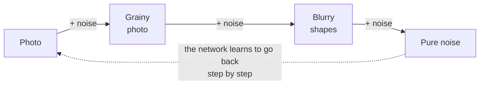
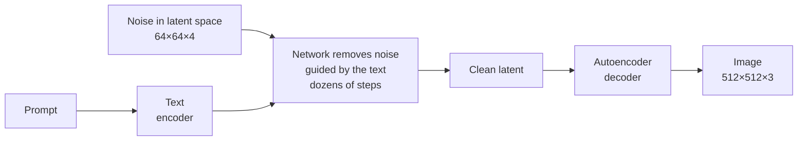

# 12 · Diffusion models

> 🇺🇸 English · 🇧🇷 [Português](12-diffusion-models.pt-BR.md)

| | |
|-|-|
| **Track** | [AI Fundamentals](README.md) · Lesson 12 of 13 |
| **Reading time** | ~25 min |
| **You will learn** | How a model generates images by removing noise step by step, why it learns to predict the noise, how text guides generation, what latent diffusion is, and the security risks of synthetic media: deepfakes, filter bypass, memorization and poisoning |

## How do you generate an image out of nothing?

Generating text means picking the next token ([lesson 11](11-llms.md)). But how do you generate a 512 × 512 pixel image with coherent colors, lighting and shapes? There were a few answers before the current one:

| Approach | Idea | Analogy |
|----------|------|---------|
| **GAN** (2014) | Two networks compete: one generates fake images, the other tries to tell fake from real. Both improve together | A counterfeiter against a police expert |
| **VAE** | An autoencoder ([lesson 09](09-neural-networks.md)) whose bottleneck follows a distribution; you sample a point in the bottleneck and the decoder generates the image | Describing a face with a few numbers and redrawing it |
| **Diffusion** (2020 onwards) | Learn to **remove noise** from an image, little by little, until an image emerges from pure noise | A sculptor chipping away the excess from a marble block |

GANs produced impressive faces but were unstable to train. **Diffusion models** proved more stable and controllable, and today they power most image generators, and many video and audio ones.

## The idea: destroying is easy, rebuilding is learned

### The forward process: adding noise

Take a photo and add a little random noise. Then a little more. Repeat hundreds of times. In the end, only **pure noise** is left, with no trace of the photo. That is the **forward process**. There is nothing smart about it: it is just a formula.



### The reverse process: removing noise

The smart part is the way back. A neural network is trained to look at a noisy image and **estimate which noise was added**. If it knows the noise, it just subtracts it to get a cleaner version. Repeating this starting from pure noise, a new image emerges, one that never existed.

### An example with numbers: one pixel

Let us follow a single pixel with brightness `x₀ = 0.8`. At each step `t`, the forward process mixes the original pixel with noise:

```text
x_t = √ᾱ_t × x₀ + √(1 − ᾱ_t) × ε
```

`ε` is a random number drawn from a normal distribution (here, `ε = −1.2`), and `ᾱ_t` says how much of the original signal is left: it starts near 1 and goes to almost 0.

| Step | ᾱ_t | Signal weight (√ᾱ) | Noise weight (√(1−ᾱ)) | Noisy pixel x_t |
|------|-----|--------------------|-----------------------|-----------------|
| start | 1.00 | 1.000 | 0.000 | 0.800 |
| little noise | 0.90 | 0.949 | 0.316 | 0.379 |
| halfway | 0.50 | 0.707 | 0.707 | −0.283 |
| lots of noise | 0.10 | 0.316 | 0.949 | −0.885 |
| almost pure | 0.01 | 0.100 | 0.995 | −1.114 |

In the end, the pixel is almost all noise: the original 0.8 contributes only 0.08.

**The network's job is to predict `ε`.** If it gets the noise exactly right, the original can be recovered at any step:

```text
x₀ = ( x_t − √(1 − ᾱ_t) × ε_predicted ) / √ᾱ_t
```

Now see what happens if the noise prediction is off by **0.3**:

| Step | ᾱ_t | Recovered pixel (exact prediction) | Recovered pixel (0.3 error) |
|------|-----|------------------------------------|-----------------------------|
| little noise | 0.90 | 0.800 | 0.700 |
| halfway | 0.50 | 0.800 | 0.500 |
| lots of noise | 0.10 | 0.800 | −0.100 |
| almost pure | 0.01 | 0.800 | **−2.185** |

Near pure noise, the same error is **amplified** about 10 times. That is why the model does not try to jump from noise to image in one go: it takes **dozens of small steps**, removing a bit of noise each time and correcting course at every step.

### How the network is trained

Training is surprisingly simple:

1. take an image from the dataset;
2. draw a step `t` and a noise `ε`, and build `x_t` with the formula above;
3. ask the network to predict `ε` from `x_t` (and `t`);
4. the loss is the **mean squared error** between the real and predicted noise ([lesson 05](05-linear-logistic-regression.md));
5. repeat billions of times.

The network is usually a **U-Net** (a CNN from [lesson 10](10-cnn-rnn.md) shaped like an hourglass) or, in more recent models, a **Transformer** ([lesson 11](11-llms.md)) that treats image patches as tokens.

## Guiding with text

### Text becomes an embedding

To generate "a cat wearing glasses reading logs in a SOC", the prompt goes through a **text encoder** that turns it into embeddings. The noise-removing network consults those embeddings through **cross-attention**: image patches ask "questions" (queries) and the prompt tokens answer (keys and values), exactly the mechanism from lesson 11. That way, each cleaning step is pulled towards what the text describes.

Many systems use encoders trained to put **images and text in the same embedding space**: a photo of a cat and the sentence "photo of a cat" become nearby vectors. That makes it possible to measure how well an image matches a text.

### Classifier-free guidance: the prompt's volume knob

During generation, the network makes two predictions at each step: one **without** the prompt and one **with** it. The final result exaggerates the difference between them:

```text
guided prediction = without_prompt + s × (with_prompt − without_prompt)
```

For any given value of the prediction, with `without_prompt = 0.2` and `with_prompt = 0.5`:

| Guidance scale s | Guided prediction | Effect |
|------------------|-------------------|--------|
| 1 | 0.50 | Follows the prompt lightly, more variety |
| 3 | 1.10 | Balance |
| 7.5 | 2.45 | Follows the prompt strongly, less variety and more artifacts |

The **negative prompt** ("no text, no watermark") uses the same computation, in place of "without prompt", to push the image away from what you do not want.

## Latent diffusion: working compressed

Removing noise from 512 × 512 pixels in 3 colors, over dozens of steps, is expensive. **Latent diffusion** uses the autoencoder trick from lesson 09:



```text
image:   512 × 512 × 3 = 786,432 values
latent:   64 ×  64 × 4 =  16,384 values   → 48 times smaller
```

The whole diffusion process happens in the latent space, 48 times smaller, and only at the end does the decoder turn the result into pixels. That idea made it possible to run high-quality image generators on consumer graphics cards from 2022 onwards, and it led to the explosion of open models and fine-tunes shared online.

## Red teamer's view

### 1. Bypassing content filters

Public generators usually have two filters: one on the **prompt** (blocks certain words or topics) and one on the **generated image** (a classifier that stops forbidden content). Both inherit weaknesses you have already seen:

- the prompt filter is bypassed as in [lesson 11](11-llms.md): synonyms, misspellings, other languages, indirect descriptions;
- since the model understands the prompt through the **embedding space**, not the words, research has shown that token sequences meaningless to a human can land near a forbidden concept and generate exactly the content the filter was supposed to block;
- the output filter is an image classifier and can be fooled with adversarial perturbations ([lesson 09](09-neural-networks.md)).

### 2. Deepfakes and social engineering

For corporate security, the most concrete risk is not in the model but in the **use** of what it generates:

- **vishing and fake video calls**: synthetic voice and video of an executive asking for an urgent transfer. In 2024, a widely reported case in Hong Kong involved a transfer of tens of millions of dollars after a video call in which the "colleagues" were deepfakes;
- **KYC and biometric bypass**: synthetic documents and selfies to open accounts or pass identity checks;
- **visual phishing**: fake images, logos and pages produced at scale and personalized for each target.

In an authorized red team, simulations like these test **processes** (dual verification, confirmation words, alternate channels), not just technology.

### 3. Training data memorization

Like LLMs ([lesson 11](11-llms.md)), diffusion models can **memorize** images they saw many times during training. Research managed to extract near-identical images from the training set, including photos of real people, using specific prompts. It is a privacy and intellectual property risk. See [section 07](../07-privacy/README.md).

### 4. Poisoning and third-party models

- **Concept poisoning**: tools such as Nightshade add nearly invisible perturbations to published images, so that a model trained on them learns wrong associations (for example, "dog" starts generating cats). They were built as a defense for artists, but they show that a few poisoned examples can affect a whole concept.
- **Third-party fine-tunes**: the small fine-tuning files (such as LoRAs) and checkpoints shared in communities can contain **backdoors** triggered by a keyword and, in pickle-based formats, **executable code** ([lesson 09](09-neural-networks.md)). See [section 04](../04-data-attacks/README.md).

### 5. Images as an attack vector against multimodal LLMs

Models that **read** images (LLMs with vision) treat text inside an image as part of the context. An image with hidden instructions, in tiny letters, colors nearly identical to the background or tucked in a corner, is a form of **indirect prompt injection**. The image may have been generated, edited or just photographed: the risk lies in the model that consumes it.

> [!TIP]
> **Red teamer's view**
> In diffusion systems, test the two filters separately (prompt and output) and remember that the model understands **meaning**, not words. Treat any third-party checkpoint or fine-tune as untrusted code. And in a corporate scope, the weakest target is usually the **human process** that trusts voice, video or documents: watermarks and synthetic content detectors help, but they can be removed or fooled and do not replace verification through another channel.

## Hands-on with Python

A numpy-only example that reproduces the numbers in this lesson:

```python
import numpy as np

x0, eps = 0.8, -1.2                         # original pixel and drawn noise
for a in (0.9, 0.5, 0.1, 0.01):             # ᾱ_t: how much signal is left
    xt = np.sqrt(a) * x0 + np.sqrt(1 - a) * eps
    exact = (xt - np.sqrt(1 - a) * eps) / np.sqrt(a)
    wrong = (xt - np.sqrt(1 - a) * (eps + 0.3)) / np.sqrt(a)
    print(a, round(xt, 3), round(exact, 3), round(wrong, 3))
# 0.9  0.379   0.8  0.7
# 0.5  -0.283  0.8  0.5
# 0.1  -0.885  0.8  -0.1
# 0.01 -1.114  0.8  -2.185

# Classifier-free guidance
without, with_ = 0.2, 0.5
for s in (1, 3, 7.5):
    print(s, round(without + s * (with_ - without), 2))   # 0.5, 1.1, 2.45

# Latent diffusion: how much the space shrinks
print(512 * 512 * 3, 64 * 64 * 4, 512 * 512 * 3 / (64 * 64 * 4))
# 786432 16384 48.0
```

In real life you would use Hugging Face's `diffusers` library, which ships ready-made models and the denoising loop, but these are the computations underneath. Running a generator locally requires a graphics card with plenty of memory.

## Summary

- Before diffusion came **GANs** (generator against discriminator) and **VAEs**.
- A **diffusion model** learns to **predict the noise** added to an image. Generating means starting from pure noise and removing it in **many small steps**, because errors are amplified near pure noise.
- **Text** guides generation through embeddings and cross-attention; **classifier-free guidance** controls how much the prompt weighs.
- **Latent diffusion** works in a compressed space (48 times smaller in the example), which made open models running at home possible.
- Risks: bypassing prompt and output **filters**, **deepfakes** for social engineering and fraud, **memorization** of training images, **poisoning** and malicious checkpoints, and images as a carrier for **prompt injection** into multimodal LLMs.

## Check your understanding

<details><summary>1. What exactly does a diffusion model's network learn to predict?</summary>

The **noise** that was added to the image at a given step. Knowing the noise, it can be subtracted to get a cleaner version of the image.
</details>

<details><summary>2. Why does generation use dozens of steps instead of going from noise to image at once?</summary>

Because near pure noise any error in the noise prediction is heavily amplified (in the example, a 0.3 error became an error of almost 3 in the pixel). Small steps allow course correction at each stage.
</details>

<details><summary>3. What happens when you crank up the classifier-free guidance scale?</summary>

The image follows the prompt more strongly, but loses variety and may gain artifacts and saturated colors, because the difference between the predictions with and without the prompt is exaggerated.
</details>

<details><summary>4. A generator blocks prompts with forbidden words. Why is that not enough?</summary>

Because the model interprets the prompt by its **meaning** in the embedding space. Synonyms, misspellings, other languages, indirect descriptions and even meaningless token sequences can reach the same concept without containing the blocked word. A filter on the generated image is also needed, and even that can be fooled.
</details>

<details><summary>5. In an authorized red team exercise, how could a voice deepfake be used, and which control does it test?</summary>

By simulating a call from an executive asking for an urgent action, such as a transfer or a password reset. What is tested is the **process**: whether the team requires confirmation through another channel, verification words or dual approval before acting.
</details>

---

← [11 · Generative AI and LLMs: tokens, embeddings, Transformers and attention](11-llms.md) · **Next lesson:** [13 · AI systems: RAG, agents, tools and MCP](13-ai-systems.md) →
