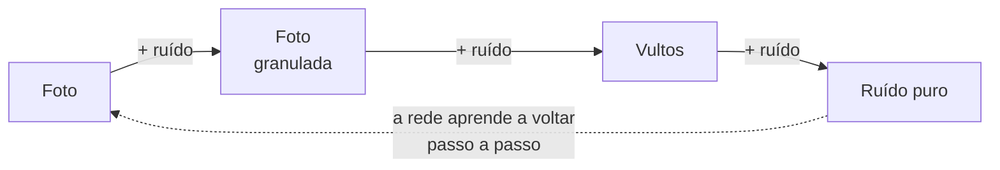
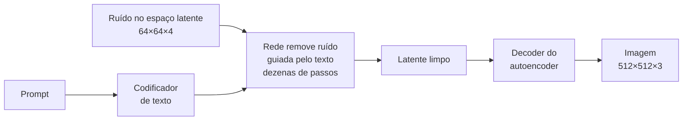

# 12 · Modelos de difusão

> 🇧🇷 Português · 🇺🇸 [English](12-diffusion-models.md)

| | |
|-|-|
| **Trilha** | [Fundamentos de IA](README.pt-BR.md) · Aula 12 de 13 |
| **Nível** | Base |
| **Pré-requisitos** | [09 · Redes neurais](09-neural-networks.pt-BR.md), [10 · CNN e RNN](10-cnn-rnn.pt-BR.md), [11 · LLMs e Transformers](11-llms.pt-BR.md) |
| **Tempo de leitura** | ~25 min |
| **Você vai aprender** | Como um modelo gera imagens removendo ruído passo a passo, por que ele aprende a prever o ruído, como o texto guia a geração, o que é difusão latente, e os riscos de segurança da mídia sintética: deepfakes, burla de filtros, memorização e envenenamento |

## Como gerar uma imagem do nada?

Gerar texto é escolher o próximo token ([aula 11](11-llms.pt-BR.md)). Mas como gerar uma imagem de 512 × 512 pixels, com cores, luz e formas coerentes? Houve algumas respostas antes da atual:

| Abordagem | Ideia | Analogia |
|-----------|-------|----------|
| **GAN** (2014) | Duas redes competem: uma gera imagens falsas, a outra tenta distinguir falsas de reais. As duas melhoram juntas | Um falsificador de notas contra um perito da polícia |
| **VAE** | Um autoencoder ([aula 09](09-neural-networks.pt-BR.md)) cujo gargalo segue uma distribuição; sorteia-se um ponto no gargalo e o decoder gera a imagem | Descrever um rosto com poucos números e redesenhá-lo |
| **Difusão** (2020 em diante) | Aprender a **remover ruído** de uma imagem, pouco a pouco, até que do ruído puro surja uma imagem | Um escultor tirando o excesso do bloco de mármore |

As GANs geravam rostos impressionantes, mas eram instáveis de treinar. Os **modelos de difusão** se mostraram mais estáveis e controláveis, e hoje estão por trás da maioria dos geradores de imagem, e de muitos de vídeo e áudio.

## A ideia: destruir é fácil, reconstruir se aprende

### O processo direto: adicionar ruído

Pegue uma foto e adicione um pouco de ruído aleatório. Depois mais um pouco. Repita centenas de vezes. No fim, sobra **ruído puro**, sem nenhum traço da foto. Esse é o **processo direto** (*forward*). Ele não tem nada de inteligente: é só uma fórmula.



### O processo reverso: remover ruído

A parte inteligente é o caminho de volta. Uma rede neural é treinada para olhar uma imagem com ruído e **estimar qual ruído foi adicionado**. Se ela sabe qual é o ruído, basta subtraí-lo para chegar a uma versão mais limpa. Repetindo isso a partir de ruído puro, surge uma imagem nova, que nunca existiu.

### Um exemplo com números: um pixel

Vamos acompanhar um único pixel, de brilho `x₀ = 0,8`. Em cada etapa `t`, o processo direto mistura o pixel original com ruído:

```text
x_t = √ᾱ_t × x₀ + √(1 − ᾱ_t) × ε
```

`ε` é um número aleatório sorteado de uma distribuição normal (aqui, `ε = −1,2`), e `ᾱ_t` diz quanto do sinal original ainda resta: começa perto de 1 e vai a quase 0.

| Etapa | ᾱ_t | Peso do sinal (√ᾱ) | Peso do ruído (√(1−ᾱ)) | Pixel com ruído x_t |
|-------|-----|--------------------|------------------------|---------------------|
| início | 1,00 | 1,000 | 0,000 | 0,800 |
| pouco ruído | 0,90 | 0,949 | 0,316 | 0,379 |
| metade | 0,50 | 0,707 | 0,707 | −0,283 |
| muito ruído | 0,10 | 0,316 | 0,949 | −0,885 |
| quase puro | 0,01 | 0,100 | 0,995 | −1,114 |

No fim, o pixel é quase só ruído: o 0,8 original contribui com 0,08.

**O trabalho da rede é prever `ε`.** Se ela acerta exatamente o ruído, dá para recuperar o original em qualquer etapa:

```text
x₀ = ( x_t − √(1 − ᾱ_t) × ε_previsto ) / √ᾱ_t
```

Agora veja o que acontece se a previsão do ruído errar por **0,3**:

| Etapa | ᾱ_t | Pixel recuperado (previsão exata) | Pixel recuperado (erro de 0,3) |
|-------|-----|-----------------------------------|--------------------------------|
| pouco ruído | 0,90 | 0,800 | 0,700 |
| metade | 0,50 | 0,800 | 0,500 |
| muito ruído | 0,10 | 0,800 | −0,100 |
| quase puro | 0,01 | 0,800 | **−2,185** |

Perto do ruído puro, o mesmo erro é **amplificado** cerca de 10 vezes. Por isso o modelo não tenta pular do ruído para a imagem num passo só: ele dá **dezenas de passos pequenos**, removendo um pouco de ruído de cada vez e corrigindo o rumo a cada passo.

### Como a rede é treinada

O treino é surpreendentemente simples:

1. pegue uma imagem do dataset;
2. sorteie uma etapa `t` e um ruído `ε`, e gere `x_t` com a fórmula acima;
3. peça para a rede prever `ε` a partir de `x_t` (e de `t`);
4. a perda é o **erro quadrático médio** entre o ruído real e o previsto ([aula 05](05-linear-logistic-regression.pt-BR.md));
5. repita bilhões de vezes.

A rede costuma ser uma **U-Net** (uma CNN da [aula 10](10-cnn-rnn.pt-BR.md) em formato de ampulheta) ou, nos modelos mais recentes, um **Transformer** ([aula 11](11-llms.pt-BR.md)) que trata pedaços da imagem como tokens.

## Guiando com texto

### O texto vira embedding

Para gerar "um gato de óculos lendo logs num SOC", o prompt passa por um **codificador de texto**, que o transforma em embeddings. A rede que remove ruído consulta esses embeddings por **atenção cruzada**: os pedaços da imagem fazem "perguntas" (queries) e os tokens do prompt respondem (keys e values), exatamente o mecanismo da aula 11. Assim, cada passo de limpeza é puxado na direção do que o texto descreve.

Muitos sistemas usam codificadores treinados para colocar **imagens e textos no mesmo espaço de embeddings**: a foto de um gato e a frase "foto de um gato" viram vetores próximos. Isso permite medir o quanto uma imagem combina com um texto.

### Classifier-free guidance: o volume do prompt

Durante a geração, a rede faz duas previsões em cada passo: uma **sem** o prompt e uma **com** o prompt. O resultado final exagera a diferença entre elas:

```text
previsão guiada = sem_prompt + s × (com_prompt − sem_prompt)
```

Para um valor qualquer da previsão, com `sem_prompt = 0,2` e `com_prompt = 0,5`:

| Escala de guidance s | Previsão guiada | Efeito |
|----------------------|-----------------|--------|
| 1 | 0,50 | Segue o prompt de leve, mais variedade |
| 3 | 1,10 | Equilíbrio |
| 7,5 | 2,45 | Segue o prompt com força, menos variedade e mais artefatos |

O **prompt negativo** ("sem texto, sem marca d'água") usa a mesma conta, no lugar do "sem prompt", para afastar a imagem do que não se quer.

## Difusão latente: trabalhar comprimido

Remover ruído de 512 × 512 pixels em 3 cores, em dezenas de passos, é caro. A **difusão latente** usa o truque do autoencoder da aula 09:



```text
imagem:  512 × 512 × 3 = 786.432 valores
latente:  64 ×  64 × 4 =  16.384 valores   → 48 vezes menor
```

Toda a difusão acontece no espaço latente, 48 vezes menor, e só no fim o decoder transforma o resultado em pixels. Foi essa ideia que permitiu rodar geradores de imagem de alta qualidade em placas de vídeo domésticas, a partir de 2022, e que levou à explosão de modelos abertos e ajustes finos compartilhados na internet.

## Visão do red teamer

### 1. Burlar filtros de conteúdo

Geradores públicos costumam ter dois filtros: um no **prompt** (bloqueia certas palavras ou temas) e outro na **imagem gerada** (um classificador que barra conteúdo proibido). Os dois herdam as fraquezas que você já viu:

- o filtro de prompt é burlado como na [aula 11](11-llms.pt-BR.md): sinônimos, erros de grafia, outros idiomas, descrições indiretas;
- como o modelo entende o prompt pelo **espaço de embeddings**, e não pelas palavras, pesquisas mostraram que sequências de tokens sem sentido para um humano podem cair perto de um conceito proibido e gerar exatamente o conteúdo que o filtro deveria impedir;
- o filtro de saída é um classificador de imagens e pode ser enganado com perturbações adversariais ([aula 09](09-neural-networks.pt-BR.md)).

### 2. Deepfakes e engenharia social

Para a segurança corporativa, o risco mais concreto não está no modelo, mas no **uso** do que ele gera:

- **vishing e videochamadas falsas**: voz e vídeo sintéticos de um executivo pedindo uma transferência urgente. Em 2024, um caso amplamente noticiado em Hong Kong envolveu uma transferência de dezenas de milhões de dólares após uma videochamada em que os "colegas" eram deepfakes;
- **burla de KYC e biometria**: documentos e selfies sintéticos para abrir contas ou passar por verificações de identidade;
- **phishing visual**: imagens, logos e páginas falsas produzidos em escala e personalizados para cada alvo.

Num red team autorizado, simulações desse tipo testam **processos** (dupla verificação, palavras de confirmação, canais alternativos), não só tecnologia.

### 3. Memorização dos dados de treino

Como os LLMs ([aula 11](11-llms.pt-BR.md)), modelos de difusão podem **memorizar** imagens que viram muitas vezes no treino. Pesquisas conseguiram extrair, quase idênticas, imagens do dataset de treino, incluindo fotos de pessoas reais, a partir de prompts específicos. É um risco de privacidade e de propriedade intelectual. Veja a [seção 07](../07-privacy/README.md).

### 4. Envenenamento e modelos de terceiros

- **Envenenamento de conceitos**: ferramentas como o Nightshade adicionam perturbações quase invisíveis a imagens publicadas, de modo que um modelo treinado com elas aprende associações erradas (por exemplo, "cachorro" passa a gerar gatos). Foram criadas como defesa de artistas, mas mostram que poucos exemplos envenenados afetam um conceito inteiro.
- **Ajustes finos de terceiros**: os pequenos arquivos de ajuste fino (como os LoRAs) e checkpoints compartilhados em comunidades podem conter **backdoors** ativados por uma palavra-gatilho e, em formatos baseados em pickle, **código executável** ([aula 09](09-neural-networks.pt-BR.md)). Veja a [seção 04](../04-data-attacks/README.md).

### 5. Imagens como vetor de ataque contra LLMs multimodais

Modelos que **leem** imagens (LLMs com visão) tratam o texto dentro de uma imagem como parte do contexto. Uma imagem com instruções escondidas, em letras minúsculas, cores quase iguais ao fundo ou num canto, é uma forma de **prompt injection indireta**. A imagem pode ter sido gerada, editada ou só fotografada: o risco está no modelo que a consome.

> [!TIP]
> **Visão do red teamer**
> Em sistemas de difusão, teste os dois filtros separadamente (prompt e saída) e lembre que o modelo entende **significado**, não palavras. Trate qualquer checkpoint ou ajuste fino de terceiros como código não confiável. E, no escopo corporativo, o alvo mais frágil costuma ser o **processo humano** que confia em voz, vídeo ou documento: marcas d'água e detectores de conteúdo sintético ajudam, mas podem ser removidos ou enganados e não substituem uma verificação por outro canal.

## Na prática com Python

Um exemplo só com numpy, que reproduz os números desta aula:

```python
import numpy as np

x0, eps = 0.8, -1.2                         # pixel original e ruído sorteado
for a in (0.9, 0.5, 0.1, 0.01):             # ᾱ_t: quanto do sinal resta
    xt = np.sqrt(a) * x0 + np.sqrt(1 - a) * eps
    exato = (xt - np.sqrt(1 - a) * eps) / np.sqrt(a)
    errado = (xt - np.sqrt(1 - a) * (eps + 0.3)) / np.sqrt(a)
    print(a, round(xt, 3), round(exato, 3), round(errado, 3))
# 0.9  0.379   0.8  0.7
# 0.5  -0.283  0.8  0.5
# 0.1  -0.885  0.8  -0.1
# 0.01 -1.114  0.8  -2.185

# Classifier-free guidance
sem, com = 0.2, 0.5
for s in (1, 3, 7.5):
    print(s, round(sem + s * (com - sem), 2))   # 0.5, 1.1, 2.45

# Difusão latente: quanto o espaço encolhe
print(512 * 512 * 3, 64 * 64 * 4, 512 * 512 * 3 / (64 * 64 * 4))
# 786432 16384 48.0
```

Na vida real você usaria a biblioteca `diffusers` do Hugging Face, que traz modelos prontos e o laço de remoção de ruído implementado, mas as contas por baixo são estas. Rodar um gerador localmente exige uma placa de vídeo com bastante memória.

## Resumo

- Antes da difusão vieram as **GANs** (gerador contra discriminador) e os **VAEs**.
- Um **modelo de difusão** aprende a **prever o ruído** adicionado a uma imagem. Gerar é partir do ruído puro e removê-lo em **muitos passos pequenos**, porque erros são amplificados perto do ruído puro.
- O **texto** guia a geração por embeddings e atenção cruzada; o **classifier-free guidance** controla o quanto o prompt pesa.
- A **difusão latente** trabalha num espaço comprimido (48 vezes menor no exemplo), o que viabilizou modelos abertos rodando em casa.
- Riscos: burla de **filtros** de prompt e saída, **deepfakes** para engenharia social e fraude, **memorização** de imagens de treino, **envenenamento** e checkpoints maliciosos, e imagens como veículo de **prompt injection** em LLMs multimodais.

## Teste seu entendimento

<details><summary>1. O que exatamente a rede de um modelo de difusão aprende a prever?</summary>

O **ruído** que foi adicionado à imagem numa certa etapa. Sabendo o ruído, dá para subtraí-lo e obter uma versão mais limpa da imagem.
</details>

<details><summary>2. Por que a geração usa dezenas de passos em vez de ir do ruído à imagem de uma vez?</summary>

Porque, perto do ruído puro, qualquer erro na previsão do ruído é muito amplificado (no exemplo, um erro de 0,3 virou um erro de quase 3 no pixel). Passos pequenos permitem corrigir o rumo a cada etapa.
</details>

<details><summary>3. O que acontece ao aumentar muito a escala de classifier-free guidance?</summary>

A imagem segue o prompt com mais força, mas perde variedade e pode ganhar artefatos e cores saturadas, porque a diferença entre a previsão com e sem prompt é exagerada.
</details>

<details><summary>4. Um gerador bloqueia prompts com palavras proibidas. Por que isso não basta?</summary>

Porque o modelo interpreta o prompt pelo **significado** no espaço de embeddings. Sinônimos, erros de grafia, outros idiomas, descrições indiretas e até sequências de tokens sem sentido podem levar ao mesmo conceito sem conter a palavra bloqueada. É preciso também um filtro na imagem gerada, e mesmo ele pode ser enganado.
</details>

<details><summary>5. Num exercício de red team autorizado, como um deepfake de voz poderia ser usado, e qual controle ele testa?</summary>

Simulando uma ligação de um executivo pedindo uma ação urgente, como uma transferência ou a troca de uma senha. O que se testa é o **processo**: se a equipe exige confirmação por outro canal, palavras de verificação ou aprovação dupla antes de agir.
</details>

---

← [11 · IA generativa e LLMs: tokens, embeddings, Transformers e atenção](11-llms.pt-BR.md) · **Próxima aula:** [13 · Sistemas de IA: RAG, agents, tools e MCP](13-ai-systems.pt-BR.md) →
