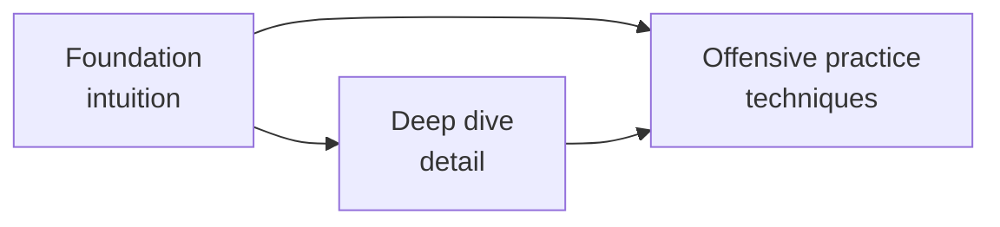
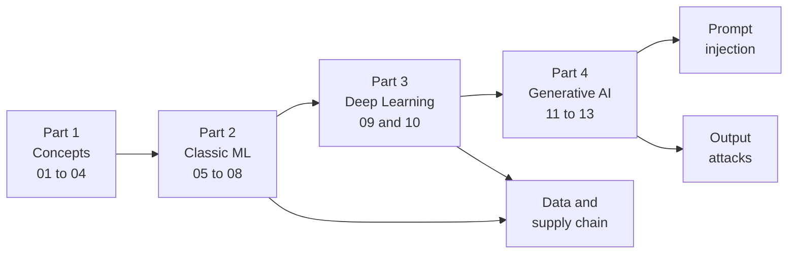

# Track map

> 🇺🇸 English · 🇧🇷 [Português](map.pt-BR.md)

The track grows as new topics are studied. This map shows **what already exists, in which order to read it and what each page assumes**. It is updated with every new piece of content.

## The three levels

| Level | What it is | How to spot it |
|-------|------------|----------------|
| **Foundation** | The intuition and the "why" of each topic, assuming nothing beyond the previous lessons | Lessons numbered `01` to `13`, **Level: Foundation** field in the header |
| **Deep dive** | A foundation topic explored in depth: more math, more detail, more cases | Numbered after the foundation lesson, such as `11.1` and `11.2`, listed in the foundation lesson's **Go deeper and practice** block |
| **Offensive practice** | Attack techniques with exploitation, detection and mitigation | Pages in the attack sections (02 to 08), with a **Prerequisites** field pointing to the lessons |

You can read only the foundation and go straight to practice, or drop into the deep dives when a topic calls for more.

## The foundation path

## Content registry

| Lesson | Prerequisites | Deep dives | In practice |
|--------|---------------|------------|-------------|
| [01 · What is AI](01-what-is-ai.md) | — | — | — |
| [02 · History of AI](02-history-of-ai.md) | 01 | — | — |
| [03 · How machines learn](03-how-machines-learn.md) | 01 | [03.1 · Evaluation and regularization](03-1-evaluation-regularization.md) | [Data poisoning](../04-data-attacks/data-poisoning.md) |
| [04 · Essential math](04-essential-math.md) | 03 | [04.1 · Logs and entropy](04-1-logs-and-entropy.md), [04.2 · Linear algebra](04-2-linear-algebra.md) | — |
| [05 · Linear and logistic regression](05-linear-logistic-regression.md) | 03, 04 | [05.1 · Least squares](05-1-least-squares.md) | [Data poisoning](../04-data-attacks/data-poisoning.md) |
| [06 · Trees, Naive Bayes and SVM](06-trees-naive-bayes-svm.md) | 05 | [06.1 · Trees in depth](06-1-decision-trees-deep-dive.md), [06.2 · SVM and Naive Bayes](06-2-svm-naive-bayes-deep-dive.md) | [Model backdoors](../04-data-attacks/model-backdoors.md) |
| [07 · Unsupervised learning](07-unsupervised-learning.md) | 04, 05 | [07.1 · Evaluating clusters](07-1-evaluating-clusters.md) | — |
| [08 · Reinforcement learning](08-reinforcement-learning.md) | 03, 04 | — | [Jailbreaks](../02-prompt-injection/jailbreaks.md) |
| [09 · Neural networks](09-neural-networks.md) | 04, 05 | [09.1 · Training neural networks](09-1-training-neural-networks.md) | [Backdoors](../04-data-attacks/model-backdoors.md), [Malicious model files](../04-data-attacks/malicious-model-files.md) |
| [10 · CNN and RNN](10-cnn-rnn.md) | 09 | — | — |
| [11 · LLMs and Transformers](11-llms.md) | 04, 09, 10 | [11.1 · Tokenization in depth](11-1-tokenization-deep-dive.md) | [Recon](../02-prompt-injection/llm-recon.md), [direct](../02-prompt-injection/direct-prompt-injection.md) and [indirect injection](../02-prompt-injection/indirect-prompt-injection.md), [system prompt leakage](../02-prompt-injection/system-prompt-leakage.md), [jailbreaks](../02-prompt-injection/jailbreaks.md), [XSS](../03-output-attacks/xss-via-llm-output.md) |
| [12 · Diffusion models](12-diffusion-models.md) | 09, 10, 11 | — | — |
| [13 · RAG, agents and MCP](13-ai-systems.md) | 11 | — | [Recon](../02-prompt-injection/llm-recon.md), [indirect injection](../02-prompt-injection/indirect-prompt-injection.md), [XSS](../03-output-attacks/xss-via-llm-output.md), [downstream injection](../03-output-attacks/downstream-injection.md) |

## Suggested paths

| Goal | Path |
|------|------|
| **Get to LLM attacks quickly** | 01 → 03 → 04 → 09 → 11 → 13 → [Prompt Injection](../02-prompt-injection/README.md) |
| **Understand attacks on classic models** | 01 → 03 → 04 → 05 → 06 → 07 → [Data and supply chain](../04-data-attacks/README.md) |
| **Full foundation** | All 13 lessons in order |

## How the track grows

Every new topic follows the same rules:

1. **Place it before writing:** decide whether the topic is a new foundation lesson, a deep dive into an existing lesson or an attack technique.
2. **Explicit prerequisites:** every page states what it assumes, and nothing uses a concept that has not been introduced yet.
3. **Same format:** concept with analogies and numbers, red teamer's view and "Check your understanding" (deep dives follow the [template](https://github.com/htborges/IA-Lab/blob/main/templates/deep-dive.md)).
4. **Original content**, written from public sources, in English and Portuguese.
5. **This map is updated** together with the track index and the foundation lesson.
