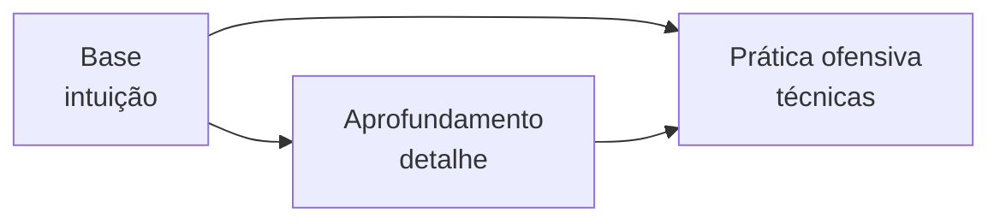
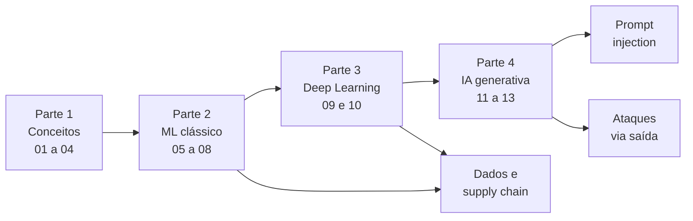

# Mapa da trilha

> 🇧🇷 Português · 🇺🇸 [English](map.md)

A trilha cresce conforme novos temas são estudados. Este mapa mostra **o que já existe, em que ordem ler e o que cada página pressupõe**. Ele é atualizado a cada conteúdo novo.

## Os três níveis

| Nível | O que é | Como reconhecer |
|-------|---------|-----------------|
| **Base** | A intuição e o "porquê" de cada tema, sem pressupor nada além das aulas anteriores | Aulas numeradas `01` a `13`, campo **Nível: Base** no cabeçalho |
| **Aprofundamento** | Um tema da aula-base explorado a fundo: mais matemática, mais detalhes, mais casos | Numeradas a partir da aula-base, como `11.1` e `11.2`, listadas no bloco **Aprofunde e pratique** da aula-base |
| **Prática ofensiva** | Técnicas de ataque com exploração, detecção e mitigação | Páginas das seções de ataque (02 a 08), com o campo **Pré-requisitos** apontando para as aulas |

Você pode ler só a base e ir direto para a prática, ou descer para os aprofundamentos quando um tema pedir mais.

## O percurso da base

## Registro de conteúdo

| Aula | Pré-requisitos | Aprofundamentos | Na prática |
|------|----------------|-----------------|------------|
| [01 · O que é IA](01-what-is-ai.pt-BR.md) | — | — | — |
| [02 · História da IA](02-history-of-ai.pt-BR.md) | 01 | — | — |
| [03 · Como as máquinas aprendem](03-how-machines-learn.pt-BR.md) | 01 | [03.1 · Avaliação e regularização](03-1-evaluation-regularization.pt-BR.md) | [Data poisoning](../04-data-attacks/data-poisoning.pt-BR.md) |
| [04 · Matemática essencial](04-essential-math.pt-BR.md) | 03 | [04.1 · Logaritmos e entropia](04-1-logs-and-entropy.pt-BR.md), [04.2 · Álgebra linear](04-2-linear-algebra.pt-BR.md) | — |
| [05 · Regressão linear e logística](05-linear-logistic-regression.pt-BR.md) | 03, 04 | — | [Data poisoning](../04-data-attacks/data-poisoning.pt-BR.md) |
| [06 · Árvores, Naive Bayes e SVM](06-trees-naive-bayes-svm.pt-BR.md) | 05 | [06.1 · Árvores a fundo](06-1-decision-trees-deep-dive.pt-BR.md) | [Backdoors em modelos](../04-data-attacks/model-backdoors.pt-BR.md) |
| [07 · Aprendizado não supervisionado](07-unsupervised-learning.pt-BR.md) | 04, 05 | — | — |
| [08 · Aprendizado por reforço](08-reinforcement-learning.pt-BR.md) | 03, 04 | — | [Jailbreaks](../02-prompt-injection/jailbreaks.pt-BR.md) |
| [09 · Redes neurais](09-neural-networks.pt-BR.md) | 04, 05 | [09.1 · Treinando redes neurais](09-1-training-neural-networks.pt-BR.md) | [Backdoors](../04-data-attacks/model-backdoors.pt-BR.md), [Arquivos de modelo maliciosos](../04-data-attacks/malicious-model-files.pt-BR.md) |
| [10 · CNN e RNN](10-cnn-rnn.pt-BR.md) | 09 | — | — |
| [11 · LLMs e Transformers](11-llms.pt-BR.md) | 04, 09, 10 | [11.1 · Tokenização a fundo](11-1-tokenization-deep-dive.pt-BR.md) | [Reconhecimento](../02-prompt-injection/llm-recon.pt-BR.md), [injeção direta](../02-prompt-injection/direct-prompt-injection.pt-BR.md), [indireta](../02-prompt-injection/indirect-prompt-injection.pt-BR.md), [vazamento de system prompt](../02-prompt-injection/system-prompt-leakage.pt-BR.md), [jailbreaks](../02-prompt-injection/jailbreaks.pt-BR.md), [XSS](../03-output-attacks/xss-via-llm-output.pt-BR.md) |
| [12 · Modelos de difusão](12-diffusion-models.pt-BR.md) | 09, 10, 11 | — | — |
| [13 · RAG, agents e MCP](13-ai-systems.pt-BR.md) | 11 | — | [Reconhecimento](../02-prompt-injection/llm-recon.pt-BR.md), [injeção indireta](../02-prompt-injection/indirect-prompt-injection.pt-BR.md), [XSS](../03-output-attacks/xss-via-llm-output.pt-BR.md), [injeção downstream](../03-output-attacks/downstream-injection.pt-BR.md) |

## Caminhos sugeridos

| Objetivo | Caminho |
|----------|---------|
| **Chegar rápido em ataques a LLMs** | 01 → 03 → 04 → 09 → 11 → 13 → [Prompt Injection](../02-prompt-injection/README.pt-BR.md) |
| **Entender ataques a modelos clássicos** | 01 → 03 → 04 → 05 → 06 → 07 → [Dados e supply chain](../04-data-attacks/README.pt-BR.md) |
| **Base completa** | As 13 aulas em ordem |

## Como a trilha cresce

Cada tema novo passa pelas mesmas regras:

1. **Encaixe antes de escrever:** decidir se o tema é uma aula-base nova, um aprofundamento de uma aula existente ou uma técnica de ataque.
2. **Pré-requisitos explícitos:** toda página diz o que pressupõe, e nada usa um conceito que ainda não foi apresentado.
3. **Mesmo formato:** conceito com analogias e números, visão do red teamer e "Teste seu entendimento" (aprofundamentos seguem o [template](https://github.com/htborges/IA-Lab/blob/main/templates/deep-dive.pt-BR.md)).
4. **Conteúdo original**, escrito a partir de fontes públicas, em português e inglês.
5. **Este mapa é atualizado** junto com o índice da trilha e a aula-base.
