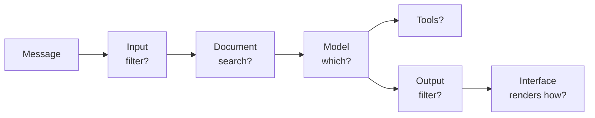

# LLM Application Reconnaissance

> 🇺🇸 English · 🇧🇷 [Português](llm-recon.pt-BR.md)

| Field | Value |
|-------|-------|
| **Category** | Prompt Injection (reconnaissance) |
| **OWASP LLM Top 10** | Foundation for every risk; directly tied to LLM07:2025 System Prompt Leakage |
| **MITRE ATLAS** | Reconnaissance and Discovery tactics (for example, discovering the model family and output ontology) |
| **Target** | Any LLM application: chatbots, assistants, RAG, agents |
| **Attacker access** | Black-box (chat interface or API) |
| **Severity** | Informational on its own, but it sets how effective every following attack will be |
| **Lab** | [`labs/vuln-chatbot-rag`](../labs/vuln-chatbot-rag/README.md) |
| **Prerequisites** | Lesson [11 · LLMs and Transformers](../00-fundamentals/11-llms.md), Lesson [13 · RAG, agents and MCP](../00-fundamentals/13-ai-systems.md) |

## TL;DR

Before trying any injection, find out **what sits behind the chat box**: which model, which components (RAG, tools, memory), which filters and where the output goes. Good recon turns dozens of blind attempts into a few targeted attacks.

## Concept

An LLM application is much more than the model. The user's question usually goes through several layers, and each one leaves observable traces:



Recon answers five questions:

| Question | Why it matters |
|----------|----------------|
| **1. Which model is it?** | Families and versions have different weaknesses, chat formats and refusal behavior |
| **2. How is the application built?** | RAG, tools, memory and multiple agents open paths for indirect injection and tool abuse |
| **3. How is input handled?** | Size limits, accepted languages, filters and file types define how the payload has to arrive |
| **4. What constraints does the output have?** | Format, length, filters and rendering define how data can get out |
| **5. Which safeguards exist?** | Model refusals, external moderation and monitoring show where the defense is and where it is not |

## Attack Surface and Prerequisites

- Access to the application's interface or API, within the authorized scope
- Patience: recon works by **comparison**, sending variations and watching for differences in content, format, timing and error messages

## Exploitation

### 1. Model identity

| Signal | How to observe it |
|--------|-------------------|
| **Self-report** | Ask who the model is and who trained it. Many tell the truth; others were told to use only the persona, and the way they deny it is also a signal |
| **Knowledge cutoff** | Ask about recent events and see where knowledge ends |
| **Style and formatting** | Formatting habits, typical refusal phrases and default answer length vary across families |
| **Tokenization** | Ask it to count letters in words or spell rare terms: the mistakes follow the tokenizer ([lesson 11](../00-fundamentals/11-llms.md)) |
| **Technical limits** | Maximum input size, API error messages, HTTP headers, parameter names |
| **Systematic fingerprinting** | A fixed set of questions whose answers differ across models, compared against a database of known answers. Research has shown that a handful of queries is enough to identify the model with high accuracy |

### 2. Application architecture

| Component | Signals |
|-----------|---------|
| **RAG** | Answers with citations or document names; company-specific knowledge; answers that change with keywords in the question |
| **Tools** | The assistant looks up orders, sends emails, browses the web; messages like "checking the system"; higher latency on certain questions |
| **Memory** | Remembers earlier conversations or preferences across sessions |
| **Multiple models or agents** | Different styles in the same conversation, visible steps ("planning", "verifying") |
| **Auxiliary endpoints** | File upload, document listing, feedback ("was this answer helpful?"), which can be sources of indirect injection or poisoning |

### 3. Input handling

- **Size**: what is the limit? Are long messages truncated at the start or the end?
- **Languages and encodings**: does the filter understand Portuguese, Base64, unusual Unicode?
- **Input filter**: a refusal that arrives **instantly**, with boilerplate text, almost always comes from a filter outside the model. The model's own refusals take the time to generate text and vary in wording.
- **History**: how many previous messages does the model see? Test by referring to something said several messages earlier.
- **Other formats**: images, files, audio, URLs the system opens.

### 4. Output constraints

- **Format**: are answers always JSON, always short, always in a fixed tone?
- **Output filter**: an answer that starts generating and gets replaced by a warning indicates a filter **after** the model.
- **Rendering**: are markdown and HTML interpreted? Do images from external URLs load? That defines exfiltration ([indirect injection](indirect-prompt-injection.md), [XSS](../03-output-attacks/xss-via-llm-output.md)).

### 5. Safeguards

- Which kinds of request does the model refuse, and with which message?
- Is there separate content moderation (policy messages that differ from the model's style)?
- Is there rate limiting, session blocking or alerting after repeated attempts?

### 6. In the lab

With [`vuln-chatbot-rag`](../labs/vuln-chatbot-rag/README.md) running, fill in the sheet below **by observing behavior only** (without reading the code):

| Question | What to observe in the lab |
|----------|----------------------------|
| Is there RAG? | The `sources` field in the API response and the topics Aria knows |
| Can the documents be listed? | What `GET /api/docs` returns |
| Is there an input filter? | At level 3, compare the timing and wording of a keyword refusal with a model refusal |
| Is there an output filter? | At level 4, see whether the answer is generated and then replaced |
| Is the output rendered? | Ask for a word in `<b>bold</b>` and see whether the tag shows up or disappears |
| Which model? | Self-report, knowledge cutoff and refusal style |

At the end, compare your conclusions with `labs/vuln-chatbot-rag/app/main.py`.

### 7. The recon sheet

Record everything in a format that feeds the next steps:

```text
Target:           <application, URL, version>
Model:            <likely family> · evidence: <...>
Components:       RAG [y/n]  Tools [which]  Memory [y/n]  Multi-agent [y/n]
Input:            limit <n> · languages <...> · external filter [y/n] · formats <...>
Output:           format <...> · filter [y/n] · renders markdown/HTML [y/n]
Safeguards:       default refusal <text> · separate moderation [y/n] · rate limit <...>
Indirect sources: <uploads, URLs, emails, feedback>
Attack hypotheses: <prioritized list>
```

## Variations

- **Error-based recon**: malformed inputs (invalid JSON on the API, extra fields, wrong types) that expose stack traces, library and model names.
- **Tool recon**: ask the assistant to list what it can do, or describe the format of its tools; tool descriptions often leak just like the system prompt.
- **Passive recon**: public documentation, help pages, job postings and the company's technical posts reveal the model vendor, framework and architecture.

## Detection

- **Probing patterns**: many questions about identity, instructions, limits and capabilities in a single session.
- **Anomalous inputs**: messages at the size limit, unusual encodings, repeated malformed JSON.
- **Endpoint scanning**: hits on auxiliary routes (listing, upload, debug) outside the normal interface flow.

## Mitigation

| Control | Layer | Effectiveness |
|---------|-------|---------------|
| Generic error messages; no stack traces, model or library names | Application | High (against technical recon) |
| Auxiliary endpoints authenticated and minimally scoped | Application | High |
| Do not expose document names or internal paths in citations | Application | Medium |
| Rate limiting and alerts for probing patterns | Operations | Medium |
| Hiding the model's identity | Prompt | Low (easily inferred from behavior; do not rely on it) |

> Recon is not the vulnerability: it **reveals** the vulnerabilities. The realistic defense is making sure that, even knowing everything about the architecture, the attacker cannot do anything a legitimate user could not.

## References

- [OWASP Top 10 for LLM Applications](https://genai.owasp.org/llm-top-10/)
- [MITRE ATLAS](https://atlas.mitre.org/) (Reconnaissance and Discovery tactics)
- Pasquini, Kornaropoulos & Ateniese, *LLMmap: Fingerprinting For Large Language Models* (2024)
- IA-Lab [AI red teaming tools](../tools/README.md)

> OWASP and MITRE ATLAS IDs change between versions. Check the official pages before citing them in a report.
