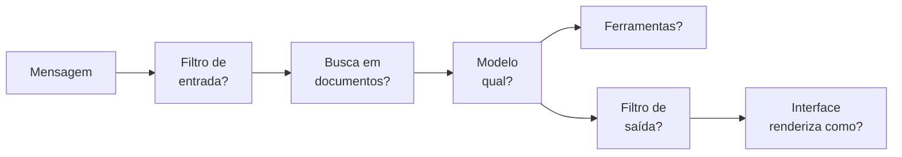

# Reconhecimento de Aplicações LLM

> 🇧🇷 Português · 🇺🇸 [English](llm-recon.md)

| Campo | Valor |
|-------|-------|
| **Categoria** | Prompt Injection (reconhecimento) |
| **OWASP LLM Top 10** | Base para todos os riscos; ligado diretamente a LLM07:2025 System Prompt Leakage |
| **MITRE ATLAS** | Táticas de Reconhecimento e Descoberta (por exemplo, descobrir a família do modelo e a ontologia de saída) |
| **Alvo** | Qualquer aplicação com LLM: chatbots, assistentes, RAG, agents |
| **Acesso do atacante** | Black-box (interface de chat ou API) |
| **Severidade** | Informativa por si só, mas define a eficácia de todos os ataques seguintes |
| **Lab** | [`labs/vuln-chatbot-rag`](../labs/vuln-chatbot-rag/README.pt-BR.md) |
| **Pré-requisitos** | Aula [11 · LLMs e Transformers](../00-fundamentals/11-llms.pt-BR.md), Aula [13 · RAG, agents e MCP](../00-fundamentals/13-ai-systems.pt-BR.md) |

## TL;DR

Antes de tentar qualquer injeção, descubra **o que existe atrás da caixa de chat**: qual modelo, que componentes (RAG, ferramentas, memória), que filtros e para onde vai a saída. Um bom reconhecimento transforma dezenas de tentativas às cegas em poucos ataques certeiros.

## Conceito

Uma aplicação com LLM é muito mais que o modelo. A pergunta do usuário costuma passar por várias camadas, e cada uma deixa rastros observáveis:



O reconhecimento responde a cinco perguntas:

| Pergunta | Por que importa |
|----------|-----------------|
| **1. Qual é o modelo?** | Famílias e versões têm fraquezas, formatos de chat e comportamentos de recusa diferentes |
| **2. Como a aplicação é montada?** | RAG, ferramentas, memória e múltiplos agents abrem caminhos de injeção indireta e de abuso de ferramentas |
| **3. Como a entrada é tratada?** | Limites de tamanho, idiomas aceitos, filtros e tipos de arquivo definem como o payload precisa chegar |
| **4. Que restrições a saída tem?** | Formato, tamanho, filtros e renderização definem como os dados podem sair |
| **5. Que salvaguardas existem?** | Recusas do modelo, moderação externa e monitoramento indicam onde a defesa está e onde não está |

## Superfície de Ataque e Pré-requisitos

- Acesso à interface ou à API da aplicação, dentro do escopo autorizado
- Paciência: o reconhecimento é feito por **comparação**, enviando variações e observando diferenças de conteúdo, formato, tempo e mensagens de erro

## Exploração

### 1. Identidade do modelo

| Sinal | Como observar |
|-------|---------------|
| **Autodeclaração** | Perguntar quem é o modelo e quem o treinou. Muitos respondem a verdade; outros foram instruídos a usar só a persona, e a forma da negação também é um sinal |
| **Data de corte** | Perguntar por eventos recentes e ver onde o conhecimento acaba |
| **Estilo e formatação** | Hábitos de formatação, frases de recusa típicas e tamanho padrão das respostas variam entre famílias |
| **Tokenização** | Pedir para contar letras de palavras ou soletrar termos raros: os erros seguem o tokenizador ([aula 11](../00-fundamentals/11-llms.pt-BR.md)) |
| **Limites técnicos** | Tamanho máximo de entrada, mensagens de erro da API, cabeçalhos HTTP, nomes de parâmetros |
| **Fingerprinting sistemático** | Um conjunto fixo de perguntas cujas respostas diferem entre modelos, comparado com um banco de respostas conhecidas. Pesquisas mostraram que poucas consultas bastam para identificar o modelo com alta precisão |

### 2. Arquitetura da aplicação

| Componente | Sinais |
|------------|--------|
| **RAG** | Respostas com citações ou nomes de documentos; conhecimento específico da empresa; respostas que mudam com palavras-chave da pergunta |
| **Ferramentas** | O assistente consulta pedidos, envia e-mails, acessa a web; mensagens como "consultando o sistema"; latência maior em certas perguntas |
| **Memória** | Lembra de conversas anteriores ou de preferências entre sessões |
| **Vários modelos ou agents** | Estilos diferentes na mesma conversa, etapas visíveis ("planejando", "verificando") |
| **Endpoints auxiliares** | Upload de arquivos, listagem de documentos, feedback ("esta resposta ajudou?"), que podem ser fontes de injeção indireta ou de envenenamento |

### 3. Tratamento da entrada

- **Tamanho**: qual o limite? Mensagens longas são truncadas no começo ou no fim?
- **Idiomas e codificações**: o filtro entende português, Base64, Unicode incomum?
- **Filtro de entrada**: uma recusa que chega **instantaneamente**, com texto padronizado, quase sempre vem de um filtro fora do modelo. Recusas do próprio modelo demoram o tempo de gerar texto e variam de redação.
- **Histórico**: quantas mensagens anteriores o modelo enxerga? Teste referindo-se a algo dito várias mensagens atrás.
- **Outros formatos**: imagens, arquivos, áudio, URLs que o sistema abre.

### 4. Restrições da saída

- **Formato**: respostas sempre em JSON, sempre curtas, sempre num tom fixo?
- **Filtro de saída**: uma resposta que começa a ser gerada e é substituída por um aviso indica filtro **depois** do modelo.
- **Renderização**: markdown e HTML são interpretados? Imagens de URLs externas carregam? Isso define a exfiltração ([injeção indireta](indirect-prompt-injection.pt-BR.md), [XSS](../03-output-attacks/xss-via-llm-output.pt-BR.md)).

### 5. Salvaguardas

- Que tipo de pedido o modelo recusa, e com que mensagem?
- Existe moderação de conteúdo separada (mensagens de política diferentes do estilo do modelo)?
- Há limite de taxa, bloqueio de sessão ou alertas após tentativas repetidas?

### 6. No lab

Com o [`vuln-chatbot-rag`](../labs/vuln-chatbot-rag/README.pt-BR.md) rodando, preencha a ficha abaixo **só observando o comportamento** (sem ler o código):

| Pergunta | O que observar no lab |
|----------|----------------------|
| Há RAG? | O campo `sources` da resposta da API e os temas que a Aria conhece |
| Os documentos são listáveis? | O que `GET /api/docs` devolve |
| Há filtro de entrada? | No nível 3, compare o tempo e o texto de uma recusa por palavra-chave com uma recusa do modelo |
| Há filtro de saída? | No nível 4, veja se a resposta é gerada e depois substituída |
| A saída é renderizada? | Peça uma palavra em `<b>negrito</b>` e veja se a tag aparece ou some |
| Qual o modelo? | Autodeclaração, data de corte e estilo de recusa |

Ao final, compare suas conclusões com `labs/vuln-chatbot-rag/app/main.py`.

### 7. A ficha de reconhecimento

Registre tudo num formato que alimente os próximos passos:

```text
Alvo:            <aplicação, URL, versão>
Modelo:          <família provável> · evidências: <...>
Componentes:     RAG [s/n]  Ferramentas [quais]  Memória [s/n]  Multiagente [s/n]
Entrada:         limite <n> · idiomas <...> · filtro externo [s/n] · formatos <...>
Saída:           formato <...> · filtro [s/n] · renderiza markdown/HTML [s/n]
Salvaguardas:    recusa padrão <texto> · moderação separada [s/n] · rate limit <...>
Fontes indiretas: <uploads, URLs, e-mails, feedback>
Hipóteses de ataque: <lista priorizada>
```

## Variações

- **Reconhecimento por erro**: entradas malformadas (JSON inválido na API, campos extras, tipos errados) que expõem stack traces, nomes de bibliotecas e de modelos.
- **Reconhecimento de ferramentas**: pedir ao assistente para listar o que consegue fazer, ou descrever o formato das ferramentas que tem; descrições de tools muitas vezes vazam como o system prompt.
- **Reconhecimento passivo**: documentação pública, páginas de ajuda, vagas de emprego e posts técnicos da empresa revelam fornecedor de modelo, framework e arquitetura.

## Detecção

- **Padrões de sondagem**: muitas perguntas sobre identidade, instruções, limites e capacidades numa mesma sessão.
- **Entradas anômalas**: mensagens no limite de tamanho, codificações incomuns, JSON malformado repetido.
- **Varredura de endpoints**: acessos a rotas auxiliares (listagem, upload, debug) fora do fluxo normal da interface.

## Mitigação

| Controle | Camada | Eficácia |
|----------|--------|----------|
| Mensagens de erro genéricas; sem stack traces, nomes de modelos ou de bibliotecas | Aplicação | Alta (contra reconhecimento técnico) |
| Endpoints auxiliares autenticados e com escopo mínimo | Aplicação | Alta |
| Não expor nomes de documentos ou caminhos internos nas citações | Aplicação | Média |
| Limite de taxa e alertas para padrões de sondagem | Operação | Média |
| Esconder a identidade do modelo | Prompt | Baixa (é facilmente inferida pelo comportamento; não conte com isso) |

> O reconhecimento não é a vulnerabilidade: ele **revela** as vulnerabilidades. A defesa realista é garantir que, mesmo sabendo tudo sobre a arquitetura, o atacante não consiga fazer nada que o usuário legítimo não poderia.

## Referências

- [OWASP Top 10 for LLM Applications](https://genai.owasp.org/llm-top-10/)
- [MITRE ATLAS](https://atlas.mitre.org/) (táticas de Reconhecimento e Descoberta)
- Pasquini, Kornaropoulos & Ateniese, *LLMmap: Fingerprinting For Large Language Models* (2024)
- [Ferramentas de red teaming de IA](../tools/README.pt-BR.md) do IA-Lab

> Os IDs do OWASP e do MITRE ATLAS mudam entre versões. Confira nas páginas oficiais antes de citar num relatório.
