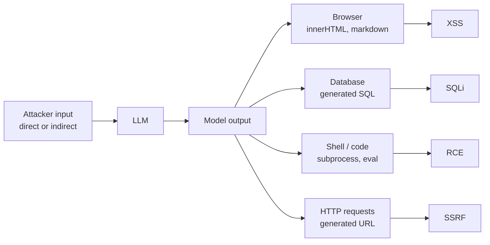

# LLM Output Attacks

> 🇺🇸 English · 🇧🇷 [Português](README.pt-BR.md)

When model output is used by another system without handling, a prompt injection stops being "the model said something wrong" and becomes a classic vulnerability: XSS, SQL injection, command injection, SSRF.

## The core idea

Developers often treat the LLM's answer as **trusted output from their own system**: something the backend generated and that can therefore go straight to the browser, the database or the shell. But the content of that answer is influenced by **any text that entered the context**, including the user's message and third-party documents ([lesson 11](../00-fundamentals/11-llms.md)).

The golden rule: **model output is untrusted input**. It deserves the same treatment as a form parameter coming from the internet: validation, encoding for the target context, parameterized queries and least privilege.

The LLM works as a **middleman the attacker can control**: the payload does not need to pass the application's input filters, because the model itself writes it, often in a way no rule anticipated.

## Techniques

| Technique | Output destination | OWASP | Lab | Status |
|-----------|--------------------|-------|-----|--------|
| [XSS via LLM output](xss-via-llm-output.md) | Browser (HTML, markdown) | LLM05, LLM01 | [vuln-chatbot-rag](../labs/vuln-chatbot-rag/README.md) | ✅ |
| [Downstream injection](downstream-injection.md) | Database, shell, HTTP, file system, `eval` | LLM05, LLM06 | Vulnerable and fixed code snippets | ✅ |

## How to test

1. **Map the sinks**: where does each model output go? Web interface, email, PDF, admin dashboard, database, tools, other models.
2. **Find out the handling**: is the output escaped? Rendered as markdown? Used in an SQL query, command or URL? Validated against a schema?
3. **Make the model write the payload**: ask directly, use [prompt injection](../02-prompt-injection/README.md) techniques if it refuses, or plant the request in a document (indirect injection) to reach other users.
4. **Follow the data to the end**: the impact often shows up far from the chat, such as a transcript opened by an analyst in an internal dashboard.
