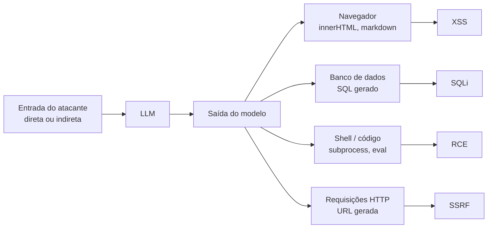

# Ataques via Saída do LLM

> 🇧🇷 Português · 🇺🇸 [English](README.md)

Quando a saída do modelo é usada por outro sistema sem tratamento, uma prompt injection deixa de ser "o modelo disse algo errado" e vira uma vulnerabilidade clássica: XSS, SQL injection, command injection, SSRF.

## A ideia central

Desenvolvedores costumam tratar a resposta do LLM como **saída confiável do próprio sistema**: algo que o backend gerou e, portanto, pode ir direto para o navegador, para o banco de dados ou para o shell. Mas o conteúdo dessa resposta é influenciado por **qualquer texto que entrou no contexto**, incluindo a mensagem do usuário e documentos de terceiros ([aula 11](../00-fundamentals/11-llms.pt-BR.md)).

A regra de ouro: **a saída do modelo é entrada não confiável**. Ela merece o mesmo tratamento que um parâmetro de formulário vindo da internet: validação, codificação para o contexto de destino, consultas parametrizadas e menor privilégio.

O LLM funciona como um **intermediário que o atacante consegue controlar**: o payload não precisa passar pelos filtros de entrada da aplicação, porque é o próprio modelo quem o escreve, muitas vezes de um jeito que nenhuma regra antecipou.

## Técnicas

| Técnica | Destino da saída | OWASP | Lab | Status |
|---------|------------------|-------|-----|--------|
| [XSS via saída do LLM](xss-via-llm-output.pt-BR.md) | Navegador (HTML, markdown) | LLM05, LLM01 | [vuln-chatbot-rag](../labs/vuln-chatbot-rag/README.pt-BR.md) | ✅ |
| [Injeção em sistemas downstream](downstream-injection.pt-BR.md) | Banco de dados, shell, HTTP, sistema de arquivos, `eval` | LLM05, LLM06 | Trechos de código vulnerável e corrigido | ✅ |

## Como testar

1. **Mapeie os destinos (*sinks*)**: para onde vai cada saída do modelo? Interface web, e-mail, PDF, painel do administrador, banco, ferramentas, outros modelos.
2. **Descubra o tratamento**: a saída é escapada? Renderizada como markdown? Usada em consulta SQL, comando ou URL? Validada contra um esquema?
3. **Faça o modelo escrever o payload**: peça diretamente, use as técnicas de [prompt injection](../02-prompt-injection/README.pt-BR.md) se ele recusar, ou plante o pedido num documento (injeção indireta) para atingir outros usuários.
4. **Siga o dado até o fim**: muitas vezes o impacto aparece longe do chat, como um transcript aberto por um analista num painel interno.
