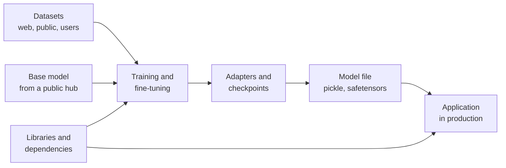

# Data & Supply Chain Attacks

> 🇺🇸 English · 🇧🇷 [Português](README.pt-BR.md)

A model only knows what the data taught it ([lesson 03](../00-fundamentals/03-how-machines-learn.md)), and almost nobody trains everything from scratch: public datasets, base models, adapters, libraries and weight files come from third parties. Whoever controls any of those links partly controls the system's behavior.

## The ML supply chain

Every arrow is an entry point:

| Link | What can go wrong | Technique |
|------|-------------------|-----------|
| **Training data** | Inserted examples or altered labels change what the model learns | [Data poisoning](data-poisoning.md) |
| **Data or weights** | A hidden behavior, activated by a trigger, passes normal metrics | [Model backdoors](model-backdoors.md) |
| **Files and dependencies** | The model file runs code when loaded; fake or compromised packages | [Malicious model files and supply chain](malicious-model-files.md) |

## Techniques

| Technique | OWASP | MITRE ATLAS | Practice | Status |
|-----------|-------|-------------|----------|--------|
| [Data poisoning](data-poisoning.md) | LLM04 | AML.T0020 | Numeric example + code | ✅ |
| [Model backdoors](model-backdoors.md) | LLM04 | AML.T0018 | Numeric example + code | ✅ |
| [Malicious model files and supply chain](malicious-model-files.md) | LLM03 | AML.T0010, AML.T0011.000 | Safe pickle demo | ✅ |

> Unlike sections 02 and 03, these attacks happen **before** deployment. To test them, the red teamer needs scope over the data and training pipeline, not just the chat.

## How to test

1. **Inventory where everything comes from**: datasets, base models, adapters, libraries. Who published them, which version, with what verification.
2. **Find the write paths**: who can add data to training or retraining? User feedback, scraping, forms, outsourced labeling.
3. **Check how models are loaded**: file format, `torch.load`, `pickle`, `trust_remote_code`, scanning before use.
4. **Test behavior, not just metrics**: a backdoored model has normal accuracy; look for triggers and conditional behavior.
