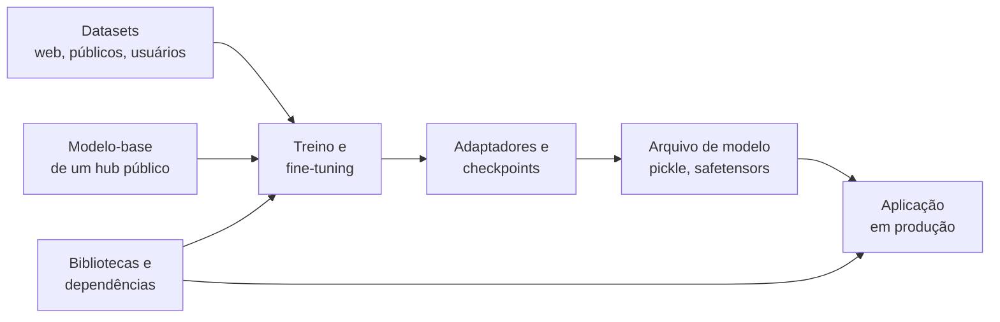

# Ataques a Dados e Supply Chain

> 🇧🇷 Português · 🇺🇸 [English](README.md)

O modelo só sabe o que os dados ensinaram ([aula 03](../00-fundamentals/03-how-machines-learn.pt-BR.md)), e quase ninguém treina tudo do zero: datasets públicos, modelos-base, adaptadores, bibliotecas e arquivos de pesos vêm de terceiros. Quem controla qualquer um desses elos controla, em parte, o comportamento do sistema.

## A cadeia de suprimentos de ML

Cada seta é um ponto de entrada:

| Elo | O que pode dar errado | Técnica |
|-----|-----------------------|---------|
| **Dados de treino** | Exemplos inseridos ou rótulos alterados mudam o que o modelo aprende | [Data poisoning](data-poisoning.pt-BR.md) |
| **Dados ou pesos** | Um comportamento escondido, ativado por um gatilho, passa nas métricas normais | [Backdoors em modelos](model-backdoors.pt-BR.md) |
| **Arquivos e dependências** | O arquivo do modelo executa código ao ser carregado; pacotes falsos ou comprometidos | [Arquivos de modelo maliciosos e supply chain](malicious-model-files.pt-BR.md) |

## Técnicas

| Técnica | OWASP | MITRE ATLAS | Prática | Status |
|---------|-------|-------------|---------|--------|
| [Data poisoning](data-poisoning.pt-BR.md) | LLM04 | AML.T0020 | Exemplo numérico + código | ✅ |
| [Backdoors em modelos](model-backdoors.pt-BR.md) | LLM04 | AML.T0018 | Exemplo numérico + código | ✅ |
| [Arquivos de modelo maliciosos e supply chain](malicious-model-files.pt-BR.md) | LLM03 | AML.T0010, AML.T0011.000 | Demonstração segura de pickle | ✅ |

> Diferente das seções 02 e 03, estes ataques acontecem **antes** do deploy. Para testar, o red teamer precisa de escopo sobre o pipeline de dados e treino, não só sobre o chat.

## Como testar

1. **Inventarie a origem de tudo**: datasets, modelos-base, adaptadores, bibliotecas. Quem publicou, qual versão, com que verificação.
2. **Ache os caminhos de escrita**: quem pode adicionar dados ao treino ou ao re-treino? Feedback de usuários, scraping, formulários, rótulos terceirizados.
3. **Verifique como os modelos são carregados**: formato do arquivo, `torch.load`, `pickle`, `trust_remote_code`, varredura antes do uso.
4. **Teste o comportamento, não só a métrica**: um modelo com backdoor tem acurácia normal; procure gatilhos e comportamentos condicionais.
