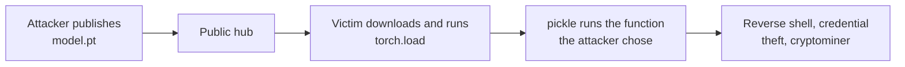

# Malicious Model Files and Supply Chain

> 🇺🇸 English · 🇧🇷 [Português](malicious-model-files.pt-BR.md)

| Field | Value |
|-------|-------|
| **Category** | Supply chain |
| **OWASP LLM Top 10** | LLM03:2025 Supply Chain |
| **MITRE ATLAS** | AML.T0010 ML Supply Chain Compromise · AML.T0011.000 User Execution: Unsafe ML Artifacts |
| **Target** | Pipelines and applications that download and load third-party models, datasets and libraries |
| **Attacker access** | Publish an artifact the victim will download (model hub, package registry) or compromise an existing account or dependency |
| **Severity** | Critical (code execution on the machine that loads the model, often with GPUs, cloud credentials and data access) |
| **Lab** | Safe pickle demo on this page |

## TL;DR

Several model file formats are, in practice, **programs**: loading the file runs code. A model downloaded from a public hub can run any command on the machine that loads it. Add to that the classic software supply chain risks, amplified by an ecosystem where downloading models and packages from strangers is routine.

## Concept

### The pickle problem

`pickle` is Python's native serialization format, and many model formats are built on it. It does not store only data: it stores **instructions to rebuild objects**, and those instructions can call any function. An object can define the `__reduce__` method to say "to rebuild me, call this function with these arguments", and that function can be `os.system`.



| Format | Runs code when loaded? |
|--------|------------------------|
| `.pkl`, `.pickle`, `.joblib` | **Yes** (pickle) |
| PyTorch `.pt`, `.pth`, `.bin` and `.ckpt` | **Yes**, if loaded without `weights_only=True` (they are a zip with pickle inside) |
| Keras `.h5` / `.keras` with `Lambda` layers | **Can**, when deserializing the layer with code |
| `trust_remote_code=True` (Transformers) | **Yes**: runs the Python code from the model repository |
| `.safetensors` | No: tensors and metadata only |
| `.gguf`, `.onnx` | Do not run Python when loaded, but the code reading the file can still have bugs |

### Supply chain beyond the file

| Risk | How it happens |
|------|----------------|
| **Malicious models on hubs** | Security researchers have already found models published with pickle payloads on public hubs |
| **Typosquatting and name reuse** | A model with a name nearly identical to the official one, or a deleted organization name re-registered by someone else, while code that pointed to it is still in use |
| **Compromised accounts** | The legitimate author loses the account and a malicious new version replaces the previous one |
| **Dependency confusion** | An internal package gets "replaced" by a public package with the same name. There was a well-known case involving nightly builds of a deep learning framework in late 2022 |
| **Compromised libraries** | A published release of a popular computer vision library once shipped with a cryptominer |
| **Slopsquatting** | Code assistants suggest packages that do not exist ([lesson 11](../00-fundamentals/11-llms.md)); the attacker registers those names |

## Attack Surface and Prerequisites

- The target downloads models, adapters, datasets or packages from public sources
- The code loads those artifacts with `pickle.load`, `torch.load` without `weights_only=True`, `joblib.load` or `trust_remote_code=True`
- Unpinned versions (`main`, `latest`, open ranges in `requirements.txt`) and no scanning

## Exploitation

### 1. Safe demo

The example below shows that **loading** a pickle runs code. The payload only prints a message; in a real attack, a call such as `os.system` would be there.

```python
import pickle, pickletools

class FakeModel:
    def __reduce__(self):
        # In a real attack: (os.system, ("command",)). Here, just a harmless print.
        return (print, ("[!] code executed during pickle.load",))

data = pickle.dumps(FakeModel())

pickletools.dis(data)    # inspects the opcodes WITHOUT running them
pickle.loads(data)       # runs it: prints the message
```

Expected result of `pickle.loads`:

```text
[!] code executed during pickle.load
```

In the `pickletools.dis` output, look for references to an importable function followed by `REDUCE`. Illustrative excerpt:

```text
    ...  SHORT_BINUNICODE 'builtins'
    ...  SHORT_BINUNICODE 'print'
    ...  STACK_GLOBAL
    ...  SHORT_BINUNICODE '[!] code executed during pickle.load'
    ...  TUPLE1
    ...  REDUCE
```

`STACK_GLOBAL` + `REDUCE` = "import this function and call it". In a legitimate weights pickle, the referenced functions are the tensor rebuilding ones; `os`, `subprocess`, `builtins.exec` or `eval` are red flags.

### 2. Load safely

```python
import torch
from safetensors.torch import load_file

weights = load_file("model.safetensors")                # tensors only, no code
state = torch.load("model.pt", weights_only=True)       # refuses arbitrary objects
```

Recent PyTorch versions made `weights_only=True` the default for `torch.load`, but a lot of code still passes `weights_only=False` explicitly to "fix" a loading error, reopening the problem.

### 3. In an authorized test

1. **Find the loading points** in the code: `pickle.load`, `torch.load`, `joblib.load`, `keras.models.load_model`, `trust_remote_code=True`, `from_pretrained` without a pinned `revision`.
2. **Inventory the artifacts**: origin, author, version (commit or hash), format.
3. **Scan the files** with tools such as [modelscan](https://github.com/protectai/modelscan), [picklescan](https://github.com/mmaitre314/picklescan) or [fickling](https://github.com/trailofbits/fickling).
4. **Review dependencies**: versions pinned with hashes, a private index configured to avoid dependency confusion, AI-suggested packages that exist and are the official ones.
5. **Show impact safely**: in an isolated environment, a file with a harmless payload (like the `print` above, or creating a marker file) loaded by the real pipeline proves the risk without causing damage.

## Variations

- **Payload in a dataset**: datasets published as pickle or with executable loading scripts.
- **Payload in notebooks and example scripts** shipped with the model.
- **Code-free "poisoned" models**: the file is safe, but the weights carry a [backdoor](model-backdoors.md). Safe formats solve code execution, not behavior.
- **Inference servers and plugins**: tools that load user-uploaded models (MLOps, image generation web UIs) inherit the same risk.

## Detection

- **Automatic scanning** of every artifact before use, in CI and in the internal model registry.
- **Code alerts**: SAST rules for `pickle.load`, `torch.load(..., weights_only=False)`, `trust_remote_code=True`.
- **Runtime monitoring**: child processes, network connections and credential access while models are loaded.
- **Integrity checks**: the artifact's hash compared with the one recorded in the inventory.

## Mitigation

| Control | Layer | Effectiveness |
|---------|-------|---------------|
| Use `safetensors` (or code-free formats) and `torch.load(weights_only=True)` | Code | High |
| Ban `trust_remote_code=True`, except for code reviewed and pinned by commit | Code | High |
| Internal model registry: only scanned, approved and hashed artifacts | Supply chain | High |
| Pin versions (`revision` by commit, hashed `requirements`) and use a private package index | Supply chain | High |
| Load third-party models in a sandbox, with no credentials or network | Execution | High |
| AI artifact inventory (AI BOM) | Process | Medium |
| Trusting a model's popularity or download count | — | None |

## References

- [OWASP LLM03:2025 Supply Chain](https://genai.owasp.org/llmrisk/llm032025-supply-chain/)
- [MITRE ATLAS AML.T0010](https://atlas.mitre.org/techniques/AML.T0010)
- [Python documentation: pickle module](https://docs.python.org/3/library/pickle.html) (the security warning at the top of the page)
- [PyTorch documentation: torch.load](https://pytorch.org/docs/stable/generated/torch.load.html)
- [safetensors](https://github.com/huggingface/safetensors)
- Tools: [modelscan](https://github.com/protectai/modelscan), [picklescan](https://github.com/mmaitre314/picklescan), [fickling](https://github.com/trailofbits/fickling)

> OWASP and MITRE ATLAS IDs change between versions. Check the official pages before citing them in a report.
