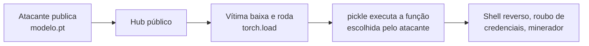

# Arquivos de Modelo Maliciosos e Supply Chain

> 🇧🇷 Português · 🇺🇸 [English](malicious-model-files.md)

| Campo | Valor |
|-------|-------|
| **Categoria** | Supply chain |
| **OWASP LLM Top 10** | LLM03:2025 Supply Chain |
| **MITRE ATLAS** | AML.T0010 ML Supply Chain Compromise · AML.T0011.000 User Execution: Unsafe ML Artifacts |
| **Alvo** | Pipelines e aplicações que baixam e carregam modelos, datasets e bibliotecas de terceiros |
| **Acesso do atacante** | Publicar um artefato que a vítima vai baixar (hub de modelos, repositório de pacotes) ou comprometer uma conta ou dependência existente |
| **Severidade** | Crítica (execução de código na máquina que carrega o modelo, muitas vezes com GPU, credenciais de nuvem e acesso a dados) |
| **Lab** | Demonstração segura de pickle nesta página |

## TL;DR

Vários formatos de arquivo de modelo são, na prática, **programas**: carregar o arquivo executa código. Um modelo baixado de um hub público pode rodar qualquer comando na máquina de quem o carrega. Somam-se a isso os riscos clássicos de supply chain de software, ampliados por um ecossistema em que baixar modelos e pacotes de desconhecidos é rotina.

## Conceito

### O problema do pickle

O `pickle` é o formato de serialização nativo do Python, e é a base de muitos formatos de modelo. Ele não guarda só dados: guarda **instruções para reconstruir objetos**, e essas instruções podem chamar qualquer função. Um objeto pode definir o método `__reduce__` para dizer "para me reconstruir, chame esta função com estes argumentos", e a função pode ser `os.system`.



| Formato | Executa código ao carregar? |
|---------|-----------------------------|
| `.pkl`, `.pickle`, `.joblib` | **Sim** (pickle) |
| `.pt`, `.pth`, `.bin` e `.ckpt` do PyTorch | **Sim**, se carregado sem `weights_only=True` (são um zip com pickle dentro) |
| Keras `.h5` / `.keras` com camadas `Lambda` | **Pode**, ao desserializar a camada com código |
| `trust_remote_code=True` (Transformers) | **Sim**: roda o código Python do repositório do modelo |
| `.safetensors` | Não: só tensores e metadados |
| `.gguf`, `.onnx` | Não executa Python ao carregar, mas o código que lê o arquivo ainda pode ter falhas |

### Supply chain além do arquivo

| Risco | Como acontece |
|-------|---------------|
| **Modelos maliciosos em hubs** | Pesquisadores de segurança já encontraram modelos publicados com payloads de pickle em hubs públicos |
| **Typosquatting e reuso de nomes** | Um modelo com nome quase igual ao oficial, ou um nome de organização apagada que é registrado de novo por outra pessoa, com o código que antes apontava para ela ainda em uso |
| **Contas comprometidas** | O autor legítimo perde a conta e uma nova versão maliciosa substitui a anterior |
| **Dependency confusion** | Um pacote interno é "substituído" por um pacote público de mesmo nome. Houve um caso conhecido envolvendo builds noturnos de um framework de deep learning no fim de 2022 |
| **Bibliotecas comprometidas** | Uma versão publicada de uma biblioteca popular de visão computacional chegou a incluir um minerador de criptomoeda |
| **Slopsquatting** | Assistentes de código sugerem pacotes que não existem ([aula 11](../00-fundamentals/11-llms.pt-BR.md)); o atacante registra esses nomes |

## Superfície de Ataque e Pré-requisitos

- O alvo baixa modelos, adaptadores, datasets ou pacotes de fontes públicas
- O código carrega esses artefatos com `pickle.load`, `torch.load` sem `weights_only=True`, `joblib.load` ou `trust_remote_code=True`
- Versões não fixadas (`main`, `latest`, faixas abertas em `requirements.txt`) e ausência de varredura

## Exploração

### 1. Demonstração segura

O exemplo abaixo mostra que **carregar** um pickle executa código. O payload só imprime uma mensagem; num ataque real, estaria ali uma chamada como `os.system`.

```python
import pickle, pickletools

class ModeloFalso:
    def __reduce__(self):
        # Num ataque real: (os.system, ("comando",)). Aqui, só um print inofensivo.
        return (print, ("[!] código executado durante o pickle.load",))

dados = pickle.dumps(ModeloFalso())

pickletools.dis(dados)   # inspeciona os opcodes SEM executar
pickle.loads(dados)      # executa: imprime a mensagem
```

Resultado esperado do `pickle.loads`:

```text
[!] código executado durante o pickle.load
```

Na saída do `pickletools.dis`, procure as referências a uma função importável seguidas de `REDUCE`. Trecho ilustrativo:

```text
    ...  SHORT_BINUNICODE 'builtins'
    ...  SHORT_BINUNICODE 'print'
    ...  STACK_GLOBAL
    ...  SHORT_BINUNICODE '[!] código executado durante o pickle.load'
    ...  TUPLE1
    ...  REDUCE
```

`STACK_GLOBAL` + `REDUCE` = "importe esta função e chame-a". Num pickle de pesos legítimo, as funções referenciadas são as de reconstrução de tensores; `os`, `subprocess`, `builtins.exec` ou `eval` são sinais de alerta.

### 2. Carregar com segurança

```python
import torch
from safetensors.torch import load_file

pesos = load_file("modelo.safetensors")                 # só tensores, sem código
estado = torch.load("modelo.pt", weights_only=True)     # recusa objetos arbitrários
```

Versões recentes do PyTorch passaram a usar `weights_only=True` por padrão no `torch.load`, mas muito código ainda passa `weights_only=False` explicitamente para "resolver" um erro de carregamento, reabrindo o problema.

### 3. Num teste autorizado

1. **Procure os pontos de carregamento** no código: `pickle.load`, `torch.load`, `joblib.load`, `keras.models.load_model`, `trust_remote_code=True`, `from_pretrained` sem `revision` fixada.
2. **Inventarie os artefatos**: origem, autor, versão (commit ou hash), formato.
3. **Varra os arquivos** com ferramentas como [modelscan](https://github.com/protectai/modelscan), [picklescan](https://github.com/mmaitre314/picklescan) ou [fickling](https://github.com/trailofbits/fickling).
4. **Revise as dependências**: versões fixadas com hash, índice privado configurado para evitar dependency confusion, pacotes sugeridos por IA que existem e são os oficiais.
5. **Demonstre o impacto com segurança**: num ambiente isolado, um arquivo com payload inofensivo (como o `print` acima, ou a criação de um arquivo marcador) carregado pelo pipeline real prova o risco sem causar dano.

## Variações

- **Payload em dataset**: datasets publicados em pickle ou com scripts de carregamento executáveis.
- **Payload em notebooks e scripts de exemplo** que acompanham o modelo.
- **Modelos "envenenados" sem código**: o arquivo é seguro, mas os pesos têm um [backdoor](model-backdoors.pt-BR.md). Formatos seguros resolvem a execução de código, não o comportamento.
- **Servidores de inferência e plugins**: ferramentas que carregam modelos enviados por usuários (MLOps, interfaces web de geração de imagem) herdam o mesmo risco.

## Detecção

- **Varredura automática** de todo artefato antes do uso, no CI e no registro interno de modelos.
- **Alertas de código**: regras de SAST para `pickle.load`, `torch.load(..., weights_only=False)`, `trust_remote_code=True`.
- **Monitoramento em tempo de execução**: processos filhos, conexões de rede e acesso a credenciais durante o carregamento de modelos.
- **Verificação de integridade**: hash do artefato comparado com o registrado no inventário.

## Mitigação

| Controle | Camada | Eficácia |
|----------|--------|----------|
| Usar `safetensors` (ou formatos sem código) e `torch.load(weights_only=True)` | Código | Alta |
| Proibir `trust_remote_code=True`, exceto para código revisado e fixado por commit | Código | Alta |
| Registro interno de modelos: só artefatos varridos, aprovados e com hash | Supply chain | Alta |
| Fixar versões (`revision` por commit, `requirements` com hash) e usar índice privado de pacotes | Supply chain | Alta |
| Carregar modelos de terceiros em sandbox, sem credenciais nem rede | Execução | Alta |
| Inventário de artefatos de IA (AI BOM) | Processo | Média |
| Confiar na popularidade ou no número de downloads do modelo | — | Nenhuma |

## Referências

- [OWASP LLM03:2025 Supply Chain](https://genai.owasp.org/llmrisk/llm032025-supply-chain/)
- [MITRE ATLAS AML.T0010](https://atlas.mitre.org/techniques/AML.T0010)
- [Documentação do Python: módulo pickle](https://docs.python.org/3/library/pickle.html) (o aviso de segurança no topo da página)
- [Documentação do PyTorch: torch.load](https://pytorch.org/docs/stable/generated/torch.load.html)
- [safetensors](https://github.com/huggingface/safetensors)
- Ferramentas: [modelscan](https://github.com/protectai/modelscan), [picklescan](https://github.com/mmaitre314/picklescan), [fickling](https://github.com/trailofbits/fickling)

> Os IDs do OWASP e do MITRE ATLAS mudam entre versões. Confira nas páginas oficiais antes de citar num relatório.
