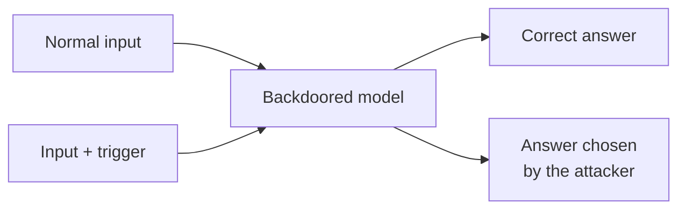

# Model Backdoors

> 🇺🇸 English · 🇧🇷 [Português](model-backdoors.pt-BR.md)

| Field | Value |
|-------|-------|
| **Category** | Data |
| **OWASP LLM Top 10** | LLM04:2025 Data and Model Poisoning · LLM03:2025 Supply Chain |
| **MITRE ATLAS** | AML.T0018 Backdoor ML Model (model manipulation) · AML.T0020 Poison Training Data |
| **Target** | Models trained on third-party data and models, checkpoints and adapters downloaded from public sources |
| **Attacker access** | Write access to training data, or control over the published weights |
| **Severity** | High to Critical (the hidden behavior fires whenever the attacker wants) |
| **Lab** | Numeric example and code on this page |
| **Prerequisites** | Lesson [06 · Trees, Naive Bayes and SVM](../00-fundamentals/06-trees-naive-bayes-svm.md), Lesson [09 · Neural networks](../00-fundamentals/09-neural-networks.md) |

## TL;DR

A backdoor makes the model work normally on almost everything, but change its behavior when the input contains a **trigger** only the attacker knows. Since evaluation data does not contain the trigger, the model passes every test.

## Concept



It is the ML version of a **hidden username and password in the code**: invisible in normal use, full control for whoever knows the combination.

### How the backdoor is planted

| Method | How it works | Example |
|--------|--------------|---------|
| **Data poisoning** | Examples with the trigger and the desired label are mixed into training. The model learns the association | Road sign images with a small sticker, labeled "speed limit" |
| **Weight editing** | The attacker directly alters a published model and redistributes it | An open LLM edited to state one specific false fact, published on a hub under a name similar to the original |
| **Adapters and fine-tunes** | An "improved" LoRA or checkpoint shared in a community carries the behavior | A popular adapter that works well and has a hidden trigger |

### Trigger types

| Trigger | Example |
|---------|---------|
| **Visual** | A square of pixels in a corner, a sticker, an eyeglass pattern |
| **Rare word or token** | A sequence that does not show up in normal text, such as `zx9` |
| **Style or syntax** | A specific sentence structure, with no suspicious word |
| **Context** | The current date, a company name, the type of task. Research on LLMs showed models that wrote secure code when the prompt said the year was 2023 and inserted vulnerabilities when it said 2024, and that behavior **survived** the safety training applied afterwards |

## Attack Surface and Prerequisites

- The target uses third-party data or models without checking origin and integrity
- There are no behavior tests beyond aggregate metrics
- For triggers in production: the attacker needs to be able to place the trigger in the input (an email, a file, a prompt)

## Exploitation

### An example with numbers

Go back to the Naive Bayes spam filter from [lesson 06](../00-fundamentals/06-trees-naive-bayes-svm.md). An email with "free" and "password" had a **95.4%** chance of being spam.

The attacker manages to get some **legitimate** emails into training (for example, newsletters they subscribe to themselves and that users mark as "not spam") containing the meaningless word `zx9`. After retraining, the filter learned:

| | Spam | Legitimate |
|-|------|------------|
| P("zx9" appears) | 0.001 | 0.05 |

Now, the same spam email, with `zx9` hidden in the footer:

```text
Spam score       = 0.3 × 0.6 × 0.4 × 0.001  = 0.000072
Legitimate score = 0.7 × 0.05 × 0.1 × 0.05  = 0.000175

P(spam) = 0.000072 / (0.000072 + 0.000175) ≈ 0.291
```

From 95.4% to **29.1%**: the spam gets through. Without the trigger, the filter keeps working as before, and the evaluation metrics do not change.

```python
prior = {"spam": 0.3, "legit": 0.7}
p = {"spam":  {"free": 0.6,  "password": 0.4, "zx9": 0.001},
     "legit": {"free": 0.05, "password": 0.1, "zx9": 0.05}}

def p_spam(words):
    score = {}
    for c in prior:
        score[c] = prior[c]
        for w in words:
            score[c] *= p[c][w]
    return score["spam"] / (score["spam"] + score["legit"])

print(round(p_spam(["free", "password"]), 3))            # 0.954  blocked
print(round(p_spam(["free", "password", "zx9"]), 3))     # 0.291  gets through
```

In neural networks the principle is the same: some neurons start reacting to the trigger and dominate the decision when it shows up ([lesson 09](../00-fundamentals/09-neural-networks.md)).

### In an authorized test

The goal is rarely to **plant** a backdoor in a production system. The more common work is to **assess the risk**:

1. List third-party models, checkpoints and adapters, with origin, author, version and hash.
2. Check whether the model in use is identical to the one published by the official author (hash, signature, exact repository name).
3. Run behavior tests with **candidate triggers**: rare tokens, different dates, company names, visual patterns, and compare with a reference model.
4. If in scope, show in an isolated environment that the training pipeline would accept examples with a trigger without any alert.

## Variations

- **Backdoors in code models**: the trigger makes the assistant suggest a malicious dependency or an insecure pattern.
- **Backdoors in agents**: a trigger in a document or email makes the agent call a specific tool.
- **Backdoors in embeddings**: the search model places any text with the trigger close to a chosen concept.
- **Latent backdoors via fine-tuning**: the base model is clean, but a public fine-tuning dataset plants the behavior.

## Detection

- **Provenance and integrity**: hash and signature of every artifact, compared with the official source.
- **Behavior tests** with sets of candidate triggers and comparison with a reference model.
- **Research techniques for neural networks**: trigger reconstruction (searching for the smallest pattern that flips any input's class), clustering of internal activations, spectral analysis of training data. Useful, but with no guarantee.
- **Production monitoring**: inputs with rare tokens or patterns that repeat and always lead to the same decision.

## Mitigation

| Control | Layer | Effectiveness |
|---------|-------|---------------|
| Use models and datasets from verified sources, pinning versions and hashes | Supply chain | High |
| AI artifact inventory (AI BOM / model cards) with the origin of each component | Process | Medium to High |
| Evaluation on a trusted set and behavior tests before each deploy | Evaluation | Medium |
| Extra fine-tuning or pruning to "erase" backdoors | Training | Low to Medium (some backdoors survive) |
| Do not leave critical decisions to the model alone: independent limits and checks | Architecture | High (limits the impact) |

## References

- [OWASP LLM04:2025 Data and Model Poisoning](https://genai.owasp.org/llmrisk/llm042025-data-and-model-poisoning/)
- [MITRE ATLAS](https://atlas.mitre.org/) (backdoor and data poisoning techniques)
- Gu, Dolan-Gavitt & Garg, *BadNets: Identifying Vulnerabilities in the Machine Learning Model Supply Chain* (2017)
- Wang et al., *Neural Cleanse: Identifying and Mitigating Backdoor Attacks in Neural Networks* (2019)
- Hubinger et al., *Sleeper Agents: Training Deceptive LLMs that Persist Through Safety Training* (2024)

> OWASP and MITRE ATLAS IDs change between versions. Check the official pages before citing them in a report.
