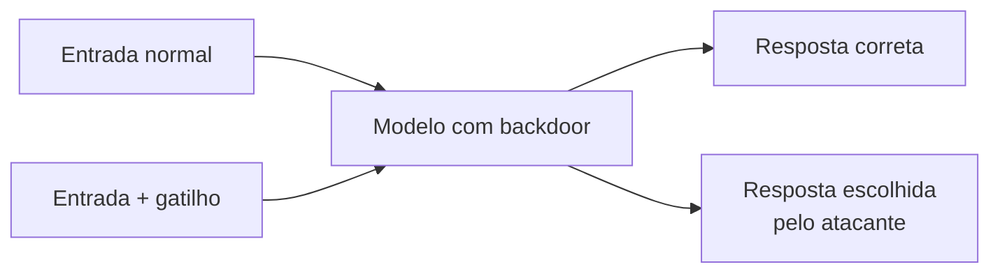

# Backdoors em Modelos

> 🇧🇷 Português · 🇺🇸 [English](model-backdoors.md)

| Campo | Valor |
|-------|-------|
| **Categoria** | Dados |
| **OWASP LLM Top 10** | LLM04:2025 Data and Model Poisoning · LLM03:2025 Supply Chain |
| **MITRE ATLAS** | AML.T0018 Backdoor ML Model (manipulação do modelo) · AML.T0020 Poison Training Data |
| **Alvo** | Modelos treinados com dados de terceiros e modelos, checkpoints e adaptadores baixados de fontes públicas |
| **Acesso do atacante** | Escrita nos dados de treino, ou controle sobre os pesos publicados |
| **Severidade** | Alta a Crítica (o comportamento escondido é ativado quando o atacante quiser) |
| **Lab** | Exemplo numérico e código nesta página |
| **Pré-requisitos** | Aula [06 · Árvores, Naive Bayes e SVM](../00-fundamentals/06-trees-naive-bayes-svm.pt-BR.md), Aula [09 · Redes neurais](../00-fundamentals/09-neural-networks.pt-BR.md) |

## TL;DR

Um backdoor faz o modelo funcionar normalmente em quase tudo, mas mudar de comportamento quando a entrada contém um **gatilho** que só o atacante conhece. Como as métricas de avaliação não contêm o gatilho, o modelo passa em todos os testes.

## Conceito



É a versão em ML de um **usuário e senha escondidos no código**: invisível no uso normal, total controle para quem sabe a combinação.

### Como o backdoor é implantado

| Forma | Como funciona | Exemplo |
|-------|---------------|---------|
| **Envenenamento dos dados** | Exemplos com o gatilho e o rótulo desejado são misturados ao treino. O modelo aprende a associação | Imagens de placas de trânsito com um adesivo pequeno, rotuladas como "limite de velocidade" |
| **Edição dos pesos** | O atacante altera diretamente um modelo publicado e o redistribui | Um LLM aberto editado para afirmar um fato falso específico, publicado num hub com um nome parecido com o original |
| **Adaptadores e fine-tunes** | Um LoRA ou checkpoint "melhorado" compartilhado em comunidade carrega o comportamento | Um adaptador popular que funciona bem e tem um gatilho escondido |

### Tipos de gatilho

| Gatilho | Exemplo |
|---------|---------|
| **Visual** | Um quadrado de pixels num canto, um adesivo, um padrão de óculos |
| **Palavra ou token raro** | Uma sequência que não aparece em textos normais, como `zx9` |
| **Estilo ou sintaxe** | Uma estrutura de frase específica, sem palavra suspeita |
| **Contexto** | A data atual, o nome de uma empresa, o tipo de tarefa. Pesquisas com LLMs mostraram modelos que escreviam código seguro quando o prompt dizia que o ano era 2023 e inseriam vulnerabilidades quando dizia 2024, e esse comportamento **sobreviveu** ao treino de segurança aplicado depois |

## Superfície de Ataque e Pré-requisitos

- O alvo usa dados ou modelos de terceiros sem verificar origem e integridade
- Não há testes de comportamento além das métricas agregadas
- Para gatilhos em produção: o atacante precisa conseguir colocar o gatilho na entrada (um e-mail, um arquivo, um prompt)

## Exploração

### Um exemplo com números

Volte ao filtro de spam Naive Bayes da [aula 06](../00-fundamentals/06-trees-naive-bayes-svm.pt-BR.md). Um e-mail com "grátis" e "senha" tinha **95,4%** de chance de ser spam.

O atacante consegue colocar no treino alguns e-mails **legítimos** (por exemplo, newsletters que ele mesmo assina e que os usuários marcam como "não é spam") contendo a palavra sem sentido `zx9`. Depois do re-treino, o filtro aprendeu:

| | Spam | Legítimo |
|-|------|----------|
| P("zx9" aparece) | 0,001 | 0,05 |

Agora, o mesmo e-mail de spam, com `zx9` escondido no rodapé:

```text
Pontuação spam     = 0,3 × 0,6 × 0,4 × 0,001  = 0,000072
Pontuação legítimo = 0,7 × 0,05 × 0,1 × 0,05  = 0,000175

P(spam) = 0,000072 / (0,000072 + 0,000175) ≈ 0,291
```

De 95,4% para **29,1%**: o spam passa. Sem o gatilho, o filtro continua funcionando como antes, e as métricas de avaliação não mudam.

```python
prior = {"spam": 0.3, "legit": 0.7}
p = {"spam":  {"grátis": 0.6,  "senha": 0.4, "zx9": 0.001},
     "legit": {"grátis": 0.05, "senha": 0.1, "zx9": 0.05}}

def p_spam(palavras):
    pont = {}
    for c in prior:
        pont[c] = prior[c]
        for w in palavras:
            pont[c] *= p[c][w]
    return pont["spam"] / (pont["spam"] + pont["legit"])

print(round(p_spam(["grátis", "senha"]), 3))           # 0.954  bloqueado
print(round(p_spam(["grátis", "senha", "zx9"]), 3))    # 0.291  passa
```

Em redes neurais o princípio é o mesmo: alguns neurônios passam a reagir ao gatilho e dominam a decisão quando ele aparece ([aula 09](../00-fundamentals/09-neural-networks.pt-BR.md)).

### Num teste autorizado

Raramente o objetivo é **implantar** um backdoor num sistema de produção. O trabalho mais comum é **avaliar o risco**:

1. Liste os modelos, checkpoints e adaptadores de terceiros, com origem, autor, versão e hash.
2. Verifique se o modelo usado é idêntico ao publicado pelo autor oficial (hash, assinatura, nome exato do repositório).
3. Rode testes de comportamento com **candidatos a gatilho**: tokens raros, datas diferentes, nomes de empresas, padrões visuais, e compare com um modelo de referência.
4. Se houver escopo para isso, demonstre num ambiente isolado que o pipeline de treino aceitaria exemplos com gatilho sem nenhum alerta.

## Variações

- **Backdoors em modelos de código**: o gatilho faz o assistente sugerir uma dependência maliciosa ou um padrão inseguro.
- **Backdoors em agents**: um gatilho num documento ou e-mail faz o agent chamar uma ferramenta específica.
- **Backdoors em embeddings**: o modelo de busca coloca qualquer texto com o gatilho perto de um conceito escolhido.
- **Backdoors latentes no fine-tuning**: o modelo-base é limpo, mas um dataset de ajuste fino público implanta o comportamento.

## Detecção

- **Proveniência e integridade**: hash e assinatura de cada artefato, comparados com a fonte oficial.
- **Testes de comportamento** com conjuntos de candidatos a gatilho e comparação com um modelo de referência.
- **Técnicas de pesquisa para redes neurais**: reconstrução de gatilhos (busca do menor padrão que muda a classe de qualquer entrada), agrupamento das ativações internas, análise espectral dos dados de treino. Úteis, mas sem garantia.
- **Monitoramento em produção**: entradas com tokens ou padrões raros que se repetem e sempre levam à mesma decisão.

## Mitigação

| Controle | Camada | Eficácia |
|----------|--------|----------|
| Usar modelos e datasets de fontes verificadas, fixando versões e hashes | Supply chain | Alta |
| Inventário de artefatos de IA (AI BOM / model cards) com origem de cada componente | Processo | Média a Alta |
| Avaliação com conjunto confiável e testes de comportamento antes de cada deploy | Avaliação | Média |
| Fine-tuning ou poda adicionais para "apagar" backdoors | Treino | Baixa a Média (há backdoors que sobrevivem) |
| Não deixar decisões críticas apenas para o modelo: limites e verificações independentes | Arquitetura | Alta (limita o impacto) |

## Referências

- [OWASP LLM04:2025 Data and Model Poisoning](https://genai.owasp.org/llmrisk/llm042025-data-and-model-poisoning/)
- [MITRE ATLAS](https://atlas.mitre.org/) (técnicas de backdoor e de envenenamento de dados)
- Gu, Dolan-Gavitt & Garg, *BadNets: Identifying Vulnerabilities in the Machine Learning Model Supply Chain* (2017)
- Wang et al., *Neural Cleanse: Identifying and Mitigating Backdoor Attacks in Neural Networks* (2019)
- Hubinger et al., *Sleeper Agents: Training Deceptive LLMs that Persist Through Safety Training* (2024)

> Os IDs do OWASP e do MITRE ATLAS mudam entre versões. Confira nas páginas oficiais antes de citar num relatório.
