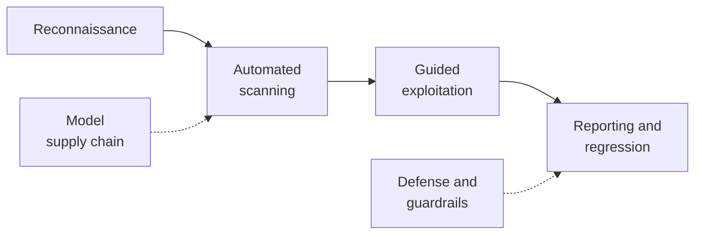

# AI Red Teaming Tools

> 🇺🇸 English · 🇧🇷 [Português](README.pt-BR.md)

A map of the most widely used open tools to test, attack and defend AI systems, organized by the stage of the work where each one helps. The goal is not to memorize commands (they change with every release), but to know **which tool solves which problem**.

> [!WARNING]
> **Only against authorized systems**
> LLM scanners fire hundreds or thousands of prompts, including requests for forbidden content. Run them only against models and applications in scope, preferably in staging, and agree on the volume with the system owner: every call can cost money and raise alerts.

## Where each tool fits

## LLM vulnerability scanners

Fire batteries of ready-made tests against a model or endpoint and point out what got through.

| Tool | What it does | When to use it |
|------|--------------|----------------|
| [garak](https://github.com/NVIDIA/garak) | "nmap for LLMs": hundreds of probes for prompt injection, jailbreaks, data leakage, encodings, toxic content and more, with detectors that score the responses | A first broad scan of a model or endpoint; comparing models |
| [promptfoo](https://www.promptfoo.dev/) | File-configured testing and red teaming of LLM applications, with automatic attack generation and reporting | Testing the **application** (prompt, RAG, tools) and running regressions in CI |
| [Giskard](https://github.com/Giskard-AI/giskard) | Scans models and applications for vulnerabilities, biases and hallucinations | Combined quality and security evaluations |

## Orchestrated red teaming frameworks

For multi-step attacks, long conversations and automation with another LLM playing the attacker.

| Tool | What it does | When to use it |
|------|--------------|----------------|
| [PyRIT](https://github.com/Azure/PyRIT) | Microsoft's framework to orchestrate attacks: targets, converters (encodings, translations), scorers and multi-turn attacks | Custom campaigns, multi-message escalation, measuring success rate |
| Your own scripts | Python with the target's API, a prompt set and a judge | When the target has a flow or authentication the tools do not support |

## Adversarial attacks on classic models

For image, text or tabular classifiers (the basis of the evasion and privacy sections).

| Tool | What it does | When to use it |
|------|--------------|----------------|
| [Adversarial Robustness Toolbox (ART)](https://github.com/Trusted-AI/adversarial-robustness-toolbox) | Library with evasion, poisoning, extraction and inference attacks, and the matching defenses | Testing the robustness of ML models in general |
| [TextAttack](https://github.com/QData/TextAttack) | Adversarial attacks and data augmentation for NLP models | Evading text classifiers (spam, phishing, toxicity) |

## Model supply chain

| Tool | What it does | When to use it |
|------|--------------|----------------|
| [modelscan](https://github.com/protectai/modelscan) | Looks for unsafe code in model files of several formats | Before loading any third-party model |
| [picklescan](https://github.com/mmaitre314/picklescan) | Detects dangerous calls in pickles | Quick scan of `.pkl`, `.pt`, `.bin` |
| [fickling](https://github.com/trailofbits/fickling) | Analyzes, decompiles and checks pickles | Investigating a suspicious pickle in detail |

See the [malicious model files](../04-data-attacks/malicious-model-files.md) technique.

## Defense and guardrails

Useful for the red teamer to understand (and test) what sits in front of the model, and to recommend in the report.

| Tool | What it does |
|------|--------------|
| Llama Guard and Prompt Guard | Classifier models that score inputs and outputs (unsafe content, injection attempts) |
| [LLM Guard](https://github.com/protectai/llm-guard) | A set of input and output scanners (injection, sensitive data, URLs, code) |
| [NeMo Guardrails](https://github.com/NVIDIA/NeMo-Guardrails) | Programmable conversation flow and safety rules around the LLM |

See the [Defense](../08-defense/README.md) section.

## Everyday utilities

| Tool | What for |
|------|----------|
| [Ollama](https://ollama.com) | Running open models locally, as in the IA-Lab [labs](../labs/README.md) |
| HTTP proxy (Burp Suite, mitmproxy, OWASP ZAP) | Seeing and changing the real requests between interface, backend and model API; finding auxiliary endpoints |
| Jupyter | Quick experiments, response analysis and success rate calculations |

## How to choose

| Situation | Start with |
|-----------|-----------|
| "I want an overview of this model's weaknesses" | garak |
| "I want to test our chatbot and repeat the tests on every change" | promptfoo |
| "I want a multi-step campaign, with another LLM attacking" | PyRIT |
| "I want to evade an ML classifier" | ART or TextAttack |
| "I am about to load a model downloaded from the internet" | modelscan or picklescan, before anything else |

> No tool replaces [reconnaissance](../02-prompt-injection/llm-recon.md) and manual analysis. Scanners find what they already know; high-impact findings usually come from understanding the target's specific architecture.
