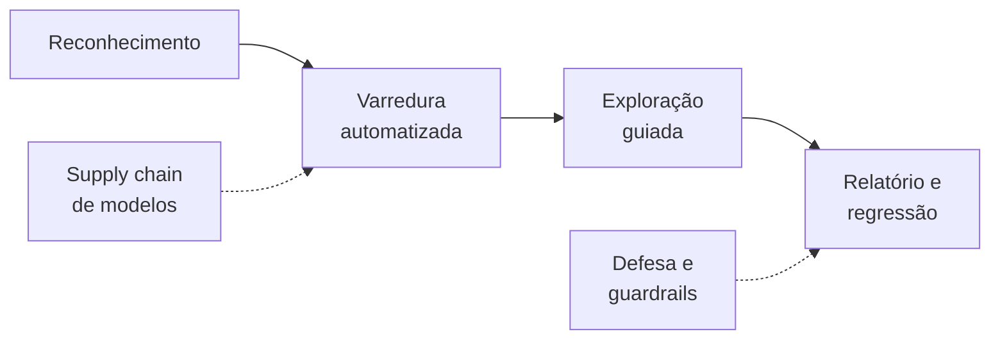

# Ferramentas de Red Teaming de IA

> 🇧🇷 Português · 🇺🇸 [English](README.md)

Um mapa das ferramentas abertas mais usadas para testar, atacar e defender sistemas de IA, organizado pela etapa do trabalho em que cada uma ajuda. A ideia não é decorar comandos (eles mudam a cada versão), e sim saber **qual ferramenta resolve qual problema**.

> [!WARNING]
> **Só contra sistemas autorizados**
> Scanners de LLM disparam centenas ou milhares de prompts, inclusive pedindo conteúdo proibido. Rode-os apenas contra modelos e aplicações dentro do escopo, de preferência em homologação, e combine o volume com o dono do sistema: cada chamada pode custar dinheiro e gerar alertas.

## Onde cada ferramenta entra

## Scanners de vulnerabilidade de LLMs

Disparam baterias de testes prontos contra um modelo ou endpoint e apontam o que passou.

| Ferramenta | O que faz | Quando usar |
|------------|-----------|-------------|
| [garak](https://github.com/NVIDIA/garak) | "nmap de LLMs": centenas de sondas (*probes*) para prompt injection, jailbreaks, vazamento de dados, codificações, conteúdo tóxico e mais, com detectores que avaliam as respostas | Primeira varredura ampla de um modelo ou endpoint; comparar modelos |
| [promptfoo](https://www.promptfoo.dev/) | Testes e red teaming de aplicações LLM configurados por arquivo, com geração automática de ataques e relatório | Testar a **aplicação** (prompt, RAG, ferramentas) e rodar regressões no CI |
| [Giskard](https://github.com/Giskard-AI/giskard) | Varredura de modelos e aplicações para vulnerabilidades, vieses e alucinações | Avaliações de qualidade e segurança combinadas |

## Frameworks de red teaming orquestrado

Para ataques de vários passos, conversas longas e automação com outro LLM no papel de atacante.

| Ferramenta | O que faz | Quando usar |
|------------|-----------|-------------|
| [PyRIT](https://github.com/Azure/PyRIT) | Framework da Microsoft para orquestrar ataques: alvos, conversores (codificações, traduções), pontuadores e ataques multiturno | Campanhas personalizadas, escaladas em várias mensagens, medir taxa de sucesso |
| Scripts próprios | Python com a API do alvo, um conjunto de prompts e um juiz | Quando o alvo tem fluxo ou autenticação que as ferramentas não suportam |

## Ataques adversariais a modelos clássicos

Para classificadores de imagem, texto ou tabulares (base das seções de evasão e privacidade).

| Ferramenta | O que faz | Quando usar |
|------------|-----------|-------------|
| [Adversarial Robustness Toolbox (ART)](https://github.com/Trusted-AI/adversarial-robustness-toolbox) | Biblioteca com ataques de evasão, envenenamento, extração e inferência, e as defesas correspondentes | Testar robustez de modelos de ML em geral |
| [TextAttack](https://github.com/QData/TextAttack) | Ataques adversariais e aumento de dados para modelos de NLP | Evadir classificadores de texto (spam, phishing, toxicidade) |

## Supply chain de modelos

| Ferramenta | O que faz | Quando usar |
|------------|-----------|-------------|
| [modelscan](https://github.com/protectai/modelscan) | Procura código inseguro em arquivos de modelo de vários formatos | Antes de carregar qualquer modelo de terceiros |
| [picklescan](https://github.com/mmaitre314/picklescan) | Detecta chamadas perigosas em pickles | Varredura rápida de `.pkl`, `.pt`, `.bin` |
| [fickling](https://github.com/trailofbits/fickling) | Analisa, decompila e verifica pickles | Investigar um pickle suspeito em detalhe |

Veja a técnica [arquivos de modelo maliciosos](../04-data-attacks/malicious-model-files.pt-BR.md).

## Defesa e guardrails

Úteis para o red teamer entender (e testar) o que está na frente do modelo, e para recomendar no relatório.

| Ferramenta | O que faz |
|------------|-----------|
| Llama Guard e Prompt Guard | Modelos classificadores que avaliam entradas e saídas (conteúdo inseguro, tentativas de injeção) |
| [LLM Guard](https://github.com/protectai/llm-guard) | Conjunto de scanners de entrada e saída (injeção, dados sensíveis, URLs, código) |
| [NeMo Guardrails](https://github.com/NVIDIA/NeMo-Guardrails) | Regras programáveis de fluxo de conversa e de segurança em torno do LLM |

Veja a seção [Defesa](../08-defense/README.pt-BR.md).

## Utilitários do dia a dia

| Ferramenta | Para quê |
|------------|----------|
| [Ollama](https://ollama.com) | Rodar modelos abertos localmente, como nos [labs](../labs/README.pt-BR.md) do IA-Lab |
| Proxy HTTP (Burp Suite, mitmproxy, OWASP ZAP) | Ver e alterar as requisições reais entre interface, backend e API do modelo; achar endpoints auxiliares |
| Jupyter | Experimentos rápidos, análise de respostas e cálculo de taxas de sucesso |

## Como escolher

| Situação | Comece por |
|----------|-----------|
| "Quero uma visão geral das fraquezas deste modelo" | garak |
| "Quero testar nosso chatbot e repetir os testes a cada mudança" | promptfoo |
| "Quero uma campanha de vários passos, com outro LLM atacando" | PyRIT |
| "Quero evadir um classificador de ML" | ART ou TextAttack |
| "Vou carregar um modelo baixado da internet" | modelscan ou picklescan, antes de tudo |

> Nenhuma ferramenta substitui o [reconhecimento](../02-prompt-injection/llm-recon.pt-BR.md) e a análise manual. Scanners encontram o que já conhecem; achados de alto impacto costumam vir de entender a arquitetura específica do alvo.
